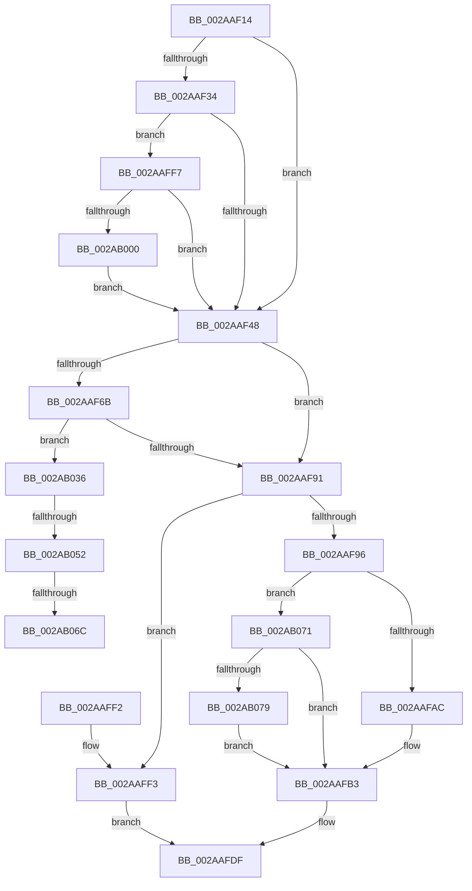

# MiUnmapFrameBuffer

- RVA: `0x002AAF14`–`0x002AB083` (길이 `367` bytes)
- VA: `0x00000001402AAF14`
- 실행 섹션: `.text`
- PDB 이름 있음: `예`; PDB Function 태그: `예`
- unwind 정보 RVA: `0x0006D01C`
- 디코드: `86`개 명령, `367/367` bytes 표시
- 미해석 바이트: `0` (있으면 어셈블리에 `.byte`로 보존)

> 이 문서는 커널 이미지의 기계어와 PDB 기호를 분석해 생성했습니다. 4번과 5번은 함수 원형과 자료형을 바이너리 사용 방식에서 추정한 C 해석이며 원본 소스 복구 결과는 아닙니다.

## 1. Dependencies

- 직접 호출 지점: **2**; 고유 호출 대상: **2**
- 직접 호출자로 확인된 함수: **2**
- RIP 상대 이미지 참조: **1**

### Outgoing calls
- `0x002AAF9B` → [MiMakeDemandZeroPte](../33/MiMakeDemandZeroPte_function_00337A00.md) (function, `0x00337A00`)
- `0x002AB02C` → [MiCaptureWriteWatchDirtyBit](../46/MiCaptureWriteWatchDirtyBit_function_00465224.md) (function, `0x00465224`)

### Direct callers
- [MiReplaceRotateWithDemandZeroNoCopy](MiReplaceRotateWithDemandZeroNoCopy_function_002AAB04.md) at `0x002AABF6`
- [MiDeleteRotateVa](../2C/MiDeleteRotateVa_function_002C79D4.md) at `0x002C7A4F`

### Static image references
- `0x002AAF62` → RVA `0x00E2DCE0` (`.data`; read)

## 2. Other-region calls and transfers

- 다른 실행 섹션으로 향하는 call: **0**
- call이 아닌 외부 분기/꼬리 이동: **3**
  - `0x002AB04C` → [sub_006DB2A4](../6D/Unknown_function_006DB2A4.md) (`tail-transfer`)
  - `0x002AB066` → [sub_006DB2A4](../6D/Unknown_function_006DB2A4.md) (`tail-transfer`)
  - `0x002AB06C` → [sub_006DB2A4 + 0x4](../6D/Unknown_function_006DB2A4.md) (`tail-transfer`)

## 3. Assembly (complete function range)

```asm
002AAF14  48 89 5C 24 08                  mov qword ptr [rsp + 8], rbx
002AAF19  48 89 74 24 18                  mov qword ptr [rsp + 0x18], rsi
002AAF1E  57                              push rdi
002AAF1F  48 83 EC 30                     sub rsp, 0x30
002AAF23  48 8B 1A                        mov rbx, qword ptr [rdx]
002AAF26  41 8B F0                        mov esi, r8d
002AAF29  48 8B FA                        mov rdi, rdx
002AAF2C  4C 8B C1                        mov r8, rcx
002AAF2F  F6 C3 42                        test bl, 0x42
002AAF32  74 14                           je 0x1402aaf48
002AAF34  8B 51 30                        mov edx, dword ptr [rcx + 0x30]
002AAF37  B9 00 00 60 00                  mov ecx, 0x600000
002AAF3C  8B C2                           mov eax, edx
002AAF3E  23 C1                           and eax, ecx
002AAF40  3B C1                           cmp eax, ecx
002AAF42  0F 84 AF 00 00 00               je 0x1402aaff7
002AAF48  48 8B C3                        mov rax, rbx
002AAF4B  49 BA FF FF FF FF FF 00 00 00   movabs r10, 0xffffffffff
002AAF55  48 C1 E8 0C                     shr rax, 0xc
002AAF59  41 B9 02 00 00 00               mov r9d, 2
002AAF5F  49 23 C2                        and rax, r10
002AAF62  48 3B 05 77 2D B8 00            cmp rax, qword ptr [rip + 0xb82d77]
002AAF69  77 26                           ja 0x1402aaf91
002AAF6B  48 8D 0C 40                     lea rcx, [rax + rax*2]
002AAF6F  48 C1 E1 04                     shl rcx, 4
002AAF73  48 B8 28 00 00 00 00 DE FF FF   movabs rax, 0xffffde0000000028
002AAF7D  48 8B 04 01                     mov rax, qword ptr [rcx + rax]
002AAF81  41 8D 51 FF                     lea edx, [r9 - 1]
002AAF85  48 C1 E8 36                     shr rax, 0x36
002AAF89  85 C2                           test edx, eax
002AAF8B  0F 85 A5 00 00 00               jne 0x1402ab036
002AAF91  83 FE 03                        cmp esi, 3
002AAF94  74 5D                           je 0x1402aaff3
002AAF96  B9 04 00 00 00                  mov ecx, 4
002AAF9B  E8 60 CA 08 00                  call 0x140337a00
002AAFA0  48 8B D0                        mov rdx, rax
002AAFA3  41 3B F1                        cmp esi, r9d
002AAFA6  0F 85 C5 00 00 00               jne 0x1402ab071
002AAFAC  48 81 CA 00 03 00 00            or rdx, 0x300
002AAFB3  48 81 E2 1F FF FF FF            and rdx, 0xffffffffffffff1f
002AAFBA  81 E3 00 08 00 00               and ebx, 0x800
002AAFC0  48 F7 DB                        neg rbx
002AAFC3  48 1B C9                        sbb rcx, rcx
002AAFC6  83 E1 60                        and ecx, 0x60
002AAFC9  48 83 C1 20                     add rcx, 0x20
002AAFCD  48 0B CA                        or rcx, rdx
002AAFD0  48 8B C1                        mov rax, rcx
002AAFD3  48 33 C2                        xor rax, rdx
002AAFD6  48 25 1F FC FF FF               and rax, 0xfffffffffffffc1f
002AAFDC  48 33 C1                        xor rax, rcx
002AAFDF  48 8B 5C 24 40                  mov rbx, qword ptr [rsp + 0x40]
002AAFE4  48 8B 74 24 50                  mov rsi, qword ptr [rsp + 0x50]
002AAFE9  48 89 07                        mov qword ptr [rdi], rax
002AAFEC  48 83 C4 30                     add rsp, 0x30
002AAFF0  5F                              pop rdi
002AAFF1  C3                              ret
002AAFF2  CC                              int3
002AAFF3  33 C0                           xor eax, eax
002AAFF5  EB E8                           jmp 0x1402aafdf
002AAFF7  F6 C2 04                        test dl, 4
002AAFFA  0F 85 48 FF FF FF               jne 0x1402aaf48
002AB000  48 8B D7                        mov rdx, rdi
002AB003  48 C1 E2 19                     shl rdx, 0x19
002AB007  48 B8 00 00 00 00 80 F6 FF FF   movabs rax, 0xfffff68000000000
002AB011  65 48 8B 0C 25 88 01 00 00      mov rcx, qword ptr gs:[0x188]
002AB01A  48 C1 E0 19                     shl rax, 0x19
002AB01E  48 2B D0                        sub rdx, rax
002AB021  48 C1 FA 10                     sar rdx, 0x10
002AB025  48 8B 89 B8 00 00 00            mov rcx, qword ptr [rcx + 0xb8]
002AB02C  E8 F3 A1 1B 00                  call 0x140465224
002AB031  E9 12 FF FF FF                  jmp 0x1402aaf48
002AB036  48 B8 00 00 00 00 00 DE FF FF   movabs rax, 0xffffde0000000000
002AB040  48 03 C8                        add rcx, rax
002AB043  48 8B 41 28                     mov rax, qword ptr [rcx + 0x28]
002AB047  48 0F BA E0 28                  bt rax, 0x28
002AB04C  0F 82 52 02 43 00               jb 0x1406db2a4
002AB052  48 8B 41 28                     mov rax, qword ptr [rcx + 0x28]
002AB056  49 B8 FE FF FF FF 3F 00 00 00   movabs r8, 0x3ffffffffe
002AB060  49 23 C2                        and rax, r10
002AB063  49 3B C0                        cmp rax, r8
002AB066  0F 84 38 02 43 00               je 0x1406db2a4
002AB06C  E9 37 02 43 00                  jmp 0x1406db2a8
002AB071  85 F6                           test esi, esi
002AB073  0F 85 3A FF FF FF               jne 0x1402aafb3
002AB079  48 0F BA EA 08                  bts rdx, 8
002AB07E  E9 30 FF FF FF                  jmp 0x1402aafb3
```

## 4. C-style interpretation (structured pseudocode)

```c
__int64 __fastcall MiUnmapFrameBuffer(__int64 a1, __int64 a2, int a3)
{
    __int64 result;
    __int64 v_rbx;
    __int64 v_rsp;
    unsigned __int64 v_stack_p18;
    unsigned __int64 v_stack_p8;

    v_stack_p8 = v_rbx;
    v_stack_p18 = v_rsi;
    v_rsp = (v_rsp) - (48);
    if ((((unsigned __int8)(*(unsigned __int64 *)(a2))) & (66)) == 0) goto loc_002AAF48;
    result = (unsigned int)(((unsigned int)((unsigned int)((unsigned int)(*(unsigned int *)(a1 + 48))))) & ((unsigned int)((unsigned int)(0x600000ULL))));
    if (((unsigned int)(result)) == ((unsigned int)((unsigned int)(0x600000ULL)))) goto loc_002AAFF7;
loc_002AAF48:
    result = (*(unsigned __int64 *)(a2)) >> (12);
    result = (result) & (v_r10);
    if (result > (*(unsigned __int64 *)(v_rip + 12070263))) goto loc_002AAF91;
    a1 = (result + result * 2) << (4);
    result = (*(unsigned __int64 *)(a1 + result * 1)) >> (54);
    if ((((unsigned int)(2 - 1)) & ((unsigned int)(result))) != 0) goto loc_002AB036;
loc_002AAF91:
    if (((unsigned int)((unsigned int)(a3))) == 3) goto loc_002AAFF3;
    result = MiMakeDemandZeroPte(4, 2 - 1, a1, 2);
    if (((unsigned int)((unsigned int)(a3))) != 2) goto loc_002AB071;
    a2 = (result) | (768);
loc_002AAFB3:
    a2 = (a2) & (-225);
    v_rbx = (unsigned int)((*(unsigned __int64 *)(a2)) & (0x800ULL));
    v_rbx = -(v_rbx);
    a1 = (unsigned int)((4) & (96));
    a1 = (a1) + (32);
    a1 = (a1) | (a2);
    result = (a1) ^ (a2);
    result = (result) & (-993);
    result = (result) ^ (a1);
loc_002AAFDF:
    *(unsigned __int64 *)(a2) = result;
    v_rsp = (v_rsp) + (48);
    return result;
loc_002AAFF3:
    result = 0;
    goto loc_002AAFDF;
loc_002AAFF7:
    if ((((unsigned __int8)(a2)) & (4)) != 0) goto loc_002AAF48;
    a2 = (a2) << (25);
    result = (result) << (25);
    a2 = (a2) - (result);
    a2 = (a2) >> (16);
    result = MiCaptureWriteWatchDirtyBit(*(unsigned __int64 *)(*(unsigned __int64 *)(gs_base + (0 + 392)) + 184), a2, a1, 2);
    goto loc_002AAF48;
loc_002AB036:
    a1 = (*(unsigned __int64 *)(*(unsigned __int64 *)(gs_base + (0 + 392)) + 184)) + (result);
    result = (*(unsigned __int64 *)(a1 + 40)) & (v_r10);
loc_002AB071:
    if ((unsigned int)(v_stack_p18) != 0) goto loc_002AAFB3;
    goto loc_002AAFB3;
}
```

## 5. (Beta) C Style

```c
int64_t MiUnmapFrameBuffer(void *Arg1, void *Arg2, int32_t Arg3)
{
    uint8_t *arg1 = (uint8_t *)Arg1;
    uint8_t *arg2 = (uint8_t *)Arg2;

    int64_t result;
    int64_t local_rbx;
    int64_t local_rsp;
    uint64_t v_stack_p18;
    uint64_t v_stack_p8;

    v_stack_p8 = local_rbx;
    v_stack_p18 = local_rsi;
    local_rsp = (local_rsp) - (48);
    if ((((uint8_t)(*(uint64_t *)(arg2))) & (66)) == 0) goto loc_002AAF48;
    result = (uint32_t)(((uint32_t)((uint32_t)((uint32_t)(*(uint32_t *)(arg1 + 0x30))))) & ((uint32_t)((uint32_t)(0x600000ULL))));
    if (((uint32_t)(result)) == ((uint32_t)((uint32_t)(0x600000ULL)))) goto loc_002AAFF7;
loc_002AAF48:
    result = (*(uint64_t *)(arg2)) >> (12);
    result = (result) & (local_r10);
    if (result > (*(uint64_t *)(v_rip + 0xB82D77))) goto loc_002AAF91;
    Arg1 = (result + result * 2) << (4);
    result = (*(uint64_t *)(arg1 + result * 1)) >> (54);
    if ((((uint32_t)(2 - 1)) & ((uint32_t)(result))) != 0) goto loc_002AB036;
loc_002AAF91:
    if (((uint32_t)((uint32_t)(Arg3))) == 3) goto loc_002AAFF3;
    result = MiMakeDemandZeroPte(4, 2 - 1, Arg1, 2);
    if (((uint32_t)((uint32_t)(Arg3))) != 2) goto loc_002AB071;
    Arg2 = (result) | (768);
loc_002AAFB3:
    Arg2 = (Arg2) & (-225);
    local_rbx = (uint32_t)((*(uint64_t *)(arg2)) & (0x800ULL));
    local_rbx = -(local_rbx);
    Arg1 = (uint32_t)((4) & (96));
    Arg1 = (Arg1) + (32);
    Arg1 = (Arg1) | (Arg2);
    result = (Arg1) ^ (Arg2);
    result = (result) & (-993);
    result = (result) ^ (Arg1);
loc_002AAFDF:
    *(uint64_t *)(arg2) = result;
    local_rsp = (local_rsp) + (48);
    return result;
loc_002AAFF3:
    result = 0;
    goto loc_002AAFDF;
loc_002AAFF7:
    if ((((uint8_t)(Arg2)) & (4)) != 0) goto loc_002AAF48;
    Arg2 = (Arg2) << (25);
    result = (result) << (25);
    Arg2 = (Arg2) - (result);
    Arg2 = (Arg2) >> (16);
    result = MiCaptureWriteWatchDirtyBit(*(uint64_t *)(*(uint64_t *)(gs_base + (0 + 0x188)) + 0xB8), Arg2, Arg1, 2);
    goto loc_002AAF48;
loc_002AB036:
    Arg1 = (*(uint64_t *)(*(uint64_t *)(gs_base + (0 + 0x188)) + 0xB8)) + (result);
    result = (*(uint64_t *)(arg1 + 0x28)) & (local_r10);
loc_002AB071:
    if ((uint32_t)(v_stack_p18) != 0) goto loc_002AAFB3;
    goto loc_002AAFB3;
}
```

### 관측된 메모리 오프셋

구조체 형식이 확인되지 않은 접근은 인자 기준의 오프셋으로만 기록했습니다.

| 기준 인자 | 오프셋 표현 | 폭 (bit) | 접근 |
|---|---:|---:|---|
| `Arg1` | `+ 0x30` | `32` | `R` |
| `Arg2` | `+ 0x0` | `64` | `R` |
| `Arg2` | `+ 0x0` | `64` | `W` |

## 6. Execution-region graph

[열기: 2D/3D 그래프와 함수 탐색 컨트롤 패널](../../../control-panel.html?section=text&rva=0x002AAF14&view=graph)

- 2D 그래프는 위에서 아래로 흐르고, 3D 그래프는 빈 공간을 드래그해 회전합니다. Shift+드래그는 이동, 휠은 확대·축소, 함수 노드 선택은 대상 보고서 이동입니다.

### Static fallback


