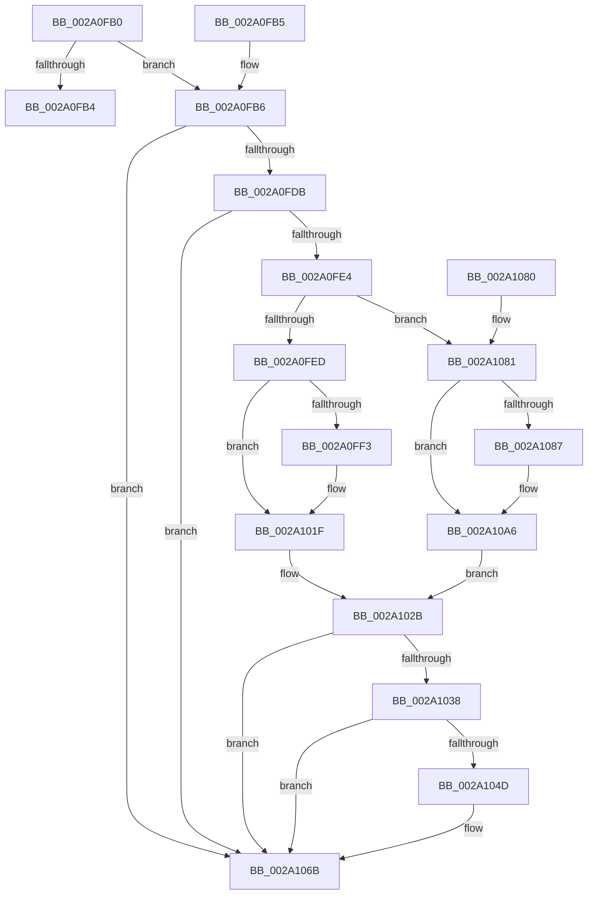

# MiUpdateSlabPagePlaceholderState

- RVA: `0x002A0FB0`–`0x002A10B7` (길이 `263` bytes)
- VA: `0x00000001402A0FB0`
- 실행 섹션: `.text`
- PDB 이름 있음: `예`; PDB Function 태그: `아니요`
- unwind 정보 RVA: `0x00068450`
- 디코드: `70`개 명령, `263/263` bytes 표시
- 미해석 바이트: `0` (있으면 어셈블리에 `.byte`로 보존)

> 이 문서는 커널 이미지의 기계어와 PDB 기호를 분석해 생성했습니다. 4번과 5번은 함수 원형과 자료형을 바이너리 사용 방식에서 추정한 C 해석이며 원본 소스 복구 결과는 아닙니다.

## 1. Dependencies

- 직접 호출 지점: **5**; 고유 호출 대상: **4**
- 직접 호출자로 확인된 함수: **6**
- RIP 상대 이미지 참조: **2**

### Outgoing calls
- `0x002A1012` → [MiSetPfnIdentity](MiSetPfnIdentity_function_002A2350.md) (function, `0x002A2350`)
- `0x002A101A` → [MiAbortCombineScan](MiAbortCombineScan_function_002A1160.md) (function, `0x002A1160`)
- `0x002A1044` → [VslSetPlaceholderPages](VslSetPlaceholderPages_function_002A10C0.md) (function, `0x002A10C0`)
- `0x002A1065` → [KeBugCheckEx](../4F/KeBugCheckEx_function_004FD660.md) (function, `0x004FD660`)
- `0x002A10A1` → [MiSetPfnIdentity](MiSetPfnIdentity_function_002A2350.md) (function, `0x002A2350`)

### Direct callers
- [MiFreePageToSlabAllocator](MiFreePageToSlabAllocator_function_002A0A60.md) at `0x002A0B5D`
- [MiFreeSlabEntry](../2D/MiFreeSlabEntry_function_002DC650.md) at `0x002DC7C1`
- [MiCreateSlabEntry](../37/MiCreateSlabEntry_function_00374DEC.md) at `0x0037521A`
- [MiGetPageFromSlabAllocator](../37/MiGetPageFromSlabAllocator_function_00377294.md) at `0x0037742D`
- [MiDemoteSlabEntry](../44/MiDemoteSlabEntry_function_0044CB0C.md) at `0x0044CCBA`
- [MiDefragmentSlabWorker](../68/MiDefragmentSlabWorker_function_0068D730.md) at `0x0068D8F5`

### Static image references
- `0x002A101F` → RVA `0x0003AF90` (`.rdata`; read)
- `0x002A102B` → RVA `0x00FC6A88` (`ALMOSTRO`; read)

## 2. Other-region calls and transfers

- 다른 실행 섹션으로 향하는 call: **0**
- 별도 외부 분기/꼬리 이동을 확인하지 못했습니다.

## 3. Assembly (complete function range)

```asm
002A0FB0  85 C9                           test ecx, ecx
002A0FB2  79 02                           jns 0x1402a0fb6
002A0FB4  C3                              ret
002A0FB5  CC                              int3
002A0FB6  48 89 5C 24 08                  mov qword ptr [rsp + 8], rbx
002A0FBB  48 89 6C 24 10                  mov qword ptr [rsp + 0x10], rbp
002A0FC0  48 89 74 24 18                  mov qword ptr [rsp + 0x18], rsi
002A0FC5  57                              push rdi
002A0FC6  48 83 EC 30                     sub rsp, 0x30
002A0FCA  8B F9                           mov edi, ecx
002A0FCC  49 8B E8                        mov rbp, r8
002A0FCF  48 8B F2                        mov rsi, rdx
002A0FD2  83 FF 04                        cmp edi, 4
002A0FD5  0F 8F 90 00 00 00               jg 0x1402a106b
002A0FDB  83 FF 02                        cmp edi, 2
002A0FDE  0F 84 87 00 00 00               je 0x1402a106b
002A0FE4  45 85 C9                        test r9d, r9d
002A0FE7  0F 84 94 00 00 00               je 0x1402a1081
002A0FED  49 83 F8 01                     cmp r8, 1
002A0FF1  75 2C                           jne 0x1402a101f
002A0FF3  48 8D 1C 52                     lea rbx, [rdx + rdx*2]
002A0FF7  48 B8 00 00 00 00 00 DE FF FF   movabs rax, 0xffffde0000000000
002A1001  48 C1 E3 04                     shl rbx, 4
002A1005  48 8B C0                        mov rax, rax
002A1008  48 03 D8                        add rbx, rax
002A100B  41 8D 50 02                     lea edx, [r8 + 2]
002A100F  48 8B CB                        mov rcx, rbx
002A1012  E8 39 13 00 00                  call 0x1402a2350
002A1017  48 8B CB                        mov rcx, rbx
002A101A  E8 41 01 00 00                  call 0x1402a1160
002A101F  48 8D 0D 6A 9F D9 FF            lea rcx, [rip - 0x266096]
002A1026  33 DB                           xor ebx, ebx
002A1028  8B 3C B9                        mov edi, dword ptr [rcx + rdi*4]
002A102B  48 F7 05 52 5A D2 00 00 40 00 00  test qword ptr [rip + 0xd25a52], 0x4000
002A1036  74 33                           je 0x1402a106b
002A1038  44 8B CF                        mov r9d, edi
002A103B  44 8B C3                        mov r8d, ebx
002A103E  48 8B D5                        mov rdx, rbp
002A1041  48 8B CE                        mov rcx, rsi
002A1044  E8 77 00 00 00                  call 0x1402a10c0
002A1049  85 C0                           test eax, eax
002A104B  79 1E                           jns 0x1402a106b
002A104D  48 63 C7                        movsxd rax, edi
002A1050  4C 8B C6                        mov r8, rsi
002A1053  4C 63 CB                        movsxd r9, ebx
002A1056  BA 0F 15 05 00                  mov edx, 0x5150f
002A105B  B9 1A 00 00 00                  mov ecx, 0x1a
002A1060  48 89 44 24 20                  mov qword ptr [rsp + 0x20], rax
002A1065  E8 F6 C5 25 00                  call 0x1404fd660
002A106A  CC                              int3
002A106B  48 8B 5C 24 40                  mov rbx, qword ptr [rsp + 0x40]
002A1070  48 8B 6C 24 48                  mov rbp, qword ptr [rsp + 0x48]
002A1075  48 8B 74 24 50                  mov rsi, qword ptr [rsp + 0x50]
002A107A  48 83 C4 30                     add rsp, 0x30
002A107E  5F                              pop rdi
002A107F  C3                              ret
002A1080  CC                              int3
002A1081  48 83 FD 01                     cmp rbp, 1
002A1085  75 1F                           jne 0x1402a10a6
002A1087  48 8D 0C 52                     lea rcx, [rdx + rdx*2]
002A108B  48 B8 00 00 00 00 00 DE FF FF   movabs rax, 0xffffde0000000000
002A1095  48 C1 E1 04                     shl rcx, 4
002A1099  48 8B C0                        mov rax, rax
002A109C  48 03 C8                        add rcx, rax
002A109F  33 D2                           xor edx, edx
002A10A1  E8 AA 12 00 00                  call 0x1402a2350
002A10A6  48 8D 0D E3 9E D9 FF            lea rcx, [rip - 0x26611d]
002A10AD  8B 1C B9                        mov ebx, dword ptr [rcx + rdi*4]
002A10B0  33 FF                           xor edi, edi
002A10B2  E9 74 FF FF FF                  jmp 0x1402a102b
```

## 4. C-style interpretation (structured pseudocode)

```c
__int64 __fastcall MiUpdateSlabPagePlaceholderState(int a1, __int64 a2, __int64 a3, int a4)
{
    __int64 result;
    __int64 v_rbx;
    __int64 v_rdi;
    __int64 v_rsp;
    unsigned __int64 v_stack_m18;
    unsigned __int64 v_stack_p10;
    unsigned __int64 v_stack_p18;
    unsigned __int64 v_stack_p8;

    if (!sign_flag) goto loc_002A0FB6;
    return result;
loc_002A0FB6:
    v_stack_p8 = v_rbx;
    v_stack_p10 = v_rbp;
    v_stack_p18 = v_rsi;
    v_rsp = (v_rsp) - (48);
    if (((unsigned int)((unsigned int)(a1))) > 4) goto loc_002A106B;
    if (((unsigned int)((unsigned int)(a1))) == 2) goto loc_002A106B;
    if (a4 == 0) goto loc_002A1081;
    if (a3 == 1) {
        v_rbx = a2 + a2 * 2;
        v_rbx = (v_rbx) << (4);
        result = result;
        v_rbx = (v_rbx) + (result);
        a2 = a3 + 2;
        a1 = v_rbx;
        result = MiSetPfnIdentity(a1, a2, a3, a4);
        a1 = v_rbx;
        result = MiAbortCombineScan(a1, a2, a3, a4);
    }
    v_rbx = 0;
loc_002A102B:
    if (((*(unsigned __int64 *)(v_rip + 13785682)) & (0x4000ULL)) == 0) goto loc_002A106B;
    result = VslSetPlaceholderPages(a2, a3, 0, (unsigned int)((unsigned int)((unsigned int)(*(unsigned int *)(v_rip - 2515094 + (unsigned int)(a1) * 4)))));
    if (sign_flag) {
        result = (int)((unsigned int)((unsigned int)(*(unsigned int *)(v_rip - 2515094 + (unsigned int)(a1) * 4))));
        a3 = a2;
        a4 = (int)(0);
        a2 = 0x5150FULL;
        a1 = 26;
        v_stack_m18 = result;
        result = KeBugCheckEx(a1, a2, a3, a4);
    }
    v_rsp = (v_rsp) + (48);
    return result;
loc_002A1081:
    if (v_stack_p10 == 1) {
        a1 = a2 + a2 * 2;
        a1 = (a1) << (4);
        result = result;
        a1 = (a1) + (result);
        a2 = 0;
        result = MiSetPfnIdentity(a1, a2, a3, a4);
    }
    v_rdi = 0;
    goto loc_002A102B;
}
```

## 5. (Beta) C Style

```c
int64_t MiUpdateSlabPagePlaceholderState(int32_t Arg1, void *Arg2, int64_t Arg3, int32_t Arg4)
{
    uint8_t *arg2 = (uint8_t *)Arg2;

    int64_t result;
    int64_t local_rbx;
    int64_t local_rdi;
    int64_t local_rsp;
    uint64_t v_stack_m18;
    uint64_t v_stack_p10;
    uint64_t v_stack_p18;
    uint64_t v_stack_p8;

    if (!sign_flag) goto loc_002A0FB6;
    return result;
loc_002A0FB6:
    v_stack_p8 = local_rbx;
    v_stack_p10 = local_rbp;
    v_stack_p18 = local_rsi;
    local_rsp = (local_rsp) - (48);
    if (((uint32_t)((uint32_t)(Arg1))) > 4) goto loc_002A106B;
    if (((uint32_t)((uint32_t)(Arg1))) == 2) goto loc_002A106B;
    if (Arg4 == 0) goto loc_002A1081;
    if (Arg3 == 1) {
        local_rbx = Arg2 + Arg2 * 2;
        local_rbx = (local_rbx) << (4);
        result = result;
        local_rbx = (local_rbx) + (result);
        Arg2 = Arg3 + 2;
        Arg1 = local_rbx;
        result = MiSetPfnIdentity(Arg1, Arg2, Arg3, Arg4);
        Arg1 = local_rbx;
        result = MiAbortCombineScan(Arg1, Arg2, Arg3, Arg4);
    }
    local_rbx = 0;
loc_002A102B:
    if (((*(uint64_t *)(v_rip + 0xD25A52)) & (0x4000ULL)) == 0) goto loc_002A106B;
    result = VslSetPlaceholderPages(Arg2, Arg3, 0, (uint32_t)((uint32_t)((uint32_t)(*(uint32_t *)(v_rip - 0x266096 + (uint32_t)(Arg1) * 4)))));
    if (sign_flag) {
        result = (int32_t)((uint32_t)((uint32_t)(*(uint32_t *)(v_rip - 0x266096 + (uint32_t)(Arg1) * 4))));
        Arg3 = Arg2;
        Arg4 = (int32_t)(0);
        Arg2 = 0x5150FULL;
        Arg1 = 26;
        v_stack_m18 = result;
        result = KeBugCheckEx(Arg1, Arg2, Arg3, Arg4);
    }
    local_rsp = (local_rsp) + (48);
    return result;
loc_002A1081:
    if (v_stack_p10 == 1) {
        Arg1 = Arg2 + Arg2 * 2;
        Arg1 = (Arg1) << (4);
        result = result;
        Arg1 = (Arg1) + (result);
        Arg2 = 0;
        result = MiSetPfnIdentity(Arg1, Arg2, Arg3, Arg4);
    }
    local_rdi = 0;
    goto loc_002A102B;
}
```

### 관측된 메모리 오프셋

구조체 형식이 확인되지 않은 접근은 인자 기준의 오프셋으로만 기록했습니다.

| 기준 인자 | 오프셋 표현 | 폭 (bit) | 접근 |
|---|---:|---:|---|
| `Arg2` | `+ 0x0 + rdx*2` | `64` | `R` |

## 6. Execution-region graph

[열기: 2D/3D 그래프와 함수 탐색 컨트롤 패널](../../../control-panel.html?section=text&rva=0x002A0FB0&view=graph)

- 2D 그래프는 위에서 아래로 흐르고, 3D 그래프는 빈 공간을 드래그해 회전합니다. Shift+드래그는 이동, 휠은 확대·축소, 함수 노드 선택은 대상 보고서 이동입니다.

### Static fallback


