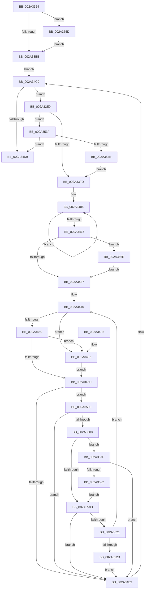

# MiWaitForFreePage

- RVA: `0x002A3324`–`0x002A3597` (길이 `627` bytes)
- VA: `0x00000001402A3324`
- 실행 섹션: `.text`
- PDB 이름 있음: `예`; PDB Function 태그: `아니요`
- unwind 정보 RVA: `0x0006874C`
- 디코드: `155`개 명령, `627/627` bytes 표시
- 미해석 바이트: `0` (있으면 어셈블리에 `.byte`로 보존)

> 이 문서는 커널 이미지의 기계어와 PDB 기호를 분석해 생성했습니다. 4번과 5번은 함수 원형과 자료형을 바이너리 사용 방식에서 추정한 C 해석이며 원본 소스 복구 결과는 아닙니다.

## 1. Dependencies

- 직접 호출 지점: **12**; 고유 호출 대상: **10**
- 직접 호출자로 확인된 함수: **16**
- RIP 상대 이미지 참조: **1**

### Outgoing calls
- `0x002A33D3` → [ExAcquireSpinLockExclusive](../24/ExAcquireSpinLockExclusive_function_00248690.md) (function, `0x00248690`)
- `0x002A3408` → [KeResetEvent](../24/KeResetEvent_function_00248350.md) (function, `0x00248350`)
- `0x002A341D` → [MiReleaseSpinLockExclusive](../24/MiReleaseSpinLockExclusive_function_002482C0.md) (function, `0x002482C0`)
- `0x002A3425` → [MiObtainFreePages](../3B/MiObtainFreePages_function_003BB724.md) (function, `0x003BB724`)
- `0x002A345B` → [MiCanFlushMakeProgress](../3B/MiCanFlushMakeProgress_function_003BC9D0.md) (function, `0x003BC9D0`)
- `0x002A34AD` → [KeWaitForMultipleObjects](../20/KeWaitForMultipleObjects_function_0020D110.md) (function, `0x0020D110`)
- `0x002A34BC` → [ExAcquireSpinLockExclusive](../24/ExAcquireSpinLockExclusive_function_00248690.md) (function, `0x00248690`)
- `0x002A34CC` → [MiSufficientAvailablePages](../36/MiSufficientAvailablePages_function_0036D0B0.md) (function, `0x0036D0B0`)
- `0x002A34DF` → [MiReleaseSpinLockExclusive](../24/MiReleaseSpinLockExclusive_function_002482C0.md) (function, `0x002482C0`)
- `0x002A3514` → [MiDemoteSlabEntries](../4D/MiDemoteSlabEntries_function_004D89A0.md) (function, `0x004D89A0`)
- `0x002A3535` → [MiNoPagesLastChance](../68/MiNoPagesLastChance_function_0068B22C.md) (function, `0x0068B22C`)
- `0x002A3575` → [VslReclaimPartitionPages](../58/VslReclaimPartitionPages_function_0058F054.md) (function, `0x0058F054`)

### Direct callers
- [MiHandleForkTransitionPte](../22/MiHandleForkTransitionPte_function_0022D34C.md) at `0x0022D9F7`
- [MiWalkPageTablesRecursively](../27/MiWalkPageTablesRecursively_function_002796C0.md) at `0x0027A454`
- [MiAllocateKernelStackPages](MiAllocateKernelStackPages_function_002A1BEC.md) at `0x002A1FEA`
- [sub_002A2D9F](Unknown_function_002A2D9F.md) at `0x002A2E18`
- [MiGetSystemPage](MiGetSystemPage_function_002AB7E8.md) at `0x002AB912`
- [MiMakePageAvoidRead](../2B/MiMakePageAvoidRead_function_002B7DE0.md) at `0x002B842D`
- [MiMakeOutswappedPageResident](../43/MiMakeOutswappedPageResident_function_00431AD0.md) at `0x00431D61`
- [MiSwitchToTransition](../4C/MiSwitchToTransition_function_004C0F5C.md) at `0x004C110A`
- [MiSplitDirectMapPage](../4D/MiSplitDirectMapPage_function_004DAAA0.md) at `0x004DAB41`
- [sub_006D7206](../6D/Unknown_function_006D7206.md) at `0x006D7238`
- [sub_006D7EC6](../6D/Unknown_function_006D7EC6.md) at `0x006D7F4B`
- [sub_006DAF7E](../6D/Unknown_function_006DAF7E.md) at `0x006DAFAC`
- [MiAllocateTopLevelPage](../../page/A5/MiAllocateTopLevelPage_function_00A5F2EC.md) at `0x00A5F470`
- [MiDoneWithThisPageGetAnother](../../page/A7/MiDoneWithThisPageGetAnother_function_00A7DDDC.md) at `0x00A7DE52`
- [MmAllocateIndependentPagesEx](../../page/AA/MmAllocateIndependentPagesEx_function_00AA0CFC.md) at `0x00AA0EBC`
- [sub_00B42C66](../../page/B4/Unknown_function_00B42C66.md) at `0x00B42D3A`

### Static image references
- `0x002A336C` → RVA `0x00010868` (`.rdata`; read)

## 2. Other-region calls and transfers

- 다른 실행 섹션으로 향하는 call: **0**
- 별도 외부 분기/꼬리 이동을 확인하지 못했습니다.

## 3. Assembly (complete function range)

```asm
002A3324  4C 8B DC                        mov r11, rsp
002A3327  53                              push rbx
002A3328  55                              push rbp
002A3329  56                              push rsi
002A332A  57                              push rdi
002A332B  41 54                           push r12
002A332D  41 55                           push r13
002A332F  41 56                           push r14
002A3331  41 57                           push r15
002A3333  48 83 EC 68                     sub rsp, 0x68
002A3337  49 83 63 20 00                  and qword ptr [r11 + 0x20], 0
002A333C  48 8B D9                        mov rbx, rcx
002A333F  65 48 8B 04 25 88 01 00 00      mov rax, qword ptr gs:[0x188]
002A3348  44 8B E2                        mov r12d, edx
002A334B  49 83 63 B0 00                  and qword ptr [r11 - 0x50], 0
002A3350  44 8B 80 A4 05 00 00            mov r8d, dword ptr [rax + 0x5a4]
002A3357  41 83 E0 02                     and r8d, 2
002A335B  41 8B C0                        mov eax, r8d
002A335E  F7 D8                           neg eax
002A3360  48 B8 B5 A6 79 C7 29 3A 92 CB   movabs rax, 0xcb923a29c779a6b5
002A336A  1B FF                           sbb edi, edi
002A336C  48 F7 2D F5 D4 D6 FF            imul qword ptr [rip - 0x292b0b]
002A3373  83 E7 82                        and edi, 0xffffff82
002A3376  81 C7 A0 00 00 00               add edi, 0xa0
002A337C  48 8B CA                        mov rcx, rdx
002A337F  48 C1 F9 0B                     sar rcx, 0xb
002A3383  48 8B C1                        mov rax, rcx
002A3386  89 BC 24 C0 00 00 00            mov dword ptr [rsp + 0xc0], edi
002A338D  48 C1 E8 3F                     shr rax, 0x3f
002A3391  48 03 C8                        add rcx, rax
002A3394  41 F7 D8                        neg r8d
002A3397  48 89 4C 24 40                  mov qword ptr [rsp + 0x40], rcx
002A339C  4D 1B ED                        sbb r13, r13
002A339F  49 83 E5 E0                     and r13, 0xffffffffffffffe0
002A33A3  49 81 C5 68 3F 00 00            add r13, 0x3f68
002A33AA  4C 03 EB                        add r13, rbx
002A33AD  4D 89 6B A8                     mov qword ptr [r11 - 0x58], r13
002A33B1  41 83 E4 02                     and r12d, 2
002A33B5  0F 85 A2 01 00 00               jne 0x1402a355d
002A33BB  41 8B C4                        mov eax, r12d
002A33BE  4C 8D BB 40 3F 00 00            lea r15, [rbx + 0x3f40]
002A33C5  F7 D8                           neg eax
002A33C7  49 8B CF                        mov rcx, r15
002A33CA  45 1B F6                        sbb r14d, r14d
002A33CD  41 F7 DE                        neg r14d
002A33D0  41 FF C6                        inc r14d
002A33D3  E8 B8 52 FA FF                  call 0x140248690
002A33D8  40 8A F0                        mov sil, al
002A33DB  8B D7                           mov edx, edi
002A33DD  8B C7                           mov eax, edi
002A33DF  48 89 44 24 48                  mov qword ptr [rsp + 0x48], rax
002A33E4  E9 E0 00 00 00                  jmp 0x1402a34c9
002A33E9  41 8B 45 18                     mov eax, dword ptr [r13 + 0x18]
002A33ED  89 84 24 B8 00 00 00            mov dword ptr [rsp + 0xb8], eax
002A33F4  45 85 E4                        test r12d, r12d
002A33F7  0F 85 42 01 00 00               jne 0x1402a353f
002A33FD  48 8D 7C 24 50                  lea rdi, [rsp + 0x50]
002A3402  41 8B EE                        mov ebp, r14d
002A3405  48 8B 0F                        mov rcx, qword ptr [rdi]
002A3408  E8 43 4F FA FF                  call 0x140248350
002A340D  48 8D 7F 08                     lea rdi, [rdi + 8]
002A3411  48 83 ED 01                     sub rbp, 1
002A3415  75 EE                           jne 0x1402a3405
002A3417  40 8A D6                        mov dl, sil
002A341A  49 8B CF                        mov rcx, r15
002A341D  E8 9E 4E FA FF                  call 0x1402482c0
002A3422  48 8B CB                        mov rcx, rbx
002A3425  E8 FA 82 11 00                  call 0x1403bb724
002A342A  48 39 AB B0 01 00 00            cmp qword ptr [rbx + 0x1b0], rbp
002A3431  0F 85 37 01 00 00               jne 0x1402a356e
002A3437  8B AC 24 B8 00 00 00            mov ebp, dword ptr [rsp + 0xb8]
002A343E  33 F6                           xor esi, esi
002A3440  48 8B 83 C0 4B 00 00            mov rax, qword ptr [rbx + 0x4bc0]
002A3447  48 85 C0                        test rax, rax
002A344A  0F 84 A6 00 00 00               je 0x1402a34f6
002A3450  33 D2                           xor edx, edx
002A3452  41 B8 20 04 00 00               mov r8d, 0x420
002A3458  48 8B CB                        mov rcx, rbx
002A345B  E8 70 95 11 00                  call 0x1403bc9d0
002A3460  BF E8 03 00 00                  mov edi, 0x3e8
002A3465  85 C0                           test eax, eax
002A3467  0F 84 89 00 00 00               je 0x1402a34f6
002A346D  48 83 64 24 38 00               and qword ptr [rsp + 0x38], 0
002A3473  48 8D 54 24 50                  lea rdx, [rsp + 0x50]
002A3478  8B C7                           mov eax, edi
002A347A  41 B9 08 00 00 00               mov r9d, 8
002A3480  48 69 C8 F0 D8 FF FF            imul rcx, rax, -0x2710
002A3487  48 8D 84 24 C8 00 00 00         lea rax, [rsp + 0xc8]
002A348F  48 89 44 24 30                  mov qword ptr [rsp + 0x30], rax
002A3494  45 8D 41 F9                     lea r8d, [r9 - 7]
002A3498  48 89 8C 24 C8 00 00 00         mov qword ptr [rsp + 0xc8], rcx
002A34A0  41 8B CE                        mov ecx, r14d
002A34A3  C6 44 24 28 00                  mov byte ptr [rsp + 0x28], 0
002A34A8  C6 44 24 20 00                  mov byte ptr [rsp + 0x20], 0
002A34AD  E8 5E 9C F6 FF                  call 0x14020d110
002A34B2  3D 02 01 00 00                  cmp eax, 0x102
002A34B7  74 47                           je 0x1402a3500
002A34B9  49 8B CF                        mov rcx, r15
002A34BC  E8 CF 51 FA FF                  call 0x140248690
002A34C1  48 8B 54 24 48                  mov rdx, qword ptr [rsp + 0x48]
002A34C6  40 8A F0                        mov sil, al
002A34C9  48 8B CB                        mov rcx, rbx
002A34CC  E8 DF 9B 0C 00                  call 0x14036d0b0
002A34D1  85 C0                           test eax, eax
002A34D3  0F 84 10 FF FF FF               je 0x1402a33e9
002A34D9  40 8A D6                        mov dl, sil
002A34DC  49 8B CF                        mov rcx, r15
002A34DF  E8 DC 4D FA FF                  call 0x1402482c0
002A34E4  48 83 C4 68                     add rsp, 0x68
002A34E8  41 5F                           pop r15
002A34EA  41 5E                           pop r14
002A34EC  41 5D                           pop r13
002A34EE  41 5C                           pop r12
002A34F0  5F                              pop rdi
002A34F1  5E                              pop rsi
002A34F2  5D                              pop rbp
002A34F3  5B                              pop rbx
002A34F4  C3                              ret
002A34F5  CC                              int3
002A34F6  BF 64 00 00 00                  mov edi, 0x64
002A34FB  E9 6D FF FF FF                  jmp 0x1402a346d
002A3500  41 8B 45 18                     mov eax, dword ptr [r13 + 0x18]
002A3504  3B E8                           cmp ebp, eax
002A3506  75 B1                           jne 0x1402a34b9
002A3508  45 85 E4                        test r12d, r12d
002A350B  75 72                           jne 0x1402a357f
002A350D  33 D2                           xor edx, edx
002A350F  48 8B CB                        mov rcx, rbx
002A3512  03 F7                           add esi, edi
002A3514  E8 87 54 23 00                  call 0x1404d89a0
002A3519  41 8B 45 18                     mov eax, dword ptr [r13 + 0x18]
002A351D  3B E8                           cmp ebp, eax
002A351F  75 98                           jne 0x1402a34b9
002A3521  3B 74 24 40                     cmp esi, dword ptr [rsp + 0x40]
002A3525  0F 82 15 FF FF FF               jb 0x1402a3440
002A352B  8B 94 24 C0 00 00 00            mov edx, dword ptr [rsp + 0xc0]
002A3532  48 8B CB                        mov rcx, rbx
002A3535  E8 F2 7C 3E 00                  call 0x14068b22c
002A353A  E9 7A FF FF FF                  jmp 0x1402a34b9
002A353F  48 8B 83 80 47 00 00            mov rax, qword ptr [rbx + 0x4780]
002A3546  48 85 C0                        test rax, rax
002A3549  75 8E                           jne 0x1402a34d9
002A354B  8B 83 A0 47 00 00               mov eax, dword ptr [rbx + 0x47a0]
002A3551  89 84 24 B0 00 00 00            mov dword ptr [rsp + 0xb0], eax
002A3558  E9 A0 FE FF FF                  jmp 0x1402a33fd
002A355D  48 8D 83 88 47 00 00            lea rax, [rbx + 0x4788]
002A3564  48 89 44 24 58                  mov qword ptr [rsp + 0x58], rax
002A3569  E9 4D FE FF FF                  jmp 0x1402a33bb
002A356E  48 8B 8B B8 00 00 00            mov rcx, qword ptr [rbx + 0xb8]
002A3575  E8 DA BA 2E 00                  call 0x14058f054
002A357A  E9 B8 FE FF FF                  jmp 0x1402a3437
002A357F  8B 83 A0 47 00 00               mov eax, dword ptr [rbx + 0x47a0]
002A3585  39 84 24 B0 00 00 00            cmp dword ptr [rsp + 0xb0], eax
002A358C  0F 85 27 FF FF FF               jne 0x1402a34b9
002A3592  E9 76 FF FF FF                  jmp 0x1402a350d
```

## 4. C-style interpretation (structured pseudocode)

```c
__int64 __fastcall MiWaitForFreePage(__int64 a1, __int64 a2)
{
    __int64 result;
    __int64 v_r12;
    __int64 v_r13;
    __int64 v_r14;
    __int64 v_rbp;
    __int64 v_rdi;
    __int64 v_rsi;
    __int64 v_rsp;
    unsigned __int64 v_stack_m58;
    unsigned __int64 v_stack_m60;
    unsigned __int64 v_stack_m68;
    unsigned __int64 v_stack_m70;
    unsigned __int64 v_stack_m78;
    unsigned __int8 v_stack_m80;
    unsigned __int8 v_stack_m88;
    unsigned int v_stack_p10;
    unsigned int v_stack_p18;
    unsigned __int64 v_stack_p20;
    unsigned int v_stack_p40;
    unsigned __int64 v_stack_p58;
    unsigned int v_stack_pB0;
    unsigned int v_stack_pC0;

    v_rsp = (v_rsp) - (104);
    a3 = (unsigned int)(((unsigned int)(*(unsigned int *)(*(unsigned __int64 *)(gs_base + (0 + 392)) + 1444))) & (2));
    result = (unsigned int)(-((unsigned int)((unsigned int)(a3))));
    v_rdi = (unsigned int)((v_rdi) & (0xFFFFFF82ULL));
    v_rdi = (unsigned int)((v_rdi) + (160));
    a1 = (a2) >> (11);
    v_stack_p18 = (unsigned int)(v_rdi);
    result = (a1) >> (63);
    a1 = (a1) + (result);
    a3 = (unsigned int)(-(a3));
    v_stack_m68 = a1;
    v_r13 = (v_r13) & (-32);
    v_r13 = (v_r13) + (0x3F68ULL);
    v_r13 = (v_r13) + (a1);
    *(unsigned __int64 *)(v_rsp - 88) = v_r13;
    v_r12 = (unsigned int)(((unsigned int)((unsigned int)(a2))) & (2));
    if (condition_is_not_equal) goto loc_002A355D;
loc_002A33BB:
    result = (unsigned int)(-((unsigned int)((unsigned int)(v_r12))));
    v_r14 = (unsigned int)(-(v_r14));
    v_r14 = (unsigned int)((v_r14) + 1);
    result = ExAcquireSpinLockExclusive(a1 + 16192, a2, a3, a4);
    v_stack_m60 = (unsigned int)((unsigned int)(v_rdi));
    goto loc_002A34C9;
loc_002A33E9:
    v_stack_p10 = (unsigned int)((unsigned int)(*(unsigned int *)(v_r13 + 24)));
    if ((unsigned int)(v_r12) != 0) goto loc_002A353F;
loc_002A33FD:
loc_002A3405:
    result = KeResetEvent(*(unsigned __int64 *)(v_stack_m58), (unsigned int)((unsigned int)(v_rdi)), a3, a4);
    v_rbp = ((unsigned int)((unsigned int)(v_r14))) - (1);
    if (condition_is_not_equal) goto loc_002A3405;
    result = MiReleaseSpinLockExclusive(a1 + 16192, (unsigned __int8)((unsigned __int8)(result)), a3, a4);
    result = MiObtainFreePages(a1, (unsigned __int8)((unsigned __int8)(result)), a3, a4);
    if ((*(unsigned __int64 *)(a1 + 432)) != v_rbp) goto loc_002A356E;
loc_002A3437:
    v_rsi = 0;
loc_002A3440:
    if (*(unsigned __int64 *)(a1 + 19392) == 0) goto loc_002A34F6;
    a2 = 0;
    result = MiCanFlushMakeProgress(a1, a2, (unsigned int)(0x420ULL), a4);
    if ((unsigned int)(result) == 0) goto loc_002A34F6;
loc_002A346D:
    a1 = (a1) * (1000);
    v_stack_m78 = v_stack_p20;
    v_stack_p20 = a1;
    v_stack_m80 = 0;
    v_stack_m88 = 0;
    result = KeWaitForMultipleObjects((unsigned int)((unsigned int)(v_r14)), v_stack_m58, 8 - 7, 8);
    if (((unsigned int)(result)) == 258) goto loc_002A3500;
loc_002A34B9:
    result = ExAcquireSpinLockExclusive(a1 + 16192, v_stack_m58, 8 - 7, 8);
loc_002A34C9:
    result = MiSufficientAvailablePages(a1, v_stack_m60, 8 - 7, 8);
    if ((unsigned int)(result) == 0) goto loc_002A33E9;
loc_002A34D9:
    result = MiReleaseSpinLockExclusive(a1 + 16192, (unsigned __int8)((unsigned __int8)(result)), 8 - 7, 8);
    v_rsp = (v_rsp) + (104);
    return result;
loc_002A34F6:
    goto loc_002A346D;
loc_002A3500:
    if (((unsigned int)((unsigned int)(v_stack_p10))) != ((unsigned int)((unsigned int)(*(unsigned int *)(v_r13 + 24))))) goto loc_002A34B9;
    if ((unsigned int)(v_r12) != 0) goto loc_002A357F;
loc_002A350D:
    a2 = 0;
    v_rsi = (unsigned int)(((unsigned __int8)(result)) + (100));
    result = MiDemoteSlabEntries(a1, a2, 8 - 7, 8);
    if (((unsigned int)((unsigned int)(v_stack_p10))) != ((unsigned int)((unsigned int)(*(unsigned int *)(v_r13 + 24))))) goto loc_002A34B9;
    if (((unsigned int)(v_rsi)) < v_stack_p40) goto loc_002A3440;
    result = MiNoPagesLastChance(a1, (unsigned int)(v_stack_pC0), 8 - 7, 8);
    goto loc_002A34B9;
loc_002A353F:
    if (*(unsigned __int64 *)(a1 + 18304) != 0) goto loc_002A34D9;
    v_stack_pB0 = (unsigned int)((unsigned int)(*(unsigned int *)(a1 + 18336)));
    goto loc_002A33FD;
loc_002A355D:
    v_stack_p58 = a1 + 18312;
    goto loc_002A33BB;
loc_002A356E:
    result = VslReclaimPartitionPages(*(unsigned __int64 *)(a1 + 184), (unsigned int)(v_stack_pC0), 8 - 7, 8);
    goto loc_002A3437;
loc_002A357F:
    if (v_stack_pB0 != ((unsigned int)((unsigned int)(*(unsigned int *)(a1 + 18336))))) goto loc_002A34B9;
    goto loc_002A350D;
}
```

## 5. (Beta) C Style

```c
int64_t MiWaitForFreePage(void *Arg1, int64_t Arg2)
{
    uint8_t *arg1 = (uint8_t *)Arg1;

    int64_t result;
    int64_t local_r12;
    int64_t local_r13;
    int64_t local_r14;
    int64_t local_rbp;
    int64_t local_rdi;
    int64_t local_rsi;
    int64_t local_rsp;
    uint64_t v_stack_m58;
    uint64_t v_stack_m60;
    uint64_t v_stack_m68;
    uint64_t v_stack_m70;
    uint64_t v_stack_m78;
    uint8_t v_stack_m80;
    uint8_t v_stack_m88;
    uint32_t v_stack_p10;
    uint32_t v_stack_p18;
    uint64_t v_stack_p20;
    uint32_t v_stack_p40;
    uint64_t v_stack_p58;
    uint32_t v_stack_pB0;
    uint32_t v_stack_pC0;

    local_rsp = (local_rsp) - (104);
    a3 = (uint32_t)(((uint32_t)(*(uint32_t *)(*(uint64_t *)(gs_base + (0 + 0x188)) + 0x5A4))) & (2));
    result = (uint32_t)(-((uint32_t)((uint32_t)(a3))));
    local_rdi = (uint32_t)((local_rdi) & (0xFFFFFF82ULL));
    local_rdi = (uint32_t)((local_rdi) + (160));
    Arg1 = (Arg2) >> (11);
    v_stack_p18 = (uint32_t)(local_rdi);
    result = (Arg1) >> (63);
    Arg1 = (Arg1) + (result);
    a3 = (uint32_t)(-(a3));
    v_stack_m68 = Arg1;
    local_r13 = (local_r13) & (-32);
    local_r13 = (local_r13) + (0x3F68ULL);
    local_r13 = (local_r13) + (Arg1);
    *(uint64_t *)(local_rsp - 0x58) = local_r13;
    local_r12 = (uint32_t)(((uint32_t)((uint32_t)(Arg2))) & (2));
    if (condition_is_not_equal) goto loc_002A355D;
loc_002A33BB:
    result = (uint32_t)(-((uint32_t)((uint32_t)(local_r12))));
    local_r14 = (uint32_t)(-(local_r14));
    local_r14 = (uint32_t)((local_r14) + 1);
    result = ExAcquireSpinLockExclusive(Arg1 + 16192, Arg2, a3, a4);
    v_stack_m60 = (uint32_t)((uint32_t)(local_rdi));
    goto loc_002A34C9;
loc_002A33E9:
    v_stack_p10 = (uint32_t)((uint32_t)(*(uint32_t *)(local_r13 + 0x18)));
    if ((uint32_t)(local_r12) != 0) goto loc_002A353F;
loc_002A33FD:
loc_002A3405:
    result = KeResetEvent(*(uint64_t *)(v_stack_m58), (uint32_t)((uint32_t)(local_rdi)), a3, a4);
    local_rbp = ((uint32_t)((uint32_t)(local_r14))) - (1);
    if (condition_is_not_equal) goto loc_002A3405;
    result = MiReleaseSpinLockExclusive(Arg1 + 16192, (uint8_t)((uint8_t)(result)), a3, a4);
    result = MiObtainFreePages(Arg1, (uint8_t)((uint8_t)(result)), a3, a4);
    if ((*(uint64_t *)(arg1 + 0x1B0)) != local_rbp) goto loc_002A356E;
loc_002A3437:
    local_rsi = 0;
loc_002A3440:
    if (*(uint64_t *)(arg1 + 0x4BC0) == 0) goto loc_002A34F6;
    Arg2 = 0;
    result = MiCanFlushMakeProgress(Arg1, Arg2, (uint32_t)(0x420ULL), a4);
    if ((uint32_t)(result) == 0) goto loc_002A34F6;
loc_002A346D:
    Arg1 = (Arg1) * (1000);
    v_stack_m78 = v_stack_p20;
    v_stack_p20 = Arg1;
    v_stack_m80 = 0;
    v_stack_m88 = 0;
    result = KeWaitForMultipleObjects((uint32_t)((uint32_t)(local_r14)), v_stack_m58, 8 - 7, 8);
    if (((uint32_t)(result)) == 258) goto loc_002A3500;
loc_002A34B9:
    result = ExAcquireSpinLockExclusive(Arg1 + 16192, v_stack_m58, 8 - 7, 8);
loc_002A34C9:
    result = MiSufficientAvailablePages(Arg1, v_stack_m60, 8 - 7, 8);
    if ((uint32_t)(result) == 0) goto loc_002A33E9;
loc_002A34D9:
    result = MiReleaseSpinLockExclusive(Arg1 + 16192, (uint8_t)((uint8_t)(result)), 8 - 7, 8);
    local_rsp = (local_rsp) + (104);
    return result;
loc_002A34F6:
    goto loc_002A346D;
loc_002A3500:
    if (((uint32_t)((uint32_t)(v_stack_p10))) != ((uint32_t)((uint32_t)(*(uint32_t *)(local_r13 + 0x18))))) goto loc_002A34B9;
    if ((uint32_t)(local_r12) != 0) goto loc_002A357F;
loc_002A350D:
    Arg2 = 0;
    local_rsi = (uint32_t)(((uint8_t)(result)) + (100));
    result = MiDemoteSlabEntries(Arg1, Arg2, 8 - 7, 8);
    if (((uint32_t)((uint32_t)(v_stack_p10))) != ((uint32_t)((uint32_t)(*(uint32_t *)(local_r13 + 0x18))))) goto loc_002A34B9;
    if (((uint32_t)(local_rsi)) < v_stack_p40) goto loc_002A3440;
    result = MiNoPagesLastChance(Arg1, (uint32_t)(v_stack_pC0), 8 - 7, 8);
    goto loc_002A34B9;
loc_002A353F:
    if (*(uint64_t *)(arg1 + 0x4780) != 0) goto loc_002A34D9;
    v_stack_pB0 = (uint32_t)((uint32_t)(*(uint32_t *)(arg1 + 0x47A0)));
    goto loc_002A33FD;
loc_002A355D:
    v_stack_p58 = Arg1 + 18312;
    goto loc_002A33BB;
loc_002A356E:
    result = VslReclaimPartitionPages(*(uint64_t *)(arg1 + 0xB8), (uint32_t)(v_stack_pC0), 8 - 7, 8);
    goto loc_002A3437;
loc_002A357F:
    if (v_stack_pB0 != ((uint32_t)((uint32_t)(*(uint32_t *)(arg1 + 0x47A0))))) goto loc_002A34B9;
    goto loc_002A350D;
}
```

### 관측된 메모리 오프셋

구조체 형식이 확인되지 않은 접근은 인자 기준의 오프셋으로만 기록했습니다.

| 기준 인자 | 오프셋 표현 | 폭 (bit) | 접근 |
|---|---:|---:|---|
| `Arg1` | `+ 0xB8` | `64` | `R` |
| `Arg1` | `+ 0x1B0` | `64` | `R` |
| `Arg1` | `+ 0x3F40` | `64` | `R` |
| `Arg1` | `+ 0x4780` | `64` | `R` |
| `Arg1` | `+ 0x4788` | `64` | `R` |
| `Arg1` | `+ 0x47A0` | `32` | `R` |
| `Arg1` | `+ 0x4BC0` | `64` | `R` |

## 6. Execution-region graph

[열기: 2D/3D 그래프와 함수 탐색 컨트롤 패널](../../../control-panel.html?section=text&rva=0x002A3324&view=graph)

- 2D 그래프는 위에서 아래로 흐르고, 3D 그래프는 빈 공간을 드래그해 회전합니다. Shift+드래그는 이동, 휠은 확대·축소, 함수 노드 선택은 대상 보고서 이동입니다.

### Static fallback


