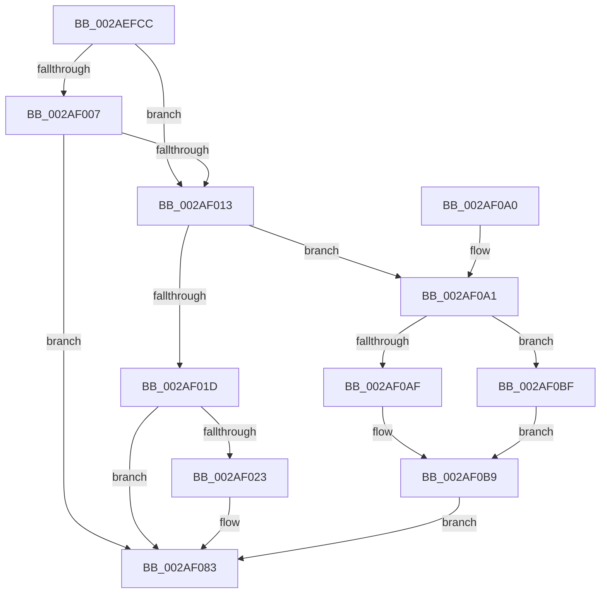

# MiWorkingSetInfoCheckPageTable

- RVA: `0x002AEFCC`–`0x002AF0CB` (길이 `255` bytes)
- VA: `0x00000001402AEFCC`
- 실행 섹션: `.text`
- PDB 이름 있음: `예`; PDB Function 태그: `아니요`
- unwind 정보 RVA: `0x00065B90`
- 디코드: `68`개 명령, `255/255` bytes 표시
- 미해석 바이트: `0` (있으면 어셈블리에 `.byte`로 보존)

> 이 문서는 커널 이미지의 기계어와 PDB 기호를 분석해 생성했습니다. 4번과 5번은 함수 원형과 자료형을 바이너리 사용 방식에서 추정한 C 해석이며 원본 소스 복구 결과는 아닙니다.

## 1. Dependencies

- 직접 호출 지점: **5**; 고유 호출 대상: **4**
- 직접 호출자로 확인된 함수: **1**
- RIP 상대 이미지 참조: **0**

### Outgoing calls
- `0x002AEFF6` → [MI_READ_PTE_LOCK_FREE](../28/MI_READ_PTE_LOCK_FREE_function_002828A0.md) (function, `0x002828A0`)
- `0x002AF00A` → [MiGetPagingFileOffset](../36/MiGetPagingFileOffset_function_0036F530.md) (function, `0x0036F530`)
- `0x002AF04A` → [MiUnlockPageTable](../21/MiUnlockPageTable_function_00216EC0.md) (function, `0x00216EC0`)
- `0x002AF06E` → [MiMakeSystemAddressValid](../27/MiMakeSystemAddressValid_function_0027FF70.md) (function, `0x0027FF70`)
- `0x002AF079` → [MiUnlockPageTable](../21/MiUnlockPageTable_function_00216EC0.md) (function, `0x00216EC0`)

### Direct callers
- [MiGetWorkingSetInfoList](MiGetWorkingSetInfoList_function_002AF770.md) at `0x002AFE33`

### Static image references
- 디코드된 RIP-relative 메모리 참조가 없습니다.

## 2. Other-region calls and transfers

- 다른 실행 섹션으로 향하는 call: **0**
- 별도 외부 분기/꼬리 이동을 확인하지 못했습니다.

## 3. Assembly (complete function range)

```asm
002AEFCC  48 8B C4                        mov rax, rsp
002AEFCF  48 89 58 08                     mov qword ptr [rax + 8], rbx
002AEFD3  48 89 68 10                     mov qword ptr [rax + 0x10], rbp
002AEFD7  48 89 70 18                     mov qword ptr [rax + 0x18], rsi
002AEFDB  48 89 78 20                     mov qword ptr [rax + 0x20], rdi
002AEFDF  41 56                           push r14
002AEFE1  48 83 EC 20                     sub rsp, 0x20
002AEFE5  4C 8B F1                        mov r14, rcx
002AEFE8  41 8B F1                        mov esi, r9d
002AEFEB  48 8B CA                        mov rcx, rdx
002AEFEE  49 8B F8                        mov rdi, r8
002AEFF1  48 8B EA                        mov rbp, rdx
002AEFF4  33 DB                           xor ebx, ebx
002AEFF6  E8 A5 38 FD FF                  call 0x1402828a0
002AEFFB  4C 8B D0                        mov r10, rax
002AEFFE  41 81 E2 00 08 00 00            and r10d, 0x800
002AF005  75 0C                           jne 0x1402af013
002AF007  48 8B C8                        mov rcx, rax
002AF00A  E8 21 05 0C 00                  call 0x14036f530
002AF00F  85 C0                           test eax, eax
002AF011  74 70                           je 0x1402af083
002AF013  40 F6 C6 01                     test sil, 1
002AF017  0F 85 84 00 00 00               jne 0x1402af0a1
002AF01D  40 F6 C6 02                     test sil, 2
002AF021  74 60                           je 0x1402af083
002AF023  48 8B D5                        mov rdx, rbp
002AF026  48 BF 00 00 00 00 80 F6 FF FF   movabs rdi, 0xfffff68000000000
002AF030  48 C1 EA 09                     shr rdx, 9
002AF034  48 B8 F8 FF FF FF 7F 00 00 00   movabs rax, 0x7ffffffff8
002AF03E  48 23 D0                        and rdx, rax
002AF041  48 8B C7                        mov rax, rdi
002AF044  48 03 D0                        add rdx, rax
002AF047  49 8B CE                        mov rcx, r14
002AF04A  E8 71 7E F6 FF                  call 0x140216ec0
002AF04F  48 8B CD                        mov rcx, rbp
002AF052  48 C1 E1 19                     shl rcx, 0x19
002AF056  48 8B C7                        mov rax, rdi
002AF059  44 8A 44 24 50                  mov r8b, byte ptr [rsp + 0x50]
002AF05E  45 33 C9                        xor r9d, r9d
002AF061  48 C1 E0 19                     shl rax, 0x19
002AF065  8B D3                           mov edx, ebx
002AF067  48 2B C8                        sub rcx, rax
002AF06A  48 C1 F9 10                     sar rcx, 0x10
002AF06E  E8 FD 0E FD FF                  call 0x14027ff70
002AF073  48 8B D5                        mov rdx, rbp
002AF076  49 8B CE                        mov rcx, r14
002AF079  E8 42 7E F6 FF                  call 0x140216ec0
002AF07E  BB 01 00 00 00                  mov ebx, 1
002AF083  48 8B 6C 24 38                  mov rbp, qword ptr [rsp + 0x38]
002AF088  8B C3                           mov eax, ebx
002AF08A  48 8B 5C 24 30                  mov rbx, qword ptr [rsp + 0x30]
002AF08F  48 8B 74 24 40                  mov rsi, qword ptr [rsp + 0x40]
002AF094  48 8B 7C 24 48                  mov rdi, qword ptr [rsp + 0x48]
002AF099  48 83 C4 20                     add rsp, 0x20
002AF09D  41 5E                           pop r14
002AF09F  C3                              ret
002AF0A0  CC                              int3
002AF0A1  48 8B 47 08                     mov rax, qword ptr [rdi + 8]
002AF0A5  48 0F BA E8 15                  bts rax, 0x15
002AF0AA  4D 85 D2                        test r10, r10
002AF0AD  75 10                           jne 0x1402af0bf
002AF0AF  48 0F BA F0 16                  btr rax, 0x16
002AF0B4  48 0F BA E8 17                  bts rax, 0x17
002AF0B9  48 89 47 08                     mov qword ptr [rdi + 8], rax
002AF0BD  EB C4                           jmp 0x1402af083
002AF0BF  48 0F BA F0 17                  btr rax, 0x17
002AF0C4  48 0F BA E8 16                  bts rax, 0x16
002AF0C9  EB EE                           jmp 0x1402af0b9
```

## 4. C-style interpretation (structured pseudocode)

```c
__int64 __fastcall MiWorkingSetInfoCheckPageTable(__int64 a1, __int64 a2, __int64 a3, int a4, unsigned __int8 a5)
{
    __int64 result;
    __int64 v_r10;
    __int64 v_rbx;
    __int64 v_rsp;
    unsigned __int64 v_stack_p10;
    unsigned __int64 v_stack_p18;
    unsigned __int64 v_stack_p20;
    unsigned __int64 v_stack_p8;

    *(unsigned __int64 *)(v_rsp + 8) = v_rbx;
    *(unsigned __int64 *)(v_rsp + 16) = v_rbp;
    *(unsigned __int64 *)(v_rsp + 24) = v_rsi;
    *(unsigned __int64 *)(v_rsp + 32) = v_rdi;
    v_rsp = (v_rsp) - (32);
    v_rbx = 0;
    result = MI_READ_PTE_LOCK_FREE(a2, a2, a3, a4);
    v_r10 = (unsigned int)((result) & (0x800ULL));
    if (condition_is_not_equal) goto loc_002AF013;
    result = MiGetPagingFileOffset(result, a2, a3, a4);
    if ((unsigned int)(result) == 0) goto loc_002AF083;
loc_002AF013:
    if ((((unsigned __int8)((unsigned int)(a4))) & (1)) != 0) goto loc_002AF0A1;
    if ((((unsigned __int8)((unsigned int)(a4))) & (2)) != 0) {
        a2 = a2;
        a2 = (a2) >> (9);
        a2 = (a2) & (result);
        result = a3;
        a2 = (a2) + (result);
        a1 = a1;
        result = MiUnlockPageTable(a1, a2, a3, a4);
        a1 = a2;
        a1 = (a1) << (25);
        result = a3;
        a3 = a5;
        a4 = 0;
        result = (result) << (25);
        a2 = 0;
        a1 = (a1) - (result);
        a1 = (a1) >> (16);
        result = MiMakeSystemAddressValid(a1, a2, a3, a4);
        a2 = a2;
        a1 = a1;
        result = MiUnlockPageTable(a1, a2, a3, a4);
        v_rbx = 1;
    }
    v_rsp = (v_rsp) + (32);
    return (unsigned int)((unsigned int)(v_rbx));
loc_002AF0A1:
    if (v_r10 != 0) goto loc_002AF0BF;
loc_002AF0B9:
    *(unsigned __int64 *)(v_stack_p20 + 8) = *(unsigned __int64 *)(v_stack_p20 + 8);
    goto loc_002AF083;
loc_002AF0BF:
    goto loc_002AF0B9;
}
```

## 5. (Beta) C Style

```c
int64_t MiWorkingSetInfoCheckPageTable(int64_t Arg1, int64_t Arg2, void *Arg3, int32_t Arg4, uint8_t Arg5)
{
    uint8_t *arg3 = (uint8_t *)Arg3;

    int64_t result;
    int64_t local_r10;
    int64_t local_rbx;
    int64_t local_rsp;
    uint64_t v_stack_p10;
    uint64_t v_stack_p18;
    uint64_t v_stack_p20;
    uint64_t v_stack_p8;

    *(uint64_t *)(local_rsp + 0x8) = local_rbx;
    *(uint64_t *)(local_rsp + 0x10) = local_rbp;
    *(uint64_t *)(local_rsp + 0x18) = local_rsi;
    *(uint64_t *)(local_rsp + 0x20) = local_rdi;
    local_rsp = (local_rsp) - (32);
    local_rbx = 0;
    result = MI_READ_PTE_LOCK_FREE(Arg2, Arg2, Arg3, Arg4);
    local_r10 = (uint32_t)((result) & (0x800ULL));
    if (condition_is_not_equal) goto loc_002AF013;
    result = MiGetPagingFileOffset(result, Arg2, Arg3, Arg4);
    if ((uint32_t)(result) == 0) goto loc_002AF083;
loc_002AF013:
    if ((((uint8_t)((uint32_t)(Arg4))) & (1)) != 0) goto loc_002AF0A1;
    if ((((uint8_t)((uint32_t)(Arg4))) & (2)) != 0) {
        Arg2 = Arg2;
        Arg2 = (Arg2) >> (9);
        Arg2 = (Arg2) & (result);
        result = Arg3;
        Arg2 = (Arg2) + (result);
        Arg1 = Arg1;
        result = MiUnlockPageTable(Arg1, Arg2, Arg3, Arg4);
        Arg1 = Arg2;
        Arg1 = (Arg1) << (25);
        result = Arg3;
        Arg3 = Arg5;
        Arg4 = 0;
        result = (result) << (25);
        Arg2 = 0;
        Arg1 = (Arg1) - (result);
        Arg1 = (Arg1) >> (16);
        result = MiMakeSystemAddressValid(Arg1, Arg2, Arg3, Arg4);
        Arg2 = Arg2;
        Arg1 = Arg1;
        result = MiUnlockPageTable(Arg1, Arg2, Arg3, Arg4);
        local_rbx = 1;
    }
    local_rsp = (local_rsp) + (32);
    return (uint32_t)((uint32_t)(local_rbx));
loc_002AF0A1:
    if (local_r10 != 0) goto loc_002AF0BF;
loc_002AF0B9:
    *(uint64_t *)(v_stack_p20 + 0x8) = *(uint64_t *)(v_stack_p20 + 0x8);
    goto loc_002AF083;
loc_002AF0BF:
    goto loc_002AF0B9;
}
```

### 관측된 메모리 오프셋

구조체 형식이 확인되지 않은 접근은 인자 기준의 오프셋으로만 기록했습니다.

| 기준 인자 | 오프셋 표현 | 폭 (bit) | 접근 |
|---|---:|---:|---|
| `Arg3` | `+ 0x8` | `64` | `R` |
| `Arg3` | `+ 0x8` | `64` | `W` |

## 6. Execution-region graph

[열기: 2D/3D 그래프와 함수 탐색 컨트롤 패널](../../../control-panel.html?section=text&rva=0x002AEFCC&view=graph)

- 2D 그래프는 위에서 아래로 흐르고, 3D 그래프는 빈 공간을 드래그해 회전합니다. Shift+드래그는 이동, 휠은 확대·축소, 함수 노드 선택은 대상 보고서 이동입니다.

### Static fallback


