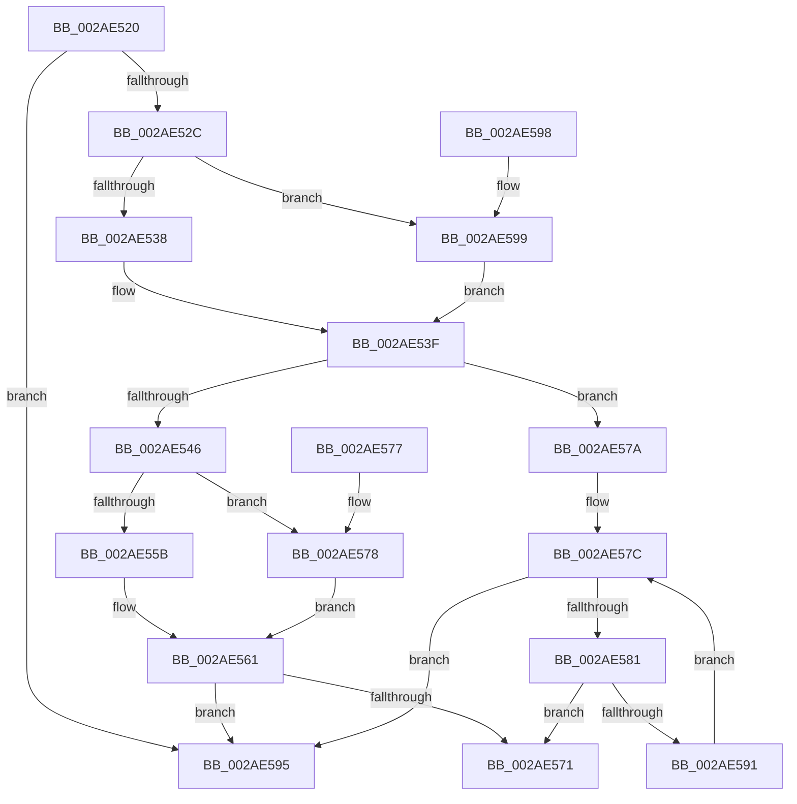

# MiWorkingSetIsContended

- RVA: `0x002AE520`–`0x002AE5A2` (길이 `130` bytes)
- VA: `0x00000001402AE520`
- 실행 섹션: `.text`
- PDB 이름 있음: `예`; PDB Function 태그: `아니요`
- unwind 정보 RVA: `0x000DB714`
- 디코드: `41`개 명령, `130/130` bytes 표시
- 미해석 바이트: `0` (있으면 어셈블리에 `.byte`로 보존)

> 이 문서는 커널 이미지의 기계어와 PDB 기호를 분석해 생성했습니다. 4번과 5번은 함수 원형과 자료형을 바이너리 사용 방식에서 추정한 C 해석이며 원본 소스 복구 결과는 아닙니다.

## 1. Dependencies

- 직접 호출 지점: **0**; 고유 호출 대상: **0**
- 직접 호출자로 확인된 함수: **25**
- RIP 상대 이미지 참조: **1**

### Outgoing calls
- 직접 디코드된 call 명령이 없습니다.

### Direct callers
- [MiInsertViewOfPhysicalSection](MiInsertViewOfPhysicalSection_function_002A57E0.md) at `0x002A5976`
- [NtGetWriteWatch](NtGetWriteWatch_function_002A7CE0.md) at `0x002A80E5`
- [MiMoveDirtyBitsToPfns](MiMoveDirtyBitsToPfns_function_002A8624.md) at `0x002A891B`
- [MiReplaceRotateWithDemandZeroNoCopy](MiReplaceRotateWithDemandZeroNoCopy_function_002AAB04.md) at `0x002AAE35`
- [MiFastTrimWorkingSet](MiFastTrimWorkingSet_function_002AD420.md) at `0x002AD605`
- [MiMapLockedPagesInUserSpaceHelper](MiMapLockedPagesInUserSpaceHelper_function_002ADFE0.md) at `0x002AE162`
- [MiGetWorkingSetInfoList](MiGetWorkingSetInfoList_function_002AF770.md) at `0x002B02CF`
- [MiSharePages](../31/MiSharePages_function_00315110.md) at `0x003160EB`
- [MiGetPageChain](../33/MiGetPageChain_function_00330130.md) at `0x0033076B`
- [MiSoftFaultMappedView](../36/MiSoftFaultMappedView_function_00365364.md) at `0x00365629`
- [MiCommitEnclavePages](../36/MiCommitEnclavePages_function_00367CCC.md) at `0x00367E89`
- [MiAddPagesToEnclave](../36/MiAddPagesToEnclave_function_00367EEC.md) at `0x00368210`
- [MiDecommitHardwareEnclavePages](../36/MiDecommitHardwareEnclavePages_function_003688D4.md) at `0x00368A85`
- [MiMapUserLargePages](../3D/MiMapUserLargePages_function_003D26F4.md) at `0x003D2D15`
- [NtLockVirtualMemory](../40/NtLockVirtualMemory_function_004088A0.md) at `0x00408F85`
- [NtLockVirtualMemory](../40/NtLockVirtualMemory_function_004088A0.md) at `0x004091B4`
- [MiQueryAddressSpan](../45/MiQueryAddressSpan_function_0045CF14.md) at `0x0045D0AE`
- [MiGetPageChainYield](../46/MiGetPageChainYield_function_00466C3C.md) at `0x00466C74`
- [MiUpdatePrivateDemandZeroView](../4C/MiUpdatePrivateDemandZeroView_function_004CCC2C.md) at `0x004CCE69`
- [MiProtectEnclavePages](../4D/MiProtectEnclavePages_function_004D5528.md) at `0x004D57A3`
- [MiVadRangeIsIoSpace](../4D/MiVadRangeIsIoSpace_function_004D5CD4.md) at `0x004D5DF6`
- [NtUnlockVirtualMemory](../4E/NtUnlockVirtualMemory_function_004EE890.md) at `0x004EE9F2`
- [NtUnlockVirtualMemory](../4E/NtUnlockVirtualMemory_function_004EE890.md) at `0x004EEE5D`
- [MiSetGraphicsPtes](../67/MiSetGraphicsPtes_function_00678554.md) at `0x006786C4`
- [MiQueryVaPhysicalContiguity](../68/MiQueryVaPhysicalContiguity_function_006875B8.md) at `0x006878C2`
- [MiMakeVaRangePhysicallyContiguous](../69/MiMakeVaRangePhysicallyContiguous_function_006936E0.md) at `0x006938FF`
- [MiScrubLargeMappedPage](../69/MiScrubLargeMappedPage_function_00693E2C.md) at `0x0069418B`

### Static image references
- `0x002AE538` → RVA `0x00E38840` (`.data`; read)

## 2. Other-region calls and transfers

- 다른 실행 섹션으로 향하는 call: **0**
- 별도 외부 분기/꼬리 이동을 확인하지 못했습니다.

## 3. Assembly (complete function range)

```asm
002AE520  8B 81 B8 00 00 00               mov eax, dword ptr [rcx + 0xb8]
002AE526  24 0F                           and al, 0xf
002AE528  3C 05                           cmp al, 5
002AE52A  77 69                           ja 0x1402ae595
002AE52C  8B 81 B8 00 00 00               mov eax, dword ptr [rcx + 0xb8]
002AE532  24 0F                           and al, 0xf
002AE534  3C 01                           cmp al, 1
002AE536  75 61                           jne 0x1402ae599
002AE538  48 8D 05 01 A3 B8 00            lea rax, [rip + 0xb8a301]
002AE53F  4C 8B 00                        mov r8, qword ptr [rax]
002AE542  85 D2                           test edx, edx
002AE544  75 34                           jne 0x1402ae57a
002AE546  65 48 8B 04 25 20 00 00 00      mov rax, qword ptr gs:[0x20]
002AE54F  48 8B 90 38 88 00 00            mov rdx, qword ptr [rax + 0x8838]
002AE556  48 85 D2                        test rdx, rdx
002AE559  74 1D                           je 0x1402ae578
002AE55B  8B 92 44 01 00 00               mov edx, dword ptr [rdx + 0x144]
002AE561  8B C2                           mov eax, edx
002AE563  48 C1 E0 06                     shl rax, 6
002AE567  42 8B 04 00                     mov eax, dword ptr [rax + r8]
002AE56B  0F BA E0 1E                     bt eax, 0x1e
002AE56F  73 24                           jae 0x1402ae595
002AE571  B8 01 00 00 00                  mov eax, 1
002AE576  C3                              ret
002AE577  CC                              int3
002AE578  EB E7                           jmp 0x1402ae561
002AE57A  33 D2                           xor edx, edx
002AE57C  83 FA 04                        cmp edx, 4
002AE57F  73 14                           jae 0x1402ae595
002AE581  8B C2                           mov eax, edx
002AE583  48 C1 E0 06                     shl rax, 6
002AE587  42 8B 0C 00                     mov ecx, dword ptr [rax + r8]
002AE58B  0F BA E1 1E                     bt ecx, 0x1e
002AE58F  72 E0                           jb 0x1402ae571
002AE591  FF C2                           inc edx
002AE593  EB E7                           jmp 0x1402ae57c
002AE595  33 C0                           xor eax, eax
002AE597  C3                              ret
002AE598  CC                              int3
002AE599  48 8D 81 C0 00 00 00            lea rax, [rcx + 0xc0]
002AE5A0  EB 9D                           jmp 0x1402ae53f
```

## 4. C-style interpretation (structured pseudocode)

```c
__int64 __fastcall MiWorkingSetIsContended(__int64 a1, int a2)
{
    __int64 result;

    result = (unsigned __int8)(((unsigned int)(*(unsigned int *)(a1 + 184))) & (15));
    if (((unsigned __int8)(result)) > 5) goto loc_002AE595;
    result = (unsigned __int8)(((unsigned int)(*(unsigned int *)(a1 + 184))) & (15));
    if (((unsigned __int8)(result)) != 1) goto loc_002AE599;
loc_002AE53F:
    if (a2 != 0) goto loc_002AE57A;
    if (*(unsigned __int64 *)(*(unsigned __int64 *)(gs_base + (0 + 32)) + 34872) == 0) goto loc_002AE578;
loc_002AE561:
    result = ((unsigned int)((unsigned int)((unsigned int)(*(unsigned int *)(*(unsigned __int64 *)(*(unsigned __int64 *)(gs_base + (0 + 32)) + 34872) + 324))))) << (6);
    if (condition_is_above_or_equal) goto loc_002AE595;
loc_002AE571:
    return 1;
loc_002AE578:
    goto loc_002AE561;
loc_002AE57A:
    a2 = 0;
loc_002AE57C:
    if (0 >= 4) goto loc_002AE595;
    result = (0) << (6);
    if (condition_is_below) goto loc_002AE571;
    a2 = (unsigned int)((a2) + 1);
    goto loc_002AE57C;
loc_002AE595:
    result = 0;
    return result;
loc_002AE599:
    goto loc_002AE53F;
}
```

## 5. (Beta) C Style

```c
int64_t MiWorkingSetIsContended(void *Arg1, int32_t Arg2)
{
    uint8_t *arg1 = (uint8_t *)Arg1;

    int64_t result;

    result = (uint8_t)(((uint32_t)(*(uint32_t *)(arg1 + 0xB8))) & (15));
    if (((uint8_t)(result)) > 5) goto loc_002AE595;
    result = (uint8_t)(((uint32_t)(*(uint32_t *)(arg1 + 0xB8))) & (15));
    if (((uint8_t)(result)) != 1) goto loc_002AE599;
loc_002AE53F:
    if (Arg2 != 0) goto loc_002AE57A;
    if (*(uint64_t *)(*(uint64_t *)(gs_base + (0 + 0x20)) + 0x8838) == 0) goto loc_002AE578;
loc_002AE561:
    result = ((uint32_t)((uint32_t)((uint32_t)(*(uint32_t *)(*(uint64_t *)(*(uint64_t *)(gs_base + (0 + 0x20)) + 0x8838) + 0x144))))) << (6);
    if (condition_is_above_or_equal) goto loc_002AE595;
loc_002AE571:
    return 1;
loc_002AE578:
    goto loc_002AE561;
loc_002AE57A:
    Arg2 = 0;
loc_002AE57C:
    if (0 >= 4) goto loc_002AE595;
    result = (0) << (6);
    if (condition_is_below) goto loc_002AE571;
    Arg2 = (uint32_t)((Arg2) + 1);
    goto loc_002AE57C;
loc_002AE595:
    result = 0;
    return result;
loc_002AE599:
    goto loc_002AE53F;
}
```

### 관측된 메모리 오프셋

구조체 형식이 확인되지 않은 접근은 인자 기준의 오프셋으로만 기록했습니다.

| 기준 인자 | 오프셋 표현 | 폭 (bit) | 접근 |
|---|---:|---:|---|
| `Arg1` | `+ 0xB8` | `32` | `R` |
| `Arg1` | `+ 0xC0` | `64` | `R` |

## 6. Execution-region graph

[열기: 2D/3D 그래프와 함수 탐색 컨트롤 패널](../../../control-panel.html?section=text&rva=0x002AE520&view=graph)

- 2D 그래프는 위에서 아래로 흐르고, 3D 그래프는 빈 공간을 드래그해 회전합니다. Shift+드래그는 이동, 휠은 확대·축소, 함수 노드 선택은 대상 보고서 이동입니다.

### Static fallback


