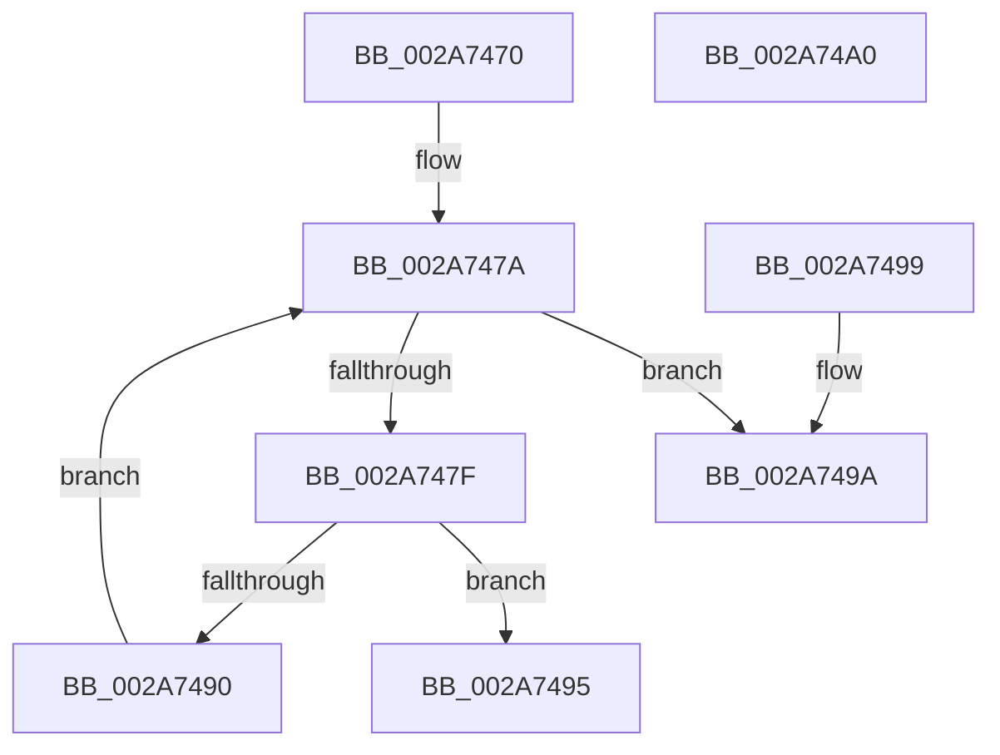

# MiWsSwapPageFileNumber

- RVA: `0x002A7470`–`0x002A74A1` (길이 `49` bytes)
- VA: `0x00000001402A7470`
- 실행 섹션: `.text`
- PDB 이름 있음: `예`; PDB Function 태그: `아니요`
- unwind 정보 RVA: `0x000DB714`
- 디코드: `15`개 명령, `49/49` bytes 표시
- 미해석 바이트: `0` (있으면 어셈블리에 `.byte`로 보존)

> 이 문서는 커널 이미지의 기계어와 PDB 기호를 분석해 생성했습니다. 4번과 5번은 함수 원형과 자료형을 바이너리 사용 방식에서 추정한 C 해석이며 원본 소스 복구 결과는 아닙니다.

## 1. Dependencies

- 직접 호출 지점: **0**; 고유 호출 대상: **0**
- 직접 호출자로 확인된 함수: **3**
- RIP 상대 이미지 참조: **0**

### Outgoing calls
- 직접 디코드된 call 명령이 없습니다.

### Direct callers
- [MiFindBestOutswapPagefile](MiFindBestOutswapPagefile_function_002A73B4.md) at `0x002A73D7`
- [MiContractWsSwapPageFileWorker](../68/MiContractWsSwapPageFileWorker_function_0068B860.md) at `0x0068B87E`
- [MiContractWsSwapPageFile](../../page/A1/MiContractWsSwapPageFile_function_00A182C4.md) at `0x00A182DB`

### Static image references
- 디코드된 RIP-relative 메모리 참조가 없습니다.

## 2. Other-region calls and transfers

- 다른 실행 섹션으로 향하는 call: **0**
- 별도 외부 분기/꼬리 이동을 확인하지 못했습니다.

## 3. Assembly (complete function range)

```asm
002A7470  44 8B 89 58 48 00 00            mov r9d, dword ptr [rcx + 0x4858]
002A7477  45 33 C0                        xor r8d, r8d
002A747A  45 3B C1                        cmp r8d, r9d
002A747D  73 1B                           jae 0x1402a749a
002A747F  4A 8B 94 C1 60 48 00 00         mov rdx, qword ptr [rcx + r8*8 + 0x4860]
002A7487  F6 82 AC 00 00 00 10            test byte ptr [rdx + 0xac], 0x10
002A748E  75 05                           jne 0x1402a7495
002A7490  41 FF C0                        inc r8d
002A7493  EB E5                           jmp 0x1402a747a
002A7495  41 8B C0                        mov eax, r8d
002A7498  C3                              ret
002A7499  CC                              int3
002A749A  B8 10 00 00 00                  mov eax, 0x10
002A749F  C3                              ret
002A74A0  CC                              int3
```

## 4. C-style interpretation (structured pseudocode)

```c
__int64 __fastcall MiWsSwapPageFileNumber(__int64 a1, __int64 a2, int a3)
{
    a3 = 0;
loc_002A747A:
    if (0 >= ((unsigned int)((unsigned int)(*(unsigned int *)(a1 + 18520))))) goto loc_002A749A;
    if (((*(unsigned __int8 *)(*(unsigned __int64 *)(a1 + a3 * 8 + 18528) + 172)) & (16)) != 0) goto loc_002A7495;
    a3 = (unsigned int)((a3) + 1);
    goto loc_002A747A;
loc_002A7495:
    return (unsigned int)(a3);
loc_002A749A:
    return 16;
}
```

## 5. (Beta) C Style

```c
int64_t MiWsSwapPageFileNumber(void *Arg1, int64_t Arg2, int32_t Arg3)
{
    uint8_t *arg1 = (uint8_t *)Arg1;

    Arg3 = 0;
loc_002A747A:
    if (0 >= ((uint32_t)((uint32_t)(*(uint32_t *)(arg1 + 0x4858))))) goto loc_002A749A;
    if (((*(uint8_t *)(*(uint64_t *)(arg1 + Arg3 * 8 + 0x4860) + 0xAC)) & (16)) != 0) goto loc_002A7495;
    Arg3 = (uint32_t)((Arg3) + 1);
    goto loc_002A747A;
loc_002A7495:
    return (uint32_t)(Arg3);
loc_002A749A:
    return 16;
}
```

### 관측된 메모리 오프셋

구조체 형식이 확인되지 않은 접근은 인자 기준의 오프셋으로만 기록했습니다.

| 기준 인자 | 오프셋 표현 | 폭 (bit) | 접근 |
|---|---:|---:|---|
| `Arg1` | `+ 0x4858` | `32` | `R` |
| `Arg1` | `+ 0x4860 + r8*8` | `64` | `R` |

## 6. Execution-region graph

[열기: 2D/3D 그래프와 함수 탐색 컨트롤 패널](../../../control-panel.html?section=text&rva=0x002A7470&view=graph)

- 2D 그래프는 위에서 아래로 흐르고, 3D 그래프는 빈 공간을 드래그해 회전합니다. Shift+드래그는 이동, 휠은 확대·축소, 함수 노드 선택은 대상 보고서 이동입니다.

### Static fallback


