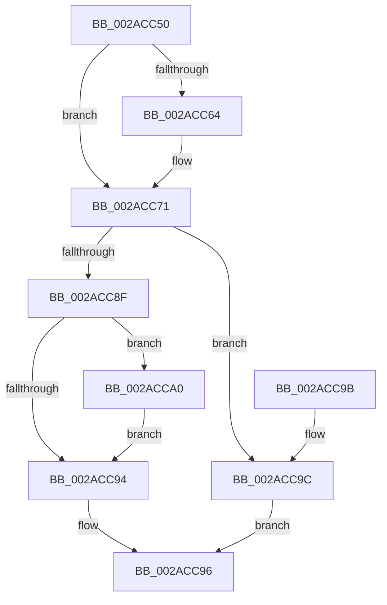

# MmCanFileBeTruncated

- RVA: `0x002ACC50`–`0x002ACCAB` (길이 `91` bytes)
- VA: `0x00000001402ACC50`
- 실행 섹션: `.text`
- PDB 이름 있음: `예`; PDB Function 태그: `아니요`
- unwind 정보 RVA: `0x0006D234`
- 디코드: `27`개 명령, `91/91` bytes 표시
- 미해석 바이트: `0` (있으면 어셈블리에 `.byte`로 보존)

> 이 문서는 커널 이미지의 기계어와 PDB 기호를 분석해 생성했습니다. 4번과 5번은 함수 원형과 자료형을 바이너리 사용 방식에서 추정한 C 해석이며 원본 소스 복구 결과는 아닙니다.

## 1. Dependencies

- 직접 호출 지점: **2**; 고유 호출 대상: **2**
- 직접 호출자로 확인된 함수: **1**
- RIP 상대 이미지 참조: **0**

### Outgoing calls
- `0x002ACC81` → [MiCanFileBeTruncatedInternal](MiCanFileBeTruncatedInternal_function_002ACCB4.md) (function, `0x002ACCB4`)
- `0x002ACCA4` → [MiReleaseSpinLockExclusive](../24/MiReleaseSpinLockExclusive_function_002482C0.md) (function, `0x002482C0`)

### Direct callers
- [CcPurgeCacheSection](../38/CcPurgeCacheSection_function_0038B130.md) at `0x0038B3E7`

### Static image references
- 디코드된 RIP-relative 메모리 참조가 없습니다.

## 2. Other-region calls and transfers

- 다른 실행 섹션으로 향하는 call: **0**
- 별도 외부 분기/꼬리 이동을 확인하지 못했습니다.

## 3. Assembly (complete function range)

```asm
002ACC50  48 83 EC 38                     sub rsp, 0x38
002ACC54  48 83 64 24 48 00               and qword ptr [rsp + 0x48], 0
002ACC5A  C6 44 24 40 00                  mov byte ptr [rsp + 0x40], 0
002ACC5F  48 85 D2                        test rdx, rdx
002ACC62  74 0D                           je 0x1402acc71
002ACC64  48 8B 02                        mov rax, qword ptr [rdx]
002ACC67  48 8D 54 24 48                  lea rdx, [rsp + 0x48]
002ACC6C  48 89 44 24 48                  mov qword ptr [rsp + 0x48], rax
002ACC71  48 8D 44 24 40                  lea rax, [rsp + 0x40]
002ACC76  45 33 C9                        xor r9d, r9d
002ACC79  45 33 C0                        xor r8d, r8d
002ACC7C  48 89 44 24 20                  mov qword ptr [rsp + 0x20], rax
002ACC81  E8 2E 00 00 00                  call 0x1402accb4
002ACC86  8A 54 24 40                     mov dl, byte ptr [rsp + 0x40]
002ACC8A  80 FA 11                        cmp dl, 0x11
002ACC8D  74 0D                           je 0x1402acc9c
002ACC8F  48 85 C0                        test rax, rax
002ACC92  75 0C                           jne 0x1402acca0
002ACC94  B0 01                           mov al, 1
002ACC96  48 83 C4 38                     add rsp, 0x38
002ACC9A  C3                              ret
002ACC9B  CC                              int3
002ACC9C  32 C0                           xor al, al
002ACC9E  EB F6                           jmp 0x1402acc96
002ACCA0  48 8D 48 48                     lea rcx, [rax + 0x48]
002ACCA4  E8 17 B6 F9 FF                  call 0x1402482c0
002ACCA9  EB E9                           jmp 0x1402acc94
```

## 4. C-style interpretation (structured pseudocode)

```c
__int64 __fastcall MmCanFileBeTruncated(__int64 a1, __int64 a2, int a3, int a4)
{
    __int64 result;
    __int64 v_rsp;
    unsigned __int64 v_stack_m18;
    unsigned __int64 v_stack_p10;
    unsigned __int8 v_stack_p8;

    v_rsp = (v_rsp) - (56);
    v_stack_p8 = 0;
    if (a2 != 0) {
        result = *(unsigned __int64 *)(a2);
        a2 = v_stack_p10;
        v_stack_p10 = result;
    }
    a4 = 0;
    a3 = 0;
    v_stack_m18 = v_stack_p8;
    result = MiCanFileBeTruncatedInternal(a1, a2, a3, a4);
    if (((unsigned __int8)(v_stack_p8)) == 17) goto loc_002ACC9C;
    if (result != 0) goto loc_002ACCA0;
loc_002ACC94:
loc_002ACC96:
    v_rsp = (v_rsp) + (56);
    return 1;
loc_002ACC9C:
    result = 0;
    goto loc_002ACC96;
loc_002ACCA0:
    result = MiReleaseSpinLockExclusive(result + 72, v_stack_p8, a3, a4);
    goto loc_002ACC94;
}
```

## 5. (Beta) C Style

```c
int64_t MmCanFileBeTruncated(int64_t Arg1, int64_t Arg2, int32_t Arg3, int32_t Arg4)
{
    int64_t result;
    int64_t local_rsp;
    uint64_t v_stack_m18;
    uint64_t v_stack_p10;
    uint8_t v_stack_p8;

    local_rsp = (local_rsp) - (56);
    v_stack_p8 = 0;
    if (Arg2 != 0) {
        result = *(uint64_t *)(Arg2);
        Arg2 = v_stack_p10;
        v_stack_p10 = result;
    }
    Arg4 = 0;
    Arg3 = 0;
    v_stack_m18 = v_stack_p8;
    result = MiCanFileBeTruncatedInternal(Arg1, Arg2, Arg3, Arg4);
    if (((uint8_t)(v_stack_p8)) == 17) goto loc_002ACC9C;
    if (result != 0) goto loc_002ACCA0;
loc_002ACC94:
loc_002ACC96:
    local_rsp = (local_rsp) + (56);
    return 1;
loc_002ACC9C:
    result = 0;
    goto loc_002ACC96;
loc_002ACCA0:
    result = MiReleaseSpinLockExclusive(result + 72, v_stack_p8, Arg3, Arg4);
    goto loc_002ACC94;
}
```

## 6. Execution-region graph

[열기: 2D/3D 그래프와 함수 탐색 컨트롤 패널](../../../control-panel.html?section=text&rva=0x002ACC50&view=graph)

- 2D 그래프는 위에서 아래로 흐르고, 3D 그래프는 빈 공간을 드래그해 회전합니다. Shift+드래그는 이동, 휠은 확대·축소, 함수 노드 선택은 대상 보고서 이동입니다.

### Static fallback


