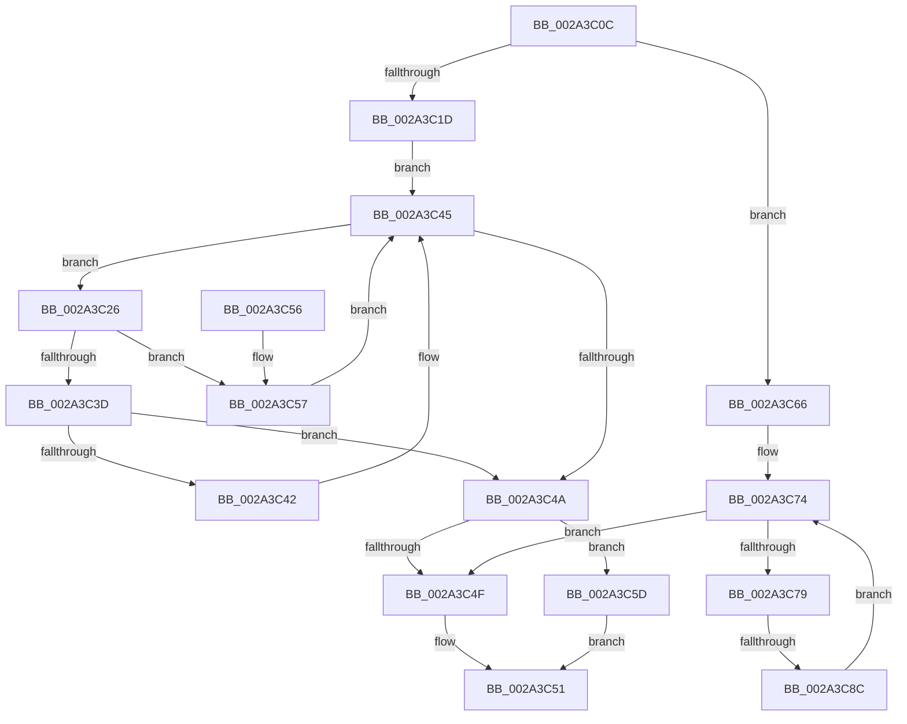

# MmFindDataTableEntryByAddress

- RVA: `0x002A3C0C`–`0x002A3C91` (길이 `133` bytes)
- VA: `0x00000001402A3C0C`
- 실행 섹션: `.text`
- PDB 이름 있음: `예`; PDB Function 태그: `예`
- unwind 정보 RVA: `0x000687E8`
- 디코드: `39`개 명령, `133/133` bytes 표시
- 미해석 바이트: `0` (있으면 어셈블리에 `.byte`로 보존)

> 이 문서는 커널 이미지의 기계어와 PDB 기호를 분석해 생성했습니다. 4번과 5번은 함수 원형과 자료형을 바이너리 사용 방식에서 추정한 C 해석이며 원본 소스 복구 결과는 아닙니다.

## 1. Dependencies

- 직접 호출 지점: **1**; 고유 호출 대상: **1**
- 직접 호출자로 확인된 함수: **14**
- RIP 상대 이미지 참조: **3**

### Outgoing calls
- `0x002A3C7F` → [MiImageContainsVa](../4B/MiImageContainsVa_function_004B1874.md) (function, `0x004B1874`)

### Direct callers
- [MiLockLoadedDataTableEntryIfNecessary](MiLockLoadedDataTableEntryIfNecessary_function_002A38B4.md) at `0x002A38E4`
- [MiLockLoadedDataTableEntry](MiLockLoadedDataTableEntry_function_002A38F4.md) at `0x002A3910`
- [MmUnlockPagableImageSection](MmUnlockPagableImageSection_function_002A39F0.md) at `0x002A3A0E`
- [MiIsDriverPage](MiIsDriverPage_function_002A5514.md) at `0x002A554C`
- [RtlPcToFileName](../3F/RtlPcToFileName_function_003FEBB0.md) at `0x003FEBD0`
- [ViAddVerifierSpecialThunks](../61/ViAddVerifierSpecialThunks_function_0061233C.md) at `0x006123B8`
- [ViAddVerifierThunks](../61/ViAddVerifierThunks_function_0061245C.md) at `0x006124D7`
- [MmGetImageRetpolineCodePage](../68/MmGetImageRetpolineCodePage_function_00682AD0.md) at `0x00682AFD`
- [MiCheckVerifierFunctionsCfgState](../../page/80/MiCheckVerifierFunctionsCfgState_function_0080C918.md) at `0x0080C969`
- [MmMarkImageForHiberPhase](../../pagelk/B7/MmMarkImageForHiberPhase_function_00B748EC.md) at `0x00B74909`
- [MmReapplyBootPatchImports](../../init/C6/MmReapplyBootPatchImports_function_00C67768.md) at `0x00C677BE`
- [MiBuildImportsForBootDrivers](../../init/C6/MiBuildImportsForBootDrivers_function_00C6B2E8.md) at `0x00C6B3E6`
- [PipInitializeCoreDriversAndElam](../../init/C7/PipInitializeCoreDriversAndElam_function_00C73F84.md) at `0x00C73FE1`
- [PipInitializeDriverDependentDLLs](../../init/C7/PipInitializeDriverDependentDLLs_function_00C74398.md) at `0x00C744F4`

### Static image references
- `0x002A3C10` → RVA `0x00EF54C0` (`.data`; read)
- `0x002A3C1D` → RVA `0x00E2D980` (`.data`; read)
- `0x002A3C66` → RVA `0x00FC6B20` (`ALMOSTRO`; read)

## 2. Other-region calls and transfers

- 다른 실행 섹션으로 향하는 call: **0**
- call이 아닌 외부 분기/꼬리 이동: **1**
  - `0x002A3C86` → [sub_006DAE74](../6D/Unknown_function_006DAE74.md) (`tail-transfer`)

## 3. Assembly (complete function range)

```asm
002A3C0C  48 83 EC 28                     sub rsp, 0x28
002A3C10  48 83 3D A8 18 C5 00 00         cmp qword ptr [rip + 0xc518a8], 0
002A3C18  4C 8B C9                        mov r9, rcx
002A3C1B  74 49                           je 0x1402a3c66
002A3C1D  48 8B 15 5C 9D B8 00            mov rdx, qword ptr [rip + 0xb89d5c]
002A3C24  EB 1F                           jmp 0x1402a3c45
002A3C26  8B 8A 70 FF FF FF               mov ecx, dword ptr [rdx - 0x90]
002A3C2C  4C 8B 82 60 FF FF FF            mov r8, qword ptr [rdx - 0xa0]
002A3C33  FF C9                           dec ecx
002A3C35  49 03 C8                        add rcx, r8
002A3C38  4C 3B C9                        cmp r9, rcx
002A3C3B  77 1A                           ja 0x1402a3c57
002A3C3D  4D 3B C8                        cmp r9, r8
002A3C40  73 08                           jae 0x1402a3c4a
002A3C42  48 8B 12                        mov rdx, qword ptr [rdx]
002A3C45  48 85 D2                        test rdx, rdx
002A3C48  75 DC                           jne 0x1402a3c26
002A3C4A  48 85 D2                        test rdx, rdx
002A3C4D  75 0E                           jne 0x1402a3c5d
002A3C4F  33 C0                           xor eax, eax
002A3C51  48 83 C4 28                     add rsp, 0x28
002A3C55  C3                              ret
002A3C56  CC                              int3
002A3C57  48 8B 52 08                     mov rdx, qword ptr [rdx + 8]
002A3C5B  EB E8                           jmp 0x1402a3c45
002A3C5D  48 8D 82 30 FF FF FF            lea rax, [rdx - 0xd0]
002A3C64  EB EB                           jmp 0x1402a3c51
002A3C66  4C 8B 15 B3 2E D2 00            mov r10, qword ptr [rip + 0xd22eb3]
002A3C6D  49 83 C2 10                     add r10, 0x10
002A3C71  4D 8B 02                        mov r8, qword ptr [r10]
002A3C74  4D 3B C2                        cmp r8, r10
002A3C77  74 D6                           je 0x1402a3c4f
002A3C79  49 8B D1                        mov rdx, r9
002A3C7C  49 8B C8                        mov rcx, r8
002A3C7F  E8 F0 DB 20 00                  call 0x1404b1874
002A3C84  85 C0                           test eax, eax
002A3C86  0F 85 E8 71 43 00               jne 0x1406dae74
002A3C8C  4D 8B 00                        mov r8, qword ptr [r8]
002A3C8F  EB E3                           jmp 0x1402a3c74
```

## 4. C-style interpretation (structured pseudocode)

```c
__int64 __fastcall MmFindDataTableEntryByAddress(__int64 a1)
{
    __int64 result;
    __int64 v_r10;
    __int64 v_rsp;

    v_rsp = (v_rsp) - (40);
    if ((*(unsigned __int64 *)(v_rip + 12916904)) == 0) goto loc_002A3C66;
    goto loc_002A3C45;
loc_002A3C26:
    a1 = (unsigned int)(((unsigned int)(*(unsigned int *)(*(unsigned __int64 *)(v_rip + 12098908) - 144))) - 1);
    a1 = (a1) + (*(unsigned __int64 *)(*(unsigned __int64 *)(v_rip + 12098908) - 160));
    if (a1 > a1) goto loc_002A3C57;
    if (a1 >= (*(unsigned __int64 *)(*(unsigned __int64 *)(v_rip + 12098908) - 160))) goto loc_002A3C4A;
loc_002A3C45:
    if (*(unsigned __int64 *)(*(unsigned __int64 *)(v_rip + 12098908)) != 0) goto loc_002A3C26;
loc_002A3C4A:
    if (*(unsigned __int64 *)(*(unsigned __int64 *)(v_rip + 12098908)) != 0) goto loc_002A3C5D;
loc_002A3C4F:
    result = 0;
loc_002A3C51:
    v_rsp = (v_rsp) + (40);
    return result;
loc_002A3C57:
    goto loc_002A3C45;
loc_002A3C5D:
    goto loc_002A3C51;
loc_002A3C66:
    v_r10 = (*(unsigned __int64 *)(v_rip + 13774515)) + (16);
loc_002A3C74:
    if ((*(unsigned __int64 *)(v_r10)) == v_r10) goto loc_002A3C4F;
    result = MiImageContainsVa(*(unsigned __int64 *)(v_r10), a1, *(unsigned __int64 *)(v_r10), a1);
    goto loc_002A3C74;
}
```

## 5. (Beta) C Style

```c
int64_t MmFindDataTableEntryByAddress(int64_t Arg1)
{
    int64_t result;
    int64_t local_r10;
    int64_t local_rsp;

    local_rsp = (local_rsp) - (40);
    if ((*(uint64_t *)(v_rip + 0xC518A8)) == 0) goto loc_002A3C66;
    goto loc_002A3C45;
loc_002A3C26:
    Arg1 = (uint32_t)(((uint32_t)(*(uint32_t *)(*(uint64_t *)(v_rip + 0xB89D5C) - 0x90))) - 1);
    Arg1 = (Arg1) + (*(uint64_t *)(*(uint64_t *)(v_rip + 0xB89D5C) - 0xA0));
    if (Arg1 > Arg1) goto loc_002A3C57;
    if (Arg1 >= (*(uint64_t *)(*(uint64_t *)(v_rip + 0xB89D5C) - 0xA0))) goto loc_002A3C4A;
loc_002A3C45:
    if (*(uint64_t *)(*(uint64_t *)(v_rip + 0xB89D5C)) != 0) goto loc_002A3C26;
loc_002A3C4A:
    if (*(uint64_t *)(*(uint64_t *)(v_rip + 0xB89D5C)) != 0) goto loc_002A3C5D;
loc_002A3C4F:
    result = 0;
loc_002A3C51:
    local_rsp = (local_rsp) + (40);
    return result;
loc_002A3C57:
    goto loc_002A3C45;
loc_002A3C5D:
    goto loc_002A3C51;
loc_002A3C66:
    local_r10 = (*(uint64_t *)(v_rip + 0xD22EB3)) + (16);
loc_002A3C74:
    if ((*(uint64_t *)(local_r10)) == local_r10) goto loc_002A3C4F;
    result = MiImageContainsVa(*(uint64_t *)(local_r10), Arg1, *(uint64_t *)(local_r10), Arg1);
    goto loc_002A3C74;
}
```

## 6. Execution-region graph

[열기: 2D/3D 그래프와 함수 탐색 컨트롤 패널](../../../control-panel.html?section=text&rva=0x002A3C0C&view=graph)

- 2D 그래프는 위에서 아래로 흐르고, 3D 그래프는 빈 공간을 드래그해 회전합니다. Shift+드래그는 이동, 휠은 확대·축소, 함수 노드 선택은 대상 보고서 이동입니다.

### Static fallback


