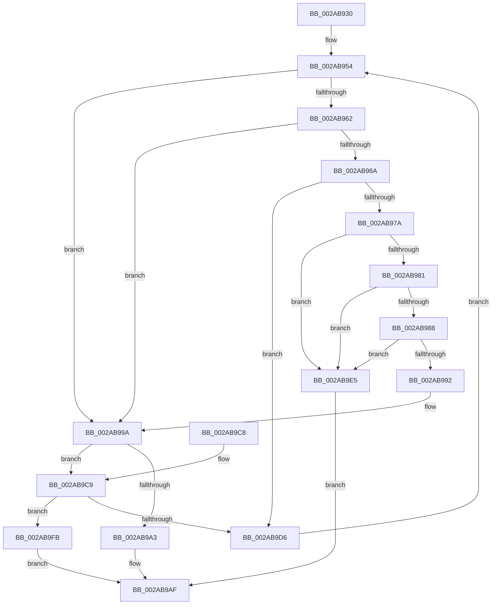

# MmFlushImageSection

- RVA: `0x002AB930`–`0x002ABA12` (길이 `226` bytes)
- VA: `0x00000001402AB930`
- 실행 섹션: `.text`
- PDB 이름 있음: `예`; PDB Function 태그: `아니요`
- unwind 정보 RVA: `0x0006D09C`
- 디코드: `71`개 명령, `226/226` bytes 표시
- 미해석 바이트: `0` (있으면 어셈블리에 `.byte`로 보존)

> 이 문서는 커널 이미지의 기계어와 PDB 기호를 분석해 생성했습니다. 4번과 5번은 함수 원형과 자료형을 바이너리 사용 방식에서 추정한 C 해석이며 원본 소스 복구 결과는 아닙니다.

## 1. Dependencies

- 직접 호출 지점: **10**; 고유 호출 대상: **5**
- 직접 호출자로 확인된 함수: **0**
- RIP 상대 이미지 참조: **1**

### Outgoing calls
- `0x002AB957` → [ExAcquireSpinLockExclusive](../24/ExAcquireSpinLockExclusive_function_00248690.md) (function, `0x00248690`)
- `0x002AB971` → [ExTryAcquireSpinLockExclusiveAtDpcLevel](../2B/ExTryAcquireSpinLockExclusiveAtDpcLevel_function_002BB800.md) (function, `0x002BB800`)
- `0x002AB995` → [ExReleaseSpinLockExclusiveFromDpcLevel](../24/ExReleaseSpinLockExclusiveFromDpcLevel_function_002497E0.md) (function, `0x002497E0`)
- `0x002AB9A8` → [MiReleaseSpinLockExclusive](../24/MiReleaseSpinLockExclusive_function_002482C0.md) (function, `0x002482C0`)
- `0x002AB9CD` → [ExTryAcquireSpinLockExclusiveAtDpcLevel](../2B/ExTryAcquireSpinLockExclusiveAtDpcLevel_function_002BB800.md) (function, `0x002BB800`)
- `0x002AB9DB` → [MiReleaseSpinLockExclusive](../24/MiReleaseSpinLockExclusive_function_002482C0.md) (function, `0x002482C0`)
- `0x002AB9E8` → [ExReleaseSpinLockExclusiveFromDpcLevel](../24/ExReleaseSpinLockExclusiveFromDpcLevel_function_002497E0.md) (function, `0x002497E0`)
- `0x002AB9F2` → [MiReleaseSpinLockExclusive](../24/MiReleaseSpinLockExclusive_function_002482C0.md) (function, `0x002482C0`)
- `0x002AB9FE` → [ExReleaseSpinLockExclusiveFromDpcLevel](../24/ExReleaseSpinLockExclusiveFromDpcLevel_function_002497E0.md) (function, `0x002497E0`)
- `0x002ABA0B` → [MiAttemptSectionDelete](MiAttemptSectionDelete_function_002AD044.md) (function, `0x002AD044`)

### Direct callers
- 이 함수 시작 RVA로 연결되는 직접 call은 확인되지 않았습니다. 간접 호출은 완전히 역산할 수 없습니다.

### Static image references
- `0x002AB94A` → RVA `0x00E2CD00` (`.data`; read)

## 2. Other-region calls and transfers

- 다른 실행 섹션으로 향하는 call: **0**
- 별도 외부 분기/꼬리 이동을 확인하지 못했습니다.

## 3. Assembly (complete function range)

```asm
002AB930  48 89 5C 24 08                  mov qword ptr [rsp + 8], rbx
002AB935  48 89 6C 24 10                  mov qword ptr [rsp + 0x10], rbp
002AB93A  48 89 74 24 18                  mov qword ptr [rsp + 0x18], rsi
002AB93F  57                              push rdi
002AB940  41 56                           push r14
002AB942  41 57                           push r15
002AB944  48 83 EC 20                     sub rsp, 0x20
002AB948  8B EA                           mov ebp, edx
002AB94A  4C 8D 3D AF 13 B8 00            lea r15, [rip + 0xb813af]
002AB951  4C 8B F1                        mov r14, rcx
002AB954  49 8B CF                        mov rcx, r15
002AB957  E8 34 CD F9 FF                  call 0x140248690
002AB95C  8A D8                           mov bl, al
002AB95E  85 ED                           test ebp, ebp
002AB960  75 38                           jne 0x1402ab99a
002AB962  49 8B 3E                        mov rdi, qword ptr [r14]
002AB965  48 85 FF                        test rdi, rdi
002AB968  74 30                           je 0x1402ab99a
002AB96A  48 8D 77 48                     lea rsi, [rdi + 0x48]
002AB96E  48 8B CE                        mov rcx, rsi
002AB971  E8 8A FE 00 00                  call 0x1402bb800
002AB976  85 C0                           test eax, eax
002AB978  74 5C                           je 0x1402ab9d6
002AB97A  48 83 7F 30 00                  cmp qword ptr [rdi + 0x30], 0
002AB97F  75 64                           jne 0x1402ab9e5
002AB981  8B 47 38                        mov eax, dword ptr [rdi + 0x38]
002AB984  A8 02                           test al, 2
002AB986  75 5D                           jne 0x1402ab9e5
002AB988  48 8B 47 70                     mov rax, qword ptr [rdi + 0x70]
002AB98C  48 83 F8 01                     cmp rax, 1
002AB990  77 53                           ja 0x1402ab9e5
002AB992  48 8B CE                        mov rcx, rsi
002AB995  E8 46 DE F9 FF                  call 0x1402497e0
002AB99A  49 8B 7E 10                     mov rdi, qword ptr [r14 + 0x10]
002AB99E  48 85 FF                        test rdi, rdi
002AB9A1  75 26                           jne 0x1402ab9c9
002AB9A3  8A D3                           mov dl, bl
002AB9A5  49 8B CF                        mov rcx, r15
002AB9A8  E8 13 C9 F9 FF                  call 0x1402482c0
002AB9AD  B0 01                           mov al, 1
002AB9AF  48 8B 5C 24 40                  mov rbx, qword ptr [rsp + 0x40]
002AB9B4  48 8B 6C 24 48                  mov rbp, qword ptr [rsp + 0x48]
002AB9B9  48 8B 74 24 50                  mov rsi, qword ptr [rsp + 0x50]
002AB9BE  48 83 C4 20                     add rsp, 0x20
002AB9C2  41 5F                           pop r15
002AB9C4  41 5E                           pop r14
002AB9C6  5F                              pop rdi
002AB9C7  C3                              ret
002AB9C8  CC                              int3
002AB9C9  48 8D 4F 48                     lea rcx, [rdi + 0x48]
002AB9CD  E8 2E FE 00 00                  call 0x1402bb800
002AB9D2  85 C0                           test eax, eax
002AB9D4  75 25                           jne 0x1402ab9fb
002AB9D6  8A D3                           mov dl, bl
002AB9D8  49 8B CF                        mov rcx, r15
002AB9DB  E8 E0 C8 F9 FF                  call 0x1402482c0
002AB9E0  E9 6F FF FF FF                  jmp 0x1402ab954
002AB9E5  49 8B CF                        mov rcx, r15
002AB9E8  E8 F3 DD F9 FF                  call 0x1402497e0
002AB9ED  8A D3                           mov dl, bl
002AB9EF  48 8B CE                        mov rcx, rsi
002AB9F2  E8 C9 C8 F9 FF                  call 0x1402482c0
002AB9F7  32 C0                           xor al, al
002AB9F9  EB B4                           jmp 0x1402ab9af
002AB9FB  49 8B CF                        mov rcx, r15
002AB9FE  E8 DD DD F9 FF                  call 0x1402497e0
002ABA03  45 33 C0                        xor r8d, r8d
002ABA06  8A D3                           mov dl, bl
002ABA08  48 8B CF                        mov rcx, rdi
002ABA0B  E8 34 16 00 00                  call 0x1402ad044
002ABA10  EB 9D                           jmp 0x1402ab9af
```

## 4. C-style interpretation (structured pseudocode)

```c
__int64 __fastcall MmFlushImageSection(__int64 a1, int a2, int a3)
{
    __int64 result;
    __int64 v_rsp;
    unsigned __int64 v_stack_p10;
    unsigned __int64 v_stack_p18;
    unsigned __int64 v_stack_p8;

    v_stack_p8 = v_rbx;
    v_stack_p10 = v_rbp;
    v_stack_p18 = v_rsi;
    v_rsp = (v_rsp) - (32);
loc_002AB954:
    result = ExAcquireSpinLockExclusive(v_rip + 12063663, a2, a3, a4);
    if ((unsigned int)((unsigned int)(a2)) != 0) goto loc_002AB99A;
    if (*(unsigned __int64 *)(a1) == 0) goto loc_002AB99A;
    result = ExTryAcquireSpinLockExclusiveAtDpcLevel(*(unsigned __int64 *)(a1) + 72, a2, a3, a4);
    if ((unsigned int)(result) == 0) goto loc_002AB9D6;
    if ((*(unsigned __int64 *)(*(unsigned __int64 *)(a1) + 48)) != 0) goto loc_002AB9E5;
    if ((((unsigned __int8)((unsigned int)(*(unsigned int *)(*(unsigned __int64 *)(a1) + 56)))) & (2)) != 0) goto loc_002AB9E5;
    if ((*(unsigned __int64 *)(*(unsigned __int64 *)(a1) + 112)) > 1) goto loc_002AB9E5;
    result = ExReleaseSpinLockExclusiveFromDpcLevel(*(unsigned __int64 *)(a1) + 72, a2, a3, a4);
loc_002AB99A:
    if (*(unsigned __int64 *)(a1 + 16) != 0) goto loc_002AB9C9;
    result = MiReleaseSpinLockExclusive(v_rip + 12063663, (unsigned __int8)((unsigned __int8)(result)), a3, a4);
loc_002AB9AF:
    v_rsp = (v_rsp) + (32);
    return 1;
loc_002AB9C9:
    result = ExTryAcquireSpinLockExclusiveAtDpcLevel(*(unsigned __int64 *)(a1 + 16) + 72, (unsigned __int8)((unsigned __int8)(result)), a3, a4);
    if ((unsigned int)(result) != 0) goto loc_002AB9FB;
loc_002AB9D6:
    result = MiReleaseSpinLockExclusive(v_rip + 12063663, (unsigned __int8)(v_stack_p8), a3, a4);
    goto loc_002AB954;
loc_002AB9E5:
    result = ExReleaseSpinLockExclusiveFromDpcLevel(v_rip + 12063663, (unsigned __int8)(v_stack_p8), a3, a4);
    result = MiReleaseSpinLockExclusive(v_stack_p18, (unsigned __int8)(v_stack_p8), a3, a4);
    result = 0;
    goto loc_002AB9AF;
loc_002AB9FB:
    result = ExReleaseSpinLockExclusiveFromDpcLevel(v_rip + 12063663, (unsigned __int8)(v_stack_p8), a3, a4);
    a3 = 0;
    result = MiAttemptSectionDelete(*(unsigned __int64 *)(a1 + 16), (unsigned __int8)(v_stack_p8), a3, a4);
    goto loc_002AB9AF;
}
```

## 5. (Beta) C Style

```c
int64_t MmFlushImageSection(void *Arg1, int32_t Arg2, int32_t Arg3)
{
    uint8_t *arg1 = (uint8_t *)Arg1;

    int64_t result;
    int64_t local_rsp;
    uint64_t v_stack_p10;
    uint64_t v_stack_p18;
    uint64_t v_stack_p8;

    v_stack_p8 = local_rbx;
    v_stack_p10 = local_rbp;
    v_stack_p18 = local_rsi;
    local_rsp = (local_rsp) - (32);
loc_002AB954:
    result = ExAcquireSpinLockExclusive(v_rip + 12063663, Arg2, Arg3, a4);
    if ((uint32_t)((uint32_t)(Arg2)) != 0) goto loc_002AB99A;
    if (*(uint64_t *)(arg1) == 0) goto loc_002AB99A;
    result = ExTryAcquireSpinLockExclusiveAtDpcLevel(*(uint64_t *)(arg1) + 72, Arg2, Arg3, a4);
    if ((uint32_t)(result) == 0) goto loc_002AB9D6;
    if ((*(uint64_t *)(*(uint64_t *)(arg1) + 0x30)) != 0) goto loc_002AB9E5;
    if ((((uint8_t)((uint32_t)(*(uint32_t *)(*(uint64_t *)(arg1) + 0x38)))) & (2)) != 0) goto loc_002AB9E5;
    if ((*(uint64_t *)(*(uint64_t *)(arg1) + 0x70)) > 1) goto loc_002AB9E5;
    result = ExReleaseSpinLockExclusiveFromDpcLevel(*(uint64_t *)(arg1) + 72, Arg2, Arg3, a4);
loc_002AB99A:
    if (*(uint64_t *)(arg1 + 0x10) != 0) goto loc_002AB9C9;
    result = MiReleaseSpinLockExclusive(v_rip + 12063663, (uint8_t)((uint8_t)(result)), Arg3, a4);
loc_002AB9AF:
    local_rsp = (local_rsp) + (32);
    return 1;
loc_002AB9C9:
    result = ExTryAcquireSpinLockExclusiveAtDpcLevel(*(uint64_t *)(arg1 + 0x10) + 72, (uint8_t)((uint8_t)(result)), Arg3, a4);
    if ((uint32_t)(result) != 0) goto loc_002AB9FB;
loc_002AB9D6:
    result = MiReleaseSpinLockExclusive(v_rip + 12063663, (uint8_t)(v_stack_p8), Arg3, a4);
    goto loc_002AB954;
loc_002AB9E5:
    result = ExReleaseSpinLockExclusiveFromDpcLevel(v_rip + 12063663, (uint8_t)(v_stack_p8), Arg3, a4);
    result = MiReleaseSpinLockExclusive(v_stack_p18, (uint8_t)(v_stack_p8), Arg3, a4);
    result = 0;
    goto loc_002AB9AF;
loc_002AB9FB:
    result = ExReleaseSpinLockExclusiveFromDpcLevel(v_rip + 12063663, (uint8_t)(v_stack_p8), Arg3, a4);
    Arg3 = 0;
    result = MiAttemptSectionDelete(*(uint64_t *)(arg1 + 0x10), (uint8_t)(v_stack_p8), Arg3, a4);
    goto loc_002AB9AF;
}
```

### 관측된 메모리 오프셋

구조체 형식이 확인되지 않은 접근은 인자 기준의 오프셋으로만 기록했습니다.

| 기준 인자 | 오프셋 표현 | 폭 (bit) | 접근 |
|---|---:|---:|---|
| `Arg1` | `+ 0x0` | `64` | `R` |
| `Arg1` | `+ 0x10` | `64` | `R` |

## 6. Execution-region graph

[열기: 2D/3D 그래프와 함수 탐색 컨트롤 패널](../../../control-panel.html?section=text&rva=0x002AB930&view=graph)

- 2D 그래프는 위에서 아래로 흐르고, 3D 그래프는 빈 공간을 드래그해 회전합니다. Shift+드래그는 이동, 휠은 확대·축소, 함수 노드 선택은 대상 보고서 이동입니다.

### Static fallback


