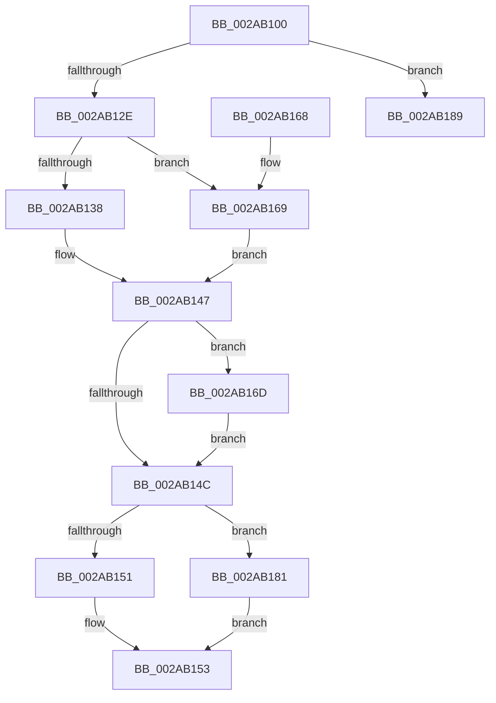

# MmForceSectionClosedEx

- RVA: `0x002AB100`–`0x002AB1A4` (길이 `164` bytes)
- VA: `0x00000001402AB100`
- 실행 섹션: `.text`
- PDB 이름 있음: `예`; PDB Function 태그: `아니요`
- unwind 정보 RVA: `0x0006D040`
- 디코드: `52`개 명령, `164/164` bytes 표시
- 미해석 바이트: `0` (있으면 어셈블리에 `.byte`로 보존)

> 이 문서는 커널 이미지의 기계어와 PDB 기호를 분석해 생성했습니다. 4번과 5번은 함수 원형과 자료형을 바이너리 사용 방식에서 추정한 C 해석이며 원본 소스 복구 결과는 아닙니다.

## 1. Dependencies

- 직접 호출 지점: **3**; 고유 호출 대상: **2**
- 직접 호출자로 확인된 함수: **0**
- RIP 상대 이미지 참조: **0**

### Outgoing calls
- `0x002AB140` → [MiForceSectionClosed](MiForceSectionClosed_function_002ACFD4.md) (function, `0x002ACFD4`)
- `0x002AB178` → [MiForceSectionClosed](MiForceSectionClosed_function_002ACFD4.md) (function, `0x002ACFD4`)
- `0x002AB19E` → [KeBugCheckEx](../4F/KeBugCheckEx_function_004FD660.md) (function, `0x004FD660`)

### Direct callers
- 이 함수 시작 RVA로 연결되는 직접 call은 확인되지 않았습니다. 간접 호출은 완전히 역산할 수 없습니다.

### Static image references
- 디코드된 RIP-relative 메모리 참조가 없습니다.

## 2. Other-region calls and transfers

- 다른 실행 섹션으로 향하는 call: **0**
- 별도 외부 분기/꼬리 이동을 확인하지 못했습니다.

## 3. Assembly (complete function range)

```asm
002AB100  48 89 5C 24 08                  mov qword ptr [rsp + 8], rbx
002AB105  48 89 6C 24 10                  mov qword ptr [rsp + 0x10], rbp
002AB10A  48 89 74 24 18                  mov qword ptr [rsp + 0x18], rsi
002AB10F  57                              push rdi
002AB110  48 83 EC 30                     sub rsp, 0x30
002AB114  F7 C2 F8 FF FF FF               test edx, 0xfffffff8
002AB11A  8B DA                           mov ebx, edx
002AB11C  48 8B E9                        mov rbp, rcx
002AB11F  41 0F 94 C0                     sete r8b
002AB123  F6 C2 03                        test dl, 3
002AB126  0F 95 C0                        setne al
002AB129  44 84 C0                        test al, r8b
002AB12C  74 5B                           je 0x1402ab189
002AB12E  BF 01 00 00 00                  mov edi, 1
002AB133  40 84 DF                        test dil, bl
002AB136  74 31                           je 0x1402ab169
002AB138  8B D3                           mov edx, ebx
002AB13A  45 33 C0                        xor r8d, r8d
002AB13D  83 E2 FD                        and edx, 0xfffffffd
002AB140  E8 8F 1E 00 00                  call 0x1402acfd4
002AB145  8B F0                           mov esi, eax
002AB147  F6 C3 02                        test bl, 2
002AB14A  75 21                           jne 0x1402ab16d
002AB14C  83 FE 02                        cmp esi, 2
002AB14F  75 30                           jne 0x1402ab181
002AB151  32 C0                           xor al, al
002AB153  48 8B 5C 24 40                  mov rbx, qword ptr [rsp + 0x40]
002AB158  48 8B 6C 24 48                  mov rbp, qword ptr [rsp + 0x48]
002AB15D  48 8B 74 24 50                  mov rsi, qword ptr [rsp + 0x50]
002AB162  48 83 C4 30                     add rsp, 0x30
002AB166  5F                              pop rdi
002AB167  C3                              ret
002AB168  CC                              int3
002AB169  8B F7                           mov esi, edi
002AB16B  EB DA                           jmp 0x1402ab147
002AB16D  83 E3 FE                        and ebx, 0xfffffffe
002AB170  45 33 C0                        xor r8d, r8d
002AB173  8B D3                           mov edx, ebx
002AB175  48 8B CD                        mov rcx, rbp
002AB178  E8 57 1E 00 00                  call 0x1402acfd4
002AB17D  8B F8                           mov edi, eax
002AB17F  EB CB                           jmp 0x1402ab14c
002AB181  83 FF 02                        cmp edi, 2
002AB184  0F 95 C0                        setne al
002AB187  EB CA                           jmp 0x1402ab153
002AB189  48 83 64 24 20 00               and qword ptr [rsp + 0x20], 0
002AB18F  45 33 C9                        xor r9d, r9d
002AB192  4C 8B C3                        mov r8, rbx
002AB195  BA 00 30 04 00                  mov edx, 0x43000
002AB19A  41 8D 49 1A                     lea ecx, [r9 + 0x1a]
002AB19E  E8 BD 24 25 00                  call 0x1404fd660
002AB1A3  CC                              int3
```

## 4. C-style interpretation (structured pseudocode)

```c
__int64 __fastcall MmForceSectionClosedEx(__int64 a1, int a2, __int64 a3, int a4)
{
    __int64 result;
    __int64 v_rbx;
    __int64 v_rsp;
    unsigned __int64 v_stack_p10;
    unsigned __int64 v_stack_p18;
    unsigned __int64 v_stack_p20;
    unsigned __int64 v_stack_p8;

    v_stack_p8 = v_rbx;
    v_stack_p10 = v_rbp;
    v_stack_p18 = v_rsi;
    v_rsp = (v_rsp) - (48);
    a3 = (((a2) & (0xFFFFFFF8ULL)) == 0) ? 1 : 0;
    result = ((((unsigned __int8)(a2)) & (3)) != 0) ? 1 : 0;
    if ((((unsigned __int8)(result)) & ((unsigned __int8)(a3))) == 0) goto loc_002AB189;
    if (((1) & ((unsigned __int8)((unsigned int)(a2)))) == 0) goto loc_002AB169;
    a3 = 0;
    a2 = (unsigned int)(((unsigned int)((unsigned int)((unsigned int)(a2)))) & (0xFFFFFFFDULL));
    result = MiForceSectionClosed(a1, a2, a3, a4);
loc_002AB147:
    if ((((unsigned __int8)((unsigned int)(a2))) & (2)) != 0) goto loc_002AB16D;
loc_002AB14C:
    if (((unsigned int)((unsigned int)((unsigned int)(result)))) != 2) goto loc_002AB181;
    result = 0;
loc_002AB153:
    v_rsp = (v_rsp) + (48);
    return result;
loc_002AB169:
    goto loc_002AB147;
loc_002AB16D:
    v_rbx = (unsigned int)((v_stack_p8) & (0xFFFFFFFEULL));
    a3 = 0;
    result = MiForceSectionClosed(v_stack_p10, (unsigned int)((unsigned int)(v_rbx)), a3, a4);
    goto loc_002AB14C;
loc_002AB181:
    result = (((unsigned int)((unsigned int)((unsigned int)(result)))) != 2) ? 1 : 0;
    goto loc_002AB153;
loc_002AB189:
    a4 = 0;
    result = KeBugCheckEx(a4 + 26, (unsigned int)(0x43000ULL), v_rbx, a4);
    return result;
}
```

## 5. (Beta) C Style

```c
int64_t MmForceSectionClosedEx(int64_t Arg1, int32_t Arg2, int64_t Arg3, int32_t Arg4)
{
    int64_t result;
    int64_t local_rbx;
    int64_t local_rsp;
    uint64_t v_stack_p10;
    uint64_t v_stack_p18;
    uint64_t v_stack_p20;
    uint64_t v_stack_p8;

    v_stack_p8 = local_rbx;
    v_stack_p10 = local_rbp;
    v_stack_p18 = local_rsi;
    local_rsp = (local_rsp) - (48);
    Arg3 = (((Arg2) & (0xFFFFFFF8ULL)) == 0) ? 1 : 0;
    result = ((((uint8_t)(Arg2)) & (3)) != 0) ? 1 : 0;
    if ((((uint8_t)(result)) & ((uint8_t)(Arg3))) == 0) goto loc_002AB189;
    if (((1) & ((uint8_t)((uint32_t)(Arg2)))) == 0) goto loc_002AB169;
    Arg3 = 0;
    Arg2 = (uint32_t)(((uint32_t)((uint32_t)((uint32_t)(Arg2)))) & (0xFFFFFFFDULL));
    result = MiForceSectionClosed(Arg1, Arg2, Arg3, Arg4);
loc_002AB147:
    if ((((uint8_t)((uint32_t)(Arg2))) & (2)) != 0) goto loc_002AB16D;
loc_002AB14C:
    if (((uint32_t)((uint32_t)((uint32_t)(result)))) != 2) goto loc_002AB181;
    result = 0;
loc_002AB153:
    local_rsp = (local_rsp) + (48);
    return result;
loc_002AB169:
    goto loc_002AB147;
loc_002AB16D:
    local_rbx = (uint32_t)((v_stack_p8) & (0xFFFFFFFEULL));
    Arg3 = 0;
    result = MiForceSectionClosed(v_stack_p10, (uint32_t)((uint32_t)(local_rbx)), Arg3, Arg4);
    goto loc_002AB14C;
loc_002AB181:
    result = (((uint32_t)((uint32_t)((uint32_t)(result)))) != 2) ? 1 : 0;
    goto loc_002AB153;
loc_002AB189:
    Arg4 = 0;
    result = KeBugCheckEx(Arg4 + 26, (uint32_t)(0x43000ULL), local_rbx, Arg4);
    return result;
}
```

## 6. Execution-region graph

[열기: 2D/3D 그래프와 함수 탐색 컨트롤 패널](../../../control-panel.html?section=text&rva=0x002AB100&view=graph)

- 2D 그래프는 위에서 아래로 흐르고, 3D 그래프는 빈 공간을 드래그해 회전합니다. Shift+드래그는 이동, 휠은 확대·축소, 함수 노드 선택은 대상 보고서 이동입니다.

### Static fallback


