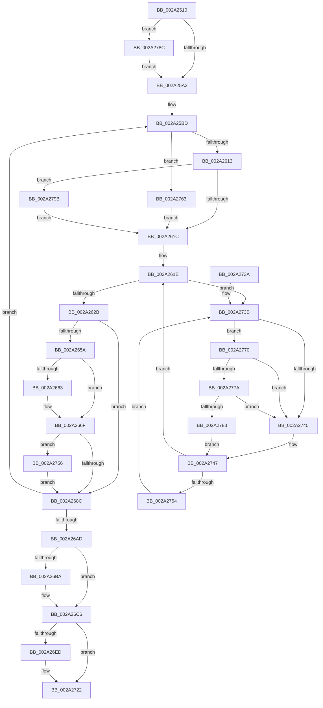

# MmFreeIndependentPages

- RVA: `0x002A2510`–`0x002A27A4` (길이 `660` bytes)
- VA: `0x00000001402A2510`
- 실행 섹션: `.text`
- PDB 이름 있음: `예`; PDB Function 태그: `아니요`
- unwind 정보 RVA: `0x000685A8`
- 디코드: `162`개 명령, `660/660` bytes 표시
- 미해석 바이트: `0` (있으면 어셈블리에 `.byte`로 보존)

> 이 문서는 커널 이미지의 기계어와 PDB 기호를 분석해 생성했습니다. 4번과 5번은 함수 원형과 자료형을 바이너리 사용 방식에서 추정한 C 해석이며 원본 소스 복구 결과는 아닙니다.

## 1. Dependencies

- 직접 호출 지점: **13**; 고유 호출 대상: **11**
- 직접 호출자로 확인된 함수: **14**
- RIP 상대 이미지 참조: **8**

### Outgoing calls
- `0x002A25F7` → [MiIsPfnFromChargedSlabAllocation](MiIsPfnFromChargedSlabAllocation_function_002A2968.md) (function, `0x002A2968`)
- `0x002A2606` → [MiLockAndDecrementShareCount](MiLockAndDecrementShareCount_function_002A2854.md) (function, `0x002A2854`)
- `0x002A2630` → [MiDecrementShareCountEx](../33/MiDecrementShareCountEx_function_00333F70.md) (function, `0x00333F70`)
- `0x002A263D` → [MiDecreaseUsedPtesInPfn](MiDecreaseUsedPtesInPfn_function_002A27AC.md) (function, `0x002A27AC`)
- `0x002A266A` → [KiLowerIrqlProcessIrqlFlags](../4F/KiLowerIrqlProcessIrqlFlags_function_004F5698.md) (function, `0x004F5698`)
- `0x002A26C1` → [KiLowerIrqlProcessIrqlFlags](../4F/KiLowerIrqlProcessIrqlFlags_function_004F5698.md) (function, `0x004F5698`)
- `0x002A26DC` → [MiReleasePtes](../24/MiReleasePtes_function_00247240.md) (function, `0x00247240`)
- `0x002A2702` → [MiReturnCommit](../24/MiReturnCommit_function_00248410.md) (function, `0x00248410`)
- `0x002A2712` → [MiReturnResident](../28/MiReturnResident_function_00286890.md) (function, `0x00286890`)
- `0x002A2759` → [KiRaiseIrqlProcessIrqlFlags](../4F/KiRaiseIrqlProcessIrqlFlags_function_004F56FC.md) (function, `0x004F56FC`)
- `0x002A277A` → [KiCheckVpBackingLongSpinWaitHypercall](../30/KiCheckVpBackingLongSpinWaitHypercall_function_0030F490.md) (function, `0x0030F490`)
- `0x002A2785` → [HvlNotifyLongSpinWait](../30/HvlNotifyLongSpinWait_function_0030F460.md) (function, `0x0030F460`)
- `0x002A2791` → [KiRaiseIrqlProcessIrqlFlags](../4F/KiRaiseIrqlProcessIrqlFlags_function_004F56FC.md) (function, `0x004F56FC`)

### Direct callers
- [IopLiveDumpFreeDumpBuffers](../3F/IopLiveDumpFreeDumpBuffers_function_003F5FE8.md) at `0x003F61A2`
- [IopLiveDumpWriteDumpFile](../3F/IopLiveDumpWriteDumpFile_function_003F6360.md) at `0x003F64CF`
- [HvlStartBootLogicalProcessors](../58/HvlStartBootLogicalProcessors_function_00584E18.md) at `0x005851B1`
- [HvlStartBootLogicalProcessors](../58/HvlStartBootLogicalProcessors_function_00584E18.md) at `0x005851CB`
- [HvlpInitializeHvCrashdump](../58/HvlpInitializeHvCrashdump_function_0058BCCC.md) at `0x0058BFED`
- [IopLiveDumpReleaseResources](../59/IopLiveDumpReleaseResources_function_0059DF1C.md) at `0x0059E029`
- [IopLiveDumpReleaseResources](../59/IopLiveDumpReleaseResources_function_0059DF1C.md) at `0x0059E047`
- [IopLiveDumpReleaseResources](../59/IopLiveDumpReleaseResources_function_0059DF1C.md) at `0x0059E065`
- [IopLiveDumpWriteDumpFileWithExtraPages](../59/IopLiveDumpWriteDumpFileWithExtraPages_function_0059F910.md) at `0x0059FD42`
- [KeAllocateProcessorProfileStructures](../5B/KeAllocateProcessorProfileStructures_function_005B14B0.md) at `0x005B166A`
- [KiFreeProcessorStacks](../5B/KiFreeProcessorStacks_function_005B7F84.md) at `0x005B8056`
- [KiFreeProcessorStateInitializationParameters](../5B/KiFreeProcessorStateInitializationParameters_function_005B80A8.md) at `0x005B8102`
- [ExDeletePoolTagTable](../65/ExDeletePoolTagTable_function_00655F88.md) at `0x00656003`
- [HvlDeleteProcessor](../../page/71/HvlDeleteProcessor_function_00717FA4.md) at `0x00718039`
- [MmAllocateIsrStack](../../page/80/MmAllocateIsrStack_function_00807ECC.md) at `0x00807F82`
- [MmFreeIsrStack](../../page/80/MmFreeIsrStack_function_00807FC0.md) at `0x00807FE3`
- [HvpFreeBin](../../page/A8/HvpFreeBin_function_00A8158C.md) at `0x00A815DE`

### Static image references
- `0x002A2596` → RVA `0x00FC6D20` (`ALMOSTRO`; read)
- `0x002A25ED` → RVA `0x00010880` (`.rdata`; read)
- `0x002A26D2` → RVA `0x00E37668` (`.data`; read)
- `0x002A26E1` → RVA `0x00E3D998` (`.data`; read)
- `0x002A26F1` → RVA `0x00E38D00` (`.data`; read)
- `0x002A271A` → RVA `0x00E376D0` (`.data`; read/write)
- `0x002A273D` → RVA `0x00FC52AC` (`ALMOSTRO`; reference)
- `0x002A2770` → RVA `0x00FC6AB8` (`ALMOSTRO`; read)

## 2. Other-region calls and transfers

- 다른 실행 섹션으로 향하는 call: **0**
- 별도 외부 분기/꼬리 이동을 확인하지 못했습니다.

## 3. Assembly (complete function range)

```asm
002A2510  48 89 5C 24 20                  mov qword ptr [rsp + 0x20], rbx
002A2515  55                              push rbp
002A2516  56                              push rsi
002A2517  57                              push rdi
002A2518  41 54                           push r12
002A251A  41 55                           push r13
002A251C  41 56                           push r14
002A251E  41 57                           push r15
002A2520  48 8B EC                        mov rbp, rsp
002A2523  48 83 EC 60                     sub rsp, 0x60
002A2527  33 C0                           xor eax, eax
002A2529  0F 57 C0                        xorps xmm0, xmm0
002A252C  44 8B F8                        mov r15d, eax
002A252F  48 89 45 F0                     mov qword ptr [rbp - 0x10], rax
002A2533  48 F7 C2 FF 0F 00 00            test rdx, 0xfff
002A253A  48 8B F9                        mov rdi, rcx
002A253D  48 B8 F8 FF FF FF 7F 00 00 00   movabs rax, 0x7ffffffff8
002A2547  41 0F 95 C7                     setne r15b
002A254B  48 C1 EA 0C                     shr rdx, 0xc
002A254F  4C 03 FA                        add r15, rdx
002A2552  48 C1 EF 09                     shr rdi, 9
002A2556  0F 11 45 C0                     movups xmmword ptr [rbp - 0x40], xmm0
002A255A  4C 89 7D 40                     mov qword ptr [rbp + 0x40], r15
002A255E  48 23 F8                        and rdi, rax
002A2561  0F 11 45 D0                     movups xmmword ptr [rbp - 0x30], xmm0
002A2565  4C 89 7D C0                     mov qword ptr [rbp - 0x40], r15
002A2569  4C 89 7D D8                     mov qword ptr [rbp - 0x28], r15
002A256D  0F 11 45 E0                     movups xmmword ptr [rbp - 0x20], xmm0
002A2571  48 B8 00 00 00 00 80 F6 FF FF   movabs rax, 0xfffff68000000000
002A257B  48 03 F8                        add rdi, rax
002A257E  48 89 7D 48                     mov qword ptr [rbp + 0x48], rdi
002A2582  45 33 E4                        xor r12d, r12d
002A2585  4E 8D 2C FF                     lea r13, [rdi + r15*8]
002A2589  45 0F 20 C6                     mov r14, cr8
002A258D  41 8D 44 24 02                  lea eax, [r12 + 2]
002A2592  44 0F 22 C0                     mov cr8, rax
002A2596  44 39 25 83 47 D2 00            cmp dword ptr [rip + 0xd24783], r12d
002A259D  0F 85 E9 01 00 00               jne 0x1402a278c
002A25A3  48 BA FF FF FF FF FF 00 00 00   movabs rdx, 0xffffffffff
002A25AD  48 B9 00 00 00 00 00 DE FF FF   movabs rcx, 0xffffde0000000000
002A25B7  41 BF 02 00 00 00               mov r15d, 2
002A25BD  48 8B 07                        mov rax, qword ptr [rdi]
002A25C0  48 C1 E8 0C                     shr rax, 0xc
002A25C4  48 23 C2                        and rax, rdx
002A25C7  4C 8D 0C 40                     lea r9, [rax + rax*2]
002A25CB  49 C1 E1 04                     shl r9, 4
002A25CF  48 8B C1                        mov rax, rcx
002A25D2  4C 03 C8                        add r9, rax
002A25D5  49 8B 41 28                     mov rax, qword ptr [r9 + 0x28]
002A25D9  48 23 C2                        and rax, rdx
002A25DC  48 8D 34 40                     lea rsi, [rax + rax*2]
002A25E0  48 C1 E6 04                     shl rsi, 4
002A25E4  48 8B C1                        mov rax, rcx
002A25E7  48 03 F0                        add rsi, rax
002A25EA  49 8B C9                        mov rcx, r9
002A25ED  48 8B 05 8C E2 D6 FF            mov rax, qword ptr [rip - 0x291d74]
002A25F4  48 89 07                        mov qword ptr [rdi], rax
002A25F7  E8 6C 03 00 00                  call 0x1402a2968
002A25FC  BA 03 00 00 00                  mov edx, 3
002A2601  49 8B C9                        mov rcx, r9
002A2604  8B D8                           mov ebx, eax
002A2606  E8 49 02 00 00                  call 0x1402a2854
002A260B  85 DB                           test ebx, ebx
002A260D  0F 85 50 01 00 00               jne 0x1402a2763
002A2613  83 F8 03                        cmp eax, 3
002A2616  0F 84 7F 01 00 00               je 0x1402a279b
002A261C  33 DB                           xor ebx, ebx
002A261E  F0 48 0F BA 6E 18 3F            lock bts qword ptr [rsi + 0x18], 0x3f
002A2625  0F 82 10 01 00 00               jb 0x1402a273b
002A262B  33 D2                           xor edx, edx
002A262D  48 8B CE                        mov rcx, rsi
002A2630  E8 3B 19 09 00                  call 0x140333f70
002A2635  BA 01 00 00 00                  mov edx, 1
002A263A  48 8B CE                        mov rcx, rsi
002A263D  E8 6A 01 00 00                  call 0x1402a27ac
002A2642  48 B8 FF FF FF FF FF FF FF 7F   movabs rax, 0x7fffffffffffffff
002A264C  F0 48 21 46 18                  lock and qword ptr [rsi + 0x18], rax
002A2651  49 FF C4                        inc r12
002A2654  41 F6 C4 3F                     test r12b, 0x3f
002A2658  75 32                           jne 0x1402a268c
002A265A  83 3D BF 46 D2 00 00            cmp dword ptr [rip + 0xd246bf], 0
002A2661  74 0C                           je 0x1402a266f
002A2663  44 0F 20 C1                     mov rcx, cr8
002A2667  41 8A D6                        mov dl, r14b
002A266A  E8 29 30 25 00                  call 0x1404f5698
002A266F  41 0F B6 C6                     movzx eax, r14b
002A2673  44 0F 22 C0                     mov cr8, rax
002A2677  44 0F 20 C1                     mov rcx, cr8
002A267B  45 0F 22 C7                     mov cr8, r15
002A267F  83 3D 9A 46 D2 00 00            cmp dword ptr [rip + 0xd2469a], 0
002A2686  0F 85 CA 00 00 00               jne 0x1402a2756
002A268C  48 83 C7 08                     add rdi, 8
002A2690  48 B9 00 00 00 00 00 DE FF FF   movabs rcx, 0xffffde0000000000
002A269A  48 BA FF FF FF FF FF 00 00 00   movabs rdx, 0xffffffffff
002A26A4  49 3B FD                        cmp rdi, r13
002A26A7  0F 82 10 FF FF FF               jb 0x1402a25bd
002A26AD  83 3D 6C 46 D2 00 00            cmp dword ptr [rip + 0xd2466c], 0
002A26B4  4C 8B 7D 40                     mov r15, qword ptr [rbp + 0x40]
002A26B8  74 0C                           je 0x1402a26c6
002A26BA  44 0F 20 C1                     mov rcx, cr8
002A26BE  41 8A D6                        mov dl, r14b
002A26C1  E8 D2 2F 25 00                  call 0x1404f5698
002A26C6  41 0F B6 C6                     movzx eax, r14b
002A26CA  44 0F 22 C0                     mov cr8, rax
002A26CE  48 8B 55 48                     mov rdx, qword ptr [rbp + 0x48]
002A26D2  48 8D 0D 8F 4F B9 00            lea rcx, [rip + 0xb94f8f]
002A26D9  45 8B C7                        mov r8d, r15d
002A26DC  E8 5F 4B FA FF                  call 0x140247240
002A26E1  48 8B 05 B0 B2 B9 00            mov rax, qword ptr [rip + 0xb9b2b0]
002A26E8  48 85 C0                        test rax, rax
002A26EB  74 35                           je 0x1402a2722
002A26ED  48 8B 5D D8                     mov rbx, qword ptr [rbp - 0x28]
002A26F1  48 8D 0D 08 66 B9 00            lea rcx, [rip + 0xb96608]
002A26F8  48 8B D3                        mov rdx, rbx
002A26FB  45 33 C0                        xor r8d, r8d
002A26FE  48 2B 55 C8                     sub rdx, qword ptr [rbp - 0x38]
002A2702  E8 09 5D FA FF                  call 0x140248410
002A2707  48 8B 55 C0                     mov rdx, qword ptr [rbp - 0x40]
002A270B  48 8D 0D EE 65 B9 00            lea rcx, [rip + 0xb965ee]
002A2712  E8 79 41 FE FF                  call 0x140286890
002A2717  48 F7 DB                        neg rbx
002A271A  F0 48 01 1D AE 4F B9 00         lock add qword ptr [rip + 0xb94fae], rbx
002A2722  48 8B 9C 24 B8 00 00 00         mov rbx, qword ptr [rsp + 0xb8]
002A272A  48 83 C4 60                     add rsp, 0x60
002A272E  41 5F                           pop r15
002A2730  41 5E                           pop r14
002A2732  41 5D                           pop r13
002A2734  41 5C                           pop r12
002A2736  5F                              pop rdi
002A2737  5E                              pop rsi
002A2738  5D                              pop rbp
002A2739  C3                              ret
002A273A  CC                              int3
002A273B  FF C3                           inc ebx
002A273D  85 1D 69 2B D2 00               test dword ptr [rip + 0xd22b69], ebx
002A2743  74 2B                           je 0x1402a2770
002A2745  F3 90                           pause
002A2747  48 8B 46 18                     mov rax, qword ptr [rsi + 0x18]
002A274B  48 85 C0                        test rax, rax
002A274E  0F 89 CA FE FF FF               jns 0x1402a261e
002A2754  EB E5                           jmp 0x1402a273b
002A2756  41 8A D7                        mov dl, r15b
002A2759  E8 9E 2F 25 00                  call 0x1404f56fc
002A275E  E9 29 FF FF FF                  jmp 0x1402a268c
002A2763  48 FF 4D C0                     dec qword ptr [rbp - 0x40]
002A2767  48 FF 4D D8                     dec qword ptr [rbp - 0x28]
002A276B  E9 AC FE FF FF                  jmp 0x1402a261c
002A2770  8B 05 42 43 D2 00               mov eax, dword ptr [rip + 0xd24342]
002A2776  A8 40                           test al, 0x40
002A2778  74 CB                           je 0x1402a2745
002A277A  E8 11 CD 06 00                  call 0x14030f490
002A277F  84 C0                           test al, al
002A2781  74 C2                           je 0x1402a2745
002A2783  8B CB                           mov ecx, ebx
002A2785  E8 D6 CC 06 00                  call 0x14030f460
002A278A  EB BB                           jmp 0x1402a2747
002A278C  8A D0                           mov dl, al
002A278E  41 8A CE                        mov cl, r14b
002A2791  E8 66 2F 25 00                  call 0x1404f56fc
002A2796  E9 08 FE FF FF                  jmp 0x1402a25a3
002A279B  48 FF 45 C8                     inc qword ptr [rbp - 0x38]
002A279F  E9 78 FE FF FF                  jmp 0x1402a261c
```

## 4. C-style interpretation (structured pseudocode)

```c
__int64 __fastcall MmFreeIndependentPages(__int64 a1, __int64 a2)
{
    __int64 result;
    __int64 v_r12;
    __int64 v_r15;
    __int64 v_rbx;
    __int64 v_rdi;
    __int64 v_rsi;
    __int64 v_rsp;
    unsigned __int64 v_stack_m48;
    unsigned __int64 v_stack_m58;
    unsigned __int64 v_stack_m60;
    unsigned __int64 v_stack_m68;
    unsigned __int64 v_stack_m70;
    unsigned __int64 v_stack_m78;
    unsigned __int64 v_stack_p10;
    unsigned __int64 v_stack_p20;
    unsigned __int64 v_stack_p8;

    v_stack_p20 = v_rbx;
    v_rsp = (v_rsp) - (96);
    result = 0;
    v_stack_m48 = 0;
    v_r15 = (((a2) & (0xFFFULL)) != 0) ? 1 : 0;
    a2 = (a2) >> (12);
    v_r15 = (v_r15) + (a2);
    v_rdi = (a1) >> (9);
    v_stack_m78 = v_xmm0;
    v_stack_p8 = v_r15;
    v_rdi = (v_rdi) & (0);
    v_stack_m68 = v_xmm0;
    v_stack_m78 = v_r15;
    v_stack_m60 = v_r15;
    v_stack_m58 = v_xmm0;
    v_rdi = (v_rdi) + (0);
    v_stack_p10 = v_rdi;
    v_r12 = 0;
    if ((*(unsigned int *)(v_rip + 13780867)) != 0) goto loc_002A278C;
loc_002A25A3:
loc_002A25BD:
    result = (*(unsigned __int64 *)(v_rdi)) >> (12);
    result = (result) & (a2);
    a4 = (result + result * 2) << (4);
    a4 = (a4) + (a1);
    result = (*(unsigned __int64 *)(a4 + 40)) & (a2);
    v_rsi = (result + result * 2) << (4);
    v_rsi = (v_rsi) + (a1);
    *(unsigned __int64 *)(v_rdi) = *(unsigned __int64 *)(v_rip - 2694516);
    result = MiIsPfnFromChargedSlabAllocation(a4, a2, a3, a4);
    result = MiLockAndDecrementShareCount(a4, 3, a3, a4);
    if ((unsigned int)((unsigned int)((unsigned int)(result))) != 0) goto loc_002A2763;
    if (((unsigned int)(result)) == 3) goto loc_002A279B;
loc_002A261C:
    v_rbx = 0;
loc_002A261E:
    if (condition_is_below) goto loc_002A273B;
    a2 = 0;
    result = MiDecrementShareCountEx(v_rsi, a2, a3, a4);
    result = MiDecreaseUsedPtesInPfn(v_rsi, 1, a3, a4);
    v_r12 = (v_r12) + 1;
    if ((((unsigned __int8)(v_r12)) & (63)) != 0) goto loc_002A268C;
    if ((*(unsigned int *)(v_rip + 13780671)) != 0) {
        a1 = v_r12 + 2;
        a2 = (unsigned __int8)(v_cr8);
        result = KiLowerIrqlProcessIrqlFlags(a1, a2, a3, a4);
    }
    if ((*(unsigned int *)(v_rip + 13780634)) != 0) goto loc_002A2756;
loc_002A268C:
    v_rdi = (v_rdi) + (8);
    if (v_rdi < (v_rdi + v_r15 * 8)) goto loc_002A25BD;
    result = (unsigned __int8)(v_cr8);
    if ((*(unsigned int *)(v_rip + 13780588)) != 0) {
        a1 = 2;
        a2 = (unsigned __int8)(v_cr8);
        result = KiLowerIrqlProcessIrqlFlags(a1, a2, a3, a4);
    }
    result = MiReleasePtes(v_rip + 12144527, v_stack_p10, (unsigned int)((unsigned int)(v_stack_p8)), a4);
    result = *(unsigned __int64 *)(v_rip + 12169904);
    if (*(unsigned __int64 *)(v_rip + 12169904) != 0) {
        v_rbx = v_stack_m60;
        a1 = v_rip + 12150280;
        a2 = v_rbx;
        a3 = 0;
        a2 = (a2) - (v_stack_m70);
        result = MiReturnCommit(a1, a2, a3, a4);
        a2 = v_stack_m78;
        a1 = v_rip + 12150254;
        result = MiReturnResident(a1, a2, a3, a4);
        v_rbx = -(v_rbx);
    }
    v_rsp = (v_rsp) + (96);
    return result;
loc_002A273B:
    v_rbx = (unsigned int)((v_stack_p20) + 1);
    if (((*(unsigned int *)(v_rip + 13773673)) & ((unsigned int)(v_rbx))) == 0) goto loc_002A2770;
loc_002A2745:
loc_002A2747:
    if (!sign_flag) goto loc_002A261E;
    goto loc_002A273B;
loc_002A2756:
    result = KiRaiseIrqlProcessIrqlFlags(a1, (unsigned __int8)(v_stack_p8), a3, a4);
    goto loc_002A268C;
loc_002A2763:
    goto loc_002A261C;
loc_002A2770:
    if ((((unsigned __int8)((unsigned int)(*(unsigned int *)(v_rip + 13779778)))) & (64)) == 0) goto loc_002A2745;
    result = KiCheckVpBackingLongSpinWaitHypercall(a1, (unsigned __int8)(v_stack_p8), a3, a4);
    if ((unsigned __int8)(result) == 0) goto loc_002A2745;
    result = HvlNotifyLongSpinWait((unsigned int)((unsigned int)(v_rbx)), (unsigned __int8)(v_stack_p8), a3, a4);
    goto loc_002A2747;
loc_002A278C:
    result = KiRaiseIrqlProcessIrqlFlags((unsigned __int8)(v_cr8), (unsigned __int8)(result), a3, a4);
    goto loc_002A25A3;
loc_002A279B:
    goto loc_002A261C;
}
```

## 5. (Beta) C Style

```c
int64_t MmFreeIndependentPages(int64_t Arg1, int64_t Arg2)
{
    int64_t result;
    int64_t local_r12;
    int64_t local_r15;
    int64_t local_rbx;
    int64_t local_rdi;
    int64_t local_rsi;
    int64_t local_rsp;
    uint64_t v_stack_m48;
    uint64_t v_stack_m58;
    uint64_t v_stack_m60;
    uint64_t v_stack_m68;
    uint64_t v_stack_m70;
    uint64_t v_stack_m78;
    uint64_t v_stack_p10;
    uint64_t v_stack_p20;
    uint64_t v_stack_p8;

    v_stack_p20 = local_rbx;
    local_rsp = (local_rsp) - (96);
    result = 0;
    v_stack_m48 = 0;
    local_r15 = (((Arg2) & (0xFFFULL)) != 0) ? 1 : 0;
    Arg2 = (Arg2) >> (12);
    local_r15 = (local_r15) + (Arg2);
    local_rdi = (Arg1) >> (9);
    v_stack_m78 = v_xmm0;
    v_stack_p8 = local_r15;
    local_rdi = (local_rdi) & (0);
    v_stack_m68 = v_xmm0;
    v_stack_m78 = local_r15;
    v_stack_m60 = local_r15;
    v_stack_m58 = v_xmm0;
    local_rdi = (local_rdi) + (0);
    v_stack_p10 = local_rdi;
    local_r12 = 0;
    if ((*(uint32_t *)(v_rip + 0xD24783)) != 0) goto loc_002A278C;
loc_002A25A3:
loc_002A25BD:
    result = (*(uint64_t *)(local_rdi)) >> (12);
    result = (result) & (Arg2);
    a4 = (result + result * 2) << (4);
    a4 = (a4) + (Arg1);
    result = (*(uint64_t *)(a4 + 0x28)) & (Arg2);
    local_rsi = (result + result * 2) << (4);
    local_rsi = (local_rsi) + (Arg1);
    *(uint64_t *)(local_rdi) = *(uint64_t *)(v_rip - 0x291D74);
    result = MiIsPfnFromChargedSlabAllocation(a4, Arg2, a3, a4);
    result = MiLockAndDecrementShareCount(a4, 3, a3, a4);
    if ((uint32_t)((uint32_t)((uint32_t)(result))) != 0) goto loc_002A2763;
    if (((uint32_t)(result)) == 3) goto loc_002A279B;
loc_002A261C:
    local_rbx = 0;
loc_002A261E:
    if (condition_is_below) goto loc_002A273B;
    Arg2 = 0;
    result = MiDecrementShareCountEx(local_rsi, Arg2, a3, a4);
    result = MiDecreaseUsedPtesInPfn(local_rsi, 1, a3, a4);
    local_r12 = (local_r12) + 1;
    if ((((uint8_t)(local_r12)) & (63)) != 0) goto loc_002A268C;
    if ((*(uint32_t *)(v_rip + 0xD246BF)) != 0) {
        Arg1 = local_r12 + 2;
        Arg2 = (uint8_t)(v_cr8);
        result = KiLowerIrqlProcessIrqlFlags(Arg1, Arg2, a3, a4);
    }
    if ((*(uint32_t *)(v_rip + 0xD2469A)) != 0) goto loc_002A2756;
loc_002A268C:
    local_rdi = (local_rdi) + (8);
    if (local_rdi < (local_rdi + local_r15 * 8)) goto loc_002A25BD;
    result = (uint8_t)(v_cr8);
    if ((*(uint32_t *)(v_rip + 0xD2466C)) != 0) {
        Arg1 = 2;
        Arg2 = (uint8_t)(v_cr8);
        result = KiLowerIrqlProcessIrqlFlags(Arg1, Arg2, a3, a4);
    }
    result = MiReleasePtes(v_rip + 12144527, v_stack_p10, (uint32_t)((uint32_t)(v_stack_p8)), a4);
    result = *(uint64_t *)(v_rip + 0xB9B2B0);
    if (*(uint64_t *)(v_rip + 0xB9B2B0) != 0) {
        local_rbx = v_stack_m60;
        Arg1 = v_rip + 12150280;
        Arg2 = local_rbx;
        a3 = 0;
        Arg2 = (Arg2) - (v_stack_m70);
        result = MiReturnCommit(Arg1, Arg2, a3, a4);
        Arg2 = v_stack_m78;
        Arg1 = v_rip + 12150254;
        result = MiReturnResident(Arg1, Arg2, a3, a4);
        local_rbx = -(local_rbx);
    }
    local_rsp = (local_rsp) + (96);
    return result;
loc_002A273B:
    local_rbx = (uint32_t)((v_stack_p20) + 1);
    if (((*(uint32_t *)(v_rip + 0xD22B69)) & ((uint32_t)(local_rbx))) == 0) goto loc_002A2770;
loc_002A2745:
loc_002A2747:
    if (!sign_flag) goto loc_002A261E;
    goto loc_002A273B;
loc_002A2756:
    result = KiRaiseIrqlProcessIrqlFlags(Arg1, (uint8_t)(v_stack_p8), a3, a4);
    goto loc_002A268C;
loc_002A2763:
    goto loc_002A261C;
loc_002A2770:
    if ((((uint8_t)((uint32_t)(*(uint32_t *)(v_rip + 0xD24342)))) & (64)) == 0) goto loc_002A2745;
    result = KiCheckVpBackingLongSpinWaitHypercall(Arg1, (uint8_t)(v_stack_p8), a3, a4);
    if ((uint8_t)(result) == 0) goto loc_002A2745;
    result = HvlNotifyLongSpinWait((uint32_t)((uint32_t)(local_rbx)), (uint8_t)(v_stack_p8), a3, a4);
    goto loc_002A2747;
loc_002A278C:
    result = KiRaiseIrqlProcessIrqlFlags((uint8_t)(v_cr8), (uint8_t)(result), a3, a4);
    goto loc_002A25A3;
loc_002A279B:
    goto loc_002A261C;
}
```

## 6. Execution-region graph

[열기: 2D/3D 그래프와 함수 탐색 컨트롤 패널](../../../control-panel.html?section=text&rva=0x002A2510&view=graph)

- 2D 그래프는 위에서 아래로 흐르고, 3D 그래프는 빈 공간을 드래그해 회전합니다. Shift+드래그는 이동, 휠은 확대·축소, 함수 노드 선택은 대상 보고서 이동입니다.

### Static fallback


