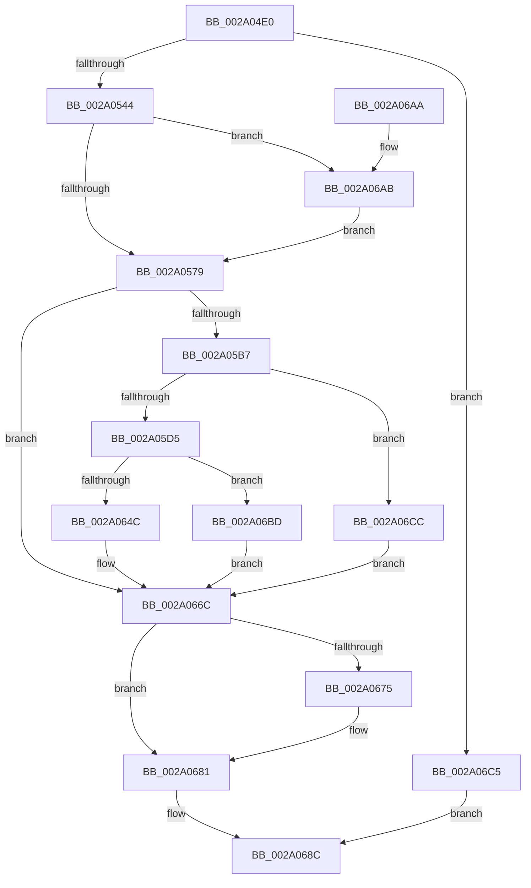

# MmGrowKernelStackEx

- RVA: `0x002A04E0`–`0x002A06DA` (길이 `506` bytes)
- VA: `0x00000001402A04E0`
- 실행 섹션: `.text`
- PDB 이름 있음: `예`; PDB Function 태그: `아니요`
- unwind 정보 RVA: `0x000683C8`
- 디코드: `126`개 명령, `506/506` bytes 표시
- 미해석 바이트: `0` (있으면 어셈블리에 `.byte`로 보존)

> 이 문서는 커널 이미지의 기계어와 PDB 기호를 분석해 생성했습니다. 4번과 5번은 함수 원형과 자료형을 바이너리 사용 방식에서 추정한 C 해석이며 원본 소스 복구 결과는 아닙니다.

## 1. Dependencies

- 직접 호출 지점: **5**; 고유 호출 대상: **5**
- 직접 호출자로 확인된 함수: **3**
- RIP 상대 이미지 참조: **4**

### Outgoing calls
- `0x002A05EA` → [MI_READ_PTE_LOCK_FREE](../28/MI_READ_PTE_LOCK_FREE_function_002828A0.md) (function, `0x002828A0`)
- `0x002A0600` → [MiPageToNode](../33/MiPageToNode_function_00338CD0.md) (function, `0x00338CD0`)
- `0x002A0640` → [MiAllocateKernelStackPages](MiAllocateKernelStackPages_function_002A1BEC.md) (function, `0x002A1BEC`)
- `0x002A067C` → [KiLowerIrqlProcessIrqlFlags](../4F/KiLowerIrqlProcessIrqlFlags_function_004F5698.md) (function, `0x004F5698`)
- `0x002A06B0` → [KiRaiseIrqlProcessIrqlFlags](../4F/KiRaiseIrqlProcessIrqlFlags_function_004F56FC.md) (function, `0x004F56FC`)

### Direct callers
- [sub_002F82CA](../2F/Unknown_function_002F82CA.md) at `0x002F82D7`
- [MmGrowKernelStack](../67/MmGrowKernelStack_function_0067B4B0.md) at `0x0067B4BA`
- [KxSwitchKernelStackCallout](../6B/KxSwitchKernelStackCallout_function_006B26A0.md) at `0x006B26B6`

### Static image references
- `0x002A052E` → RVA `0x00FC5088` (`ALMOSTRO`; read)
- `0x002A0555` → RVA `0x00E30088` (`.data`; read)
- `0x002A056C` → RVA `0x00FC6D20` (`ALMOSTRO`; read)
- `0x002A06CC` → RVA `0x00E35FA0` (`.data`; read/write)

## 2. Other-region calls and transfers

- 다른 실행 섹션으로 향하는 call: **0**
- 별도 외부 분기/꼬리 이동을 확인하지 못했습니다.

## 3. Assembly (complete function range)

```asm
002A04E0  48 89 5C 24 08                  mov qword ptr [rsp + 8], rbx
002A04E5  48 89 74 24 10                  mov qword ptr [rsp + 0x10], rsi
002A04EA  48 89 7C 24 18                  mov qword ptr [rsp + 0x18], rdi
002A04EF  55                              push rbp
002A04F0  41 54                           push r12
002A04F2  41 55                           push r13
002A04F4  41 56                           push r14
002A04F6  41 57                           push r15
002A04F8  48 8B EC                        mov rbp, rsp
002A04FB  48 83 EC 70                     sub rsp, 0x70
002A04FF  65 48 8B 3C 25 88 01 00 00      mov rdi, qword ptr gs:[0x188]
002A0508  45 33 C0                        xor r8d, r8d
002A050B  48 8B D9                        mov rbx, rcx
002A050E  4C 89 45 C0                     mov qword ptr [rbp - 0x40], r8
002A0512  4C 8B E2                        mov r12, rdx
002A0515  66 44 89 45 D5                  mov word ptr [rbp - 0x2b], r8w
002A051A  44 88 45 D7                     mov byte ptr [rbp - 0x29], r8b
002A051E  48 8B 47 28                     mov rax, qword ptr [rdi + 0x28]
002A0522  48 8B 57 38                     mov rdx, qword ptr [rdi + 0x38]
002A0526  4C 89 45 F0                     mov qword ptr [rbp - 0x10], r8
002A052A  48 8B 48 08                     mov rcx, qword ptr [rax + 8]
002A052E  8B 05 54 4B D2 00               mov eax, dword ptr [rip + 0xd24b54]
002A0534  48 83 E1 FE                     and rcx, 0xfffffffffffffffe
002A0538  48 2B D1                        sub rdx, rcx
002A053B  48 3B D0                        cmp rdx, rax
002A053E  0F 82 81 01 00 00               jb 0x1402a06c5
002A0544  48 8B 87 20 02 00 00            mov rax, qword ptr [rdi + 0x220]
002A054B  45 8B F0                        mov r14d, r8d
002A054E  0F B7 88 AE 04 00 00            movzx ecx, word ptr [rax + 0x4ae]
002A0555  48 8B 05 2C FB B8 00            mov rax, qword ptr [rip + 0xb8fb2c]
002A055C  4C 8B 2C C8                     mov r13, qword ptr [rax + rcx*8]
002A0560  45 0F 20 C7                     mov r15, cr8
002A0564  41 8D 40 02                     lea eax, [r8 + 2]
002A0568  44 0F 22 C0                     mov cr8, rax
002A056C  44 39 05 AD 67 D2 00            cmp dword ptr [rip + 0xd267ad], r8d
002A0573  0F 85 32 01 00 00               jne 0x1402a06ab
002A0579  48 8B 77 30                     mov rsi, qword ptr [rdi + 0x30]
002A057D  49 B9 F8 FF FF FF 7F 00 00 00   movabs r9, 0x7ffffffff8
002A0587  48 C1 EE 09                     shr rsi, 9
002A058B  49 23 F1                        and rsi, r9
002A058E  48 BA 00 00 00 00 80 F6 FF FF   movabs rdx, 0xfffff68000000000
002A0598  48 8B C2                        mov rax, rdx
002A059B  49 2B DC                        sub rbx, r12
002A059E  48 03 F0                        add rsi, rax
002A05A1  48 C1 EB 09                     shr rbx, 9
002A05A5  49 23 D9                        and rbx, r9
002A05A8  48 8B C2                        mov rax, rdx
002A05AB  48 03 D8                        add rbx, rax
002A05AE  48 3B DE                        cmp rbx, rsi
002A05B1  0F 83 B5 00 00 00               jae 0x1402a066c
002A05B7  48 8B 47 28                     mov rax, qword ptr [rdi + 0x28]
002A05BB  48 8B 48 08                     mov rcx, qword ptr [rax + 8]
002A05BF  48 C1 E9 09                     shr rcx, 9
002A05C3  49 23 C9                        and rcx, r9
002A05C6  48 8B C2                        mov rax, rdx
002A05C9  48 03 C8                        add rcx, rax
002A05CC  48 3B D9                        cmp rbx, rcx
002A05CF  0F 82 F7 00 00 00               jb 0x1402a06cc
002A05D5  48 8B 4F 38                     mov rcx, qword ptr [rdi + 0x38]
002A05D9  48 C1 E9 09                     shr rcx, 9
002A05DD  49 23 C9                        and rcx, r9
002A05E0  48 8B C2                        mov rax, rdx
002A05E3  48 83 C0 F8                     add rax, -8
002A05E7  48 03 C8                        add rcx, rax
002A05EA  E8 B1 22 FE FF                  call 0x1402828a0
002A05EF  48 C1 E8 0C                     shr rax, 0xc
002A05F3  48 B9 FF FF FF FF FF 00 00 00   movabs rcx, 0xffffffffff
002A05FD  48 23 C8                        and rcx, rax
002A0600  E8 CB 86 09 00                  call 0x140338cd0
002A0605  4C 21 75 E8                     and qword ptr [rbp - 0x18], r14
002A0609  48 8D 4D B0                     lea rcx, [rbp - 0x50]
002A060D  48 2B F3                        sub rsi, rbx
002A0610  89 45 E0                        mov dword ptr [rbp - 0x20], eax
002A0613  48 83 EE 08                     sub rsi, 8
002A0617  4C 89 6D B0                     mov qword ptr [rbp - 0x50], r13
002A061B  48 C1 FE 03                     sar rsi, 3
002A061F  48 FF C6                        inc rsi
002A0622  48 89 5D B8                     mov qword ptr [rbp - 0x48], rbx
002A0626  48 89 75 C8                     mov qword ptr [rbp - 0x38], rsi
002A062A  C7 45 D0 02 00 00 00            mov dword ptr [rbp - 0x30], 2
002A0631  48 89 7D D8                     mov qword ptr [rbp - 0x28], rdi
002A0635  C6 45 D4 02                     mov byte ptr [rbp - 0x2c], 2
002A0639  C7 45 E4 05 00 00 00            mov dword ptr [rbp - 0x1c], 5
002A0640  E8 A7 15 00 00                  call 0x1402a1bec
002A0645  45 33 C0                        xor r8d, r8d
002A0648  85 C0                           test eax, eax
002A064A  74 71                           je 0x1402a06bd
002A064C  48 C1 E3 19                     shl rbx, 0x19
002A0650  48 B8 00 00 00 00 80 F6 FF FF   movabs rax, 0xfffff68000000000
002A065A  48 8B C0                        mov rax, rax
002A065D  48 C1 E0 19                     shl rax, 0x19
002A0661  48 2B D8                        sub rbx, rax
002A0664  48 C1 FB 10                     sar rbx, 0x10
002A0668  48 89 5F 30                     mov qword ptr [rdi + 0x30], rbx
002A066C  44 39 05 AD 66 D2 00            cmp dword ptr [rip + 0xd266ad], r8d
002A0673  74 0C                           je 0x1402a0681
002A0675  44 0F 20 C1                     mov rcx, cr8
002A0679  41 8A D7                        mov dl, r15b
002A067C  E8 17 50 25 00                  call 0x1404f5698
002A0681  41 0F B6 CF                     movzx ecx, r15b
002A0685  44 0F 22 C1                     mov cr8, rcx
002A0689  41 8B C6                        mov eax, r14d
002A068C  4C 8D 5C 24 70                  lea r11, [rsp + 0x70]
002A0691  49 8B 5B 30                     mov rbx, qword ptr [r11 + 0x30]
002A0695  49 8B 73 38                     mov rsi, qword ptr [r11 + 0x38]
002A0699  49 8B 7B 40                     mov rdi, qword ptr [r11 + 0x40]
002A069D  49 8B E3                        mov rsp, r11
002A06A0  41 5F                           pop r15
002A06A2  41 5E                           pop r14
002A06A4  41 5D                           pop r13
002A06A6  41 5C                           pop r12
002A06A8  5D                              pop rbp
002A06A9  C3                              ret
002A06AA  CC                              int3
002A06AB  8A D0                           mov dl, al
002A06AD  41 8A CF                        mov cl, r15b
002A06B0  E8 47 50 25 00                  call 0x1404f56fc
002A06B5  45 33 C0                        xor r8d, r8d
002A06B8  E9 BC FE FF FF                  jmp 0x1402a0579
002A06BD  41 BE 9A 00 00 C0               mov r14d, 0xc000009a
002A06C3  EB A7                           jmp 0x1402a066c
002A06C5  B8 BB 00 00 C0                  mov eax, 0xc00000bb
002A06CA  EB C0                           jmp 0x1402a068c
002A06CC  FF 05 CE 58 B9 00               inc dword ptr [rip + 0xb958ce]
002A06D2  41 BE FD 00 00 C0               mov r14d, 0xc00000fd
002A06D8  EB 92                           jmp 0x1402a066c
```

## 4. C-style interpretation (structured pseudocode)

```c
__int64 __fastcall MmGrowKernelStackEx(__int64 a1, __int64 a2, int a3)
{
    __int64 result;
    __int64 v_rbx;
    __int64 v_rsi;
    __int64 v_rsp;
    unsigned __int64 v_stack_m28;
    unsigned __int64 v_stack_m38;
    unsigned __int64 v_stack_m40;
    unsigned int v_stack_m44;
    unsigned int v_stack_m48;
    unsigned __int64 v_stack_m50;
    unsigned __int8 v_stack_m51;
    unsigned __int16 v_stack_m53;
    unsigned __int8 v_stack_m54;
    unsigned int v_stack_m58;
    unsigned __int64 v_stack_m60;
    unsigned __int64 v_stack_m68;
    unsigned __int64 v_stack_m70;
    unsigned __int64 v_stack_m78;
    unsigned __int64 v_stack_p10;
    unsigned __int64 v_stack_p18;
    unsigned __int64 v_stack_p8;

    v_stack_p8 = v_rbx;
    v_stack_p10 = v_rsi;
    v_stack_p18 = v_rdi;
    v_rsp = (v_rsp) - (112);
    a3 = 0;
    v_stack_m68 = 0;
    v_stack_m53 = 0;
    v_stack_m51 = 0;
    v_stack_m38 = 0;
    a1 = (*(unsigned __int64 *)(*(unsigned __int64 *)(*(unsigned __int64 *)(gs_base + (0 + 392)) + 40) + 8)) & (-2);
    a2 = (*(unsigned __int64 *)(*(unsigned __int64 *)(gs_base + (0 + 392)) + 56)) - (a1);
    if (a2 < ((unsigned int)(*(unsigned int *)(v_rip + 13781844)))) goto loc_002A06C5;
    if ((*(unsigned int *)(v_rip + 13789101)) != 0) goto loc_002A06AB;
loc_002A0579:
    v_rsi = (*(unsigned __int64 *)(*(unsigned __int64 *)(gs_base + (0 + 392)) + 48)) >> (9);
    v_rsi = (v_rsi) & (a4);
    v_rbx = (a1) - (a2);
    v_rsi = (v_rsi) + (a2);
    v_rbx = (v_rbx) >> (9);
    v_rbx = (v_rbx) & (a4);
    v_rbx = (v_rbx) + (a2);
    if (v_rbx >= v_rsi) goto loc_002A066C;
    a1 = (*(unsigned __int64 *)(*(unsigned __int64 *)(*(unsigned __int64 *)(gs_base + (0 + 392)) + 40) + 8)) >> (9);
    a1 = (a1) & (a4);
    a1 = (a1) + (a2);
    if (v_rbx < a1) goto loc_002A06CC;
    a1 = (*(unsigned __int64 *)(*(unsigned __int64 *)(gs_base + (0 + 392)) + 56)) >> (9);
    a1 = (a1) & (a4);
    result = (a2) + (-8);
    a1 = (a1) + (result);
    result = MI_READ_PTE_LOCK_FREE(a1, a2, a3, a4);
    result = (result) >> (12);
    a1 = (a1) & (result);
    result = MiPageToNode(a1, a2, a3, a4);
    v_rsi = (v_rsi) - (v_rbx);
    v_stack_m48 = (unsigned int)(result);
    v_rsi = (v_rsi) - (8);
    v_stack_m78 = *(unsigned __int64 *)(*(unsigned __int64 *)(v_rip + 12122924) + *(unsigned __int16 *)(*(unsigned __int64 *)(*(unsigned __int64 *)(gs_base + (0 + 392)) + 544) + 1198) * 8);
    v_rsi = (v_rsi) >> (3);
    v_rsi = (v_rsi) + 1;
    v_stack_m70 = v_rbx;
    v_stack_m60 = v_rsi;
    v_stack_m58 = 2;
    v_stack_m50 = *(unsigned __int64 *)(gs_base + (0 + 392));
    v_stack_m54 = 2;
    v_stack_m44 = 5;
    result = MiAllocateKernelStackPages(v_stack_m78, a2, a3, a4);
    a3 = 0;
    if ((unsigned int)(result) == 0) goto loc_002A06BD;
    v_rbx = (v_rbx) << (25);
    result = (result) << (25);
    v_rbx = (v_rbx) - (result);
    v_rbx = (v_rbx) >> (16);
    *(unsigned __int64 *)(*(unsigned __int64 *)(gs_base + (0 + 392)) + 48) = v_rbx;
loc_002A066C:
    if ((*(unsigned int *)(v_rip + 13788845)) != 0) {
        a1 = a3 + 2;
        a2 = (unsigned __int8)(v_cr8);
        result = KiLowerIrqlProcessIrqlFlags(a1, a2, a3, a4);
    }
loc_002A068C:
    return 0;
loc_002A06AB:
    result = KiRaiseIrqlProcessIrqlFlags((unsigned __int8)(v_cr8), 0, a3, a4);
    a3 = 0;
    goto loc_002A0579;
loc_002A06BD:
    goto loc_002A066C;
loc_002A06C5:
    goto loc_002A068C;
loc_002A06CC:
    goto loc_002A066C;
}
```

## 5. (Beta) C Style

```c
int64_t MmGrowKernelStackEx(int64_t Arg1, int64_t Arg2, int32_t Arg3)
{
    int64_t result;
    int64_t local_rbx;
    int64_t local_rsi;
    int64_t local_rsp;
    uint64_t v_stack_m28;
    uint64_t v_stack_m38;
    uint64_t v_stack_m40;
    uint32_t v_stack_m44;
    uint32_t v_stack_m48;
    uint64_t v_stack_m50;
    uint8_t v_stack_m51;
    uint16_t v_stack_m53;
    uint8_t v_stack_m54;
    uint32_t v_stack_m58;
    uint64_t v_stack_m60;
    uint64_t v_stack_m68;
    uint64_t v_stack_m70;
    uint64_t v_stack_m78;
    uint64_t v_stack_p10;
    uint64_t v_stack_p18;
    uint64_t v_stack_p8;

    v_stack_p8 = local_rbx;
    v_stack_p10 = local_rsi;
    v_stack_p18 = local_rdi;
    local_rsp = (local_rsp) - (112);
    Arg3 = 0;
    v_stack_m68 = 0;
    v_stack_m53 = 0;
    v_stack_m51 = 0;
    v_stack_m38 = 0;
    Arg1 = (*(uint64_t *)(*(uint64_t *)(*(uint64_t *)(gs_base + (0 + 0x188)) + 0x28) + 0x8)) & (-2);
    Arg2 = (*(uint64_t *)(*(uint64_t *)(gs_base + (0 + 0x188)) + 0x38)) - (Arg1);
    if (Arg2 < ((uint32_t)(*(uint32_t *)(v_rip + 0xD24B54)))) goto loc_002A06C5;
    if ((*(uint32_t *)(v_rip + 0xD267AD)) != 0) goto loc_002A06AB;
loc_002A0579:
    local_rsi = (*(uint64_t *)(*(uint64_t *)(gs_base + (0 + 0x188)) + 0x30)) >> (9);
    local_rsi = (local_rsi) & (a4);
    local_rbx = (Arg1) - (Arg2);
    local_rsi = (local_rsi) + (Arg2);
    local_rbx = (local_rbx) >> (9);
    local_rbx = (local_rbx) & (a4);
    local_rbx = (local_rbx) + (Arg2);
    if (local_rbx >= local_rsi) goto loc_002A066C;
    Arg1 = (*(uint64_t *)(*(uint64_t *)(*(uint64_t *)(gs_base + (0 + 0x188)) + 0x28) + 0x8)) >> (9);
    Arg1 = (Arg1) & (a4);
    Arg1 = (Arg1) + (Arg2);
    if (local_rbx < Arg1) goto loc_002A06CC;
    Arg1 = (*(uint64_t *)(*(uint64_t *)(gs_base + (0 + 0x188)) + 0x38)) >> (9);
    Arg1 = (Arg1) & (a4);
    result = (Arg2) + (-8);
    Arg1 = (Arg1) + (result);
    result = MI_READ_PTE_LOCK_FREE(Arg1, Arg2, Arg3, a4);
    result = (result) >> (12);
    Arg1 = (Arg1) & (result);
    result = MiPageToNode(Arg1, Arg2, Arg3, a4);
    local_rsi = (local_rsi) - (local_rbx);
    v_stack_m48 = (uint32_t)(result);
    local_rsi = (local_rsi) - (8);
    v_stack_m78 = *(uint64_t *)(*(uint64_t *)(v_rip + 0xB8FB2C) + *(uint16_t *)(*(uint64_t *)(*(uint64_t *)(gs_base + (0 + 0x188)) + 0x220) + 0x4AE) * 8);
    local_rsi = (local_rsi) >> (3);
    local_rsi = (local_rsi) + 1;
    v_stack_m70 = local_rbx;
    v_stack_m60 = local_rsi;
    v_stack_m58 = 2;
    v_stack_m50 = *(uint64_t *)(gs_base + (0 + 0x188));
    v_stack_m54 = 2;
    v_stack_m44 = 5;
    result = MiAllocateKernelStackPages(v_stack_m78, Arg2, Arg3, a4);
    Arg3 = 0;
    if ((uint32_t)(result) == 0) goto loc_002A06BD;
    local_rbx = (local_rbx) << (25);
    result = (result) << (25);
    local_rbx = (local_rbx) - (result);
    local_rbx = (local_rbx) >> (16);
    *(uint64_t *)(*(uint64_t *)(gs_base + (0 + 0x188)) + 0x30) = local_rbx;
loc_002A066C:
    if ((*(uint32_t *)(v_rip + 0xD266AD)) != 0) {
        Arg1 = Arg3 + 2;
        Arg2 = (uint8_t)(v_cr8);
        result = KiLowerIrqlProcessIrqlFlags(Arg1, Arg2, Arg3, a4);
    }
loc_002A068C:
    return 0;
loc_002A06AB:
    result = KiRaiseIrqlProcessIrqlFlags((uint8_t)(v_cr8), 0, Arg3, a4);
    Arg3 = 0;
    goto loc_002A0579;
loc_002A06BD:
    goto loc_002A066C;
loc_002A06C5:
    goto loc_002A068C;
loc_002A06CC:
    goto loc_002A066C;
}
```

## 6. Execution-region graph

[열기: 2D/3D 그래프와 함수 탐색 컨트롤 패널](../../../control-panel.html?section=text&rva=0x002A04E0&view=graph)

- 2D 그래프는 위에서 아래로 흐르고, 3D 그래프는 빈 공간을 드래그해 회전합니다. Shift+드래그는 이동, 휠은 확대·축소, 함수 노드 선택은 대상 보고서 이동입니다.

### Static fallback


