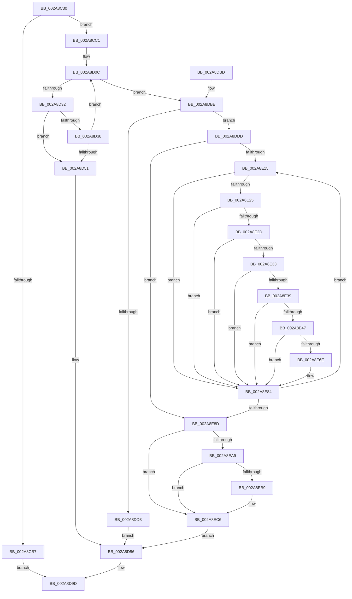

# MmOutSwapVirtualAddresses

- RVA: `0x002A8C30`–`0x002A8ED9` (길이 `681` bytes)
- VA: `0x00000001402A8C30`
- 실행 섹션: `.text`
- PDB 이름 있음: `예`; PDB Function 태그: `아니요`
- unwind 정보 RVA: `0x00068D78`
- 디코드: `186`개 명령, `681/681` bytes 표시
- 미해석 바이트: `0` (있으면 어셈블리에 `.byte`로 보존)

> 이 문서는 커널 이미지의 기계어와 PDB 기호를 분석해 생성했습니다. 4번과 5번은 함수 원형과 자료형을 바이너리 사용 방식에서 추정한 C 해석이며 원본 소스 복구 결과는 아닙니다.

## 1. Dependencies

- 직접 호출 지점: **20**; 고유 호출 대상: **19**
- 직접 호출자로 확인된 함수: **1**
- RIP 상대 이미지 참조: **2**

### Outgoing calls
- `0x002A8CA9` → [MiFindBestOutswapPagefile](MiFindBestOutswapPagefile_function_002A73B4.md) (function, `0x002A73B4`)
- `0x002A8CD0` → [EtwTraceWorkingSetSwap](../../page/A1/EtwTraceWorkingSetSwap_function_00A17D80.md) (function, `0x00A17D80`)
- `0x002A8CE0` → [MiValidateMemoryRangeEntries](../../page/A1/MiValidateMemoryRangeEntries_function_00A11C18.md) (function, `0x00A11C18`)
- `0x002A8CF2` → [memset](../6C/memset_function_006C6C40.md) (function, `0x006C6C40`)
- `0x002A8CFD` → [MiLockWsSwapExclusive](MiLockWsSwapExclusive_function_002A8A70.md) (function, `0x002A8A70`)
- `0x002A8D23` → [MiReserveWorkingSetSwapSpace](../../page/A8/MiReserveWorkingSetSwapSpace_function_00A833E4.md) (function, `0x00A833E4`)
- `0x002A8D46` → [MiExtendWorkingSetSwapPagefile](../../page/70/MiExtendWorkingSetSwapPagefile_function_007026D4.md) (function, `0x007026D4`)
- `0x002A8D5E` → [MiFreeReservationRuns](../../page/A4/MiFreeReservationRuns_function_00A4AB28.md) (function, `0x00A4AB28`)
- `0x002A8D69` → [MiUnlockWsSwapExclusive](MiUnlockWsSwapExclusive_function_002A74A8.md) (function, `0x002A74A8`)
- `0x002A8D96` → [EtwTraceWorkingSetSwap](../../page/A1/EtwTraceWorkingSetSwap_function_00A17D80.md) (function, `0x00A17D80`)
- `0x002A8DA4` → [_security_check_cookie](../6A/_security_check_cookie_function_006AC640.md) (function, `0x006AC640`)
- `0x002A8DC1` → [MiAllocateWorkingSetSwapSupport](../3E/MiAllocateWorkingSetSwapSupport_function_003E2AB0.md) (function, `0x003E2AB0`)
- `0x002A8DF9` → [LOCK_ADDRESS_SPACE_SHARED](LOCK_ADDRESS_SPACE_SHARED_function_002A8B3C.md) (function, `0x002A8B3C`)
- `0x002A8E04` → [LOCK_PAGE_TABLE_COMMITMENT](LOCK_PAGE_TABLE_COMMITMENT_function_002A6090.md) (function, `0x002A6090`)
- `0x002A8E18` → [MiLocateAddress](../31/MiLocateAddress_function_003168D0.md) (function, `0x003168D0`)
- `0x002A8E7F` → [MiOutSwapWorkingSet](../2C/MiOutSwapWorkingSet_function_002C1464.md) (function, `0x002C1464`)
- `0x002A8E93` → [UNLOCK_PAGE_TABLE_COMMITMENT](../2E/UNLOCK_PAGE_TABLE_COMMITMENT_function_002E27D0.md) (function, `0x002E27D0`)
- `0x002A8E9E` → [UNLOCK_ADDRESS_SPACE_SHARED](UNLOCK_ADDRESS_SPACE_SHARED_function_002A8ACC.md) (function, `0x002A8ACC`)
- `0x002A8EAC` → [MiReAllocateWorkingSetSwapSupport](../3E/MiReAllocateWorkingSetSwapSupport_function_003E2A58.md) (function, `0x003E2A58`)
- `0x002A8EBE` → [ExFreePoolWithTag](../../poolcode/B8/ExFreePoolWithTag_function_00B82870.md) (function, `0x00B82870`)

### Direct callers
- [SmPerformStoreSwapOperation](SmPerformStoreSwapOperation_function_002A8BE0.md) at `0x002A8C09`

### Static image references
- `0x002A8C49` → RVA `0x00E0A740` (`.data`; read)
- `0x002A8C91` → RVA `0x00E30088` (`.data`; read)

## 2. Other-region calls and transfers

- 다른 실행 섹션으로 향하는 call: **7**
  - `0x002A8CD0` → [EtwTraceWorkingSetSwap](../../page/A1/EtwTraceWorkingSetSwap_function_00A17D80.md) (`.text` → `PAGE`)
  - `0x002A8CE0` → [MiValidateMemoryRangeEntries](../../page/A1/MiValidateMemoryRangeEntries_function_00A11C18.md) (`.text` → `PAGE`)
  - `0x002A8D23` → [MiReserveWorkingSetSwapSpace](../../page/A8/MiReserveWorkingSetSwapSpace_function_00A833E4.md) (`.text` → `PAGE`)
  - `0x002A8D46` → [MiExtendWorkingSetSwapPagefile](../../page/70/MiExtendWorkingSetSwapPagefile_function_007026D4.md) (`.text` → `PAGE`)
  - `0x002A8D5E` → [MiFreeReservationRuns](../../page/A4/MiFreeReservationRuns_function_00A4AB28.md) (`.text` → `PAGE`)
  - `0x002A8D96` → [EtwTraceWorkingSetSwap](../../page/A1/EtwTraceWorkingSetSwap_function_00A17D80.md) (`.text` → `PAGE`)
  - `0x002A8EBE` → [ExFreePoolWithTag](../../poolcode/B8/ExFreePoolWithTag_function_00B82870.md) (`.text` → `POOLCODE`)
- 별도 외부 분기/꼬리 이동을 확인하지 못했습니다.

## 3. Assembly (complete function range)

```asm
002A8C30  40 55                           push rbp
002A8C32  53                              push rbx
002A8C33  56                              push rsi
002A8C34  57                              push rdi
002A8C35  41 54                           push r12
002A8C37  41 55                           push r13
002A8C39  41 56                           push r14
002A8C3B  41 57                           push r15
002A8C3D  48 8D 6C 24 D8                  lea rbp, [rsp - 0x28]
002A8C42  48 81 EC 28 01 00 00            sub rsp, 0x128
002A8C49  48 8B 05 F0 1A B6 00            mov rax, qword ptr [rip + 0xb61af0]
002A8C50  48 33 C4                        xor rax, rsp
002A8C53  48 89 45 18                     mov qword ptr [rbp + 0x18], rax
002A8C57  48 83 64 24 40 00               and qword ptr [rsp + 0x40], 0
002A8C5D  0F 57 C0                        xorps xmm0, xmm0
002A8C60  83 64 24 30 00                  and dword ptr [rsp + 0x30], 0
002A8C65  33 C0                           xor eax, eax
002A8C67  48 89 45 10                     mov qword ptr [rbp + 0x10], rax
002A8C6B  4C 8B F1                        mov r14, rcx
002A8C6E  0F 11 45 F0                     movups xmmword ptr [rbp - 0x10], xmm0
002A8C72  48 8B FA                        mov rdi, rdx
002A8C75  48 8D 54 24 30                  lea rdx, [rsp + 0x30]
002A8C7A  0F 11 45 00                     movups xmmword ptr [rbp], xmm0
002A8C7E  65 48 8B 1C 25 88 01 00 00      mov rbx, qword ptr gs:[0x188]
002A8C87  4D 8B E0                        mov r12, r8
002A8C8A  0F B7 89 AE 04 00 00            movzx ecx, word ptr [rcx + 0x4ae]
002A8C91  48 8B 05 F0 73 B8 00            mov rax, qword ptr [rip + 0xb873f0]
002A8C98  4C 89 4C 24 48                  mov qword ptr [rsp + 0x48], r9
002A8C9D  48 89 5C 24 38                  mov qword ptr [rsp + 0x38], rbx
002A8CA2  4C 8B 2C C8                     mov r13, qword ptr [rax + rcx*8]
002A8CA6  49 8B CD                        mov rcx, r13
002A8CA9  E8 06 E7 FF FF                  call 0x1402a73b4
002A8CAE  89 44 24 34                     mov dword ptr [rsp + 0x34], eax
002A8CB2  83 F8 10                        cmp eax, 0x10
002A8CB5  75 0A                           jne 0x1402a8cc1
002A8CB7  B8 47 01 00 C0                  mov eax, 0xc0000147
002A8CBC  E9 DC 00 00 00                  jmp 0x1402a8d9d
002A8CC1  BA 02 00 00 00                  mov edx, 2
002A8CC6  4C 8D 45 F0                     lea r8, [rbp - 0x10]
002A8CCA  49 8B CE                        mov rcx, r14
002A8CCD  89 55 F0                        mov dword ptr [rbp - 0x10], edx
002A8CD0  E8 AB F0 76 00                  call 0x140a17d80
002A8CD5  4C 8D 44 24 40                  lea r8, [rsp + 0x40]
002A8CDA  49 8B D4                        mov rdx, r12
002A8CDD  48 8B CF                        mov rcx, rdi
002A8CE0  E8 33 8F 76 00                  call 0x140a11c18
002A8CE5  33 D2                           xor edx, edx
002A8CE7  48 8D 4C 24 50                  lea rcx, [rsp + 0x50]
002A8CEC  41 B8 98 00 00 00               mov r8d, 0x98
002A8CF2  E8 49 DF 41 00                  call 0x1406c6c40
002A8CF7  49 8B D5                        mov rdx, r13
002A8CFA  48 8B CB                        mov rcx, rbx
002A8CFD  E8 6E FD FF FF                  call 0x1402a8a70
002A8D02  48 8B 74 24 40                  mov rsi, qword ptr [rsp + 0x40]
002A8D07  44 8B 7C 24 30                  mov r15d, dword ptr [rsp + 0x30]
002A8D0C  44 8B 4C 24 34                  mov r9d, dword ptr [rsp + 0x34]
002A8D11  48 8D 54 24 78                  lea rdx, [rsp + 0x78]
002A8D16  48 89 74 24 28                  mov qword ptr [rsp + 0x28], rsi
002A8D1B  49 8B CD                        mov rcx, r13
002A8D1E  44 89 7C 24 20                  mov dword ptr [rsp + 0x20], r15d
002A8D23  E8 BC A6 7D 00                  call 0x140a833e4
002A8D28  8B D8                           mov ebx, eax
002A8D2A  85 C0                           test eax, eax
002A8D2C  0F 89 8C 00 00 00               jns 0x1402a8dbe
002A8D32  41 83 FF 10                     cmp r15d, 0x10
002A8D36  73 19                           jae 0x1402a8d51
002A8D38  45 8B C7                        mov r8d, r15d
002A8D3B  44 89 7C 24 34                  mov dword ptr [rsp + 0x34], r15d
002A8D40  48 8B D6                        mov rdx, rsi
002A8D43  49 8B CD                        mov rcx, r13
002A8D46  E8 89 99 45 00                  call 0x1407026d4
002A8D4B  8B D8                           mov ebx, eax
002A8D4D  85 C0                           test eax, eax
002A8D4F  79 BB                           jns 0x1402a8d0c
002A8D51  4C 8B 7C 24 38                  mov r15, qword ptr [rsp + 0x38]
002A8D56  48 8D 54 24 78                  lea rdx, [rsp + 0x78]
002A8D5B  49 8B CD                        mov rcx, r13
002A8D5E  E8 C5 1D 7A 00                  call 0x140a4ab28
002A8D63  49 8B D5                        mov rdx, r13
002A8D66  49 8B CF                        mov rcx, r15
002A8D69  E8 3A E7 FF FF                  call 0x1402a74a8
002A8D6E  48 8B 45 C8                     mov rax, qword ptr [rbp - 0x38]
002A8D72  4C 8D 45 F0                     lea r8, [rbp - 0x10]
002A8D76  48 89 45 F8                     mov qword ptr [rbp - 8], rax
002A8D7A  33 D2                           xor edx, edx
002A8D7C  48 8B 45 D0                     mov rax, qword ptr [rbp - 0x30]
002A8D80  49 8B CE                        mov rcx, r14
002A8D83  48 89 45 00                     mov qword ptr [rbp], rax
002A8D87  48 8B 45 D8                     mov rax, qword ptr [rbp - 0x28]
002A8D8B  48 89 45 08                     mov qword ptr [rbp + 8], rax
002A8D8F  89 5D 10                        mov dword ptr [rbp + 0x10], ebx
002A8D92  48 89 75 F0                     mov qword ptr [rbp - 0x10], rsi
002A8D96  E8 E5 EF 76 00                  call 0x140a17d80
002A8D9B  8B C3                           mov eax, ebx
002A8D9D  48 8B 4D 18                     mov rcx, qword ptr [rbp + 0x18]
002A8DA1  48 33 CC                        xor rcx, rsp
002A8DA4  E8 97 38 40 00                  call 0x1406ac640
002A8DA9  48 81 C4 28 01 00 00            add rsp, 0x128
002A8DB0  41 5F                           pop r15
002A8DB2  41 5E                           pop r14
002A8DB4  41 5D                           pop r13
002A8DB6  41 5C                           pop r12
002A8DB8  5F                              pop rdi
002A8DB9  5E                              pop rsi
002A8DBA  5B                              pop rbx
002A8DBB  5D                              pop rbp
002A8DBC  C3                              ret
002A8DBD  CC                              int3
002A8DBE  48 8B CE                        mov rcx, rsi
002A8DC1  E8 EA 9C 13 00                  call 0x1403e2ab0
002A8DC6  4C 8B 7C 24 38                  mov r15, qword ptr [rsp + 0x38]
002A8DCB  48 8B D8                        mov rbx, rax
002A8DCE  48 85 C0                        test rax, rax
002A8DD1  75 0A                           jne 0x1402a8ddd
002A8DD3  BB 9A 00 00 C0                  mov ebx, 0xc000009a
002A8DD8  E9 79 FF FF FF                  jmp 0x1402a8d56
002A8DDD  49 8D 86 00 04 00 00            lea rax, [r14 + 0x400]
002A8DE4  48 89 5C 24 50                  mov qword ptr [rsp + 0x50], rbx
002A8DE9  49 8B D6                        mov rdx, r14
002A8DEC  48 89 44 24 60                  mov qword ptr [rsp + 0x60], rax
002A8DF1  49 8B CF                        mov rcx, r15
002A8DF4  4C 89 6C 24 68                  mov qword ptr [rsp + 0x68], r13
002A8DF9  E8 3E FD FF FF                  call 0x1402a8b3c
002A8DFE  49 8B D6                        mov rdx, r14
002A8E01  49 8B CF                        mov rcx, r15
002A8E04  E8 87 D2 FF FF                  call 0x1402a6090
002A8E09  49 C1 E4 04                     shl r12, 4
002A8E0D  4C 03 E7                        add r12, rdi
002A8E10  49 3B FC                        cmp rdi, r12
002A8E13  73 78                           jae 0x1402a8e8d
002A8E15  48 8B 0F                        mov rcx, qword ptr [rdi]
002A8E18  E8 B3 DA 06 00                  call 0x1403168d0
002A8E1D  48 8B D0                        mov rdx, rax
002A8E20  48 85 C0                        test rax, rax
002A8E23  74 5F                           je 0x1402a8e84
002A8E25  8B 48 30                        mov ecx, dword ptr [rax + 0x30]
002A8E28  F6 C1 70                        test cl, 0x70
002A8E2B  75 57                           jne 0x1402a8e84
002A8E2D  0F BA E1 15                     bt ecx, 0x15
002A8E31  73 51                           jae 0x1402a8e84
002A8E33  0F BA E1 17                     bt ecx, 0x17
002A8E37  72 4B                           jb 0x1402a8e84
002A8E39  81 E1 00 00 18 00               and ecx, 0x180000
002A8E3F  81 F9 00 00 10 00               cmp ecx, 0x100000
002A8E45  73 3D                           jae 0x1402a8e84
002A8E47  0F B6 48 21                     movzx ecx, byte ptr [rax + 0x21]
002A8E4B  8B 40 1C                        mov eax, dword ptr [rax + 0x1c]
002A8E4E  4C 8B 4F 08                     mov r9, qword ptr [rdi + 8]
002A8E52  4C 8B 07                        mov r8, qword ptr [rdi]
002A8E55  49 FF C9                        dec r9
002A8E58  48 C1 E1 20                     shl rcx, 0x20
002A8E5C  4D 03 C8                        add r9, r8
002A8E5F  48 0B C8                        or rcx, rax
002A8E62  49 8B C1                        mov rax, r9
002A8E65  48 C1 E8 0C                     shr rax, 0xc
002A8E69  48 3B C8                        cmp rcx, rax
002A8E6C  72 16                           jb 0x1402a8e84
002A8E6E  48 8D 44 24 50                  lea rax, [rsp + 0x50]
002A8E73  49 8D 8E 00 04 00 00            lea rcx, [r14 + 0x400]
002A8E7A  48 89 44 24 20                  mov qword ptr [rsp + 0x20], rax
002A8E7F  E8 E0 85 01 00                  call 0x1402c1464
002A8E84  48 83 C7 10                     add rdi, 0x10
002A8E88  49 3B FC                        cmp rdi, r12
002A8E8B  72 88                           jb 0x1402a8e15
002A8E8D  49 8B D6                        mov rdx, r14
002A8E90  49 8B CF                        mov rcx, r15
002A8E93  E8 38 99 03 00                  call 0x1402e27d0
002A8E98  49 8B D6                        mov rdx, r14
002A8E9B  49 8B CF                        mov rcx, r15
002A8E9E  E8 29 FC FF FF                  call 0x1402a8acc
002A8EA3  48 39 73 10                     cmp qword ptr [rbx + 0x10], rsi
002A8EA7  73 1D                           jae 0x1402a8ec6
002A8EA9  48 8B CB                        mov rcx, rbx
002A8EAC  E8 A7 9B 13 00                  call 0x1403e2a58
002A8EB1  48 8B F8                        mov rdi, rax
002A8EB4  48 85 C0                        test rax, rax
002A8EB7  74 0D                           je 0x1402a8ec6
002A8EB9  33 D2                           xor edx, edx
002A8EBB  48 8B CB                        mov rcx, rbx
002A8EBE  E8 AD 99 8D 00                  call 0x140b82870
002A8EC3  48 8B DF                        mov rbx, rdi
002A8EC6  48 8B 73 18                     mov rsi, qword ptr [rbx + 0x18]
002A8ECA  48 8B 44 24 48                  mov rax, qword ptr [rsp + 0x48]
002A8ECF  48 89 18                        mov qword ptr [rax], rbx
002A8ED2  33 DB                           xor ebx, ebx
002A8ED4  E9 7D FE FF FF                  jmp 0x1402a8d56
```

## 4. C-style interpretation (structured pseudocode)

```c
__int64 __fastcall MmOutSwapVirtualAddresses(__int64 a1, __int64 a2, __int64 a3, __int64 a4)
{
    __int64 result;
    __int64 v_r12;
    __int64 v_rbx;
    __int64 v_rdi;
    __int64 v_rsp;
    unsigned __int64 v_stack_m118;
    unsigned __int64 v_stack_m120;
    unsigned __int64 v_stack_m128;
    unsigned __int64 v_stack_m130;
    unsigned int v_stack_m134;
    unsigned int v_stack_m138;
    unsigned __int64 v_stack_m140;
    unsigned int v_stack_m148;
    unsigned __int64 v_stack_m50;
    unsigned __int64 v_stack_m58;
    unsigned __int64 v_stack_m60;
    unsigned __int64 v_stack_m68;
    unsigned __int64 v_stack_m70;
    unsigned __int64 v_stack_m78;
    unsigned __int64 v_stack_m90;
    unsigned __int64 v_stack_m98;
    unsigned __int64 v_stack_mA0;
    unsigned __int64 v_stack_mF0;
    unsigned __int64 v_stack_p20;
    unsigned __int64 v_stack_p38;
    unsigned __int64 v_stack_p48;
    unsigned __int64 v_stack_p50;
    unsigned __int64 v_stack_p60;
    unsigned __int64 v_stack_p68;

    v_rsp = (v_rsp) - (296);
    result = (*(unsigned __int64 *)(v_rip + 11934448)) ^ (v_rsp);
    v_stack_m50 = result;
    result = 0;
    v_stack_m58 = 0;
    v_stack_m78 = v_xmm0;
    v_stack_m68 = v_xmm0;
    v_stack_m120 = a4;
    v_stack_m130 = *(unsigned __int64 *)(gs_base + (0 + 392));
    result = MiFindBestOutswapPagefile(*(unsigned __int64 *)(*(unsigned __int64 *)(v_rip + 12088304) + *(unsigned __int16 *)(a1 + 1198) * 8), v_stack_m138, a3, a4);
    v_stack_m134 = (unsigned int)(result);
    if (((unsigned int)(result)) != 16) goto loc_002A8CC1;
    goto loc_002A8D9D;
loc_002A8CC1:
    v_stack_m78 = 2;
    result = EtwTraceWorkingSetSwap(a1, 2, v_stack_m78, a4);
    result = MiValidateMemoryRangeEntries(a2, a3, v_stack_m128, a4);
    a2 = 0;
    result = memset(v_stack_m118, a2, 152, a4);
    result = MiLockWsSwapExclusive(*(unsigned __int64 *)(gs_base + (0 + 392)), *(unsigned __int64 *)(*(unsigned __int64 *)(v_rip + 12088304) + *(unsigned __int16 *)(a1 + 1198) * 8), 152, a4);
loc_002A8D0C:
    v_stack_m140 = v_stack_m128;
    v_stack_m148 = (unsigned int)((unsigned int)(v_stack_m138));
    result = MiReserveWorkingSetSwapSpace(*(unsigned __int64 *)(*(unsigned __int64 *)(v_rip + 12088304) + *(unsigned __int16 *)(a1 + 1198) * 8), v_stack_mF0, 152, (unsigned int)(v_stack_m134));
    if (!sign_flag) goto loc_002A8DBE;
    if (((unsigned int)((unsigned int)(v_stack_m138))) >= 16) goto loc_002A8D51;
    v_stack_m134 = (unsigned int)((unsigned int)(v_stack_m138));
    result = MiExtendWorkingSetSwapPagefile(*(unsigned __int64 *)(*(unsigned __int64 *)(v_rip + 12088304) + *(unsigned __int16 *)(a1 + 1198) * 8), v_stack_m128, (unsigned int)((unsigned int)((unsigned int)(v_stack_m138))), (unsigned int)(v_stack_m134));
    if (!sign_flag) goto loc_002A8D0C;
loc_002A8D51:
loc_002A8D56:
    result = MiFreeReservationRuns(*(unsigned __int64 *)(*(unsigned __int64 *)(v_rip + 12088304) + *(unsigned __int16 *)(a1 + 1198) * 8), v_stack_mF0, (unsigned int)((unsigned int)((unsigned int)(v_stack_m138))), (unsigned int)(v_stack_m134));
    result = MiUnlockWsSwapExclusive(v_stack_m130, *(unsigned __int64 *)(*(unsigned __int64 *)(v_rip + 12088304) + *(unsigned __int16 *)(a1 + 1198) * 8), (unsigned int)((unsigned int)((unsigned int)(v_stack_m138))), (unsigned int)(v_stack_m134));
    v_stack_m70 = v_stack_mA0;
    a2 = 0;
    v_stack_m68 = v_stack_m98;
    v_stack_m60 = v_stack_m90;
    v_stack_m58 = (unsigned int)((unsigned int)((unsigned int)(result)));
    v_stack_m78 = v_stack_m128;
    result = EtwTraceWorkingSetSwap(a1, a2, v_stack_m78, (unsigned int)(v_stack_m134));
loc_002A8D9D:
    a1 = (v_stack_m50) ^ (v_rsp);
    result = _security_check_cookie(a1, a2, v_stack_m78, (unsigned int)(v_stack_m134));
    v_rsp = (v_rsp) + (296);
    return result;
loc_002A8DBE:
    result = MiAllocateWorkingSetSwapSupport(v_stack_m128, a2, v_stack_m78, (unsigned int)(v_stack_m134));
    if (result != 0) goto loc_002A8DDD;
    goto loc_002A8D56;
loc_002A8DDD:
    v_stack_p50 = (unsigned int)(0xC000009AULL);
    v_stack_p60 = a1 + 1024;
    v_stack_p68 = *(unsigned __int64 *)(*(unsigned __int64 *)(v_rip + 12088304) + *(unsigned __int16 *)(a1 + 1198) * 8);
    result = LOCK_ADDRESS_SPACE_SHARED(v_stack_p38, a1, v_stack_m78, (unsigned int)(v_stack_m134));
    result = LOCK_PAGE_TABLE_COMMITMENT(v_stack_p38, a1, v_stack_m78, (unsigned int)(v_stack_m134));
    v_r12 = (a3) << (4);
    v_r12 = (v_r12) + (0);
    if (0 >= v_r12) goto loc_002A8E8D;
loc_002A8E15:
    result = MiLocateAddress(*(unsigned __int64 *)(a2), a1, v_stack_m78, (unsigned int)(v_stack_m134));
    if (result == 0) goto loc_002A8E84;
    if ((((unsigned __int8)((unsigned int)(*(unsigned int *)(result + 48)))) & (112)) != 0) goto loc_002A8E84;
    if (condition_is_above_or_equal) goto loc_002A8E84;
    if (condition_is_below) goto loc_002A8E84;
    a1 = (unsigned int)(((unsigned int)(*(unsigned int *)(result + 48))) & (0x180000ULL));
    if (((unsigned int)(a1)) >= 0x100000ULL) goto loc_002A8E84;
    a4 = (*(unsigned __int64 *)(a2 + 8)) - 1;
    a1 = (*(unsigned __int8 *)(result + 33)) << (32);
    a4 = (a4) + (*(unsigned __int64 *)(a2));
    a1 = (a1) | ((unsigned int)(*(unsigned int *)(result + 28)));
    result = (a4) >> (12);
    if (a1 >= result) {
        result = v_stack_p50;
        a1 = a1 + 1024;
        v_stack_p20 = result;
        result = MiOutSwapWorkingSet(a1, result, *(unsigned __int64 *)(a2), a4);
    }
    v_rdi = (a2) + (16);
    if (v_rdi < v_r12) goto loc_002A8E15;
loc_002A8E8D:
    result = UNLOCK_PAGE_TABLE_COMMITMENT(v_stack_p38, a1, *(unsigned __int64 *)(a2), a4);
    result = UNLOCK_ADDRESS_SPACE_SHARED(v_stack_p38, a1, *(unsigned __int64 *)(a2), a4);
    if ((*(unsigned __int64 *)((unsigned int)(0xC000009AULL) + 16)) >= v_stack_m128) goto loc_002A8EC6;
    result = MiReAllocateWorkingSetSwapSupport((unsigned int)(0xC000009AULL), a1, *(unsigned __int64 *)(a2), a4);
    v_rbx = (unsigned int)(0xC000009AULL);
    if (result != 0) {
        a2 = 0;
        a1 = (unsigned int)(0xC000009AULL);
        result = ExFreePoolWithTag(a1, a2, *(unsigned __int64 *)(a2), a4);
        v_rbx = result;
    }
    *(unsigned __int64 *)(v_stack_p48) = v_rbx;
    v_rbx = 0;
    goto loc_002A8D56;
}
```

## 5. (Beta) C Style

```c
int64_t MmOutSwapVirtualAddresses(void *Arg1, int64_t Arg2, int64_t Arg3, int64_t Arg4)
{
    uint8_t *arg1 = (uint8_t *)Arg1;

    int64_t result;
    int64_t local_r12;
    int64_t local_rbx;
    int64_t local_rdi;
    int64_t local_rsp;
    uint64_t v_stack_m118;
    uint64_t v_stack_m120;
    uint64_t v_stack_m128;
    uint64_t v_stack_m130;
    uint32_t v_stack_m134;
    uint32_t v_stack_m138;
    uint64_t v_stack_m140;
    uint32_t v_stack_m148;
    uint64_t v_stack_m50;
    uint64_t v_stack_m58;
    uint64_t v_stack_m60;
    uint64_t v_stack_m68;
    uint64_t v_stack_m70;
    uint64_t v_stack_m78;
    uint64_t v_stack_m90;
    uint64_t v_stack_m98;
    uint64_t v_stack_mA0;
    uint64_t v_stack_mF0;
    uint64_t v_stack_p20;
    uint64_t v_stack_p38;
    uint64_t v_stack_p48;
    uint64_t v_stack_p50;
    uint64_t v_stack_p60;
    uint64_t v_stack_p68;

    local_rsp = (local_rsp) - (296);
    result = (*(uint64_t *)(v_rip + 0xB61AF0)) ^ (local_rsp);
    v_stack_m50 = result;
    result = 0;
    v_stack_m58 = 0;
    v_stack_m78 = v_xmm0;
    v_stack_m68 = v_xmm0;
    v_stack_m120 = Arg4;
    v_stack_m130 = *(uint64_t *)(gs_base + (0 + 0x188));
    result = MiFindBestOutswapPagefile(*(uint64_t *)(*(uint64_t *)(v_rip + 0xB873F0) + *(uint16_t *)(arg1 + 0x4AE) * 8), v_stack_m138, Arg3, Arg4);
    v_stack_m134 = (uint32_t)(result);
    if (((uint32_t)(result)) != 16) goto loc_002A8CC1;
    goto loc_002A8D9D;
loc_002A8CC1:
    v_stack_m78 = 2;
    result = EtwTraceWorkingSetSwap(Arg1, 2, v_stack_m78, Arg4);
    result = MiValidateMemoryRangeEntries(Arg2, Arg3, v_stack_m128, Arg4);
    Arg2 = 0;
    result = memset(v_stack_m118, Arg2, 152, Arg4);
    result = MiLockWsSwapExclusive(*(uint64_t *)(gs_base + (0 + 0x188)), *(uint64_t *)(*(uint64_t *)(v_rip + 0xB873F0) + *(uint16_t *)(arg1 + 0x4AE) * 8), 152, Arg4);
loc_002A8D0C:
    v_stack_m140 = v_stack_m128;
    v_stack_m148 = (uint32_t)((uint32_t)(v_stack_m138));
    result = MiReserveWorkingSetSwapSpace(*(uint64_t *)(*(uint64_t *)(v_rip + 0xB873F0) + *(uint16_t *)(arg1 + 0x4AE) * 8), v_stack_mF0, 152, (uint32_t)(v_stack_m134));
    if (!sign_flag) goto loc_002A8DBE;
    if (((uint32_t)((uint32_t)(v_stack_m138))) >= 16) goto loc_002A8D51;
    v_stack_m134 = (uint32_t)((uint32_t)(v_stack_m138));
    result = MiExtendWorkingSetSwapPagefile(*(uint64_t *)(*(uint64_t *)(v_rip + 0xB873F0) + *(uint16_t *)(arg1 + 0x4AE) * 8), v_stack_m128, (uint32_t)((uint32_t)((uint32_t)(v_stack_m138))), (uint32_t)(v_stack_m134));
    if (!sign_flag) goto loc_002A8D0C;
loc_002A8D51:
loc_002A8D56:
    result = MiFreeReservationRuns(*(uint64_t *)(*(uint64_t *)(v_rip + 0xB873F0) + *(uint16_t *)(arg1 + 0x4AE) * 8), v_stack_mF0, (uint32_t)((uint32_t)((uint32_t)(v_stack_m138))), (uint32_t)(v_stack_m134));
    result = MiUnlockWsSwapExclusive(v_stack_m130, *(uint64_t *)(*(uint64_t *)(v_rip + 0xB873F0) + *(uint16_t *)(arg1 + 0x4AE) * 8), (uint32_t)((uint32_t)((uint32_t)(v_stack_m138))), (uint32_t)(v_stack_m134));
    v_stack_m70 = v_stack_mA0;
    Arg2 = 0;
    v_stack_m68 = v_stack_m98;
    v_stack_m60 = v_stack_m90;
    v_stack_m58 = (uint32_t)((uint32_t)((uint32_t)(result)));
    v_stack_m78 = v_stack_m128;
    result = EtwTraceWorkingSetSwap(Arg1, Arg2, v_stack_m78, (uint32_t)(v_stack_m134));
loc_002A8D9D:
    Arg1 = (v_stack_m50) ^ (local_rsp);
    result = _security_check_cookie(Arg1, Arg2, v_stack_m78, (uint32_t)(v_stack_m134));
    local_rsp = (local_rsp) + (296);
    return result;
loc_002A8DBE:
    result = MiAllocateWorkingSetSwapSupport(v_stack_m128, Arg2, v_stack_m78, (uint32_t)(v_stack_m134));
    if (result != 0) goto loc_002A8DDD;
    goto loc_002A8D56;
loc_002A8DDD:
    v_stack_p50 = (uint32_t)(0xC000009AULL);
    v_stack_p60 = Arg1 + 1024;
    v_stack_p68 = *(uint64_t *)(*(uint64_t *)(v_rip + 0xB873F0) + *(uint16_t *)(arg1 + 0x4AE) * 8);
    result = LOCK_ADDRESS_SPACE_SHARED(v_stack_p38, Arg1, v_stack_m78, (uint32_t)(v_stack_m134));
    result = LOCK_PAGE_TABLE_COMMITMENT(v_stack_p38, Arg1, v_stack_m78, (uint32_t)(v_stack_m134));
    local_r12 = (Arg3) << (4);
    local_r12 = (local_r12) + (0);
    if (0 >= local_r12) goto loc_002A8E8D;
loc_002A8E15:
    result = MiLocateAddress(*(uint64_t *)(Arg2), Arg1, v_stack_m78, (uint32_t)(v_stack_m134));
    if (result == 0) goto loc_002A8E84;
    if ((((uint8_t)((uint32_t)(*(uint32_t *)(result + 0x30)))) & (112)) != 0) goto loc_002A8E84;
    if (condition_is_above_or_equal) goto loc_002A8E84;
    if (condition_is_below) goto loc_002A8E84;
    Arg1 = (uint32_t)(((uint32_t)(*(uint32_t *)(result + 0x30))) & (0x180000ULL));
    if (((uint32_t)(Arg1)) >= 0x100000ULL) goto loc_002A8E84;
    Arg4 = (*(uint64_t *)(Arg2 + 0x8)) - 1;
    Arg1 = (*(uint8_t *)(result + 0x21)) << (32);
    Arg4 = (Arg4) + (*(uint64_t *)(Arg2));
    Arg1 = (Arg1) | ((uint32_t)(*(uint32_t *)(result + 0x1C)));
    result = (Arg4) >> (12);
    if (Arg1 >= result) {
        result = v_stack_p50;
        Arg1 = Arg1 + 1024;
        v_stack_p20 = result;
        result = MiOutSwapWorkingSet(Arg1, result, *(uint64_t *)(Arg2), Arg4);
    }
    local_rdi = (Arg2) + (16);
    if (local_rdi < local_r12) goto loc_002A8E15;
loc_002A8E8D:
    result = UNLOCK_PAGE_TABLE_COMMITMENT(v_stack_p38, Arg1, *(uint64_t *)(Arg2), Arg4);
    result = UNLOCK_ADDRESS_SPACE_SHARED(v_stack_p38, Arg1, *(uint64_t *)(Arg2), Arg4);
    if ((*(uint64_t *)((uint32_t)(0xC000009AULL) + 0x10)) >= v_stack_m128) goto loc_002A8EC6;
    result = MiReAllocateWorkingSetSwapSupport((uint32_t)(0xC000009AULL), Arg1, *(uint64_t *)(Arg2), Arg4);
    local_rbx = (uint32_t)(0xC000009AULL);
    if (result != 0) {
        Arg2 = 0;
        Arg1 = (uint32_t)(0xC000009AULL);
        result = ExFreePoolWithTag(Arg1, Arg2, *(uint64_t *)(Arg2), Arg4);
        local_rbx = result;
    }
    *(uint64_t *)(v_stack_p48) = local_rbx;
    local_rbx = 0;
    goto loc_002A8D56;
}
```

### 관측된 메모리 오프셋

구조체 형식이 확인되지 않은 접근은 인자 기준의 오프셋으로만 기록했습니다.

| 기준 인자 | 오프셋 표현 | 폭 (bit) | 접근 |
|---|---:|---:|---|
| `Arg1` | `+ 0x400` | `64` | `R` |
| `Arg1` | `+ 0x4AE` | `16` | `R` |

## 6. Execution-region graph

[열기: 2D/3D 그래프와 함수 탐색 컨트롤 패널](../../../control-panel.html?section=text&rva=0x002A8C30&view=graph)

- 2D 그래프는 위에서 아래로 흐르고, 3D 그래프는 빈 공간을 드래그해 회전합니다. Shift+드래그는 이동, 휠은 확대·축소, 함수 노드 선택은 대상 보고서 이동입니다.

### Static fallback


