# MmOutSwapWorkingSet

- RVA: `0x002A6BC8`–`0x002A70E2` (길이 `1,306` bytes)
- VA: `0x00000001402A6BC8`
- 실행 섹션: `.text`
- PDB 이름 있음: `예`; PDB Function 태그: `예`
- unwind 정보 RVA: `0x00068B54`
- 디코드: `319`개 명령, `1,306/1,306` bytes 표시
- 미해석 바이트: `0` (있으면 어셈블리에 `.byte`로 보존)

> 이 문서는 커널 이미지의 기계어와 PDB 기호를 분석해 생성했습니다. 4번과 5번은 함수 원형과 자료형을 바이너리 사용 방식에서 추정한 C 해석이며 원본 소스 복구 결과는 아닙니다.

## 1. Dependencies

- 직접 호출 지점: **37**; 고유 호출 대상: **29**
- 직접 호출자로 확인된 함수: **2**
- RIP 상대 이미지 참조: **3**

### Outgoing calls
- `0x002A6C3F` → [memset](../6C/memset_function_006C6C40.md) (function, `0x006C6C40`)
- `0x002A6C72` → [SmStoreExistsForProcess](../34/SmStoreExistsForProcess_function_00349F54.md) (function, `0x00349F54`)
- `0x002A6C8B` → [EtwTraceWorkingSetSwap](../../page/A1/EtwTraceWorkingSetSwap_function_00A17D80.md) (function, `0x00A17D80`)
- `0x002A6C98` → [MiFindBestOutswapPagefile](MiFindBestOutswapPagefile_function_002A73B4.md) (function, `0x002A73B4`)
- `0x002A6CB6` → [MiAllocatePool](../35/MiAllocatePool_function_0035B540.md) (function, `0x0035B540`)
- `0x002A6CDC` → [MiUnlockWsSwapExclusive](MiUnlockWsSwapExclusive_function_002A74A8.md) (function, `0x002A74A8`)
- `0x002A6D09` → [EtwTraceWorkingSetSwap](../../page/A1/EtwTraceWorkingSetSwap_function_00A17D80.md) (function, `0x00A17D80`)
- `0x002A6D17` → [_security_check_cookie](../6A/_security_check_cookie_function_006AC640.md) (function, `0x006AC640`)
- `0x002A6D49` → [MiLockWsSwapExclusive](MiLockWsSwapExclusive_function_002A8A70.md) (function, `0x002A8A70`)
- `0x002A6D5D` → [ExAcquireSpinLockExclusive](../24/ExAcquireSpinLockExclusive_function_00248690.md) (function, `0x00248690`)
- `0x002A6D67` → [MiGetWorkingSetSwapSupport](MiGetWorkingSetSwapSupport_function_002A35A0.md) (function, `0x002A35A0`)
- `0x002A6D9C` → [MiReleaseSpinLockExclusive](../24/MiReleaseSpinLockExclusive_function_002482C0.md) (function, `0x002482C0`)
- `0x002A6DBE` → [MiAllocateWorkingSetSwapSupport](../3E/MiAllocateWorkingSetSwapSupport_function_003E2AB0.md) (function, `0x003E2AB0`)
- `0x002A6E1B` → [LOCK_ADDRESS_SPACE_SHARED](LOCK_ADDRESS_SPACE_SHARED_function_002A8B3C.md) (function, `0x002A8B3C`)
- `0x002A6E35` → [LOCK_PAGE_TABLE_COMMITMENT](LOCK_PAGE_TABLE_COMMITMENT_function_002A6090.md) (function, `0x002A6090`)
- `0x002A6E3D` → [MiGetFirstVad](MiGetFirstVad_function_002A8BBC.md) (function, `0x002A8BBC`)
- `0x002A6E4D` → [MiVadMapsLargeImage](MiVadMapsLargeImage_function_002A70F0.md) (function, `0x002A70F0`)
- `0x002A6E56` → [MiVadSupportsPrivateCommit](../31/MiVadSupportsPrivateCommit_function_00316FD0.md) (function, `0x00316FD0`)
- `0x002A6E9C` → [MiOutSwapWorkingSet](../2C/MiOutSwapWorkingSet_function_002C1464.md) (function, `0x002C1464`)
- `0x002A6EA4` → [MiGetNextVad](../29/MiGetNextVad_function_00297224.md) (function, `0x00297224`)
- `0x002A6EB3` → [UNLOCK_PAGE_TABLE_COMMITMENT](../2E/UNLOCK_PAGE_TABLE_COMMITMENT_function_002E27D0.md) (function, `0x002E27D0`)
- `0x002A6EC0` → [UNLOCK_ADDRESS_SPACE_SHARED](UNLOCK_ADDRESS_SPACE_SHARED_function_002A8ACC.md) (function, `0x002A8ACC`)
- `0x002A6EEC` → [MiGetKernelStackSwapSupport](../3E/MiGetKernelStackSwapSupport_function_003E2900.md) (function, `0x003E2900`)
- `0x002A6EFE` → [ExAcquireSpinLockExclusive](../24/ExAcquireSpinLockExclusive_function_00248690.md) (function, `0x00248690`)
- `0x002A6F08` → [MiGetWorkingSetSwapSupport](MiGetWorkingSetSwapSupport_function_002A35A0.md) (function, `0x002A35A0`)
- `0x002A6F24` → [MiReleaseSpinLockExclusive](../24/MiReleaseSpinLockExclusive_function_002482C0.md) (function, `0x002482C0`)
- `0x002A6F35` → [MiFreeReservationRuns](../../page/A4/MiFreeReservationRuns_function_00A4AB28.md) (function, `0x00A4AB28`)
- `0x002A6F49` → [MiFreeWorkingSetSwapContext](../../page/A4/MiFreeWorkingSetSwapContext_function_00A4AABC.md) (function, `0x00A4AABC`)
- `0x002A6FBA` → [MiReserveWorkingSetSwapSpace](../../page/A8/MiReserveWorkingSetSwapSpace_function_00A833E4.md) (function, `0x00A833E4`)
- `0x002A6FDE` → [MiExtendWorkingSetSwapPagefile](../../page/70/MiExtendWorkingSetSwapPagefile_function_007026D4.md) (function, `0x007026D4`)
- `0x002A702E` → [MiAllocateWorkingSetSwapSupport](../3E/MiAllocateWorkingSetSwapSupport_function_003E2AB0.md) (function, `0x003E2AB0`)
- `0x002A7044` → [VmCheckLargePageInswap](../../page/7A/VmCheckLargePageInswap_function_007ACD18.md) (function, `0x007ACD18`)
- `0x002A7059` → [UNLOCK_ADDRESS_SPACE_SHARED](UNLOCK_ADDRESS_SPACE_SHARED_function_002A8ACC.md) (function, `0x002A8ACC`)
- `0x002A7068` → [MiReAllocateWorkingSetSwapSupport](../3E/MiReAllocateWorkingSetSwapSupport_function_003E2A58.md) (function, `0x003E2A58`)
- `0x002A707E` → [ExFreePoolWithTag](../../poolcode/B8/ExFreePoolWithTag_function_00B82870.md) (function, `0x00B82870`)
- `0x002A7095` → [MiReAllocateWorkingSetSwapSupport](../3E/MiReAllocateWorkingSetSwapSupport_function_003E2A58.md) (function, `0x003E2A58`)
- `0x002A70AC` → [ExFreePoolWithTag](../../poolcode/B8/ExFreePoolWithTag_function_00B82870.md) (function, `0x00B82870`)

### Direct callers
- [PspChangeProcessExecutionStateLegacy](../5E/PspChangeProcessExecutionStateLegacy_function_005E4098.md) at `0x005E41EB`
- [PspChangeProcessExecutionState](../../page/AE/PspChangeProcessExecutionState_function_00AEC594.md) at `0x00AEC6F2`

### Static image references
- `0x002A6BEB` → RVA `0x00E0A740` (`.data`; read)
- `0x002A6C4E` → RVA `0x00E30088` (`.data`; read)
- `0x002A6D87` → RVA `0x00E38858` (`.data`; read)

## 2. Other-region calls and transfers

- 다른 실행 섹션으로 향하는 call: **9**
  - `0x002A6C8B` → [EtwTraceWorkingSetSwap](../../page/A1/EtwTraceWorkingSetSwap_function_00A17D80.md) (`.text` → `PAGE`)
  - `0x002A6D09` → [EtwTraceWorkingSetSwap](../../page/A1/EtwTraceWorkingSetSwap_function_00A17D80.md) (`.text` → `PAGE`)
  - `0x002A6F35` → [MiFreeReservationRuns](../../page/A4/MiFreeReservationRuns_function_00A4AB28.md) (`.text` → `PAGE`)
  - `0x002A6F49` → [MiFreeWorkingSetSwapContext](../../page/A4/MiFreeWorkingSetSwapContext_function_00A4AABC.md) (`.text` → `PAGE`)
  - `0x002A6FBA` → [MiReserveWorkingSetSwapSpace](../../page/A8/MiReserveWorkingSetSwapSpace_function_00A833E4.md) (`.text` → `PAGE`)
  - `0x002A6FDE` → [MiExtendWorkingSetSwapPagefile](../../page/70/MiExtendWorkingSetSwapPagefile_function_007026D4.md) (`.text` → `PAGE`)
  - `0x002A7044` → [VmCheckLargePageInswap](../../page/7A/VmCheckLargePageInswap_function_007ACD18.md) (`.text` → `PAGE`)
  - `0x002A707E` → [ExFreePoolWithTag](../../poolcode/B8/ExFreePoolWithTag_function_00B82870.md) (`.text` → `POOLCODE`)
  - `0x002A70AC` → [ExFreePoolWithTag](../../poolcode/B8/ExFreePoolWithTag_function_00B82870.md) (`.text` → `POOLCODE`)
- call이 아닌 외부 분기/꼬리 이동: **5**
  - `0x002A6F8F` → [sub_006DAF20](../6D/Unknown_function_006DAF20.md) (`tail-transfer`)
  - `0x002A6F9A` → [sub_006DAF20 + 0x11](../6D/Unknown_function_006DAF20.md) (`tail-transfer`)
  - `0x002A70BD` → [sub_006DAF20 + 0x36](../6D/Unknown_function_006DAF20.md) (`tail-transfer`)
  - `0x002A70D0` → [sub_006DAF20 + 0x23](../6D/Unknown_function_006DAF20.md) (`tail-transfer`)
  - `0x002A70DD` → [sub_006DAF20 + 0x2A](../6D/Unknown_function_006DAF20.md) (`tail-transfer`)

## 3. Assembly (complete function range)

```asm
002A6BC8  48 8B C4                        mov rax, rsp
002A6BCB  48 89 58 10                     mov qword ptr [rax + 0x10], rbx
002A6BCF  48 89 70 18                     mov qword ptr [rax + 0x18], rsi
002A6BD3  48 89 78 20                     mov qword ptr [rax + 0x20], rdi
002A6BD7  55                              push rbp
002A6BD8  41 54                           push r12
002A6BDA  41 55                           push r13
002A6BDC  41 56                           push r14
002A6BDE  41 57                           push r15
002A6BE0  48 8D 68 A8                     lea rbp, [rax - 0x58]
002A6BE4  48 81 EC 30 01 00 00            sub rsp, 0x130
002A6BEB  48 8B 05 4E 3B B6 00            mov rax, qword ptr [rip + 0xb63b4e]
002A6BF2  48 33 C4                        xor rax, rsp
002A6BF5  48 89 45 28                     mov qword ptr [rbp + 0x28], rax
002A6BF9  83 64 24 40 00                  and dword ptr [rsp + 0x40], 0
002A6BFE  4C 8D B1 00 04 00 00            lea r14, [rcx + 0x400]
002A6C05  0F 57 C0                        xorps xmm0, xmm0
002A6C08  89 54 24 30                     mov dword ptr [rsp + 0x30], edx
002A6C0C  33 C0                           xor eax, eax
002A6C0E  8B FA                           mov edi, edx
002A6C10  0F 11 45 00                     movups xmmword ptr [rbp], xmm0
002A6C14  48 89 45 20                     mov qword ptr [rbp + 0x20], rax
002A6C18  4C 8B E9                        mov r13, rcx
002A6C1B  0F 11 45 10                     movups xmmword ptr [rbp + 0x10], xmm0
002A6C1F  65 48 8B 34 25 88 01 00 00      mov rsi, qword ptr gs:[0x188]
002A6C28  48 8D 4C 24 60                  lea rcx, [rsp + 0x60]
002A6C2D  33 D2                           xor edx, edx
002A6C2F  48 89 74 24 38                  mov qword ptr [rsp + 0x38], rsi
002A6C34  41 B8 98 00 00 00               mov r8d, 0x98
002A6C3A  33 DB                           xor ebx, ebx
002A6C3C  45 33 E4                        xor r12d, r12d
002A6C3F  E8 FC FF 41 00                  call 0x1406c6c40
002A6C44  41 0F B7 8E AE 00 00 00         movzx ecx, word ptr [r14 + 0xae]
002A6C4C  85 FF                           test edi, edi
002A6C4E  48 8B 05 33 94 B8 00            mov rax, qword ptr [rip + 0xb89433]
002A6C55  4C 8B 3C C8                     mov r15, qword ptr [rax + rcx*8]
002A6C59  8D 4B 01                        lea ecx, [rbx + 1]
002A6C5C  8B 45 00                        mov eax, dword ptr [rbp]
002A6C5F  0F 45 C1                        cmovne eax, ecx
002A6C62  4C 89 7C 24 48                  mov qword ptr [rsp + 0x48], r15
002A6C67  49 8B CD                        mov rcx, r13
002A6C6A  89 45 00                        mov dword ptr [rbp], eax
002A6C6D  4C 89 7C 24 78                  mov qword ptr [rsp + 0x78], r15
002A6C72  E8 DD 32 0A 00                  call 0x140349f54
002A6C77  85 C0                           test eax, eax
002A6C79  0F 85 E7 02 00 00               jne 0x1402a6f66
002A6C7F  4C 8D 45 00                     lea r8, [rbp]
002A6C83  BA 02 00 00 00                  mov edx, 2
002A6C88  49 8B CD                        mov rcx, r13
002A6C8B  E8 F0 10 77 00                  call 0x140a17d80
002A6C90  48 8D 54 24 40                  lea rdx, [rsp + 0x40]
002A6C95  49 8B CF                        mov rcx, r15
002A6C98  E8 17 07 00 00                  call 0x1402a73b4
002A6C9D  8B F8                           mov edi, eax
002A6C9F  83 F8 10                        cmp eax, 0x10
002A6CA2  0F 84 D0 02 00 00               je 0x1402a6f78
002A6CA8  BA 50 00 00 00                  mov edx, 0x50
002A6CAD  41 B8 4D 6D 53 43               mov r8d, 0x43536d4d
002A6CB3  8D 4A F0                        lea ecx, [rdx - 0x10]
002A6CB6  E8 85 48 0B 00                  call 0x14035b540
002A6CBB  48 8B F0                        mov rsi, rax
002A6CBE  48 85 C0                        test rax, rax
002A6CC1  75 7B                           jne 0x1402a6d3e
002A6CC3  BF 9A 00 00 C0                  mov edi, 0xc000009a
002A6CC8  48 8B 74 24 38                  mov rsi, qword ptr [rsp + 0x38]
002A6CCD  B8 01 00 00 00                  mov eax, 1
002A6CD2  84 D8                           test al, bl
002A6CD4  74 0B                           je 0x1402a6ce1
002A6CD6  49 8B D7                        mov rdx, r15
002A6CD9  48 8B CE                        mov rcx, rsi
002A6CDC  E8 C7 07 00 00                  call 0x1402a74a8
002A6CE1  48 8B 55 D8                     mov rdx, qword ptr [rbp - 0x28]
002A6CE5  4C 8D 45 00                     lea r8, [rbp]
002A6CE9  48 89 55 08                     mov qword ptr [rbp + 8], rdx
002A6CED  49 8B CD                        mov rcx, r13
002A6CF0  48 8B 55 E0                     mov rdx, qword ptr [rbp - 0x20]
002A6CF4  48 89 55 10                     mov qword ptr [rbp + 0x10], rdx
002A6CF8  48 8B 55 E8                     mov rdx, qword ptr [rbp - 0x18]
002A6CFC  48 89 55 18                     mov qword ptr [rbp + 0x18], rdx
002A6D00  33 D2                           xor edx, edx
002A6D02  89 7D 20                        mov dword ptr [rbp + 0x20], edi
002A6D05  4C 89 65 00                     mov qword ptr [rbp], r12
002A6D09  E8 72 10 77 00                  call 0x140a17d80
002A6D0E  8B C7                           mov eax, edi
002A6D10  48 8B 4D 28                     mov rcx, qword ptr [rbp + 0x28]
002A6D14  48 33 CC                        xor rcx, rsp
002A6D17  E8 24 59 40 00                  call 0x1406ac640
002A6D1C  4C 8D 9C 24 30 01 00 00         lea r11, [rsp + 0x130]
002A6D24  49 8B 5B 38                     mov rbx, qword ptr [r11 + 0x38]
002A6D28  49 8B 73 40                     mov rsi, qword ptr [r11 + 0x40]
002A6D2C  49 8B 7B 48                     mov rdi, qword ptr [r11 + 0x48]
002A6D30  49 8B E3                        mov rsp, r11
002A6D33  41 5F                           pop r15
002A6D35  41 5E                           pop r14
002A6D37  41 5D                           pop r13
002A6D39  41 5C                           pop r12
002A6D3B  5D                              pop rbp
002A6D3C  C3                              ret
002A6D3D  CC                              int3
002A6D3E  48 8B 4C 24 38                  mov rcx, qword ptr [rsp + 0x38]
002A6D43  49 8B D7                        mov rdx, r15
002A6D46  83 CB 01                        or ebx, 1
002A6D49  E8 22 1D 00 00                  call 0x1402a8a70
002A6D4E  49 8D 87 A0 04 00 00            lea rax, [r15 + 0x4a0]
002A6D55  48 8B C8                        mov rcx, rax
002A6D58  48 89 44 24 50                  mov qword ptr [rsp + 0x50], rax
002A6D5D  E8 2E 19 FA FF                  call 0x140248690
002A6D62  49 8B CE                        mov rcx, r14
002A6D65  8A D0                           mov dl, al
002A6D67  E8 34 C8 FF FF                  call 0x1402a35a0
002A6D6C  48 85 C0                        test rax, rax
002A6D6F  0F 85 16 02 00 00               jne 0x1402a6f8b
002A6D75  41 8B 86 B8 00 00 00            mov eax, dword ptr [r14 + 0xb8]
002A6D7C  41 BF 01 00 00 00               mov r15d, 1
002A6D82  24 0F                           and al, 0xf
002A6D84  41 3A C7                        cmp al, r15b
002A6D87  48 8D 05 CA 1A B9 00            lea rax, [rip + 0xb91aca]
002A6D8E  0F 85 C6 01 00 00               jne 0x1402a6f5a
002A6D94  48 8B 4C 24 50                  mov rcx, qword ptr [rsp + 0x50]
002A6D99  4C 89 38                        mov qword ptr [rax], r15
002A6D9C  E8 1F 15 FA FF                  call 0x1402482c0
002A6DA1  4D 8B A6 88 00 00 00            mov r12, qword ptr [r14 + 0x88]
002A6DA8  4D 85 E4                        test r12, r12
002A6DAB  0F 84 A2 01 00 00               je 0x1402a6f53
002A6DB1  83 7D 80 FF                     cmp dword ptr [rbp - 0x80], -1
002A6DB5  0F 85 E4 01 00 00               jne 0x1402a6f9f
002A6DBB  49 8B CC                        mov rcx, r12
002A6DBE  E8 ED BC 13 00                  call 0x1403e2ab0
002A6DC3  48 89 06                        mov qword ptr [rsi], rax
002A6DC6  48 85 C0                        test rax, rax
002A6DC9  0F 84 26 02 00 00               je 0x1402a6ff5
002A6DCF  83 7D 80 FF                     cmp dword ptr [rbp - 0x80], -1
002A6DD3  BF 01 00 00 00                  mov edi, 1
002A6DD8  0F 85 21 02 00 00               jne 0x1402a6fff
002A6DDE  45 33 FF                        xor r15d, r15d
002A6DE1  44 39 7C 24 30                  cmp dword ptr [rsp + 0x30], r15d
002A6DE6  0F 85 1B 02 00 00               jne 0x1402a7007
002A6DEC  49 83 BD 70 06 00 00 00         cmp qword ptr [r13 + 0x670], 0
002A6DF4  48 8B 06                        mov rax, qword ptr [rsi]
002A6DF7  48 89 44 24 60                  mov qword ptr [rsp + 0x60], rax
002A6DFC  48 8B 46 08                     mov rax, qword ptr [rsi + 8]
002A6E00  48 89 44 24 68                  mov qword ptr [rsp + 0x68], rax
002A6E05  4C 89 74 24 70                  mov qword ptr [rsp + 0x70], r14
002A6E0A  0F 85 31 02 00 00               jne 0x1402a7041
002A6E10  48 8B 7C 24 38                  mov rdi, qword ptr [rsp + 0x38]
002A6E15  49 8B D5                        mov rdx, r13
002A6E18  48 8B CF                        mov rcx, rdi
002A6E1B  E8 1C 1D 00 00                  call 0x1402a8b3c
002A6E20  41 8B 85 F4 01 00 00            mov eax, dword ptr [r13 + 0x1f4]
002A6E27  49 8B D5                        mov rdx, r13
002A6E2A  48 8B CF                        mov rcx, rdi
002A6E2D  A8 20                           test al, 0x20
002A6E2F  0F 85 24 02 00 00               jne 0x1402a7059
002A6E35  E8 56 F2 FF FF                  call 0x1402a6090
002A6E3A  49 8B CD                        mov rcx, r13
002A6E3D  E8 7A 1D 00 00                  call 0x1402a8bbc
002A6E42  48 8B F8                        mov rdi, rax
002A6E45  48 85 C0                        test rax, rax
002A6E48  74 61                           je 0x1402a6eab
002A6E4A  48 8B C8                        mov rcx, rax
002A6E4D  E8 9E 02 00 00                  call 0x1402a70f0
002A6E52  85 C0                           test eax, eax
002A6E54  75 4B                           jne 0x1402a6ea1
002A6E56  E8 75 01 07 00                  call 0x140316fd0
002A6E5B  85 C0                           test eax, eax
002A6E5D  74 42                           je 0x1402a6ea1
002A6E5F  8B 47 1C                        mov eax, dword ptr [rdi + 0x1c]
002A6E62  48 8B D7                        mov rdx, rdi
002A6E65  44 0F B6 4F 21                  movzx r9d, byte ptr [rdi + 0x21]
002A6E6A  49 8B CE                        mov rcx, r14
002A6E6D  44 0F B6 47 20                  movzx r8d, byte ptr [rdi + 0x20]
002A6E72  49 C1 E1 20                     shl r9, 0x20
002A6E76  4C 0B C8                        or r9, rax
002A6E79  49 C1 E0 20                     shl r8, 0x20
002A6E7D  8B 47 18                        mov eax, dword ptr [rdi + 0x18]
002A6E80  4C 0B C0                        or r8, rax
002A6E83  49 C1 E1 0C                     shl r9, 0xc
002A6E87  48 8D 44 24 60                  lea rax, [rsp + 0x60]
002A6E8C  49 C1 E0 0C                     shl r8, 0xc
002A6E90  49 81 C9 FF 0F 00 00            or r9, 0xfff
002A6E97  48 89 44 24 20                  mov qword ptr [rsp + 0x20], rax
002A6E9C  E8 C3 A5 01 00                  call 0x1402c1464
002A6EA1  48 8B CF                        mov rcx, rdi
002A6EA4  E8 7B 03 FF FF                  call 0x140297224
002A6EA9  EB 97                           jmp 0x1402a6e42
002A6EAB  48 8B 4C 24 38                  mov rcx, qword ptr [rsp + 0x38]
002A6EB0  49 8B D5                        mov rdx, r13
002A6EB3  E8 18 B9 03 00                  call 0x1402e27d0
002A6EB8  48 8B 4C 24 38                  mov rcx, qword ptr [rsp + 0x38]
002A6EBD  49 8B D5                        mov rdx, r13
002A6EC0  E8 07 1C 00 00                  call 0x1402a8acc
002A6EC5  48 8B 0E                        mov rcx, qword ptr [rsi]
002A6EC8  4C 39 61 10                     cmp qword ptr [rcx + 0x10], r12
002A6ECC  0F 82 96 01 00 00               jb 0x1402a7068
002A6ED2  48 8B 4E 08                     mov rcx, qword ptr [rsi + 8]
002A6ED6  48 85 C9                        test rcx, rcx
002A6ED9  0F 85 AC 01 00 00               jne 0x1402a708b
002A6EDF  48 8B 06                        mov rax, qword ptr [rsi]
002A6EE2  49 8B D5                        mov rdx, r13
002A6EE5  48 8B CE                        mov rcx, rsi
002A6EE8  4C 8B 60 18                     mov r12, qword ptr [rax + 0x18]
002A6EEC  E8 0F BA 13 00                  call 0x1403e2900
002A6EF1  83 CB 04                        or ebx, 4
002A6EF4  33 FF                           xor edi, edi
002A6EF6  4C 8B 7C 24 50                  mov r15, qword ptr [rsp + 0x50]
002A6EFB  49 8B CF                        mov rcx, r15
002A6EFE  E8 8D 17 FA FF                  call 0x140248690
002A6F03  49 8B CE                        mov rcx, r14
002A6F06  8A D0                           mov dl, al
002A6F08  E8 93 C6 FF FF                  call 0x1402a35a0
002A6F0D  41 B8 01 00 00 00               mov r8d, 1
002A6F13  49 3B C0                        cmp rax, r8
002A6F16  0F 84 9E 01 00 00               je 0x1402a70ba
002A6F1C  BF 0A 01 00 C0                  mov edi, 0xc000010a
002A6F21  49 8B CF                        mov rcx, r15
002A6F24  E8 97 13 FA FF                  call 0x1402482c0
002A6F29  4C 8B 7C 24 48                  mov r15, qword ptr [rsp + 0x48]
002A6F2E  48 8D 55 88                     lea rdx, [rbp - 0x78]
002A6F32  49 8B CF                        mov rcx, r15
002A6F35  E8 EE 3B 7A 00                  call 0x140a4ab28
002A6F3A  48 85 F6                        test rsi, rsi
002A6F3D  0F 84 85 FD FF FF               je 0x1402a6cc8
002A6F43  48 8B D6                        mov rdx, rsi
002A6F46  49 8B CF                        mov rcx, r15
002A6F49  E8 6E 3B 7A 00                  call 0x140a4aabc
002A6F4E  E9 75 FD FF FF                  jmp 0x1402a6cc8
002A6F53  BF 2D 00 00 C0                  mov edi, 0xc000002d
002A6F58  EB 9C                           jmp 0x1402a6ef6
002A6F5A  49 8D 86 D8 00 00 00            lea rax, [r14 + 0xd8]
002A6F61  E9 2E FE FF FF                  jmp 0x1402a6d94
002A6F66  83 4D 80 FF                     or dword ptr [rbp - 0x80], 0xffffffff
002A6F6A  BB 02 00 00 00                  mov ebx, 2
002A6F6F  83 4D 00 04                     or dword ptr [rbp], 4
002A6F73  E9 07 FD FF FF                  jmp 0x1402a6c7f
002A6F78  83 FB 02                        cmp ebx, 2
002A6F7B  0F 84 27 FD FF FF               je 0x1402a6ca8
002A6F81  BF 47 01 00 C0                  mov edi, 0xc0000147
002A6F86  E9 42 FD FF FF                  jmp 0x1402a6ccd
002A6F8B  48 83 F8 01                     cmp rax, 1
002A6F8F  0F 85 8B 3F 43 00               jne 0x1406daf20
002A6F95  BF 76 04 00 C0                  mov edi, 0xc0000476
002A6F9A  E9 92 3F 43 00                  jmp 0x1406daf31
002A6F9F  44 8B 7C 24 40                  mov r15d, dword ptr [rsp + 0x40]
002A6FA4  48 8D 55 88                     lea rdx, [rbp - 0x78]
002A6FA8  48 8B 4C 24 48                  mov rcx, qword ptr [rsp + 0x48]
002A6FAD  44 8B CF                        mov r9d, edi
002A6FB0  4C 89 64 24 28                  mov qword ptr [rsp + 0x28], r12
002A6FB5  44 89 7C 24 20                  mov dword ptr [rsp + 0x20], r15d
002A6FBA  E8 25 C4 7D 00                  call 0x140a833e4
002A6FBF  8B F8                           mov edi, eax
002A6FC1  85 C0                           test eax, eax
002A6FC3  0F 89 F2 FD FF FF               jns 0x1402a6dbb
002A6FC9  41 83 FF 10                     cmp r15d, 0x10
002A6FCD  0F 83 23 FF FF FF               jae 0x1402a6ef6
002A6FD3  48 8B 4C 24 48                  mov rcx, qword ptr [rsp + 0x48]
002A6FD8  45 8B C7                        mov r8d, r15d
002A6FDB  49 8B D4                        mov rdx, r12
002A6FDE  E8 F1 B6 45 00                  call 0x1407026d4
002A6FE3  8B F8                           mov edi, eax
002A6FE5  85 C0                           test eax, eax
002A6FE7  0F 88 09 FF FF FF               js 0x1402a6ef6
002A6FED  41 8B FF                        mov edi, r15d
002A6FF0  E9 AC FD FF FF                  jmp 0x1402a6da1
002A6FF5  BF 9A 00 00 C0                  mov edi, 0xc000009a
002A6FFA  E9 F7 FE FF FF                  jmp 0x1402a6ef6
002A6FFF  09 78 20                        or dword ptr [rax + 0x20], edi
002A7002  E9 D7 FD FF FF                  jmp 0x1402a6dde
002A7007  49 8B 8E 90 00 00 00            mov rcx, qword ptr [r14 + 0x90]
002A700E  49 8B 86 98 00 00 00            mov rax, qword ptr [r14 + 0x98]
002A7015  4C 8B F9                        mov r15, rcx
002A7018  4C 2B F8                        sub r15, rax
002A701B  4C 3B F9                        cmp r15, rcx
002A701E  4C 0F 47 F9                     cmova r15, rcx
002A7022  4D 85 FF                        test r15, r15
002A7025  0F 84 C1 FD FF FF               je 0x1402a6dec
002A702B  49 8B CF                        mov rcx, r15
002A702E  E8 7D BA 13 00                  call 0x1403e2ab0
002A7033  48 89 46 08                     mov qword ptr [rsi + 8], rax
002A7037  48 85 C0                        test rax, rax
002A703A  74 B9                           je 0x1402a6ff5
002A703C  E9 AB FD FF FF                  jmp 0x1402a6dec
002A7041  49 8B CD                        mov rcx, r13
002A7044  E8 CF 5C 50 00                  call 0x1407acd18
002A7049  8B 4D F0                        mov ecx, dword ptr [rbp - 0x10]
002A704C  85 C0                           test eax, eax
002A704E  0F 45 CF                        cmovne ecx, edi
002A7051  89 4D F0                        mov dword ptr [rbp - 0x10], ecx
002A7054  E9 B7 FD FF FF                  jmp 0x1402a6e10
002A7059  E8 6E 1A 00 00                  call 0x1402a8acc
002A705E  BF 0A 01 00 C0                  mov edi, 0xc000010a
002A7063  E9 8E FE FF FF                  jmp 0x1402a6ef6
002A7068  E8 EB B9 13 00                  call 0x1403e2a58
002A706D  48 8B F8                        mov rdi, rax
002A7070  48 85 C0                        test rax, rax
002A7073  0F 84 59 FE FF FF               je 0x1402a6ed2
002A7079  48 8B 0E                        mov rcx, qword ptr [rsi]
002A707C  33 D2                           xor edx, edx
002A707E  E8 ED B7 8D 00                  call 0x140b82870
002A7083  48 89 3E                        mov qword ptr [rsi], rdi
002A7086  E9 47 FE FF FF                  jmp 0x1402a6ed2
002A708B  4C 39 79 10                     cmp qword ptr [rcx + 0x10], r15
002A708F  0F 83 4A FE FF FF               jae 0x1402a6edf
002A7095  E8 BE B9 13 00                  call 0x1403e2a58
002A709A  48 8B F8                        mov rdi, rax
002A709D  48 85 C0                        test rax, rax
002A70A0  0F 84 39 FE FF FF               je 0x1402a6edf
002A70A6  48 8B 4E 08                     mov rcx, qword ptr [rsi + 8]
002A70AA  33 D2                           xor edx, edx
002A70AC  E8 BF B7 8D 00                  call 0x140b82870
002A70B1  48 89 7E 08                     mov qword ptr [rsi + 8], rdi
002A70B5  E9 25 FE FF FF                  jmp 0x1402a6edf
002A70BA  83 FB 04                        cmp ebx, 4
002A70BD  0F 82 93 3E 43 00               jb 0x1406daf56
002A70C3  41 8B 8E B8 00 00 00            mov ecx, dword ptr [r14 + 0xb8]
002A70CA  80 E1 0F                        and cl, 0xf
002A70CD  41 3A C8                        cmp cl, r8b
002A70D0  0F 85 6D 3E 43 00               jne 0x1406daf43
002A70D6  4C 8D 35 7B 17 B9 00            lea r14, [rip + 0xb9177b]
002A70DD  E9 68 3E 43 00                  jmp 0x1406daf4a
```

## 4. C-style interpretation (structured pseudocode)

```c
__int64 __fastcall MmOutSwapWorkingSet(__int64 a1, int a2)
{
    __int64 result;
    __int64 v_r12;
    __int64 v_r15;
    __int64 v_rbx;
    __int64 v_rdi;
    __int64 v_rsp;
    unsigned int v_stack_m100;
    unsigned __int64 v_stack_m108;
    unsigned __int64 v_stack_m110;
    unsigned int v_stack_m118;
    unsigned __int64 v_stack_m120;
    unsigned int v_stack_m128;
    unsigned __int64 v_stack_m28;
    unsigned __int64 v_stack_mC0;
    unsigned __int64 v_stack_mC8;
    unsigned __int64 v_stack_mD0;
    unsigned __int64 v_stack_mE0;
    unsigned __int64 v_stack_mE8;
    unsigned int v_stack_mF0;
    unsigned __int64 v_stack_mF8;

    *(unsigned __int64 *)(v_rsp + 16) = v_rbx;
    *(unsigned __int64 *)(v_rsp + 24) = v_rsi;
    *(unsigned __int64 *)(v_rsp + 32) = v_rdi;
    v_rsp = (v_rsp) - (304);
    result = (*(unsigned __int64 *)(v_rip + 11942734)) ^ (v_rsp);
    *(unsigned __int64 *)(v_rsp - 88 + 40) = result;
    v_stack_m128 = a2;
    result = 0;
    *(unsigned __int64 *)(v_rsp - 88) = v_xmm0;
    *(unsigned __int64 *)(v_rsp - 88 + 32) = 0;
    *(unsigned __int64 *)(v_rsp - 88 + 16) = v_xmm0;
    a2 = 0;
    v_stack_m120 = *(unsigned __int64 *)(gs_base + (0 + 392));
    v_rbx = 0;
    v_r12 = 0;
    result = memset(v_stack_mF8, a2, 152, a4);
    result = (unsigned int)(*(unsigned int *)(v_rsp - 88));
    if ((unsigned int)((unsigned int)(a2)) != 0) { result = (unsigned int)(v_rbx + 1); }
    v_stack_m110 = *(unsigned __int64 *)(*(unsigned __int64 *)(v_rip + 12096563) + *(unsigned __int16 *)(a1 + 1024 + 174) * 8);
    *(unsigned int *)(v_rsp - 88) = (unsigned int)(result);
    v_stack_mE0 = *(unsigned __int64 *)(*(unsigned __int64 *)(v_rip + 12096563) + *(unsigned __int16 *)(a1 + 1024 + 174) * 8);
    result = SmStoreExistsForProcess(a1, a2, 152, a4);
    if ((unsigned int)(result) != 0) goto loc_002A6F66;
loc_002A6C7F:
    result = EtwTraceWorkingSetSwap(a1, 2, v_rsp - 88, a4);
    result = MiFindBestOutswapPagefile(*(unsigned __int64 *)(*(unsigned __int64 *)(v_rip + 12096563) + *(unsigned __int16 *)(a1 + 1024 + 174) * 8), v_stack_m118, v_rsp - 88, a4);
    if (((unsigned int)(result)) == 16) goto loc_002A6F78;
loc_002A6CA8:
    result = MiAllocatePool(80 - 16, 80, (unsigned int)(0x43536D4DULL), a4);
    if (result != 0) goto loc_002A6D3E;
loc_002A6CC8:
loc_002A6CCD:
    result = 1;
    if (((1) & (0)) != 0) {
        a2 = *(unsigned __int64 *)(*(unsigned __int64 *)(v_rip + 12096563) + *(unsigned __int16 *)(a1 + 1024 + 174) * 8);
        a1 = v_stack_m120;
        result = MiUnlockWsSwapExclusive(a1, a2, (unsigned int)(0x43536D4DULL), a4);
    }
    *(unsigned __int64 *)(v_rsp - 88 + 8) = *(unsigned __int64 *)(v_rsp - 88 - 40);
    *(unsigned __int64 *)(v_rsp - 88 + 16) = *(unsigned __int64 *)(v_rsp - 88 - 32);
    *(unsigned __int64 *)(v_rsp - 88 + 24) = *(unsigned __int64 *)(v_rsp - 88 - 24);
    a2 = 0;
    *(unsigned int *)(v_rsp - 88 + 32) = (unsigned int)((unsigned int)(0xC000009AULL));
    *(unsigned __int64 *)(v_rsp - 88) = 0;
    result = EtwTraceWorkingSetSwap(a1, a2, v_rsp - 88, a4);
    a1 = (*(unsigned __int64 *)(v_rsp - 88 + 40)) ^ (v_rsp);
    result = _security_check_cookie(a1, a2, v_rsp - 88, a4);
    return result;
loc_002A6D3E:
    v_rbx = (unsigned int)((*(unsigned __int64 *)(v_stack_m28 + 56)) | (1));
    result = MiLockWsSwapExclusive(v_stack_mF8, *(unsigned __int64 *)(*(unsigned __int64 *)(v_rip + 12096563) + *(unsigned __int16 *)(a1 + 1024 + 174) * 8), v_rsp - 88, a4);
    v_stack_mE0 = *(unsigned __int64 *)(*(unsigned __int64 *)(v_rip + 12096563) + *(unsigned __int16 *)(a1 + 1024 + 174) * 8) + 1184;
    result = ExAcquireSpinLockExclusive(*(unsigned __int64 *)(*(unsigned __int64 *)(v_rip + 12096563) + *(unsigned __int16 *)(a1 + 1024 + 174) * 8) + 1184, *(unsigned __int64 *)(*(unsigned __int64 *)(v_rip + 12096563) + *(unsigned __int16 *)(a1 + 1024 + 174) * 8), v_rsp - 88, a4);
    result = MiGetWorkingSetSwapSupport(a1 + 1024, (unsigned __int8)(result), v_rsp - 88, a4);
    if (result != 0) goto loc_002A6F8B;
    result = (unsigned __int8)(((unsigned int)(*(unsigned int *)(a1 + 1024 + 184))) & (15));
    if (((unsigned __int8)(result)) != 1) goto loc_002A6F5A;
loc_002A6D94:
    *(unsigned __int64 *)(v_rip + 12131018) = 1;
    result = MiReleaseSpinLockExclusive(v_stack_mE0, (unsigned __int8)(result), v_rsp - 88, a4);
loc_002A6DA1:
    if (*(unsigned __int64 *)(a1 + 1024 + 136) == 0) goto loc_002A6F53;
    if ((*(unsigned int *)(v_rsp - 88 - 128)) != -1) goto loc_002A6F9F;
loc_002A6DBB:
    result = MiAllocateWorkingSetSwapSupport(*(unsigned __int64 *)(a1 + 1024 + 136), (unsigned __int8)(result), v_rsp - 88, a4);
    *(unsigned __int64 *)(*(unsigned __int64 *)(v_stack_m28 + 64)) = result;
    if (result == 0) goto loc_002A6FF5;
    if ((*(unsigned int *)(v_rsp - 88 - 128)) != -1) goto loc_002A6FFF;
loc_002A6DDE:
    v_r15 = 0;
    if (v_stack_m100 != 0) goto loc_002A7007;
loc_002A6DEC:
    v_stack_mD0 = *(unsigned __int64 *)(*(unsigned __int64 *)(v_stack_m28 + 64));
    v_stack_mC8 = *(unsigned __int64 *)(*(unsigned __int64 *)(v_stack_m28 + 64) + 8);
    v_stack_mC0 = a1 + 1024;
    if ((*(unsigned __int64 *)(a1 + 1648)) != 0) goto loc_002A7041;
loc_002A6E10:
    result = LOCK_ADDRESS_SPACE_SHARED(v_stack_mF8, a1, v_rsp - 88, a4);
    if ((((unsigned __int8)((unsigned int)(*(unsigned int *)(a1 + 500)))) & (32)) != 0) goto loc_002A7059;
    result = LOCK_PAGE_TABLE_COMMITMENT(v_stack_mF8, a1, v_rsp - 88, a4);
    result = MiGetFirstVad(a1, a1, v_rsp - 88, a4);
loc_002A6E42:
    if (result == 0) goto loc_002A6EAB;
    result = MiVadMapsLargeImage(result, a1, v_rsp - 88, a4);
    if ((unsigned int)(result) != 0) goto loc_002A6EA1;
    result = MiVadSupportsPrivateCommit(result, a1, v_rsp - 88, a4);
    if ((unsigned int)(result) != 0) {
        result = *(unsigned int *)(result + 28);
        a2 = result;
        a4 = *(unsigned __int8 *)(result + 33);
        a1 = a1 + 1024;
        a3 = *(unsigned __int8 *)(result + 32);
        a4 = (a4) << (32);
        a4 = (a4) | (result);
        a3 = (a3) << (32);
        result = *(unsigned int *)(result + 24);
        a3 = (a3) | (result);
        a4 = (a4) << (12);
        result = v_stack_mD0;
        a3 = (a3) << (12);
        a4 = (a4) | (0xFFFULL);
        v_stack_m110 = result;
        result = MiOutSwapWorkingSet(a1, a2, a3, a4);
    }
    result = MiGetNextVad(result, a2, a3, a4);
    goto loc_002A6E42;
loc_002A6EAB:
    result = UNLOCK_PAGE_TABLE_COMMITMENT(v_stack_mF8, a1, a3, a4);
    result = UNLOCK_ADDRESS_SPACE_SHARED(v_stack_mF8, a1, a3, a4);
    if ((*(unsigned __int64 *)(*(unsigned __int64 *)(*(unsigned __int64 *)(v_stack_m28 + 64)) + 16)) < (*(unsigned __int64 *)(a1 + 1024 + 136))) goto loc_002A7068;
loc_002A6ED2:
    if (*(unsigned __int64 *)(*(unsigned __int64 *)(v_stack_m28 + 64) + 8) != 0) goto loc_002A708B;
loc_002A6EDF:
    result = MiGetKernelStackSwapSupport(*(unsigned __int64 *)(v_stack_m28 + 64), a1, a3, a4);
    v_rbx = (unsigned int)((v_rbx) | (4));
    v_rdi = 0;
loc_002A6EF6:
    result = ExAcquireSpinLockExclusive(v_stack_mE0, a1, a3, a4);
    result = MiGetWorkingSetSwapSupport(a1 + 1024, (unsigned __int8)(result), a3, a4);
    if (result == 1) goto loc_002A70BA;
    result = MiReleaseSpinLockExclusive(v_stack_mE0, (unsigned __int8)(result), 1, a4);
    result = MiFreeReservationRuns(v_stack_mE8, v_rsp - 88 - 120, 1, a4);
    if (*(unsigned __int64 *)(v_stack_m28 + 64) == 0) goto loc_002A6CC8;
    result = MiFreeWorkingSetSwapContext(v_stack_mE8, *(unsigned __int64 *)(v_stack_m28 + 64), 1, a4);
    goto loc_002A6CC8;
loc_002A6F53:
    goto loc_002A6EF6;
loc_002A6F5A:
    goto loc_002A6D94;
loc_002A6F66:
    goto loc_002A6C7F;
loc_002A6F78:
    if (2 == 2) goto loc_002A6CA8;
    goto loc_002A6CCD;
loc_002A6F8B:
loc_002A6F9F:
    v_stack_m108 = *(unsigned __int64 *)(*(unsigned __int64 *)(*(unsigned __int64 *)(v_stack_m28 + 64)) + 24);
    v_stack_m110 = (unsigned int)((unsigned int)(v_stack_mF0));
    result = MiReserveWorkingSetSwapSpace(v_stack_mE8, v_rsp - 88 - 120, 1, (unsigned int)((unsigned int)((unsigned int)(0xC0000476ULL))));
    if (!sign_flag) goto loc_002A6DBB;
    if (((unsigned int)((unsigned int)(v_stack_mF0))) >= 16) goto loc_002A6EF6;
    result = MiExtendWorkingSetSwapPagefile(v_stack_mE8, *(unsigned __int64 *)(*(unsigned __int64 *)(*(unsigned __int64 *)(v_stack_m28 + 64)) + 24), (unsigned int)((unsigned int)((unsigned int)(v_stack_mF0))), (unsigned int)((unsigned int)((unsigned int)(0xC0000476ULL))));
    if (sign_flag) goto loc_002A6EF6;
    goto loc_002A6DA1;
loc_002A6FF5:
    goto loc_002A6EF6;
loc_002A6FFF:
    goto loc_002A6DDE;
loc_002A7007:
    v_r15 = (*(unsigned __int64 *)(a1 + 1024 + 144)) - (*(unsigned __int64 *)(a1 + 1024 + 152));
    if (v_r15 > (*(unsigned __int64 *)(a1 + 1024 + 144))) { v_r15 = *(unsigned __int64 *)(a1 + 1024 + 144); }
    if (v_r15 == 0) goto loc_002A6DEC;
    result = MiAllocateWorkingSetSwapSupport(v_r15, *(unsigned __int64 *)(*(unsigned __int64 *)(*(unsigned __int64 *)(v_stack_m28 + 64)) + 24), (unsigned int)((unsigned int)((unsigned int)(v_stack_mF0))), (unsigned int)((unsigned int)((unsigned int)(0xC0000476ULL))));
    *(unsigned __int64 *)(*(unsigned __int64 *)(v_stack_m28 + 64) + 8) = result;
    if (result == 0) goto loc_002A6FF5;
    goto loc_002A6DEC;
loc_002A7041:
    result = VmCheckLargePageInswap(a1, *(unsigned __int64 *)(*(unsigned __int64 *)(*(unsigned __int64 *)(v_stack_m28 + 64)) + 24), (unsigned int)((unsigned int)((unsigned int)(v_stack_mF0))), (unsigned int)((unsigned int)((unsigned int)(0xC0000476ULL))));
    a1 = (unsigned int)(*(unsigned int *)(v_rsp - 88 - 16));
    if ((unsigned int)(result) != 0) { a1 = (unsigned int)((unsigned int)(0xC000009AULL)); }
    *(unsigned int *)(v_rsp - 88 - 16) = (unsigned int)(a1);
    goto loc_002A6E10;
loc_002A7059:
    result = UNLOCK_ADDRESS_SPACE_SHARED(a1, *(unsigned __int64 *)(*(unsigned __int64 *)(*(unsigned __int64 *)(v_stack_m28 + 64)) + 24), (unsigned int)((unsigned int)((unsigned int)(v_stack_mF0))), (unsigned int)((unsigned int)((unsigned int)(0xC0000476ULL))));
    goto loc_002A6EF6;
loc_002A7068:
    result = MiReAllocateWorkingSetSwapSupport(a1, *(unsigned __int64 *)(*(unsigned __int64 *)(*(unsigned __int64 *)(v_stack_m28 + 64)) + 24), (unsigned int)((unsigned int)((unsigned int)(v_stack_mF0))), (unsigned int)((unsigned int)((unsigned int)(0xC0000476ULL))));
    if (result == 0) goto loc_002A6ED2;
    a2 = 0;
    result = ExFreePoolWithTag(*(unsigned __int64 *)(*(unsigned __int64 *)(v_stack_m28 + 64)), a2, (unsigned int)((unsigned int)((unsigned int)(v_stack_mF0))), (unsigned int)((unsigned int)((unsigned int)(0xC0000476ULL))));
    *(unsigned __int64 *)(*(unsigned __int64 *)(v_stack_m28 + 64)) = result;
    goto loc_002A6ED2;
loc_002A708B:
    if ((*(unsigned __int64 *)(*(unsigned __int64 *)(*(unsigned __int64 *)(v_stack_m28 + 64)) + 16)) >= v_r15) goto loc_002A6EDF;
    result = MiReAllocateWorkingSetSwapSupport(*(unsigned __int64 *)(*(unsigned __int64 *)(v_stack_m28 + 64)), a2, (unsigned int)((unsigned int)((unsigned int)(v_stack_mF0))), (unsigned int)((unsigned int)((unsigned int)(0xC0000476ULL))));
    if (result == 0) goto loc_002A6EDF;
    a2 = 0;
    result = ExFreePoolWithTag(*(unsigned __int64 *)(*(unsigned __int64 *)(v_stack_m28 + 64) + 8), a2, (unsigned int)((unsigned int)((unsigned int)(v_stack_mF0))), (unsigned int)((unsigned int)((unsigned int)(0xC0000476ULL))));
    *(unsigned __int64 *)(*(unsigned __int64 *)(v_stack_m28 + 64) + 8) = result;
    goto loc_002A6EDF;
loc_002A70BA:
    a1 = (unsigned __int8)(((unsigned int)(*(unsigned int *)(a1 + 1024 + 184))) & (15));
}
```

## 5. (Beta) C Style

```c
int64_t MmOutSwapWorkingSet(void *Arg1, int32_t Arg2)
{
    uint8_t *arg1 = (uint8_t *)Arg1;

    int64_t result;
    int64_t local_r12;
    int64_t local_r15;
    int64_t local_rbx;
    int64_t local_rdi;
    int64_t local_rsp;
    uint32_t v_stack_m100;
    uint64_t v_stack_m108;
    uint64_t v_stack_m110;
    uint32_t v_stack_m118;
    uint64_t v_stack_m120;
    uint32_t v_stack_m128;
    uint64_t v_stack_m28;
    uint64_t v_stack_mC0;
    uint64_t v_stack_mC8;
    uint64_t v_stack_mD0;
    uint64_t v_stack_mE0;
    uint64_t v_stack_mE8;
    uint32_t v_stack_mF0;
    uint64_t v_stack_mF8;

    *(uint64_t *)(local_rsp + 0x10) = local_rbx;
    *(uint64_t *)(local_rsp + 0x18) = local_rsi;
    *(uint64_t *)(local_rsp + 0x20) = local_rdi;
    local_rsp = (local_rsp) - (304);
    result = (*(uint64_t *)(v_rip + 0xB63B4E)) ^ (local_rsp);
    *(uint64_t *)(local_rsp - 0x58 + 0x28) = result;
    v_stack_m128 = Arg2;
    result = 0;
    *(uint64_t *)(local_rsp - 0x58) = v_xmm0;
    *(uint64_t *)(local_rsp - 0x58 + 0x20) = 0;
    *(uint64_t *)(local_rsp - 0x58 + 0x10) = v_xmm0;
    Arg2 = 0;
    v_stack_m120 = *(uint64_t *)(gs_base + (0 + 0x188));
    local_rbx = 0;
    local_r12 = 0;
    result = memset(v_stack_mF8, Arg2, 152, a4);
    result = (uint32_t)(*(uint32_t *)(local_rsp - 0x58));
    if ((uint32_t)((uint32_t)(Arg2)) != 0) { result = (uint32_t)(local_rbx + 1); }
    v_stack_m110 = *(uint64_t *)(*(uint64_t *)(v_rip + 0xB89433) + *(uint16_t *)(arg1 + 0x400 + 0xAE) * 8);
    *(uint32_t *)(local_rsp - 0x58) = (uint32_t)(result);
    v_stack_mE0 = *(uint64_t *)(*(uint64_t *)(v_rip + 0xB89433) + *(uint16_t *)(arg1 + 0x400 + 0xAE) * 8);
    result = SmStoreExistsForProcess(Arg1, Arg2, 152, a4);
    if ((uint32_t)(result) != 0) goto loc_002A6F66;
loc_002A6C7F:
    result = EtwTraceWorkingSetSwap(Arg1, 2, local_rsp - 88, a4);
    result = MiFindBestOutswapPagefile(*(uint64_t *)(*(uint64_t *)(v_rip + 0xB89433) + *(uint16_t *)(arg1 + 0x400 + 0xAE) * 8), v_stack_m118, local_rsp - 88, a4);
    if (((uint32_t)(result)) == 16) goto loc_002A6F78;
loc_002A6CA8:
    result = MiAllocatePool(80 - 16, 80, (uint32_t)(0x43536D4DULL), a4);
    if (result != 0) goto loc_002A6D3E;
loc_002A6CC8:
loc_002A6CCD:
    result = 1;
    if (((1) & (0)) != 0) {
        Arg2 = *(uint64_t *)(*(uint64_t *)(v_rip + 0xB89433) + *(uint16_t *)(arg1 + 0x400 + 0xAE) * 8);
        Arg1 = v_stack_m120;
        result = MiUnlockWsSwapExclusive(Arg1, Arg2, (uint32_t)(0x43536D4DULL), a4);
    }
    *(uint64_t *)(local_rsp - 0x58 + 0x8) = *(uint64_t *)(local_rsp - 0x58 - 0x28);
    *(uint64_t *)(local_rsp - 0x58 + 0x10) = *(uint64_t *)(local_rsp - 0x58 - 0x20);
    *(uint64_t *)(local_rsp - 0x58 + 0x18) = *(uint64_t *)(local_rsp - 0x58 - 0x18);
    Arg2 = 0;
    *(uint32_t *)(local_rsp - 0x58 + 0x20) = (uint32_t)((uint32_t)(0xC000009AULL));
    *(uint64_t *)(local_rsp - 0x58) = 0;
    result = EtwTraceWorkingSetSwap(Arg1, Arg2, local_rsp - 88, a4);
    Arg1 = (*(uint64_t *)(local_rsp - 0x58 + 0x28)) ^ (local_rsp);
    result = _security_check_cookie(Arg1, Arg2, local_rsp - 88, a4);
    return result;
loc_002A6D3E:
    local_rbx = (uint32_t)((*(uint64_t *)(v_stack_m28 + 0x38)) | (1));
    result = MiLockWsSwapExclusive(v_stack_mF8, *(uint64_t *)(*(uint64_t *)(v_rip + 0xB89433) + *(uint16_t *)(arg1 + 0x400 + 0xAE) * 8), local_rsp - 88, a4);
    v_stack_mE0 = *(uint64_t *)(*(uint64_t *)(v_rip + 0xB89433) + *(uint16_t *)(arg1 + 0x400 + 0xAE) * 8) + 1184;
    result = ExAcquireSpinLockExclusive(*(uint64_t *)(*(uint64_t *)(v_rip + 0xB89433) + *(uint16_t *)(arg1 + 0x400 + 0xAE) * 8) + 1184, *(uint64_t *)(*(uint64_t *)(v_rip + 0xB89433) + *(uint16_t *)(arg1 + 0x400 + 0xAE) * 8), local_rsp - 88, a4);
    result = MiGetWorkingSetSwapSupport(Arg1 + 1024, (uint8_t)(result), local_rsp - 88, a4);
    if (result != 0) goto loc_002A6F8B;
    result = (uint8_t)(((uint32_t)(*(uint32_t *)(arg1 + 0x400 + 0xB8))) & (15));
    if (((uint8_t)(result)) != 1) goto loc_002A6F5A;
loc_002A6D94:
    *(uint64_t *)(v_rip + 0xB91ACA) = 1;
    result = MiReleaseSpinLockExclusive(v_stack_mE0, (uint8_t)(result), local_rsp - 88, a4);
loc_002A6DA1:
    if (*(uint64_t *)(arg1 + 0x400 + 0x88) == 0) goto loc_002A6F53;
    if ((*(uint32_t *)(local_rsp - 0x58 - 0x80)) != -1) goto loc_002A6F9F;
loc_002A6DBB:
    result = MiAllocateWorkingSetSwapSupport(*(uint64_t *)(arg1 + 0x400 + 0x88), (uint8_t)(result), local_rsp - 88, a4);
    *(uint64_t *)(*(uint64_t *)(v_stack_m28 + 0x40)) = result;
    if (result == 0) goto loc_002A6FF5;
    if ((*(uint32_t *)(local_rsp - 0x58 - 0x80)) != -1) goto loc_002A6FFF;
loc_002A6DDE:
    local_r15 = 0;
    if (v_stack_m100 != 0) goto loc_002A7007;
loc_002A6DEC:
    v_stack_mD0 = *(uint64_t *)(*(uint64_t *)(v_stack_m28 + 0x40));
    v_stack_mC8 = *(uint64_t *)(*(uint64_t *)(v_stack_m28 + 0x40) + 0x8);
    v_stack_mC0 = Arg1 + 1024;
    if ((*(uint64_t *)(arg1 + 0x670)) != 0) goto loc_002A7041;
loc_002A6E10:
    result = LOCK_ADDRESS_SPACE_SHARED(v_stack_mF8, Arg1, local_rsp - 88, a4);
    if ((((uint8_t)((uint32_t)(*(uint32_t *)(arg1 + 0x1F4)))) & (32)) != 0) goto loc_002A7059;
    result = LOCK_PAGE_TABLE_COMMITMENT(v_stack_mF8, Arg1, local_rsp - 88, a4);
    result = MiGetFirstVad(Arg1, Arg1, local_rsp - 88, a4);
loc_002A6E42:
    if (result == 0) goto loc_002A6EAB;
    result = MiVadMapsLargeImage(result, Arg1, local_rsp - 88, a4);
    if ((uint32_t)(result) != 0) goto loc_002A6EA1;
    result = MiVadSupportsPrivateCommit(result, Arg1, local_rsp - 88, a4);
    if ((uint32_t)(result) != 0) {
        result = *(uint32_t *)(result + 0x1C);
        Arg2 = result;
        a4 = *(uint8_t *)(result + 0x21);
        Arg1 = Arg1 + 1024;
        a3 = *(uint8_t *)(result + 0x20);
        a4 = (a4) << (32);
        a4 = (a4) | (result);
        a3 = (a3) << (32);
        result = *(uint32_t *)(result + 0x18);
        a3 = (a3) | (result);
        a4 = (a4) << (12);
        result = v_stack_mD0;
        a3 = (a3) << (12);
        a4 = (a4) | (0xFFFULL);
        v_stack_m110 = result;
        result = MiOutSwapWorkingSet(Arg1, Arg2, a3, a4);
    }
    result = MiGetNextVad(result, Arg2, a3, a4);
    goto loc_002A6E42;
loc_002A6EAB:
    result = UNLOCK_PAGE_TABLE_COMMITMENT(v_stack_mF8, Arg1, a3, a4);
    result = UNLOCK_ADDRESS_SPACE_SHARED(v_stack_mF8, Arg1, a3, a4);
    if ((*(uint64_t *)(*(uint64_t *)(*(uint64_t *)(v_stack_m28 + 0x40)) + 0x10)) < (*(uint64_t *)(arg1 + 0x400 + 0x88))) goto loc_002A7068;
loc_002A6ED2:
    if (*(uint64_t *)(*(uint64_t *)(v_stack_m28 + 0x40) + 0x8) != 0) goto loc_002A708B;
loc_002A6EDF:
    result = MiGetKernelStackSwapSupport(*(uint64_t *)(v_stack_m28 + 0x40), Arg1, a3, a4);
    local_rbx = (uint32_t)((local_rbx) | (4));
    local_rdi = 0;
loc_002A6EF6:
    result = ExAcquireSpinLockExclusive(v_stack_mE0, Arg1, a3, a4);
    result = MiGetWorkingSetSwapSupport(Arg1 + 1024, (uint8_t)(result), a3, a4);
    if (result == 1) goto loc_002A70BA;
    result = MiReleaseSpinLockExclusive(v_stack_mE0, (uint8_t)(result), 1, a4);
    result = MiFreeReservationRuns(v_stack_mE8, local_rsp - 88 - 120, 1, a4);
    if (*(uint64_t *)(v_stack_m28 + 0x40) == 0) goto loc_002A6CC8;
    result = MiFreeWorkingSetSwapContext(v_stack_mE8, *(uint64_t *)(v_stack_m28 + 0x40), 1, a4);
    goto loc_002A6CC8;
loc_002A6F53:
    goto loc_002A6EF6;
loc_002A6F5A:
    goto loc_002A6D94;
loc_002A6F66:
    goto loc_002A6C7F;
loc_002A6F78:
    if (2 == 2) goto loc_002A6CA8;
    goto loc_002A6CCD;
loc_002A6F8B:
loc_002A6F9F:
    v_stack_m108 = *(uint64_t *)(*(uint64_t *)(*(uint64_t *)(v_stack_m28 + 0x40)) + 0x18);
    v_stack_m110 = (uint32_t)((uint32_t)(v_stack_mF0));
    result = MiReserveWorkingSetSwapSpace(v_stack_mE8, local_rsp - 88 - 120, 1, (uint32_t)((uint32_t)((uint32_t)(0xC0000476ULL))));
    if (!sign_flag) goto loc_002A6DBB;
    if (((uint32_t)((uint32_t)(v_stack_mF0))) >= 16) goto loc_002A6EF6;
    result = MiExtendWorkingSetSwapPagefile(v_stack_mE8, *(uint64_t *)(*(uint64_t *)(*(uint64_t *)(v_stack_m28 + 0x40)) + 0x18), (uint32_t)((uint32_t)((uint32_t)(v_stack_mF0))), (uint32_t)((uint32_t)((uint32_t)(0xC0000476ULL))));
    if (sign_flag) goto loc_002A6EF6;
    goto loc_002A6DA1;
loc_002A6FF5:
    goto loc_002A6EF6;
loc_002A6FFF:
    goto loc_002A6DDE;
loc_002A7007:
    local_r15 = (*(uint64_t *)(arg1 + 0x400 + 0x90)) - (*(uint64_t *)(arg1 + 0x400 + 0x98));
    if (local_r15 > (*(uint64_t *)(arg1 + 0x400 + 0x90))) { local_r15 = *(uint64_t *)(arg1 + 0x400 + 0x90); }
    if (local_r15 == 0) goto loc_002A6DEC;
    result = MiAllocateWorkingSetSwapSupport(local_r15, *(uint64_t *)(*(uint64_t *)(*(uint64_t *)(v_stack_m28 + 0x40)) + 0x18), (uint32_t)((uint32_t)((uint32_t)(v_stack_mF0))), (uint32_t)((uint32_t)((uint32_t)(0xC0000476ULL))));
    *(uint64_t *)(*(uint64_t *)(v_stack_m28 + 0x40) + 0x8) = result;
    if (result == 0) goto loc_002A6FF5;
    goto loc_002A6DEC;
loc_002A7041:
    result = VmCheckLargePageInswap(Arg1, *(uint64_t *)(*(uint64_t *)(*(uint64_t *)(v_stack_m28 + 0x40)) + 0x18), (uint32_t)((uint32_t)((uint32_t)(v_stack_mF0))), (uint32_t)((uint32_t)((uint32_t)(0xC0000476ULL))));
    Arg1 = (uint32_t)(*(uint32_t *)(local_rsp - 0x58 - 0x10));
    if ((uint32_t)(result) != 0) { Arg1 = (uint32_t)((uint32_t)(0xC000009AULL)); }
    *(uint32_t *)(local_rsp - 0x58 - 0x10) = (uint32_t)(Arg1);
    goto loc_002A6E10;
loc_002A7059:
    result = UNLOCK_ADDRESS_SPACE_SHARED(Arg1, *(uint64_t *)(*(uint64_t *)(*(uint64_t *)(v_stack_m28 + 0x40)) + 0x18), (uint32_t)((uint32_t)((uint32_t)(v_stack_mF0))), (uint32_t)((uint32_t)((uint32_t)(0xC0000476ULL))));
    goto loc_002A6EF6;
loc_002A7068:
    result = MiReAllocateWorkingSetSwapSupport(Arg1, *(uint64_t *)(*(uint64_t *)(*(uint64_t *)(v_stack_m28 + 0x40)) + 0x18), (uint32_t)((uint32_t)((uint32_t)(v_stack_mF0))), (uint32_t)((uint32_t)((uint32_t)(0xC0000476ULL))));
    if (result == 0) goto loc_002A6ED2;
    Arg2 = 0;
    result = ExFreePoolWithTag(*(uint64_t *)(*(uint64_t *)(v_stack_m28 + 0x40)), Arg2, (uint32_t)((uint32_t)((uint32_t)(v_stack_mF0))), (uint32_t)((uint32_t)((uint32_t)(0xC0000476ULL))));
    *(uint64_t *)(*(uint64_t *)(v_stack_m28 + 0x40)) = result;
    goto loc_002A6ED2;
loc_002A708B:
    if ((*(uint64_t *)(*(uint64_t *)(*(uint64_t *)(v_stack_m28 + 0x40)) + 0x10)) >= local_r15) goto loc_002A6EDF;
    result = MiReAllocateWorkingSetSwapSupport(*(uint64_t *)(*(uint64_t *)(v_stack_m28 + 0x40)), Arg2, (uint32_t)((uint32_t)((uint32_t)(v_stack_mF0))), (uint32_t)((uint32_t)((uint32_t)(0xC0000476ULL))));
    if (result == 0) goto loc_002A6EDF;
    Arg2 = 0;
    result = ExFreePoolWithTag(*(uint64_t *)(*(uint64_t *)(v_stack_m28 + 0x40) + 0x8), Arg2, (uint32_t)((uint32_t)((uint32_t)(v_stack_mF0))), (uint32_t)((uint32_t)((uint32_t)(0xC0000476ULL))));
    *(uint64_t *)(*(uint64_t *)(v_stack_m28 + 0x40) + 0x8) = result;
    goto loc_002A6EDF;
loc_002A70BA:
    Arg1 = (uint8_t)(((uint32_t)(*(uint32_t *)(arg1 + 0x400 + 0xB8))) & (15));
}
```

### 관측된 메모리 오프셋

구조체 형식이 확인되지 않은 접근은 인자 기준의 오프셋으로만 기록했습니다.

| 기준 인자 | 오프셋 표현 | 폭 (bit) | 접근 |
|---|---:|---:|---|
| `Arg1` | `+ 0x88` | `64` | `R` |
| `Arg1` | `+ 0x90` | `64` | `R` |
| `Arg1` | `+ 0x98` | `64` | `R` |
| `Arg1` | `+ 0xAE` | `16` | `R` |
| `Arg1` | `+ 0xB8` | `32` | `R` |
| `Arg1` | `+ 0xD8` | `64` | `R` |
| `Arg1` | `+ 0x1F4` | `32` | `R` |
| `Arg1` | `+ 0x400` | `64` | `R` |
| `Arg1` | `+ 0x670` | `64` | `R` |

## 6. Execution-region graph

[열기: 2D/3D 그래프와 함수 탐색 컨트롤 패널](../../../control-panel.html?section=text&rva=0x002A6BC8&view=graph)

- 2D 그래프는 위에서 아래로 흐르고, 3D 그래프는 빈 공간을 드래그해 회전합니다. Shift+드래그는 이동, 휠은 확대·축소, 함수 노드 선택은 대상 보고서 이동입니다.

### Static fallback

```mermaid
flowchart TD
  bb_002A6BC8[BB_002A6BC8]
  bb_002A6C7F[BB_002A6C7F]
  bb_002A6CA8[BB_002A6CA8]
  bb_002A6CC3[BB_002A6CC3]
  bb_002A6CC8[BB_002A6CC8]
  bb_002A6CCD[BB_002A6CCD]
  bb_002A6CD6[BB_002A6CD6]
  bb_002A6CE1[BB_002A6CE1]
  bb_002A6D3D[BB_002A6D3D]
  bb_002A6D3E[BB_002A6D3E]
  bb_002A6D75[BB_002A6D75]
  bb_002A6D94[BB_002A6D94]
  bb_002A6DA1[BB_002A6DA1]
  bb_002A6DB1[BB_002A6DB1]
  bb_002A6DBB[BB_002A6DBB]
  bb_002A6DCF[BB_002A6DCF]
  bb_002A6DDE[BB_002A6DDE]
  bb_002A6DEC[BB_002A6DEC]
  bb_002A6E10[BB_002A6E10]
  bb_002A6E35[BB_002A6E35]
  bb_002A6E42[BB_002A6E42]
  bb_002A6E4A[BB_002A6E4A]
  bb_002A6E56[BB_002A6E56]
  bb_002A6E5F[BB_002A6E5F]
  bb_002A6EA1[BB_002A6EA1]
  bb_002A6EAB[BB_002A6EAB]
  bb_002A6ED2[BB_002A6ED2]
  bb_002A6EDF[BB_002A6EDF]
  bb_002A6EF6[BB_002A6EF6]
  bb_002A6F1C[BB_002A6F1C]
  bb_002A6F43[BB_002A6F43]
  bb_002A6F53[BB_002A6F53]
  bb_002A6F5A[BB_002A6F5A]
  bb_002A6F66[BB_002A6F66]
  bb_002A6F78[BB_002A6F78]
  bb_002A6F81[BB_002A6F81]
  bb_002A6F8B[BB_002A6F8B]
  bb_002A6F95[BB_002A6F95]
  bb_002A6F9F[BB_002A6F9F]
  bb_002A6FC9[BB_002A6FC9]
  bb_002A6FD3[BB_002A6FD3]
  bb_002A6FED[BB_002A6FED]
  bb_002A6FF5[BB_002A6FF5]
  bb_002A6FFF[BB_002A6FFF]
  bb_002A7007[BB_002A7007]
  bb_002A702B[BB_002A702B]
  bb_002A703C[BB_002A703C]
  bb_002A7041[BB_002A7041]
  bb_002A7059[BB_002A7059]
  bb_002A7068[BB_002A7068]
  bb_002A7079[BB_002A7079]
  bb_002A708B[BB_002A708B]
  bb_002A7095[BB_002A7095]
  bb_002A70A6[BB_002A70A6]
  bb_002A70BA[BB_002A70BA]
  bb_002A70C3[BB_002A70C3]
  bb_002A70D6[BB_002A70D6]
  bb_002A6BC8 -->|branch| bb_002A6F66
  bb_002A6BC8 -->|fallthrough| bb_002A6C7F
  bb_002A6C7F -->|branch| bb_002A6F78
  bb_002A6C7F -->|fallthrough| bb_002A6CA8
  bb_002A6CA8 -->|branch| bb_002A6D3E
  bb_002A6CA8 -->|fallthrough| bb_002A6CC3
  bb_002A6CC3 -->|flow| bb_002A6CC8
  bb_002A6CC8 -->|flow| bb_002A6CCD
  bb_002A6CCD -->|branch| bb_002A6CE1
  bb_002A6CCD -->|fallthrough| bb_002A6CD6
  bb_002A6CD6 -->|flow| bb_002A6CE1
  bb_002A6D3D -->|flow| bb_002A6D3E
  bb_002A6D3E -->|branch| bb_002A6F8B
  bb_002A6D3E -->|fallthrough| bb_002A6D75
  bb_002A6D75 -->|branch| bb_002A6F5A
  bb_002A6D75 -->|fallthrough| bb_002A6D94
  bb_002A6D94 -->|flow| bb_002A6DA1
  bb_002A6DA1 -->|branch| bb_002A6F53
  bb_002A6DA1 -->|fallthrough| bb_002A6DB1
  bb_002A6DB1 -->|branch| bb_002A6F9F
  bb_002A6DB1 -->|fallthrough| bb_002A6DBB
  bb_002A6DBB -->|branch| bb_002A6FF5
  bb_002A6DBB -->|fallthrough| bb_002A6DCF
  bb_002A6DCF -->|branch| bb_002A6FFF
  bb_002A6DCF -->|fallthrough| bb_002A6DDE
  bb_002A6DDE -->|branch| bb_002A7007
  bb_002A6DDE -->|fallthrough| bb_002A6DEC
  bb_002A6DEC -->|branch| bb_002A7041
  bb_002A6DEC -->|fallthrough| bb_002A6E10
  bb_002A6E10 -->|branch| bb_002A7059
  bb_002A6E10 -->|fallthrough| bb_002A6E35
  bb_002A6E35 -->|flow| bb_002A6E42
  bb_002A6E42 -->|branch| bb_002A6EAB
  bb_002A6E42 -->|fallthrough| bb_002A6E4A
  bb_002A6E4A -->|branch| bb_002A6EA1
  bb_002A6E4A -->|fallthrough| bb_002A6E56
  bb_002A6E56 -->|branch| bb_002A6EA1
  bb_002A6E56 -->|fallthrough| bb_002A6E5F
  bb_002A6E5F -->|flow| bb_002A6EA1
  bb_002A6EA1 -->|branch| bb_002A6E42
  bb_002A6EAB -->|branch| bb_002A7068
  bb_002A6EAB -->|fallthrough| bb_002A6ED2
  bb_002A6ED2 -->|branch| bb_002A708B
  bb_002A6ED2 -->|fallthrough| bb_002A6EDF
  bb_002A6EDF -->|flow| bb_002A6EF6
  bb_002A6EF6 -->|branch| bb_002A70BA
  bb_002A6EF6 -->|fallthrough| bb_002A6F1C
  bb_002A6F1C -->|branch| bb_002A6CC8
  bb_002A6F1C -->|fallthrough| bb_002A6F43
  bb_002A6F43 -->|branch| bb_002A6CC8
  bb_002A6F53 -->|branch| bb_002A6EF6
  bb_002A6F5A -->|branch| bb_002A6D94
  bb_002A6F66 -->|branch| bb_002A6C7F
  bb_002A6F78 -->|branch| bb_002A6CA8
  bb_002A6F78 -->|fallthrough| bb_002A6F81
  bb_002A6F81 -->|branch| bb_002A6CCD
  bb_002A6F8B -->|fallthrough| bb_002A6F95
  bb_002A6F9F -->|branch| bb_002A6DBB
  bb_002A6F9F -->|fallthrough| bb_002A6FC9
  bb_002A6FC9 -->|branch| bb_002A6EF6
  bb_002A6FC9 -->|fallthrough| bb_002A6FD3
  bb_002A6FD3 -->|branch| bb_002A6EF6
  bb_002A6FD3 -->|fallthrough| bb_002A6FED
  bb_002A6FED -->|branch| bb_002A6DA1
  bb_002A6FF5 -->|branch| bb_002A6EF6
  bb_002A6FFF -->|branch| bb_002A6DDE
  bb_002A7007 -->|branch| bb_002A6DEC
  bb_002A7007 -->|fallthrough| bb_002A702B
  bb_002A702B -->|branch| bb_002A6FF5
  bb_002A702B -->|fallthrough| bb_002A703C
  bb_002A703C -->|branch| bb_002A6DEC
  bb_002A7041 -->|branch| bb_002A6E10
  bb_002A7059 -->|branch| bb_002A6EF6
  bb_002A7068 -->|branch| bb_002A6ED2
  bb_002A7068 -->|fallthrough| bb_002A7079
  bb_002A7079 -->|branch| bb_002A6ED2
  bb_002A708B -->|branch| bb_002A6EDF
  bb_002A708B -->|fallthrough| bb_002A7095
  bb_002A7095 -->|branch| bb_002A6EDF
  bb_002A7095 -->|fallthrough| bb_002A70A6
  bb_002A70A6 -->|branch| bb_002A6EDF
  bb_002A70BA -->|fallthrough| bb_002A70C3
  bb_002A70C3 -->|fallthrough| bb_002A70D6
```


