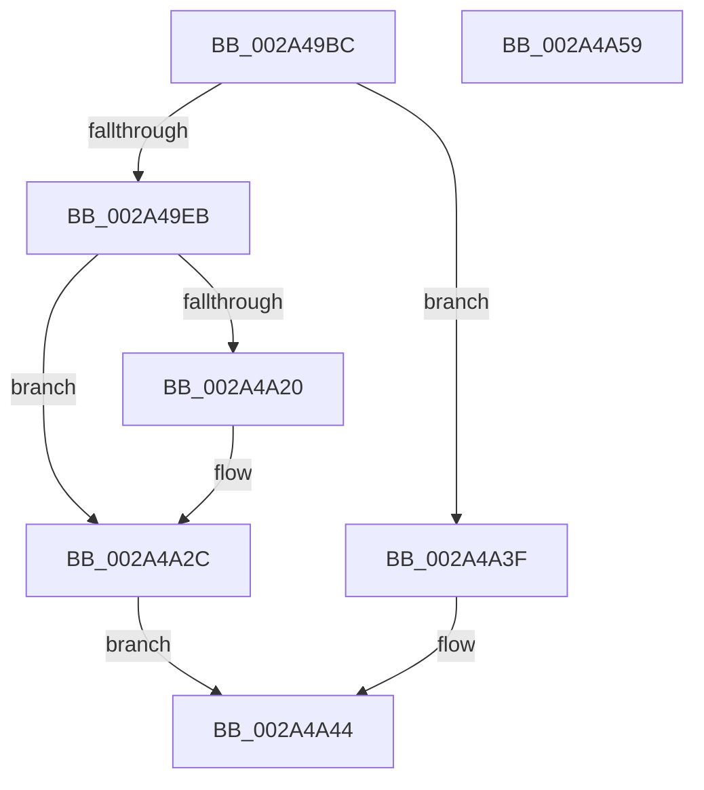

# MmQueryProcessWorkingSetSwapPages

- RVA: `0x002A49BC`–`0x002A4A5A` (길이 `158` bytes)
- VA: `0x00000001402A49BC`
- 실행 섹션: `.text`
- PDB 이름 있음: `예`; PDB Function 태그: `아니요`
- unwind 정보 RVA: `0x0005C954`
- 디코드: `40`개 명령, `158/158` bytes 표시
- 미해석 바이트: `0` (있으면 어셈블리에 `.byte`로 보존)

> 이 문서는 커널 이미지의 기계어와 PDB 기호를 분석해 생성했습니다. 4번과 5번은 함수 원형과 자료형을 바이너리 사용 방식에서 추정한 C 해석이며 원본 소스 복구 결과는 아닙니다.

## 1. Dependencies

- 직접 호출 지점: **4**; 고유 호출 대상: **3**
- 직접 호출자로 확인된 함수: **3**
- RIP 상대 이미지 참조: **1**

### Outgoing calls
- `0x002A49E0` → [MiGetWorkingSetSwapSupport](MiGetWorkingSetSwapSupport_function_002A35A0.md) (function, `0x002A35A0`)
- `0x002A4A0A` → [ExAcquireSpinLockExclusive](../24/ExAcquireSpinLockExclusive_function_00248690.md) (function, `0x00248690`)
- `0x002A4A15` → [MiGetWorkingSetSwapSupport](MiGetWorkingSetSwapSupport_function_002A35A0.md) (function, `0x002A35A0`)
- `0x002A4A36` → [MiReleaseSpinLockExclusive](../24/MiReleaseSpinLockExclusive_function_002482C0.md) (function, `0x002482C0`)

### Direct callers
- [PfpPrivSourceEnum](../../page/91/PfpPrivSourceEnum_function_0091BF00.md) at `0x0091C45B`
- [SmStoreCompressionStop](../../page/A6/SmStoreCompressionStop_function_00A6197C.md) at `0x00A61A8C`
- [SmStoreCompressionStart](../../page/A6/SmStoreCompressionStart_function_00A61AD0.md) at `0x00A61B55`

### Static image references
- `0x002A49F8` → RVA `0x00E30088` (`.data`; read)

## 2. Other-region calls and transfers

- 다른 실행 섹션으로 향하는 call: **0**
- 별도 외부 분기/꼬리 이동을 확인하지 못했습니다.

## 3. Assembly (complete function range)

```asm
002A49BC  48 89 5C 24 08                  mov qword ptr [rsp + 8], rbx
002A49C1  48 89 6C 24 10                  mov qword ptr [rsp + 0x10], rbp
002A49C6  48 89 74 24 18                  mov qword ptr [rsp + 0x18], rsi
002A49CB  57                              push rdi
002A49CC  48 83 EC 20                     sub rsp, 0x20
002A49D0  48 8D B9 00 04 00 00            lea rdi, [rcx + 0x400]
002A49D7  4C 8B C1                        mov r8, rcx
002A49DA  48 8B CF                        mov rcx, rdi
002A49DD  48 8B F2                        mov rsi, rdx
002A49E0  E8 BB EB FF FF                  call 0x1402a35a0
002A49E5  48 83 F8 02                     cmp rax, 2
002A49E9  76 54                           jbe 0x1402a4a3f
002A49EB  41 0F B7 90 AE 04 00 00         movzx edx, word ptr [r8 + 0x4ae]
002A49F3  BB 25 02 00 C0                  mov ebx, 0xc0000225
002A49F8  48 8B 05 89 B6 B8 00            mov rax, qword ptr [rip + 0xb8b689]
002A49FF  48 8B 2C D0                     mov rbp, qword ptr [rax + rdx*8]
002A4A03  48 8D 8D A0 04 00 00            lea rcx, [rbp + 0x4a0]
002A4A0A  E8 81 3C FA FF                  call 0x140248690
002A4A0F  48 8B CF                        mov rcx, rdi
002A4A12  44 8A C8                        mov r9b, al
002A4A15  E8 86 EB FF FF                  call 0x1402a35a0
002A4A1A  48 83 F8 02                     cmp rax, 2
002A4A1E  76 0C                           jbe 0x1402a4a2c
002A4A20  48 8B 10                        mov rdx, qword ptr [rax]
002A4A23  33 DB                           xor ebx, ebx
002A4A25  4C 8B 42 18                     mov r8, qword ptr [rdx + 0x18]
002A4A29  4C 89 06                        mov qword ptr [rsi], r8
002A4A2C  41 8A D1                        mov dl, r9b
002A4A2F  48 8D 8D A0 04 00 00            lea rcx, [rbp + 0x4a0]
002A4A36  E8 85 38 FA FF                  call 0x1402482c0
002A4A3B  8B C3                           mov eax, ebx
002A4A3D  EB 05                           jmp 0x1402a4a44
002A4A3F  B8 25 02 00 C0                  mov eax, 0xc0000225
002A4A44  48 8B 5C 24 30                  mov rbx, qword ptr [rsp + 0x30]
002A4A49  48 8B 6C 24 38                  mov rbp, qword ptr [rsp + 0x38]
002A4A4E  48 8B 74 24 40                  mov rsi, qword ptr [rsp + 0x40]
002A4A53  48 83 C4 20                     add rsp, 0x20
002A4A57  5F                              pop rdi
002A4A58  C3                              ret
002A4A59  CC                              int3
```

## 4. C-style interpretation (structured pseudocode)

```c
__int64 __fastcall MmQueryProcessWorkingSetSwapPages(__int64 a1, __int64 a2)
{
    __int64 result;
    __int64 v_rbx;
    __int64 v_rsp;
    unsigned __int64 v_stack_p10;
    unsigned __int64 v_stack_p18;
    unsigned __int64 v_stack_p8;

    v_stack_p8 = v_rbx;
    v_stack_p10 = v_rbp;
    v_stack_p18 = v_rsi;
    v_rsp = (v_rsp) - (32);
    result = MiGetWorkingSetSwapSupport(a1 + 1024, a2, a1, a4);
    if (result <= 2) goto loc_002A4A3F;
    result = ExAcquireSpinLockExclusive(*(unsigned __int64 *)(*(unsigned __int64 *)(v_rip + 12105353) + *(unsigned __int16 *)(a1 + 1198) * 8) + 1184, *(unsigned __int16 *)(a1 + 1198), a1, a4);
    result = MiGetWorkingSetSwapSupport(a1 + 1024, *(unsigned __int16 *)(a1 + 1198), a1, (unsigned __int8)(result));
    v_rbx = (unsigned int)(0xC0000225ULL);
    if (result >= = 2) {
        a2 = *(unsigned __int64 *)(result);
        v_rbx = 0;
        a3 = *(unsigned __int64 *)(a2 + 24);
        *(unsigned __int64 *)(a2) = a3;
    }
    result = MiReleaseSpinLockExclusive(*(unsigned __int64 *)(*(unsigned __int64 *)(v_rip + 12105353) + *(unsigned __int16 *)(a1 + 1198) * 8) + 1184, (unsigned __int8)((unsigned __int8)(result)), a3, (unsigned __int8)(result));
    goto loc_002A4A44;
loc_002A4A3F:
loc_002A4A44:
    v_rsp = (v_rsp) + (32);
    return (unsigned int)(0xC0000225ULL);
}
```

## 5. (Beta) C Style

```c
int64_t MmQueryProcessWorkingSetSwapPages(void *Arg1, void *Arg2)
{
    uint8_t *arg1 = (uint8_t *)Arg1;
    uint8_t *arg2 = (uint8_t *)Arg2;

    int64_t result;
    int64_t local_rbx;
    int64_t local_rsp;
    uint64_t v_stack_p10;
    uint64_t v_stack_p18;
    uint64_t v_stack_p8;

    v_stack_p8 = local_rbx;
    v_stack_p10 = local_rbp;
    v_stack_p18 = local_rsi;
    local_rsp = (local_rsp) - (32);
    result = MiGetWorkingSetSwapSupport(Arg1 + 1024, Arg2, Arg1, a4);
    if (result <= 2) goto loc_002A4A3F;
    result = ExAcquireSpinLockExclusive(*(uint64_t *)(*(uint64_t *)(v_rip + 0xB8B689) + *(uint16_t *)(arg1 + 0x4AE) * 8) + 1184, *(uint16_t *)(arg1 + 0x4AE), Arg1, a4);
    result = MiGetWorkingSetSwapSupport(Arg1 + 1024, *(uint16_t *)(arg1 + 0x4AE), Arg1, (uint8_t)(result));
    local_rbx = (uint32_t)(0xC0000225ULL);
    if (result >= = 2) {
        Arg2 = *(uint64_t *)(result);
        local_rbx = 0;
        a3 = *(uint64_t *)(arg2 + 0x18);
        *(uint64_t *)(arg2) = a3;
    }
    result = MiReleaseSpinLockExclusive(*(uint64_t *)(*(uint64_t *)(v_rip + 0xB8B689) + *(uint16_t *)(arg1 + 0x4AE) * 8) + 1184, (uint8_t)((uint8_t)(result)), a3, (uint8_t)(result));
    goto loc_002A4A44;
loc_002A4A3F:
loc_002A4A44:
    local_rsp = (local_rsp) + (32);
    return (uint32_t)(0xC0000225ULL);
}
```

### 관측된 메모리 오프셋

구조체 형식이 확인되지 않은 접근은 인자 기준의 오프셋으로만 기록했습니다.

| 기준 인자 | 오프셋 표현 | 폭 (bit) | 접근 |
|---|---:|---:|---|
| `Arg1` | `+ 0x400` | `64` | `R` |
| `Arg2` | `+ 0x0` | `64` | `W` |

## 6. Execution-region graph

[열기: 2D/3D 그래프와 함수 탐색 컨트롤 패널](../../../control-panel.html?section=text&rva=0x002A49BC&view=graph)

- 2D 그래프는 위에서 아래로 흐르고, 3D 그래프는 빈 공간을 드래그해 회전합니다. Shift+드래그는 이동, 휠은 확대·축소, 함수 노드 선택은 대상 보고서 이동입니다.

### Static fallback


