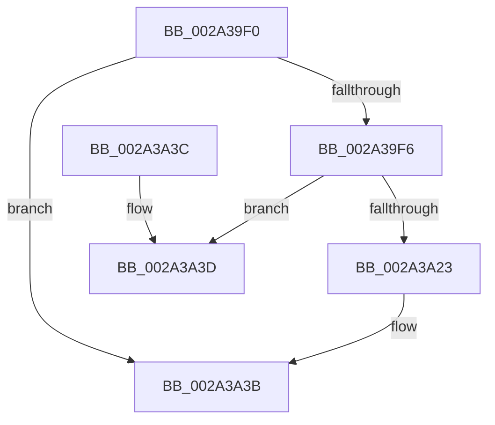

# MmUnlockPagableImageSection

- RVA: `0x002A39F0`–`0x002A3A58` (길이 `104` bytes)
- VA: `0x00000001402A39F0`
- 실행 섹션: `.text`
- PDB 이름 있음: `예`; PDB Function 태그: `아니요`
- unwind 정보 RVA: `0x000687B0`
- 디코드: `31`개 명령, `104/104` bytes 표시
- 미해석 바이트: `0` (있으면 어셈블리에 `.byte`로 보존)

> 이 문서는 커널 이미지의 기계어와 PDB 기호를 분석해 생성했습니다. 4번과 5번은 함수 원형과 자료형을 바이너리 사용 방식에서 추정한 C 해석이며 원본 소스 복구 결과는 아닙니다.

## 1. Dependencies

- 직접 호출 지점: **5**; 고유 호출 대상: **5**
- 직접 호출자로 확인된 함수: **18**
- RIP 상대 이미지 참조: **0**

### Outgoing calls
- `0x002A3A03` → [MmLockLoadedModuleListShared](../2F/MmLockLoadedModuleListShared_function_002F21E4.md) (function, `0x002F21E4`)
- `0x002A3A0E` → [MmFindDataTableEntryByAddress](MmFindDataTableEntryByAddress_function_002A3C0C.md) (function, `0x002A3C0C`)
- `0x002A3A19` → [MmUnlockLoadedModuleListShared](../2F/MmUnlockLoadedModuleListShared_function_002F2230.md) (function, `0x002F2230`)
- `0x002A3A2C` → [MiLockPagableImageSection](MiLockPagableImageSection_function_002A3A60.md) (function, `0x002A3A60`)
- `0x002A3A52` → [KeBugCheckEx](../4F/KeBugCheckEx_function_004FD660.md) (function, `0x004FD660`)

### Direct callers
- [PoRunDownDeviceObject](../26/PoRunDownDeviceObject_function_0026FFFC.md) at `0x0027009D`
- [HalpPowerStateCallback](../4B/HalpPowerStateCallback_function_004B8150.md) at `0x004B816E`
- [IopLiveDumpCapture](../59/IopLiveDumpCapture_function_0059AF88.md) at `0x0059B017`
- [DifMmUnlockPagableImageSectionWrapper](../63/DifMmUnlockPagableImageSectionWrapper_function_00636B60.md) at `0x00636C26`
- [PnprUnlockPagesForReplace](../../page/73/PnprUnlockPagesForReplace_function_0073AA5C.md) at `0x0073AA67`
- [KiStartDynamicProcessor](../../page/74/KiStartDynamicProcessor_function_007456C8.md) at `0x00745B74`
- [PopDirectedDripsNotifyAppsAndServices](../../page/75/PopDirectedDripsNotifyAppsAndServices_function_0075792C.md) at `0x007579E3`
- [MiApplyImageHotPatch](../../page/80/MiApplyImageHotPatch_function_00802330.md) at `0x0080257F`
- [HalpPowerInitSystem](../../pagelk/B5/HalpPowerInitSystem_function_00B5C540.md) at `0x00B5C572`
- [MiShutdownSystem](../../pagelk/B7/MiShutdownSystem_function_00B73934.md) at `0x00B73A48`
- [MmDuplicateMemory](../../pagelk/B7/MmDuplicateMemory_function_00B74158.md) at `0x00B74552`
- [PopUnlockAfterSleepWorker](../../pagelk/B7/PopUnlockAfterSleepWorker_function_00B782A0.md) at `0x00B78337`
- [ExQuerySystemLockInformation](../../pagelk/B7/ExQuerySystemLockInformation_function_00B793DC.md) at `0x00B79484`
- [IoUnregisterShutdownNotification](../../pagelk/B7/IoUnregisterShutdownNotification_function_00B7CCC0.md) at `0x00B7CDB1`
- [VfClearDifWithoutReboot](../../pagevrfy/B9/VfClearDifWithoutReboot_function_00B93880.md) at `0x00B93890`
- [VfClearDifWithoutReboot](../../pagevrfy/B9/VfClearDifWithoutReboot_function_00B93880.md) at `0x00B938A9`
- [BgkpUnlockBgfxCodeSection](../../pagebgfx/BC/BgkpUnlockBgfxCodeSection_function_00BC4910.md) at `0x00BC49B3`
- [KiInitializeMTRR](../../init/C3/KiInitializeMTRR_function_00C39A1C.md) at `0x00C39D4D`
- [MiInitSystem](../../init/C5/MiInitSystem_function_00C5E6C0.md) at `0x00C5E9F4`

### Static image references
- 디코드된 RIP-relative 메모리 참조가 없습니다.

## 2. Other-region calls and transfers

- 다른 실행 섹션으로 향하는 call: **0**
- 별도 외부 분기/꼬리 이동을 확인하지 못했습니다.

## 3. Assembly (complete function range)

```asm
002A39F0  48 83 F9 01                     cmp rcx, 1
002A39F4  74 45                           je 0x1402a3a3b
002A39F6  48 89 5C 24 08                  mov qword ptr [rsp + 8], rbx
002A39FB  57                              push rdi
002A39FC  48 83 EC 30                     sub rsp, 0x30
002A3A00  48 8B D9                        mov rbx, rcx
002A3A03  E8 DC E7 04 00                  call 0x1402f21e4
002A3A08  48 8B CB                        mov rcx, rbx
002A3A0B  44 8A D8                        mov r11b, al
002A3A0E  E8 F9 01 00 00                  call 0x1402a3c0c
002A3A13  41 8A CB                        mov cl, r11b
002A3A16  48 8B F8                        mov rdi, rax
002A3A19  E8 12 E8 04 00                  call 0x1402f2230
002A3A1E  48 85 FF                        test rdi, rdi
002A3A21  74 1A                           je 0x1402a3a3d
002A3A23  45 33 C0                        xor r8d, r8d
002A3A26  48 8B D3                        mov rdx, rbx
002A3A29  48 8B CF                        mov rcx, rdi
002A3A2C  E8 2F 00 00 00                  call 0x1402a3a60
002A3A31  48 8B 5C 24 40                  mov rbx, qword ptr [rsp + 0x40]
002A3A36  48 83 C4 30                     add rsp, 0x30
002A3A3A  5F                              pop rdi
002A3A3B  C3                              ret
002A3A3C  CC                              int3
002A3A3D  48 83 64 24 20 00               and qword ptr [rsp + 0x20], 0
002A3A43  45 33 C9                        xor r9d, r9d
002A3A46  4C 8B C3                        mov r8, rbx
002A3A49  BA 12 10 00 00                  mov edx, 0x1012
002A3A4E  41 8D 49 1A                     lea ecx, [r9 + 0x1a]
002A3A52  E8 09 9C 25 00                  call 0x1404fd660
002A3A57  CC                              int3
```

## 4. C-style interpretation (structured pseudocode)

```c
__int64 __fastcall MmUnlockPagableImageSection(__int64 a1, __int64 a2, int a3, int a4)
{
    __int64 result;
    __int64 v_rsp;
    unsigned __int64 v_stack_p20;
    unsigned __int64 v_stack_p8;

    if (a1 == 1) goto loc_002A3A3B;
    v_stack_p8 = v_rbx;
    v_rsp = (v_rsp) - (48);
    result = MmLockLoadedModuleListShared(a1, a2, a3, a4);
    result = MmFindDataTableEntryByAddress(a1, a2, a3, a4);
    result = MmUnlockLoadedModuleListShared((unsigned __int8)((unsigned __int8)(result)), a2, a3, a4);
    if (result == 0) goto loc_002A3A3D;
    a3 = 0;
    result = MiLockPagableImageSection(result, a1, a3, a4);
    v_rsp = (v_rsp) + (48);
loc_002A3A3B:
    return result;
loc_002A3A3D:
    a4 = 0;
    result = KeBugCheckEx(a4 + 26, (unsigned int)(0x1012ULL), v_stack_p8, a4);
    return result;
}
```

## 5. (Beta) C Style

```c
int64_t MmUnlockPagableImageSection(int64_t Arg1, int64_t Arg2, int32_t Arg3, int32_t Arg4)
{
    int64_t result;
    int64_t local_rsp;
    uint64_t v_stack_p20;
    uint64_t v_stack_p8;

    if (Arg1 == 1) goto loc_002A3A3B;
    v_stack_p8 = local_rbx;
    local_rsp = (local_rsp) - (48);
    result = MmLockLoadedModuleListShared(Arg1, Arg2, Arg3, Arg4);
    result = MmFindDataTableEntryByAddress(Arg1, Arg2, Arg3, Arg4);
    result = MmUnlockLoadedModuleListShared((uint8_t)((uint8_t)(result)), Arg2, Arg3, Arg4);
    if (result == 0) goto loc_002A3A3D;
    Arg3 = 0;
    result = MiLockPagableImageSection(result, Arg1, Arg3, Arg4);
    local_rsp = (local_rsp) + (48);
loc_002A3A3B:
    return result;
loc_002A3A3D:
    Arg4 = 0;
    result = KeBugCheckEx(Arg4 + 26, (uint32_t)(0x1012ULL), v_stack_p8, Arg4);
    return result;
}
```

## 6. Execution-region graph

[열기: 2D/3D 그래프와 함수 탐색 컨트롤 패널](../../../control-panel.html?section=text&rva=0x002A39F0&view=graph)

- 2D 그래프는 위에서 아래로 흐르고, 3D 그래프는 빈 공간을 드래그해 회전합니다. Shift+드래그는 이동, 휠은 확대·축소, 함수 노드 선택은 대상 보고서 이동입니다.

### Static fallback


