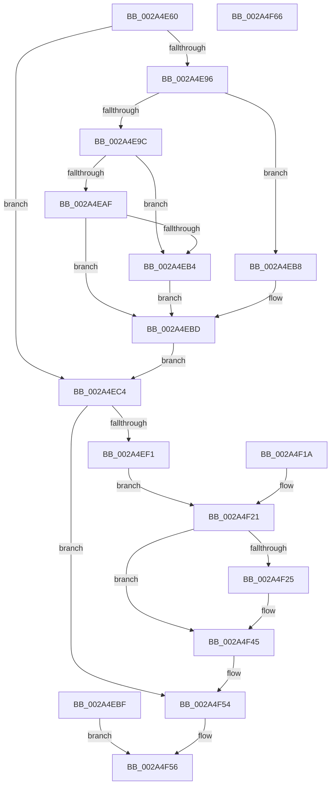

# NtShutdownWorkerFactory

- RVA: `0x002A4E60`–`0x002A4F67` (길이 `263` bytes)
- VA: `0x00000001402A4E60`
- 실행 섹션: `.text`
- PDB 이름 있음: `예`; PDB Function 태그: `아니요`
- unwind 정보 RVA: `0x00068958`
- 디코드: `67`개 명령, `263/263` bytes 표시
- 미해석 바이트: `0` (있으면 어셈블리에 `.byte`로 보존)

> 이 문서는 커널 이미지의 기계어와 PDB 기호를 분석해 생성했습니다. 4번과 5번은 함수 원형과 자료형을 바이너리 사용 방식에서 추정한 C 해석이며 원본 소스 복구 결과는 아닙니다.

## 1. Dependencies

- 직접 호출 지점: **7**; 고유 호출 대상: **7**
- 직접 호출자로 확인된 함수: **0**
- RIP 상대 이미지 참조: **1**

### Outgoing calls
- `0x002A4EB8` → [ExRaiseDatatypeMisalignment](../../page/89/ExRaiseDatatypeMisalignment_function_00899FD0.md) (function, `0x00899FD0`)
- `0x002A4EE6` → [ObReferenceObjectByHandle](../../page/86/ObReferenceObjectByHandle_function_00868DB0.md) (function, `0x00868DB0`)
- `0x002A4EF9` → [ExpShutdownWorkerFactory](ExpShutdownWorkerFactory_function_002A4F70.md) (function, `0x002A4F70`)
- `0x002A4F02` → [ExWaitForRundownProtectionRelease](ExWaitForRundownProtectionRelease_function_002A4CB0.md) (function, `0x002A4CB0`)
- `0x002A4F33` → [KeAcquireInStackQueuedSpinLock](../27/KeAcquireInStackQueuedSpinLock_function_002757A0.md) (function, `0x002757A0`)
- `0x002A4F40` → [KeReleaseInStackQueuedSpinLock](../34/KeReleaseInStackQueuedSpinLock_function_00342CE0.md) (function, `0x00342CE0`)
- `0x002A4F4F` → [ObfDereferenceObjectWithTag](../2F/ObfDereferenceObjectWithTag_function_002F78E0.md) (function, `0x002F78E0`)

### Direct callers
- 이 함수 시작 RVA로 연결되는 직접 call은 확인되지 않았습니다. 간접 호출은 완전히 역산할 수 없습니다.

### Static image references
- `0x002A4EC4` → RVA `0x00FC51E0` (`ALMOSTRO`; read)

## 2. Other-region calls and transfers

- 다른 실행 섹션으로 향하는 call: **2**
  - `0x002A4EB8` → [ExRaiseDatatypeMisalignment](../../page/89/ExRaiseDatatypeMisalignment_function_00899FD0.md) (`.text` → `PAGE`)
  - `0x002A4EE6` → [ObReferenceObjectByHandle](../../page/86/ObReferenceObjectByHandle_function_00868DB0.md) (`.text` → `PAGE`)
- 별도 외부 분기/꼬리 이동을 확인하지 못했습니다.

## 3. Assembly (complete function range)

```asm
002A4E60  48 89 5C 24 08                  mov qword ptr [rsp + 8], rbx
002A4E65  48 89 74 24 10                  mov qword ptr [rsp + 0x10], rsi
002A4E6A  57                              push rdi
002A4E6B  48 83 EC 50                     sub rsp, 0x50
002A4E6F  48 8B FA                        mov rdi, rdx
002A4E72  0F 57 C0                        xorps xmm0, xmm0
002A4E75  33 C0                           xor eax, eax
002A4E77  0F 11 44 24 30                  movups xmmword ptr [rsp + 0x30], xmm0
002A4E7C  48 89 44 24 40                  mov qword ptr [rsp + 0x40], rax
002A4E81  65 48 8B 04 25 88 01 00 00      mov rax, qword ptr gs:[0x188]
002A4E8A  44 8A 88 32 02 00 00            mov r9b, byte ptr [rax + 0x232]
002A4E91  45 84 C9                        test r9b, r9b
002A4E94  74 2E                           je 0x1402a4ec4
002A4E96  40 F6 C7 03                     test dil, 3
002A4E9A  75 1C                           jne 0x1402a4eb8
002A4E9C  48 8D 42 04                     lea rax, [rdx + 4]
002A4EA0  48 BA 00 00 FF FF FF 7F 00 00   movabs rdx, 0x7fffffff0000
002A4EAA  48 3B C2                        cmp rax, rdx
002A4EAD  77 05                           ja 0x1402a4eb4
002A4EAF  48 3B C7                        cmp rax, rdi
002A4EB2  73 09                           jae 0x1402a4ebd
002A4EB4  8A 02                           mov al, byte ptr [rdx]
002A4EB6  EB 05                           jmp 0x1402a4ebd
002A4EB8  E8 13 51 5F 00                  call 0x140899fd0
002A4EBD  EB 05                           jmp 0x1402a4ec4
002A4EBF  E9 92 00 00 00                  jmp 0x1402a4f56
002A4EC4  4C 8B 05 15 03 D2 00            mov r8, qword ptr [rip + 0xd20315]
002A4ECB  48 83 64 24 70 00               and qword ptr [rsp + 0x70], 0
002A4ED1  48 83 64 24 28 00               and qword ptr [rsp + 0x28], 0
002A4ED7  48 8D 44 24 70                  lea rax, [rsp + 0x70]
002A4EDC  48 89 44 24 20                  mov qword ptr [rsp + 0x20], rax
002A4EE1  BA 20 00 00 00                  mov edx, 0x20
002A4EE6  E8 C5 3E 5C 00                  call 0x140868db0
002A4EEB  8B F0                           mov esi, eax
002A4EED  85 C0                           test eax, eax
002A4EEF  78 63                           js 0x1402a4f54
002A4EF1  48 8B 5C 24 70                  mov rbx, qword ptr [rsp + 0x70]
002A4EF6  48 8B CB                        mov rcx, rbx
002A4EF9  E8 72 00 00 00                  call 0x1402a4f70
002A4EFE  48 8D 4B 68                     lea rcx, [rbx + 0x68]
002A4F02  E8 A9 FD FF FF                  call 0x1402a4cb0
002A4F07  48 81 C3 88 01 00 00            add rbx, 0x188
002A4F0E  48 89 5C 24 78                  mov qword ptr [rsp + 0x78], rbx
002A4F13  8B 03                           mov eax, dword ptr [rbx]
002A4F15  F0 01 07                        lock add dword ptr [rdi], eax
002A4F18  EB 07                           jmp 0x1402a4f21
002A4F1A  8B F0                           mov esi, eax
002A4F1C  48 8B 5C 24 78                  mov rbx, qword ptr [rsp + 0x78]
002A4F21  85 F6                           test esi, esi
002A4F23  78 20                           js 0x1402a4f45
002A4F25  48 8D 54 24 30                  lea rdx, [rsp + 0x30]
002A4F2A  48 8B 4C 24 70                  mov rcx, qword ptr [rsp + 0x70]
002A4F2F  48 8B 49 10                     mov rcx, qword ptr [rcx + 0x10]
002A4F33  E8 68 08 FD FF                  call 0x1402757a0
002A4F38  83 23 00                        and dword ptr [rbx], 0
002A4F3B  48 8D 4C 24 30                  lea rcx, [rsp + 0x30]
002A4F40  E8 9B DD 09 00                  call 0x140342ce0
002A4F45  BA 44 66 6C 74                  mov edx, 0x746c6644
002A4F4A  48 8B 4C 24 70                  mov rcx, qword ptr [rsp + 0x70]
002A4F4F  E8 8C 29 05 00                  call 0x1402f78e0
002A4F54  8B C6                           mov eax, esi
002A4F56  48 8B 5C 24 60                  mov rbx, qword ptr [rsp + 0x60]
002A4F5B  48 8B 74 24 68                  mov rsi, qword ptr [rsp + 0x68]
002A4F60  48 83 C4 50                     add rsp, 0x50
002A4F64  5F                              pop rdi
002A4F65  C3                              ret
002A4F66  CC                              int3
```

## 4. C-style interpretation (structured pseudocode)

```c
__int64 __fastcall NtShutdownWorkerFactory(__int64 a1, __int64 a2)
{
    __int64 result;
    __int64 v_rbx;
    __int64 v_rsp;
    unsigned __int64 v_stack_m18;
    unsigned __int64 v_stack_m28;
    unsigned __int64 v_stack_m30;
    unsigned __int64 v_stack_m38;
    unsigned __int64 v_stack_p10;
    unsigned __int64 v_stack_p18;
    unsigned __int64 v_stack_p20;
    unsigned __int64 v_stack_p8;

    v_stack_p8 = v_rbx;
    v_stack_p10 = v_rsi;
    v_rsp = (v_rsp) - (80);
    result = 0;
    v_stack_m28 = v_xmm0;
    v_stack_m18 = 0;
    if ((unsigned __int8)(*(unsigned __int8 *)(*(unsigned __int64 *)(gs_base + (0 + 392)) + 562)) == 0) goto loc_002A4EC4;
    if ((((unsigned __int8)(a2)) & (3)) != 0) goto loc_002A4EB8;
    if ((a2 + 4) > a2) goto loc_002A4EB4;
    if ((a2 + 4) >= a2) goto loc_002A4EBD;
loc_002A4EB4:
    goto loc_002A4EBD;
loc_002A4EB8:
    result = ExRaiseDatatypeMisalignment(a1, a2, a3, *(unsigned __int8 *)(*(unsigned __int64 *)(gs_base + (0 + 392)) + 562));
loc_002A4EBD:
    goto loc_002A4EC4;
loc_002A4EC4:
    v_stack_m38 = v_stack_p18;
    result = ObReferenceObjectByHandle(a1, 32, *(unsigned __int64 *)(v_rip + 13763349), *(unsigned __int8 *)(*(unsigned __int64 *)(gs_base + (0 + 392)) + 562));
    if (sign_flag) goto loc_002A4F54;
    result = ExpShutdownWorkerFactory(v_stack_p18, 32, *(unsigned __int64 *)(v_rip + 13763349), *(unsigned __int8 *)(*(unsigned __int64 *)(gs_base + (0 + 392)) + 562));
    result = ExWaitForRundownProtectionRelease(v_stack_p18 + 104, 32, *(unsigned __int64 *)(v_rip + 13763349), *(unsigned __int8 *)(*(unsigned __int64 *)(gs_base + (0 + 392)) + 562));
    v_rbx = (v_stack_p18) + (392);
    v_stack_p20 = v_rbx;
    goto loc_002A4F21;
loc_002A4F21:
    result = (unsigned int)(*(unsigned int *)(v_rbx));
    if (!(sign_flag)) {
        a2 = v_stack_m28;
        a1 = v_stack_p18;
        a1 = *(unsigned __int64 *)(a1 + 16);
        result = KeAcquireInStackQueuedSpinLock(a1, a2, *(unsigned __int64 *)(v_rip + 13763349), *(unsigned __int8 *)(*(unsigned __int64 *)(gs_base + (0 + 392)) + 562));
        a1 = v_stack_m28;
        result = KeReleaseInStackQueuedSpinLock(a1, a2, *(unsigned __int64 *)(v_rip + 13763349), *(unsigned __int8 *)(*(unsigned __int64 *)(gs_base + (0 + 392)) + 562));
    }
    result = ObfDereferenceObjectWithTag(v_stack_p18, (unsigned int)(0x746C6644ULL), *(unsigned __int64 *)(v_rip + 13763349), *(unsigned __int8 *)(*(unsigned __int64 *)(gs_base + (0 + 392)) + 562));
loc_002A4F54:
loc_002A4F56:
    v_rsp = (v_rsp) + (80);
    return (unsigned int)((unsigned int)((unsigned int)((unsigned int)(result))));
}
```

## 5. (Beta) C Style

```c
int64_t NtShutdownWorkerFactory(int64_t Arg1, void *Arg2)
{
    uint8_t *arg2 = (uint8_t *)Arg2;

    int64_t result;
    int64_t local_rbx;
    int64_t local_rsp;
    uint64_t v_stack_m18;
    uint64_t v_stack_m28;
    uint64_t v_stack_m30;
    uint64_t v_stack_m38;
    uint64_t v_stack_p10;
    uint64_t v_stack_p18;
    uint64_t v_stack_p20;
    uint64_t v_stack_p8;

    v_stack_p8 = local_rbx;
    v_stack_p10 = local_rsi;
    local_rsp = (local_rsp) - (80);
    result = 0;
    v_stack_m28 = v_xmm0;
    v_stack_m18 = 0;
    if ((uint8_t)(*(uint8_t *)(*(uint64_t *)(gs_base + (0 + 0x188)) + 0x232)) == 0) goto loc_002A4EC4;
    if ((((uint8_t)(Arg2)) & (3)) != 0) goto loc_002A4EB8;
    if ((Arg2 + 4) > Arg2) goto loc_002A4EB4;
    if ((Arg2 + 4) >= Arg2) goto loc_002A4EBD;
loc_002A4EB4:
    goto loc_002A4EBD;
loc_002A4EB8:
    result = ExRaiseDatatypeMisalignment(Arg1, Arg2, a3, *(uint8_t *)(*(uint64_t *)(gs_base + (0 + 0x188)) + 0x232));
loc_002A4EBD:
    goto loc_002A4EC4;
loc_002A4EC4:
    v_stack_m38 = v_stack_p18;
    result = ObReferenceObjectByHandle(Arg1, 32, *(uint64_t *)(v_rip + 0xD20315), *(uint8_t *)(*(uint64_t *)(gs_base + (0 + 0x188)) + 0x232));
    if (sign_flag) goto loc_002A4F54;
    result = ExpShutdownWorkerFactory(v_stack_p18, 32, *(uint64_t *)(v_rip + 0xD20315), *(uint8_t *)(*(uint64_t *)(gs_base + (0 + 0x188)) + 0x232));
    result = ExWaitForRundownProtectionRelease(v_stack_p18 + 104, 32, *(uint64_t *)(v_rip + 0xD20315), *(uint8_t *)(*(uint64_t *)(gs_base + (0 + 0x188)) + 0x232));
    local_rbx = (v_stack_p18) + (392);
    v_stack_p20 = local_rbx;
    goto loc_002A4F21;
loc_002A4F21:
    result = (uint32_t)(*(uint32_t *)(local_rbx));
    if (!(sign_flag)) {
        Arg2 = v_stack_m28;
        Arg1 = v_stack_p18;
        Arg1 = *(uint64_t *)(Arg1 + 0x10);
        result = KeAcquireInStackQueuedSpinLock(Arg1, Arg2, *(uint64_t *)(v_rip + 0xD20315), *(uint8_t *)(*(uint64_t *)(gs_base + (0 + 0x188)) + 0x232));
        Arg1 = v_stack_m28;
        result = KeReleaseInStackQueuedSpinLock(Arg1, Arg2, *(uint64_t *)(v_rip + 0xD20315), *(uint8_t *)(*(uint64_t *)(gs_base + (0 + 0x188)) + 0x232));
    }
    result = ObfDereferenceObjectWithTag(v_stack_p18, (uint32_t)(0x746C6644ULL), *(uint64_t *)(v_rip + 0xD20315), *(uint8_t *)(*(uint64_t *)(gs_base + (0 + 0x188)) + 0x232));
loc_002A4F54:
loc_002A4F56:
    local_rsp = (local_rsp) + (80);
    return (uint32_t)((uint32_t)((uint32_t)((uint32_t)(result))));
}
```

### 관측된 메모리 오프셋

구조체 형식이 확인되지 않은 접근은 인자 기준의 오프셋으로만 기록했습니다.

| 기준 인자 | 오프셋 표현 | 폭 (bit) | 접근 |
|---|---:|---:|---|
| `Arg2` | `+ 0x4` | `64` | `R` |

## 6. Execution-region graph

[열기: 2D/3D 그래프와 함수 탐색 컨트롤 패널](../../../control-panel.html?section=text&rva=0x002A4E60&view=graph)

- 2D 그래프는 위에서 아래로 흐르고, 3D 그래프는 빈 공간을 드래그해 회전합니다. Shift+드래그는 이동, 휠은 확대·축소, 함수 노드 선택은 대상 보고서 이동입니다.

### Static fallback


