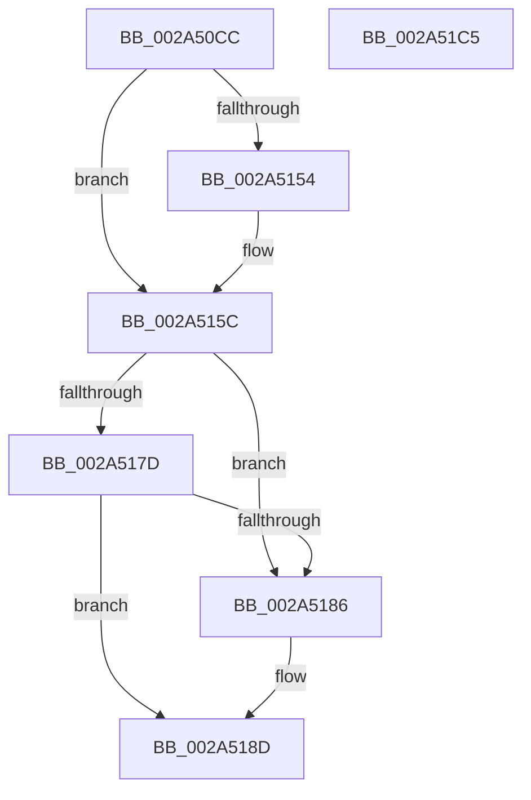

# PfSnDeactivateTrace

- RVA: `0x002A50CC`–`0x002A51C6` (길이 `250` bytes)
- VA: `0x00000001402A50CC`
- 실행 섹션: `.text`
- PDB 이름 있음: `예`; PDB Function 태그: `아니요`
- unwind 정보 RVA: `0x0005E6B4`
- 디코드: `61`개 명령, `250/250` bytes 표시
- 미해석 바이트: `0` (있으면 어셈블리에 `.byte`로 보존)

> 이 문서는 커널 이미지의 기계어와 PDB 기호를 분석해 생성했습니다. 4번과 5번은 함수 원형과 자료형을 바이너리 사용 방식에서 추정한 C 해석이며 원본 소스 복구 결과는 아닙니다.

## 1. Dependencies

- 직접 호출 지점: **11**; 고유 호출 대상: **6**
- 직접 호출자로 확인된 함수: **1**
- RIP 상대 이미지 참조: **2**

### Outgoing calls
- `0x002A50EF` → [KeAcquireSpinLockRaiseToDpc](../20/KeAcquireSpinLockRaiseToDpc_function_00208470.md) (function, `0x00208470`)
- `0x002A50FD` → [KeReleaseSpinLock](../39/KeReleaseSpinLock_function_00392BA0.md) (function, `0x00392BA0`)
- `0x002A5109` → [PfSnRemoveProcessTrace](PfSnRemoveProcessTrace_function_002A51CC.md) (function, `0x002A51CC`)
- `0x002A5118` → [ExReleaseRundownProtection](../34/ExReleaseRundownProtection_function_00349E80.md) (function, `0x00349E80`)
- `0x002A5127` → [KeAcquireSpinLockRaiseToDpc](../20/KeAcquireSpinLockRaiseToDpc_function_00208470.md) (function, `0x00208470`)
- `0x002A513E` → [KeCancelTimer](../23/KeCancelTimer_function_002327E0.md) (function, `0x002327E0`)
- `0x002A514B` → [KeReleaseSpinLock](../39/KeReleaseSpinLock_function_00392BA0.md) (function, `0x00392BA0`)
- `0x002A5157` → [ExReleaseRundownProtection](../34/ExReleaseRundownProtection_function_00349E80.md) (function, `0x00349E80`)
- `0x002A515F` → [ExWaitForRundownProtectionRelease](ExWaitForRundownProtectionRelease_function_002A4CB0.md) (function, `0x002A4CB0`)
- `0x002A516B` → [KeAcquireSpinLockRaiseToDpc](../20/KeAcquireSpinLockRaiseToDpc_function_00208470.md) (function, `0x00208470`)
- `0x002A51A3` → [KeReleaseSpinLock](../39/KeReleaseSpinLock_function_00392BA0.md) (function, `0x00392BA0`)

### Direct callers
- [PfSnEndTrace](../../page/8B/PfSnEndTrace_function_008B04A8.md) at `0x008B053E`

### Static image references
- `0x002A50E8` → RVA `0x00E67260` (`.data`; read)
- `0x002A518D` → RVA `0x00E67248` (`.data`; read/write)

## 2. Other-region calls and transfers

- 다른 실행 섹션으로 향하는 call: **0**
- 별도 외부 분기/꼬리 이동을 확인하지 못했습니다.

## 3. Assembly (complete function range)

```asm
002A50CC  48 8B C4                        mov rax, rsp
002A50CF  48 89 58 08                     mov qword ptr [rax + 8], rbx
002A50D3  48 89 68 10                     mov qword ptr [rax + 0x10], rbp
002A50D7  48 89 70 18                     mov qword ptr [rax + 0x18], rsi
002A50DB  48 89 78 20                     mov qword ptr [rax + 0x20], rdi
002A50DF  41 56                           push r14
002A50E1  48 83 EC 20                     sub rsp, 0x20
002A50E5  4C 8B F1                        mov r14, rcx
002A50E8  48 8D 0D 71 21 BC 00            lea rcx, [rip + 0xbc2171]
002A50EF  E8 7C 33 F6 FF                  call 0x140208470
002A50F4  8A D0                           mov dl, al
002A50F6  48 8D 0D 63 21 BC 00            lea rcx, [rip + 0xbc2163]
002A50FD  E8 9E DA 0E 00                  call 0x140392ba0
002A5102  49 8B 8E 60 01 00 00            mov rcx, qword ptr [r14 + 0x160]
002A5109  E8 BE 00 00 00                  call 0x1402a51cc
002A510E  49 8D AE 68 01 00 00            lea rbp, [r14 + 0x168]
002A5115  48 8B CD                        mov rcx, rbp
002A5118  E8 63 4D 0A 00                  call 0x140349e80
002A511D  49 8D B6 10 01 00 00            lea rsi, [r14 + 0x110]
002A5124  48 8B CE                        mov rcx, rsi
002A5127  E8 44 33 F6 FF                  call 0x140208470
002A512C  41 83 8E 18 01 00 00 02         or dword ptr [r14 + 0x118], 2
002A5134  49 8D 8E 88 00 00 00            lea rcx, [r14 + 0x88]
002A513B  40 8A F8                        mov dil, al
002A513E  E8 9D D6 F8 FF                  call 0x1402327e0
002A5143  40 8A D7                        mov dl, dil
002A5146  48 8B CE                        mov rcx, rsi
002A5149  8A D8                           mov bl, al
002A514B  E8 50 DA 0E 00                  call 0x140392ba0
002A5150  84 DB                           test bl, bl
002A5152  74 08                           je 0x1402a515c
002A5154  48 8B CD                        mov rcx, rbp
002A5157  E8 24 4D 0A 00                  call 0x140349e80
002A515C  48 8B CD                        mov rcx, rbp
002A515F  E8 4C FB FF FF                  call 0x1402a4cb0
002A5164  48 8D 0D F5 20 BC 00            lea rcx, [rip + 0xbc20f5]
002A516B  E8 00 33 F6 FF                  call 0x140208470
002A5170  49 8D 56 08                     lea rdx, [r14 + 8]
002A5174  4C 8B 0A                        mov r9, qword ptr [rdx]
002A5177  49 39 51 08                     cmp qword ptr [r9 + 8], rdx
002A517B  75 09                           jne 0x1402a5186
002A517D  4C 8B 42 08                     mov r8, qword ptr [rdx + 8]
002A5181  49 39 10                        cmp qword ptr [r8], rdx
002A5184  74 07                           je 0x1402a518d
002A5186  B9 03 00 00 00                  mov ecx, 3
002A518B  CD 29                           int 0x29
002A518D  FF 0D B5 20 BC 00               dec dword ptr [rip + 0xbc20b5]
002A5193  48 8D 0D C6 20 BC 00            lea rcx, [rip + 0xbc20c6]
002A519A  4D 89 08                        mov qword ptr [r8], r9
002A519D  8A D0                           mov dl, al
002A519F  4D 89 41 08                     mov qword ptr [r9 + 8], r8
002A51A3  E8 F8 D9 0E 00                  call 0x140392ba0
002A51A8  48 8B 5C 24 30                  mov rbx, qword ptr [rsp + 0x30]
002A51AD  33 C0                           xor eax, eax
002A51AF  48 8B 6C 24 38                  mov rbp, qword ptr [rsp + 0x38]
002A51B4  48 8B 74 24 40                  mov rsi, qword ptr [rsp + 0x40]
002A51B9  48 8B 7C 24 48                  mov rdi, qword ptr [rsp + 0x48]
002A51BE  48 83 C4 20                     add rsp, 0x20
002A51C2  41 5E                           pop r14
002A51C4  C3                              ret
002A51C5  CC                              int3
```

## 4. C-style interpretation (structured pseudocode)

```c
__int64 __fastcall PfSnDeactivateTrace(__int64 a1)
{
    __int64 result;
    __int64 v_rsp;
    unsigned __int64 v_stack_p10;
    unsigned __int64 v_stack_p18;
    unsigned __int64 v_stack_p20;
    unsigned __int64 v_stack_p8;

    *(unsigned __int64 *)(v_rsp + 8) = v_rbx;
    *(unsigned __int64 *)(v_rsp + 16) = v_rbp;
    *(unsigned __int64 *)(v_rsp + 24) = v_rsi;
    *(unsigned __int64 *)(v_rsp + 32) = v_rdi;
    v_rsp = (v_rsp) - (32);
    result = KeAcquireSpinLockRaiseToDpc(v_rip + 12329329, a2, a3, a4);
    result = KeReleaseSpinLock(v_rip + 12329315, (unsigned __int8)(result), a3, a4);
    result = PfSnRemoveProcessTrace(*(unsigned __int64 *)(a1 + 352), (unsigned __int8)(result), a3, a4);
    result = ExReleaseRundownProtection(a1 + 360, (unsigned __int8)(result), a3, a4);
    result = KeAcquireSpinLockRaiseToDpc(a1 + 272, (unsigned __int8)(result), a3, a4);
    result = KeCancelTimer(a1 + 136, (unsigned __int8)(result), a3, a4);
    result = KeReleaseSpinLock(a1 + 272, (unsigned __int8)((unsigned __int8)(result)), a3, a4);
    if ((unsigned __int8)((unsigned __int8)(result)) != 0) {
        a1 = a1 + 360;
        result = ExReleaseRundownProtection(a1, (unsigned __int8)((unsigned __int8)(result)), a3, a4);
    }
    result = ExWaitForRundownProtectionRelease(a1 + 360, (unsigned __int8)((unsigned __int8)(result)), a3, a4);
    result = KeAcquireSpinLockRaiseToDpc(v_rip + 12329205, (unsigned __int8)((unsigned __int8)(result)), a3, a4);
    if ((*(unsigned __int64 *)(*(unsigned __int64 *)(a1 + 8) + 8)) != (a1 + 8)) goto loc_002A5186;
    if ((*(unsigned __int64 *)(*(unsigned __int64 *)(a1 + 8 + 8))) != (a1 + 8)) {
        a1 = 3;
    }
    *(unsigned __int64 *)(*(unsigned __int64 *)(a1 + 8 + 8)) = *(unsigned __int64 *)(a1 + 8);
    *(unsigned __int64 *)(*(unsigned __int64 *)(a1 + 8) + 8) = *(unsigned __int64 *)(a1 + 8 + 8);
    result = KeReleaseSpinLock(v_rip + 12329158, (unsigned __int8)(result), *(unsigned __int64 *)(a1 + 8 + 8), *(unsigned __int64 *)(a1 + 8));
    result = 0;
    v_rsp = (v_rsp) + (32);
    return result;
}
```

## 5. (Beta) C Style

```c
int64_t PfSnDeactivateTrace(void *Arg1)
{
    uint8_t *arg1 = (uint8_t *)Arg1;

    int64_t result;
    int64_t local_rsp;
    uint64_t v_stack_p10;
    uint64_t v_stack_p18;
    uint64_t v_stack_p20;
    uint64_t v_stack_p8;

    *(uint64_t *)(local_rsp + 0x8) = local_rbx;
    *(uint64_t *)(local_rsp + 0x10) = local_rbp;
    *(uint64_t *)(local_rsp + 0x18) = local_rsi;
    *(uint64_t *)(local_rsp + 0x20) = local_rdi;
    local_rsp = (local_rsp) - (32);
    result = KeAcquireSpinLockRaiseToDpc(v_rip + 12329329, a2, a3, a4);
    result = KeReleaseSpinLock(v_rip + 12329315, (uint8_t)(result), a3, a4);
    result = PfSnRemoveProcessTrace(*(uint64_t *)(arg1 + 0x160), (uint8_t)(result), a3, a4);
    result = ExReleaseRundownProtection(Arg1 + 360, (uint8_t)(result), a3, a4);
    result = KeAcquireSpinLockRaiseToDpc(Arg1 + 272, (uint8_t)(result), a3, a4);
    result = KeCancelTimer(Arg1 + 136, (uint8_t)(result), a3, a4);
    result = KeReleaseSpinLock(Arg1 + 272, (uint8_t)((uint8_t)(result)), a3, a4);
    if ((uint8_t)((uint8_t)(result)) != 0) {
        Arg1 = Arg1 + 360;
        result = ExReleaseRundownProtection(Arg1, (uint8_t)((uint8_t)(result)), a3, a4);
    }
    result = ExWaitForRundownProtectionRelease(Arg1 + 360, (uint8_t)((uint8_t)(result)), a3, a4);
    result = KeAcquireSpinLockRaiseToDpc(v_rip + 12329205, (uint8_t)((uint8_t)(result)), a3, a4);
    if ((*(uint64_t *)(*(uint64_t *)(arg1 + 0x8) + 0x8)) != (Arg1 + 8)) goto loc_002A5186;
    if ((*(uint64_t *)(*(uint64_t *)(arg1 + 0x8 + 0x8))) != (Arg1 + 8)) {
        Arg1 = 3;
    }
    *(uint64_t *)(*(uint64_t *)(arg1 + 0x8 + 0x8)) = *(uint64_t *)(arg1 + 0x8);
    *(uint64_t *)(*(uint64_t *)(arg1 + 0x8) + 0x8) = *(uint64_t *)(arg1 + 0x8 + 0x8);
    result = KeReleaseSpinLock(v_rip + 12329158, (uint8_t)(result), *(uint64_t *)(arg1 + 0x8 + 0x8), *(uint64_t *)(arg1 + 0x8));
    result = 0;
    local_rsp = (local_rsp) + (32);
    return result;
}
```

### 관측된 메모리 오프셋

구조체 형식이 확인되지 않은 접근은 인자 기준의 오프셋으로만 기록했습니다.

| 기준 인자 | 오프셋 표현 | 폭 (bit) | 접근 |
|---|---:|---:|---|
| `Arg1` | `+ 0x0` | `64` | `R` |
| `Arg1` | `+ 0x8` | `64` | `R` |
| `Arg1` | `+ 0x88` | `64` | `R` |
| `Arg1` | `+ 0x110` | `64` | `R` |
| `Arg1` | `+ 0x118` | `32` | `R/W` |
| `Arg1` | `+ 0x160` | `64` | `R` |
| `Arg1` | `+ 0x168` | `64` | `R` |

## 6. Execution-region graph

[열기: 2D/3D 그래프와 함수 탐색 컨트롤 패널](../../../control-panel.html?section=text&rva=0x002A50CC&view=graph)

- 2D 그래프는 위에서 아래로 흐르고, 3D 그래프는 빈 공간을 드래그해 회전합니다. Shift+드래그는 이동, 휠은 확대·축소, 함수 노드 선택은 대상 보고서 이동입니다.

### Static fallback


