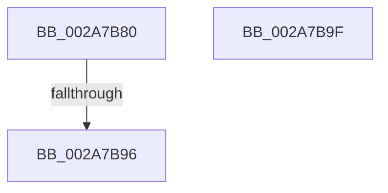

# PsChargeProcessNonPagedPoolQuota

- RVA: `0x002A7B80`–`0x002A7BA0` (길이 `32` bytes)
- VA: `0x00000001402A7B80`
- 실행 섹션: `.text`
- PDB 이름 있음: `예`; PDB Function 태그: `아니요`
- unwind 정보 RVA: `0x00068C70`
- 디코드: `13`개 명령, `32/32` bytes 표시
- 미해석 바이트: `0` (있으면 어셈블리에 `.byte`로 보존)

> 이 문서는 커널 이미지의 기계어와 PDB 기호를 분석해 생성했습니다. 4번과 5번은 함수 원형과 자료형을 바이너리 사용 방식에서 추정한 C 해석이며 원본 소스 복구 결과는 아닙니다.

## 1. Dependencies

- 직접 호출 지점: **0**; 고유 호출 대상: **0**
- 직접 호출자로 확인된 함수: **12**
- RIP 상대 이미지 참조: **1**

### Outgoing calls
- 직접 디코드된 call 명령이 없습니다.

### Direct callers
- [MiCloneVads](../22/MiCloneVads_function_0022DC1C.md) at `0x0022DD11`
- [MiFreeVadRange](MiFreeVadRange_function_002A77AC.md) at `0x002A7958`
- [MiCreateCloneChain](MiCreateCloneChain_function_002A8EE0.md) at `0x002A8FD3`
- [MiCreateAweInfoBitMap](../../page/80/MiCreateAweInfoBitMap_function_0080A770.md) at `0x0080A874`
- [MiInsertVadCharges](../../page/88/MiInsertVadCharges_function_00886AA8.md) at `0x00886B1C`
- [MiCreatePlaceholderStorage](../../page/8C/MiCreatePlaceholderStorage_function_008CF330.md) at `0x008CF35F`
- [MiCreateVadEventBitmap](../../page/98/MiCreateVadEventBitmap_function_009803FC.md) at `0x00980467`
- [MiBuildNewCloneDescriptor](../../page/A6/MiBuildNewCloneDescriptor_function_00A6C744.md) at `0x00A6C777`
- [MiCreateRotateView](../../page/A7/MiCreateRotateView_function_00A7F498.md) at `0x00A7F4EB`
- [ExEnableHandleTracing](../../page/AD/ExEnableHandleTracing_function_00AD2C8C.md) at `0x00AD2D55`
- [NtSetInformationProcess](../../page/AE/NtSetInformationProcess_function_00AE5370.md) at `0x00AE5720`
- [ViIrpAllocateLockedPacket](../../pagevrfy/B9/ViIrpAllocateLockedPacket_function_00B9E0AC.md) at `0x00B9E16E`

### Static image references
- `0x002A7B87` → RVA `0x00FC6AB0` (`ALMOSTRO`; read)

## 2. Other-region calls and transfers

- 다른 실행 섹션으로 향하는 call: **0**
- call이 아닌 외부 분기/꼬리 이동: **1**
  - `0x002A7B94` → [sub_002A7BA0](Unknown_function_002A7BA0.md) (`tail-transfer`)

## 3. Assembly (complete function range)

```asm
002A7B80  40 53                           push rbx
002A7B82  57                              push rdi
002A7B83  48 83 EC 38                     sub rsp, 0x38
002A7B87  48 3B 0D 22 EF D1 00            cmp rcx, qword ptr [rip + 0xd1ef22]
002A7B8E  48 8B FA                        mov rdi, rdx
002A7B91  48 8B D9                        mov rbx, rcx
002A7B94  75 0A                           jne 0x1402a7ba0
002A7B96  33 C0                           xor eax, eax
002A7B98  48 83 C4 38                     add rsp, 0x38
002A7B9C  5F                              pop rdi
002A7B9D  5B                              pop rbx
002A7B9E  C3                              ret
002A7B9F  CC                              int3
```

## 4. C-style interpretation (structured pseudocode)

```c
__int64 __fastcall PsChargeProcessNonPagedPoolQuota(__int64 a1, __int64 a2)
{
    __int64 result;
    __int64 v_rsp;

    v_rsp = (v_rsp) - (56);
    result = 0;
    v_rsp = (v_rsp) + (56);
    return result;
}
```

## 5. (Beta) C Style

```c
int64_t PsChargeProcessNonPagedPoolQuota(int64_t Arg1, int64_t Arg2)
{
    int64_t result;
    int64_t local_rsp;

    local_rsp = (local_rsp) - (56);
    result = 0;
    local_rsp = (local_rsp) + (56);
    return result;
}
```

## 6. Execution-region graph

[열기: 2D/3D 그래프와 함수 탐색 컨트롤 패널](../../../control-panel.html?section=text&rva=0x002A7B80&view=graph)

- 2D 그래프는 위에서 아래로 흐르고, 3D 그래프는 빈 공간을 드래그해 회전합니다. Shift+드래그는 이동, 휠은 확대·축소, 함수 노드 선택은 대상 보고서 이동입니다.

### Static fallback


