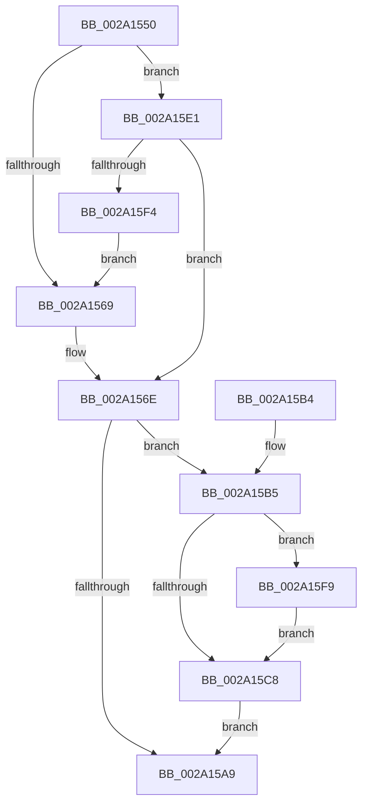

# PspDeleteKernelStack

- RVA: `0x002A1550`–`0x002A160E` (길이 `190` bytes)
- VA: `0x00000001402A1550`
- 실행 섹션: `.text`
- PDB 이름 있음: `예`; PDB Function 태그: `아니요`
- unwind 정보 RVA: `0x000684F4`
- 디코드: `48`개 명령, `190/190` bytes 표시
- 미해석 바이트: `0` (있으면 어셈블리에 `.byte`로 보존)

> 이 문서는 커널 이미지의 기계어와 PDB 기호를 분석해 생성했습니다. 4번과 5번은 함수 원형과 자료형을 바이너리 사용 방식에서 추정한 C 해석이며 원본 소스 복구 결과는 아닙니다.

## 1. Dependencies

- 직접 호출 지점: **3**; 고유 호출 대상: **3**
- 직접 호출자로 확인된 함수: **1**
- RIP 상대 이미지 참조: **0**

### Outgoing calls
- `0x002A159B` → [MmDeleteKernelStack](../33/MmDeleteKernelStack_function_0033A960.md) (function, `0x0033A960`)
- `0x002A15DA` → [KiDeleteKernelShadowStack](../../page/A2/KiDeleteKernelShadowStack_function_00A25DC8.md) (function, `0x00A25DC8`)
- `0x002A1602` → [KeResetKernelShadowStackRstorssp](../../page/AB/KeResetKernelShadowStackRstorssp_function_00AB3980.md) (function, `0x00AB3980`)

### Direct callers
- [KeEnumerateKernelStackSegments](KeEnumerateKernelStackSegments_function_002A13B8.md) at `0x002A146D`

### Static image references
- 디코드된 RIP-relative 메모리 참조가 없습니다.

## 2. Other-region calls and transfers

- 다른 실행 섹션으로 향하는 call: **2**
  - `0x002A15DA` → [KiDeleteKernelShadowStack](../../page/A2/KiDeleteKernelShadowStack_function_00A25DC8.md) (`.text` → `PAGE`)
  - `0x002A1602` → [KeResetKernelShadowStackRstorssp](../../page/AB/KeResetKernelShadowStackRstorssp_function_00AB3980.md) (`.text` → `PAGE`)
- 별도 외부 분기/꼬리 이동을 확인하지 못했습니다.

## 3. Assembly (complete function range)

```asm
002A1550  48 89 5C 24 10                  mov qword ptr [rsp + 0x10], rbx
002A1555  57                              push rdi
002A1556  48 83 EC 60                     sub rsp, 0x60
002A155A  F7 41 74 00 00 80 00            test dword ptr [rcx + 0x74], 0x800000
002A1561  48 8B DA                        mov rbx, rdx
002A1564  48 8B F9                        mov rdi, rcx
002A1567  75 78                           jne 0x1402a15e1
002A1569  B8 02 00 00 00                  mov eax, 2
002A156E  48 83 64 24 38 00               and qword ptr [rsp + 0x38], 0
002A1574  48 8D 4C 24 30                  lea rcx, [rsp + 0x30]
002A1579  89 44 24 30                     mov dword ptr [rsp + 0x30], eax
002A157D  0F 57 C0                        xorps xmm0, xmm0
002A1580  48 8B 02                        mov rax, qword ptr [rdx]
002A1583  48 89 44 24 48                  mov qword ptr [rsp + 0x48], rax
002A1588  F3 0F 7F 44 24 50               movdqu xmmword ptr [rsp + 0x50], xmm0
002A158E  C7 44 24 34 05 00 00 00         mov dword ptr [rsp + 0x34], 5
002A1596  48 89 7C 24 40                  mov qword ptr [rsp + 0x40], rdi
002A159B  E8 C0 93 09 00                  call 0x14033a960
002A15A0  48 8B 43 30                     mov rax, qword ptr [rbx + 0x30]
002A15A4  48 85 C0                        test rax, rax
002A15A7  75 0C                           jne 0x1402a15b5
002A15A9  48 8B 5C 24 78                  mov rbx, qword ptr [rsp + 0x78]
002A15AE  48 83 C4 60                     add rsp, 0x60
002A15B2  5F                              pop rdi
002A15B3  C3                              ret
002A15B4  CC                              int3
002A15B5  44 8B 53 28                     mov r10d, dword ptr [rbx + 0x28]
002A15B9  41 83 E2 07                     and r10d, 7
002A15BD  48 89 44 24 70                  mov qword ptr [rsp + 0x70], rax
002A15C2  41 83 FA 02                     cmp r10d, 2
002A15C6  74 31                           je 0x1402a15f9
002A15C8  48 8B 53 20                     mov rdx, qword ptr [rbx + 0x20]
002A15CC  45 33 C9                        xor r9d, r9d
002A15CF  45 8B C2                        mov r8d, r10d
002A15D2  48 89 44 24 20                  mov qword ptr [rsp + 0x20], rax
002A15D7  48 8B CF                        mov rcx, rdi
002A15DA  E8 E9 47 78 00                  call 0x140a25dc8
002A15DF  EB C8                           jmp 0x1402a15a9
002A15E1  48 8B 41 60                     mov rax, qword ptr [rcx + 0x60]
002A15E5  48 39 42 10                     cmp qword ptr [rdx + 0x10], rax
002A15E9  B8 08 00 00 00                  mov eax, 8
002A15EE  0F 84 7A FF FF FF               je 0x1402a156e
002A15F4  E9 70 FF FF FF                  jmp 0x1402a1569
002A15F9  48 8B 53 38                     mov rdx, qword ptr [rbx + 0x38]
002A15FD  48 8D 4C 24 70                  lea rcx, [rsp + 0x70]
002A1602  E8 79 23 81 00                  call 0x140ab3980
002A1607  48 8B 44 24 70                  mov rax, qword ptr [rsp + 0x70]
002A160C  EB BA                           jmp 0x1402a15c8
```

## 4. C-style interpretation (structured pseudocode)

```c
__int64 __fastcall PspDeleteKernelStack(__int64 a1, __int64 a2, __int64 a3, int a4)
{
    __int64 result;
    __int64 v_r10;
    __int64 v_rsp;
    unsigned __int64 v_stack_m18;
    unsigned __int64 v_stack_m20;
    unsigned __int64 v_stack_m28;
    unsigned __int64 v_stack_m30;
    unsigned int v_stack_m34;
    unsigned __int64 v_stack_m38;
    unsigned __int64 v_stack_p10;
    unsigned __int64 v_stack_p20;
    unsigned __int64 v_stack_p70;

    v_stack_p10 = v_rbx;
    v_rsp = (v_rsp) - (96);
    if (((*(unsigned int *)(a1 + 116)) & (0x800000ULL)) != 0) goto loc_002A15E1;
loc_002A1569:
loc_002A156E:
    v_stack_m38 = 2;
    v_stack_m20 = *(unsigned __int64 *)(a2);
    v_stack_m18 = v_xmm0;
    v_stack_m34 = 5;
    v_stack_m28 = a1;
    result = MmDeleteKernelStack(v_stack_m38, a2, a3, a4);
    if (*(unsigned __int64 *)(a2 + 48) != 0) goto loc_002A15B5;
loc_002A15A9:
    v_rsp = (v_rsp) + (96);
    return *(unsigned __int64 *)(a2 + 48);
loc_002A15B5:
    v_r10 = (unsigned int)(((unsigned int)(*(unsigned int *)(v_stack_p10 + 40))) & (7));
    v_stack_p70 = *(unsigned __int64 *)(a2 + 48);
    if (((unsigned int)(v_r10)) == 2) goto loc_002A15F9;
loc_002A15C8:
    a4 = 0;
    v_stack_p20 = *(unsigned __int64 *)(a2 + 48);
    result = KiDeleteKernelShadowStack(a1, *(unsigned __int64 *)(v_stack_p10 + 32), (unsigned int)((unsigned int)(v_r10)), a4);
    goto loc_002A15A9;
loc_002A15E1:
    if ((*(unsigned __int64 *)(*(unsigned __int64 *)(v_stack_p10 + 32) + 16)) == (*(unsigned __int64 *)(a1 + 96))) goto loc_002A156E;
    goto loc_002A1569;
loc_002A15F9:
    result = KeResetKernelShadowStackRstorssp(v_stack_p70, *(unsigned __int64 *)(v_stack_p10 + 56), (unsigned int)((unsigned int)(v_r10)), a4);
    goto loc_002A15C8;
}
```

## 5. (Beta) C Style

```c
int64_t PspDeleteKernelStack(void *Arg1, void *Arg2, int64_t Arg3, int32_t Arg4)
{
    uint8_t *arg1 = (uint8_t *)Arg1;
    uint8_t *arg2 = (uint8_t *)Arg2;

    int64_t result;
    int64_t local_r10;
    int64_t local_rsp;
    uint64_t v_stack_m18;
    uint64_t v_stack_m20;
    uint64_t v_stack_m28;
    uint64_t v_stack_m30;
    uint32_t v_stack_m34;
    uint64_t v_stack_m38;
    uint64_t v_stack_p10;
    uint64_t v_stack_p20;
    uint64_t v_stack_p70;

    v_stack_p10 = local_rbx;
    local_rsp = (local_rsp) - (96);
    if (((*(uint32_t *)(arg1 + 0x74)) & (0x800000ULL)) != 0) goto loc_002A15E1;
loc_002A1569:
loc_002A156E:
    v_stack_m38 = 2;
    v_stack_m20 = *(uint64_t *)(arg2);
    v_stack_m18 = v_xmm0;
    v_stack_m34 = 5;
    v_stack_m28 = Arg1;
    result = MmDeleteKernelStack(v_stack_m38, Arg2, Arg3, Arg4);
    if (*(uint64_t *)(arg2 + 0x30) != 0) goto loc_002A15B5;
loc_002A15A9:
    local_rsp = (local_rsp) + (96);
    return *(uint64_t *)(arg2 + 0x30);
loc_002A15B5:
    local_r10 = (uint32_t)(((uint32_t)(*(uint32_t *)(v_stack_p10 + 0x28))) & (7));
    v_stack_p70 = *(uint64_t *)(arg2 + 0x30);
    if (((uint32_t)(local_r10)) == 2) goto loc_002A15F9;
loc_002A15C8:
    Arg4 = 0;
    v_stack_p20 = *(uint64_t *)(arg2 + 0x30);
    result = KiDeleteKernelShadowStack(Arg1, *(uint64_t *)(v_stack_p10 + 0x20), (uint32_t)((uint32_t)(local_r10)), Arg4);
    goto loc_002A15A9;
loc_002A15E1:
    if ((*(uint64_t *)(*(uint64_t *)(v_stack_p10 + 0x20) + 0x10)) == (*(uint64_t *)(arg1 + 0x60))) goto loc_002A156E;
    goto loc_002A1569;
loc_002A15F9:
    result = KeResetKernelShadowStackRstorssp(v_stack_p70, *(uint64_t *)(v_stack_p10 + 0x38), (uint32_t)((uint32_t)(local_r10)), Arg4);
    goto loc_002A15C8;
}
```

### 관측된 메모리 오프셋

구조체 형식이 확인되지 않은 접근은 인자 기준의 오프셋으로만 기록했습니다.

| 기준 인자 | 오프셋 표현 | 폭 (bit) | 접근 |
|---|---:|---:|---|
| `Arg1` | `+ 0x60` | `64` | `R` |
| `Arg1` | `+ 0x74` | `32` | `R` |
| `Arg2` | `+ 0x0` | `64` | `R` |
| `Arg2` | `+ 0x10` | `64` | `R` |
| `Arg2` | `+ 0x20` | `64` | `R` |
| `Arg2` | `+ 0x28` | `32` | `R` |
| `Arg2` | `+ 0x30` | `64` | `R` |
| `Arg2` | `+ 0x38` | `64` | `R` |

## 6. Execution-region graph

[열기: 2D/3D 그래프와 함수 탐색 컨트롤 패널](../../../control-panel.html?section=text&rva=0x002A1550&view=graph)

- 2D 그래프는 위에서 아래로 흐르고, 3D 그래프는 빈 공간을 드래그해 회전합니다. Shift+드래그는 이동, 휠은 확대·축소, 함수 노드 선택은 대상 보고서 이동입니다.

### Static fallback


