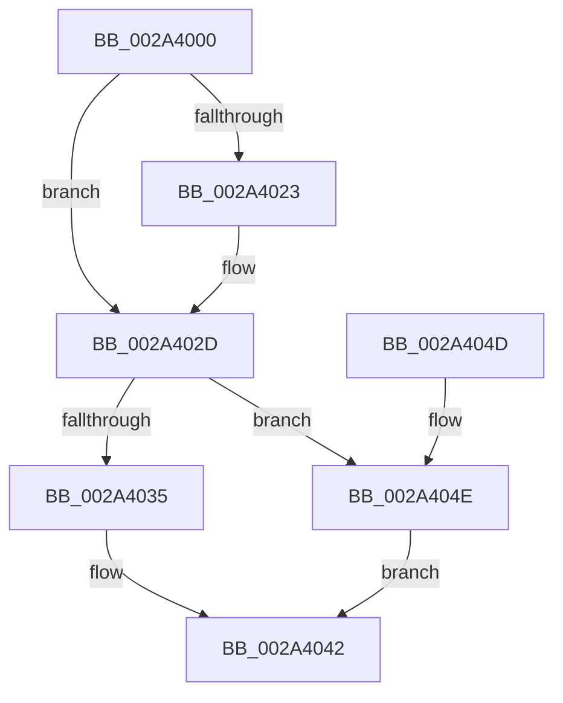

# PspHandleTableWalker

- RVA: `0x002A4000`–`0x002A4052` (길이 `82` bytes)
- VA: `0x00000001402A4000`
- 실행 섹션: `.text`
- PDB 이름 있음: `예`; PDB Function 태그: `아니요`
- unwind 정보 RVA: `0x00065BB8`
- 디코드: `28`개 명령, `82/82` bytes 표시
- 미해석 바이트: `0` (있으면 어셈블리에 `.byte`로 보존)

> 이 문서는 커널 이미지의 기계어와 PDB 기호를 분석해 생성했습니다. 4번과 5번은 함수 원형과 자료형을 바이너리 사용 방식에서 추정한 C 해석이며 원본 소스 복구 결과는 아닙니다.

## 1. Dependencies

- 직접 호출 지점: **1**; 고유 호출 대상: **1**
- 직접 호출자로 확인된 함수: **0**
- RIP 상대 이미지 참조: **0**

### Outgoing calls
- `0x002A4028` → [ExpUnblockPushLock](ExpUnblockPushLock_function_002A40FC.md) (function, `0x002A40FC`)

### Direct callers
- 이 함수 시작 RVA로 연결되는 직접 call은 확인되지 않았습니다. 간접 호출은 완전히 역산할 수 없습니다.

### Static image references
- 디코드된 RIP-relative 메모리 참조가 없습니다.

## 2. Other-region calls and transfers

- 다른 실행 섹션으로 향하는 call: **0**
- 별도 외부 분기/꼬리 이동을 확인하지 못했습니다.

## 3. Assembly (complete function range)

```asm
002A4000  48 89 5C 24 08                  mov qword ptr [rsp + 8], rbx
002A4005  57                              push rdi
002A4006  48 83 EC 20                     sub rsp, 0x20
002A400A  49 8B D9                        mov rbx, r9
002A400D  49 8B F8                        mov rdi, r8
002A4010  F0 48 FF 02                     lock inc qword ptr [rdx]
002A4014  48 83 C1 30                     add rcx, 0x30
002A4018  F0 83 0C 24 00                  lock or dword ptr [rsp], 0
002A401D  48 83 39 00                     cmp qword ptr [rcx], 0
002A4021  74 0A                           je 0x1402a402d
002A4023  45 33 C0                        xor r8d, r8d
002A4026  33 D2                           xor edx, edx
002A4028  E8 CF 00 00 00                  call 0x1402a40fc
002A402D  8B 43 0C                        mov eax, dword ptr [rbx + 0xc]
002A4030  3B 43 08                        cmp eax, dword ptr [rbx + 8]
002A4033  73 19                           jae 0x1402a404e
002A4035  8B C8                           mov ecx, eax
002A4037  48 8B 03                        mov rax, qword ptr [rbx]
002A403A  89 3C 88                        mov dword ptr [rax + rcx*4], edi
002A403D  FF 43 0C                        inc dword ptr [rbx + 0xc]
002A4040  32 C0                           xor al, al
002A4042  48 8B 5C 24 30                  mov rbx, qword ptr [rsp + 0x30]
002A4047  48 83 C4 20                     add rsp, 0x20
002A404B  5F                              pop rdi
002A404C  C3                              ret
002A404D  CC                              int3
002A404E  B0 01                           mov al, 1
002A4050  EB F0                           jmp 0x1402a4042
```

## 4. C-style interpretation (structured pseudocode)

```c
__int64 __fastcall PspHandleTableWalker(__int64 a1, __int64 a2, __int64 a3, __int64 a4)
{
    __int64 result;
    __int64 v_rsp;
    unsigned int v_stack_m28;
    unsigned __int64 v_stack_p8;

    v_stack_p8 = v_rbx;
    v_rsp = (v_rsp) - (32);
    a1 = (a1) + (48);
    if ((*(unsigned __int64 *)(a1)) != 0) {
        a3 = 0;
        a2 = 0;
        result = ExpUnblockPushLock(a1, a2, a3, a4);
    }
    if (((unsigned int)((unsigned int)(*(unsigned int *)(a4 + 12)))) >= (*(unsigned int *)(a4 + 8))) goto loc_002A404E;
    *(unsigned int *)(*(unsigned __int64 *)(a4) + (unsigned int)((unsigned int)((unsigned int)(*(unsigned int *)(a4 + 12)))) * 4) = 0;
    result = 0;
loc_002A4042:
    v_rsp = (v_rsp) + (32);
    return result;
loc_002A404E:
    goto loc_002A4042;
}
```

## 5. (Beta) C Style

```c
int64_t PspHandleTableWalker(void *Arg1, void *Arg2, int64_t Arg3, void *Arg4)
{
    uint8_t *arg1 = (uint8_t *)Arg1;
    uint8_t *arg2 = (uint8_t *)Arg2;
    uint8_t *arg4 = (uint8_t *)Arg4;

    int64_t result;
    int64_t local_rsp;
    uint32_t v_stack_m28;
    uint64_t v_stack_p8;

    v_stack_p8 = local_rbx;
    local_rsp = (local_rsp) - (32);
    Arg1 = (Arg1) + (48);
    if ((*(uint64_t *)(arg1)) != 0) {
        Arg3 = 0;
        Arg2 = 0;
        result = ExpUnblockPushLock(Arg1, Arg2, Arg3, Arg4);
    }
    if (((uint32_t)((uint32_t)(*(uint32_t *)(arg4 + 0xC)))) >= (*(uint32_t *)(arg4 + 0x8))) goto loc_002A404E;
    *(uint32_t *)(*(uint64_t *)(arg4) + (uint32_t)((uint32_t)((uint32_t)(*(uint32_t *)(arg4 + 0xC)))) * 4) = 0;
    result = 0;
loc_002A4042:
    local_rsp = (local_rsp) + (32);
    return result;
loc_002A404E:
    goto loc_002A4042;
}
```

### 관측된 메모리 오프셋

구조체 형식이 확인되지 않은 접근은 인자 기준의 오프셋으로만 기록했습니다.

| 기준 인자 | 오프셋 표현 | 폭 (bit) | 접근 |
|---|---:|---:|---|
| `Arg1` | `+ 0x0` | `64` | `R` |
| `Arg2` | `+ 0x0` | `64` | `R/W` |
| `Arg4` | `+ 0x0` | `64` | `R` |
| `Arg4` | `+ 0x8` | `32` | `R` |
| `Arg4` | `+ 0xC` | `32` | `R` |
| `Arg4` | `+ 0xC` | `32` | `R/W` |

## 6. Execution-region graph

[열기: 2D/3D 그래프와 함수 탐색 컨트롤 패널](../../../control-panel.html?section=text&rva=0x002A4000&view=graph)

- 2D 그래프는 위에서 아래로 흐르고, 3D 그래프는 빈 공간을 드래그해 회전합니다. Shift+드래그는 이동, 휠은 확대·축소, 함수 노드 선택은 대상 보고서 이동입니다.

### Static fallback


