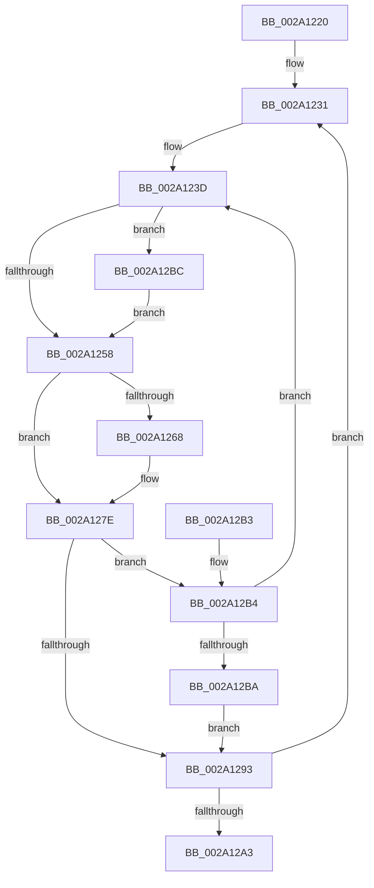

# PspReaper

- RVA: `0x002A1220`–`0x002A12CC` (길이 `172` bytes)
- VA: `0x00000001402A1220`
- 실행 섹션: `.text`
- PDB 이름 있음: `예`; PDB Function 태그: `아니요`
- unwind 정보 RVA: `0x000684A0`
- 디코드: `44`개 명령, `172/172` bytes 표시
- 미해석 바이트: `0` (있으면 어셈블리에 `.byte`로 보존)

> 이 문서는 커널 이미지의 기계어와 PDB 기호를 분석해 생성했습니다. 4번과 5번은 함수 원형과 자료형을 바이너리 사용 방식에서 추정한 C 해석이며 원본 소스 복구 결과는 아닙니다.

## 1. Dependencies

- 직접 호출 지점: **4**; 고유 호출 대상: **4**
- 직접 호출자로 확인된 함수: **0**
- RIP 상대 이미지 참조: **3**

### Outgoing calls
- `0x002A1247` → [KeDeleteThread](KeDeleteThread_function_002A12D4.md) (function, `0x002A12D4`)
- `0x002A1275` → [KeEnumerateKernelStackSegments](KeEnumerateKernelStackSegments_function_002A13B8.md) (function, `0x002A13B8`)
- `0x002A1289` → [ObfDereferenceObjectWithTag](../2F/ObfDereferenceObjectWithTag_function_002F78E0.md) (function, `0x002F78E0`)
- `0x002A12BE` → [ExFreePoolWithTag](../../poolcode/B8/ExFreePoolWithTag_function_00B82870.md) (function, `0x00B82870`)

### Direct callers
- 이 함수 시작 RVA로 연결되는 직접 call은 확인되지 않았습니다. 간접 호출은 완전히 역산할 수 없습니다.

### Static image references
- `0x002A1236` → RVA `0x00F06798` (`.data`; read/write)
- `0x002A126B` → RVA `0x002A1550` (`PspDeleteKernelStack`; read)
- `0x002A1298` → RVA `0x00F06798` (`.data`; read)

## 2. Other-region calls and transfers

- 다른 실행 섹션으로 향하는 call: **1**
  - `0x002A12BE` → [ExFreePoolWithTag](../../poolcode/B8/ExFreePoolWithTag_function_00B82870.md) (`.text` → `POOLCODE`)
- 별도 외부 분기/꼬리 이동을 확인하지 못했습니다.

## 3. Assembly (complete function range)

```asm
002A1220  48 89 5C 24 08                  mov qword ptr [rsp + 8], rbx
002A1225  48 89 74 24 10                  mov qword ptr [rsp + 0x10], rsi
002A122A  57                              push rdi
002A122B  48 83 EC 20                     sub rsp, 0x20
002A122F  33 F6                           xor esi, esi
002A1231  BB 01 00 00 00                  mov ebx, 1
002A1236  48 87 1D 5B 55 C6 00            xchg qword ptr [rip + 0xc6555b], rbx
002A123D  48 8D BB 18 FB FF FF            lea rdi, [rbx - 0x4e8]
002A1244  48 8B CF                        mov rcx, rdi
002A1247  E8 88 00 00 00                  call 0x1402a12d4
002A124C  48 8B 8F 20 06 00 00            mov rcx, qword ptr [rdi + 0x620]
002A1253  48 85 C9                        test rcx, rcx
002A1256  75 64                           jne 0x1402a12bc
002A1258  83 C8 FF                        or eax, 0xffffffff
002A125B  F0 0F C1 87 EC 05 00 00         lock xadd dword ptr [rdi + 0x5ec], eax
002A1263  83 F8 01                        cmp eax, 1
002A1266  75 16                           jne 0x1402a127e
002A1268  45 33 C0                        xor r8d, r8d
002A126B  48 8D 15 DE 02 00 00            lea rdx, [rip + 0x2de]
002A1272  48 8B CF                        mov rcx, rdi
002A1275  E8 3E 01 00 00                  call 0x1402a13b8
002A127A  48 89 77 28                     mov qword ptr [rdi + 0x28], rsi
002A127E  48 8B 1B                        mov rbx, qword ptr [rbx]
002A1281  BA 44 66 6C 74                  mov edx, 0x746c6644
002A1286  48 8B CF                        mov rcx, rdi
002A1289  E8 52 66 05 00                  call 0x1402f78e0
002A128E  48 85 DB                        test rbx, rbx
002A1291  75 21                           jne 0x1402a12b4
002A1293  B8 01 00 00 00                  mov eax, 1
002A1298  F0 48 0F B1 35 F7 54 C6 00      lock cmpxchg qword ptr [rip + 0xc654f7], rsi
002A12A1  75 8E                           jne 0x1402a1231
002A12A3  48 8B 5C 24 30                  mov rbx, qword ptr [rsp + 0x30]
002A12A8  48 8B 74 24 38                  mov rsi, qword ptr [rsp + 0x38]
002A12AD  48 83 C4 20                     add rsp, 0x20
002A12B1  5F                              pop rdi
002A12B2  C3                              ret
002A12B3  CC                              int3
002A12B4  48 83 FB 01                     cmp rbx, 1
002A12B8  75 83                           jne 0x1402a123d
002A12BA  EB D7                           jmp 0x1402a1293
002A12BC  33 D2                           xor edx, edx
002A12BE  E8 AD 15 8E 00                  call 0x140b82870
002A12C3  48 89 B7 20 06 00 00            mov qword ptr [rdi + 0x620], rsi
002A12CA  EB 8C                           jmp 0x1402a1258
```

## 4. C-style interpretation (structured pseudocode)

```c
__int64 __fastcall PspReaper(__int64 a1, __int64 a2, int a3)
{
    __int64 result;
    __int64 v_rsi;
    __int64 v_rsp;
    unsigned __int64 v_stack_p10;
    unsigned __int64 v_stack_p8;

    v_stack_p8 = v_rbx;
    v_stack_p10 = v_rsi;
    v_rsp = (v_rsp) - (32);
    v_rsi = 0;
loc_002A1231:
loc_002A123D:
    result = KeDeleteThread(1 - 1256, a2, a3, a4);
    if (*(unsigned __int64 *)(1 - 1256 + 1568) != 0) goto loc_002A12BC;
loc_002A1258:
    result = (unsigned int)((result) | (0xFFFFFFFFULL));
    if (((unsigned int)(result)) == 1) {
        a3 = 0;
        a2 = v_rip + 734;
        a1 = 1 - 1256;
        result = KeEnumerateKernelStackSegments(a1, a2, a3, a4);
        *(unsigned __int64 *)(1 - 1256 + 40) = 0;
    }
    result = ObfDereferenceObjectWithTag(1 - 1256, (unsigned int)(0x746C6644ULL), a3, a4);
    if (*(unsigned __int64 *)(1) != 0) goto loc_002A12B4;
loc_002A1293:
    if (*(unsigned __int64 *)(1) != 0) goto loc_002A1231;
    v_rsp = (v_rsp) + (32);
    return 1;
loc_002A12B4:
    if (v_stack_p8 != 1) goto loc_002A123D;
    goto loc_002A1293;
loc_002A12BC:
    a2 = 0;
    result = ExFreePoolWithTag(1 - 1256, a2, a3, a4);
    *(unsigned __int64 *)(1 - 1256 + 1568) = v_stack_p10;
    goto loc_002A1258;
}
```

## 5. (Beta) C Style

```c
int64_t PspReaper(int64_t Arg1, int64_t Arg2, int32_t Arg3)
{
    int64_t result;
    int64_t local_rsi;
    int64_t local_rsp;
    uint64_t v_stack_p10;
    uint64_t v_stack_p8;

    v_stack_p8 = local_rbx;
    v_stack_p10 = local_rsi;
    local_rsp = (local_rsp) - (32);
    local_rsi = 0;
loc_002A1231:
loc_002A123D:
    result = KeDeleteThread(1 - 1256, Arg2, Arg3, a4);
    if (*(uint64_t *)(1 - 0x4E8 + 0x620) != 0) goto loc_002A12BC;
loc_002A1258:
    result = (uint32_t)((result) | (0xFFFFFFFFULL));
    if (((uint32_t)(result)) == 1) {
        Arg3 = 0;
        Arg2 = v_rip + 734;
        Arg1 = 1 - 1256;
        result = KeEnumerateKernelStackSegments(Arg1, Arg2, Arg3, a4);
        *(uint64_t *)(1 - 0x4E8 + 0x28) = 0;
    }
    result = ObfDereferenceObjectWithTag(1 - 1256, (uint32_t)(0x746C6644ULL), Arg3, a4);
    if (*(uint64_t *)(1) != 0) goto loc_002A12B4;
loc_002A1293:
    if (*(uint64_t *)(1) != 0) goto loc_002A1231;
    local_rsp = (local_rsp) + (32);
    return 1;
loc_002A12B4:
    if (v_stack_p8 != 1) goto loc_002A123D;
    goto loc_002A1293;
loc_002A12BC:
    Arg2 = 0;
    result = ExFreePoolWithTag(1 - 1256, Arg2, Arg3, a4);
    *(uint64_t *)(1 - 0x4E8 + 0x620) = v_stack_p10;
    goto loc_002A1258;
}
```

## 6. Execution-region graph

[열기: 2D/3D 그래프와 함수 탐색 컨트롤 패널](../../../control-panel.html?section=text&rva=0x002A1220&view=graph)

- 2D 그래프는 위에서 아래로 흐르고, 3D 그래프는 빈 공간을 드래그해 회전합니다. Shift+드래그는 이동, 휠은 확대·축소, 함수 노드 선택은 대상 보고서 이동입니다.

### Static fallback


