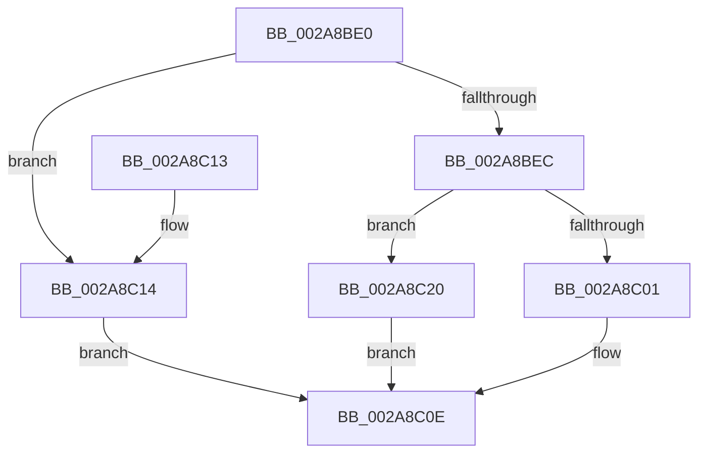

# SmPerformStoreSwapOperation

- RVA: `0x002A8BE0`–`0x002A8C27` (길이 `71` bytes)
- VA: `0x00000001402A8BE0`
- 실행 섹션: `.text`
- PDB 이름 있음: `예`; PDB Function 태그: `아니요`
- unwind 정보 RVA: `0x00068D6C`
- 디코드: `20`개 명령, `71/71` bytes 표시
- 미해석 바이트: `0` (있으면 어셈블리에 `.byte`로 보존)

> 이 문서는 커널 이미지의 기계어와 PDB 기호를 분석해 생성했습니다. 4번과 5번은 함수 원형과 자료형을 바이너리 사용 방식에서 추정한 C 해석이며 원본 소스 복구 결과는 아닙니다.

## 1. Dependencies

- 직접 호출 지점: **3**; 고유 호출 대상: **3**
- 직접 호출자로 확인된 함수: **1**
- RIP 상대 이미지 참조: **0**

### Outgoing calls
- `0x002A8C09` → [MmOutSwapVirtualAddresses](MmOutSwapVirtualAddresses_function_002A8C30.md) (function, `0x002A8C30`)
- `0x002A8C17` → [AlpcpFreeBuffer](../../page/90/AlpcpFreeBuffer_function_009071C0.md) (function, `0x009071C0`)
- `0x002A8C20` → [MmInSwapVirtualAddresses](../../page/A1/MmInSwapVirtualAddresses_function_00A17CCC.md) (function, `0x00A17CCC`)

### Direct callers
- [SMKM_STORE&lt;SM_TRAITS&gt;::SmStOutSwapStore](../49/SMKM_STORE_SM_TRAITS_SmStOutSwapStore_function_00496C84.md) at `0x00496F22`

### Static image references
- 디코드된 RIP-relative 메모리 참조가 없습니다.

## 2. Other-region calls and transfers

- 다른 실행 섹션으로 향하는 call: **2**
  - `0x002A8C17` → [AlpcpFreeBuffer](../../page/90/AlpcpFreeBuffer_function_009071C0.md) (`.text` → `PAGE`)
  - `0x002A8C20` → [MmInSwapVirtualAddresses](../../page/A1/MmInSwapVirtualAddresses_function_00A17CCC.md) (`.text` → `PAGE`)
- 별도 외부 분기/꼬리 이동을 확인하지 못했습니다.

## 3. Assembly (complete function range)

```asm
002A8BE0  48 83 EC 28                     sub rsp, 0x28
002A8BE4  4C 8B CA                        mov r9, rdx
002A8BE7  83 F9 03                        cmp ecx, 3
002A8BEA  74 28                           je 0x1402a8c14
002A8BEC  65 48 8B 04 25 88 01 00 00      mov rax, qword ptr gs:[0x188]
002A8BF5  83 F9 02                        cmp ecx, 2
002A8BF8  48 8B 88 B8 00 00 00            mov rcx, qword ptr [rax + 0xb8]
002A8BFF  74 1F                           je 0x1402a8c20
002A8C01  44 8B 42 10                     mov r8d, dword ptr [rdx + 0x10]
002A8C05  48 8B 52 08                     mov rdx, qword ptr [rdx + 8]
002A8C09  E8 22 00 00 00                  call 0x1402a8c30
002A8C0E  48 83 C4 28                     add rsp, 0x28
002A8C12  C3                              ret
002A8C13  CC                              int3
002A8C14  49 8B C9                        mov rcx, r9
002A8C17  E8 A4 E5 65 00                  call 0x1409071c0
002A8C1C  33 C0                           xor eax, eax
002A8C1E  EB EE                           jmp 0x1402a8c0e
002A8C20  E8 A7 F0 76 00                  call 0x140a17ccc
002A8C25  EB E7                           jmp 0x1402a8c0e
```

## 4. C-style interpretation (structured pseudocode)

```c
__int64 __fastcall SmPerformStoreSwapOperation(int a1, __int64 a2)
{
    __int64 result;
    __int64 v_rsp;

    v_rsp = (v_rsp) - (40);
    if (a1 == 3) goto loc_002A8C14;
    if (a1 == 2) goto loc_002A8C20;
    result = MmOutSwapVirtualAddresses(*(unsigned __int64 *)(*(unsigned __int64 *)(gs_base + (0 + 392)) + 184), *(unsigned __int64 *)(a2 + 8), (unsigned int)(*(unsigned int *)(a2 + 16)), a2);
loc_002A8C0E:
    v_rsp = (v_rsp) + (40);
    return result;
loc_002A8C14:
    result = AlpcpFreeBuffer(a2, *(unsigned __int64 *)(a2 + 8), (unsigned int)(*(unsigned int *)(a2 + 16)), a2);
    result = 0;
    goto loc_002A8C0E;
loc_002A8C20:
    result = MmInSwapVirtualAddresses(a2, *(unsigned __int64 *)(a2 + 8), (unsigned int)(*(unsigned int *)(a2 + 16)), a2);
    goto loc_002A8C0E;
}
```

## 5. (Beta) C Style

```c
int64_t SmPerformStoreSwapOperation(int32_t Arg1, void *Arg2)
{
    uint8_t *arg2 = (uint8_t *)Arg2;

    int64_t result;
    int64_t local_rsp;

    local_rsp = (local_rsp) - (40);
    if (Arg1 == 3) goto loc_002A8C14;
    if (Arg1 == 2) goto loc_002A8C20;
    result = MmOutSwapVirtualAddresses(*(uint64_t *)(*(uint64_t *)(gs_base + (0 + 0x188)) + 0xB8), *(uint64_t *)(arg2 + 0x8), (uint32_t)(*(uint32_t *)(arg2 + 0x10)), Arg2);
loc_002A8C0E:
    local_rsp = (local_rsp) + (40);
    return result;
loc_002A8C14:
    result = AlpcpFreeBuffer(Arg2, *(uint64_t *)(arg2 + 0x8), (uint32_t)(*(uint32_t *)(arg2 + 0x10)), Arg2);
    result = 0;
    goto loc_002A8C0E;
loc_002A8C20:
    result = MmInSwapVirtualAddresses(Arg2, *(uint64_t *)(arg2 + 0x8), (uint32_t)(*(uint32_t *)(arg2 + 0x10)), Arg2);
    goto loc_002A8C0E;
}
```

### 관측된 메모리 오프셋

구조체 형식이 확인되지 않은 접근은 인자 기준의 오프셋으로만 기록했습니다.

| 기준 인자 | 오프셋 표현 | 폭 (bit) | 접근 |
|---|---:|---:|---|
| `Arg2` | `+ 0x8` | `64` | `R` |
| `Arg2` | `+ 0x10` | `32` | `R` |

## 6. Execution-region graph

[열기: 2D/3D 그래프와 함수 탐색 컨트롤 패널](../../../control-panel.html?section=text&rva=0x002A8BE0&view=graph)

- 2D 그래프는 위에서 아래로 흐르고, 3D 그래프는 빈 공간을 드래그해 회전합니다. Shift+드래그는 이동, 휠은 확대·축소, 함수 노드 선택은 대상 보고서 이동입니다.

### Static fallback


