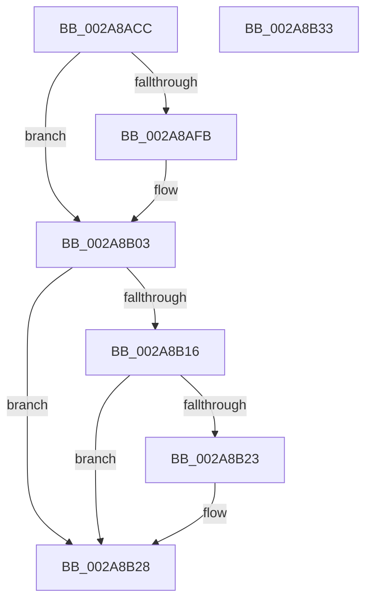

# UNLOCK_ADDRESS_SPACE_SHARED

- RVA: `0x002A8ACC`–`0x002A8B34` (길이 `104` bytes)
- VA: `0x00000001402A8ACC`
- 실행 섹션: `.text`
- PDB 이름 있음: `예`; PDB Function 태그: `아니요`
- unwind 정보 RVA: `0x00068D5C`
- 디코드: `29`개 명령, `104/104` bytes 표시
- 미해석 바이트: `0` (있으면 어셈블리에 `.byte`로 보존)

> 이 문서는 커널 이미지의 기계어와 PDB 기호를 분석해 생성했습니다. 4번과 5번은 함수 원형과 자료형을 바이너리 사용 방식에서 추정한 C 해석이며 원본 소스 복구 결과는 아닙니다.

## 1. Dependencies

- 직접 호출 지점: **3**; 고유 호출 대상: **3**
- 직접 호출자로 확인된 함수: **14**
- RIP 상대 이미지 참조: **0**

### Outgoing calls
- `0x002A8AFE` → [ExfReleasePushLockShared](../26/ExfReleasePushLockShared_function_00263440.md) (function, `0x00263440`)
- `0x002A8B06` → [KeAbPostRelease](../2E/KeAbPostRelease_function_002E1600.md) (function, `0x002E1600`)
- `0x002A8B23` → [KiCheckForKernelApcDelivery](../2E/KiCheckForKernelApcDelivery_function_002E2C80.md) (function, `0x002E2C80`)

### Direct callers
- [MiEmptyWorkingSetPrivatePagesByVa](MiEmptyWorkingSetPrivatePagesByVa_function_002A6AC0.md) at `0x002A6B0E`
- [MmOutSwapWorkingSet](MmOutSwapWorkingSet_function_002A6BC8.md) at `0x002A6EC0`
- [MmOutSwapWorkingSet](MmOutSwapWorkingSet_function_002A6BC8.md) at `0x002A7059`
- [MmOutSwapVirtualAddresses](MmOutSwapVirtualAddresses_function_002A8C30.md) at `0x002A8E9E`
- [MiHotPatchProcess](../../page/80/MiHotPatchProcess_function_00803B78.md) at `0x00803D02`
- [MiHotPatchProcess](../../page/80/MiHotPatchProcess_function_00803B78.md) at `0x00803D8C`
- [MmCheckForSafeExecution](../../page/80/MmCheckForSafeExecution_function_008076B0.md) at `0x00807746`
- [MiAllocateUserPhysicalPages](../../page/80/MiAllocateUserPhysicalPages_function_00809828.md) at `0x00809C34`
- [MiAllocateUserPhysicalPages](../../page/80/MiAllocateUserPhysicalPages_function_00809828.md) at `0x00809C59`
- [MiAllocateUserPhysicalPages](../../page/80/MiAllocateUserPhysicalPages_function_00809828.md) at `0x00809C7B`
- [MiAllocateUserPhysicalPages](../../page/80/MiAllocateUserPhysicalPages_function_00809828.md) at `0x0080A218`
- [MiAllocateUserPhysicalPages](../../page/80/MiAllocateUserPhysicalPages_function_00809828.md) at `0x0080A2D7`
- [MiAllocateUserPhysicalPages](../../page/80/MiAllocateUserPhysicalPages_function_00809828.md) at `0x0080A418`
- [MiAllocateUserPhysicalPages](../../page/80/MiAllocateUserPhysicalPages_function_00809828.md) at `0x0080A5DA`
- [sub_0087F611](../../page/87/Unknown_function_0087F611.md) at `0x0087F611`
- [MiMapAllImageScpPages](../../page/8D/MiMapAllImageScpPages_function_008D0534.md) at `0x008D0593`
- [MiCommitInitialVadMetadataBits](../../page/8D/MiCommitInitialVadMetadataBits_function_008D09CC.md) at `0x008D0A63`
- [MiCommitInitialVadMetadataBits](../../page/8D/MiCommitInitialVadMetadataBits_function_008D09CC.md) at `0x008D0AA1`
- [MmIsFileMapped](../../page/91/MmIsFileMapped_function_0091D8D4.md) at `0x0091DA15`
- [MmEnumerateAddressSpaceAndReferenceImages](../../page/97/MmEnumerateAddressSpaceAndReferenceImages_function_0097DD50.md) at `0x0097E04A`
- [MiFreeLargePageView](../../page/9B/MiFreeLargePageView_function_009BB3B4.md) at `0x009BB42F`
- [MmCleanProcessAddressSpace](../../page/A1/MmCleanProcessAddressSpace_function_00A17EC0.md) at `0x00A17FA3`
- [MmCleanProcessAddressSpace](../../page/A1/MmCleanProcessAddressSpace_function_00A17EC0.md) at `0x00A18029`
- [MmCleanProcessAddressSpace](../../page/A1/MmCleanProcessAddressSpace_function_00A17EC0.md) at `0x00A18106`
- [MmCleanProcessAddressSpace](../../page/A1/MmCleanProcessAddressSpace_function_00A17EC0.md) at `0x00A18133`
- [MiCreateLargePageVad](../../page/A9/MiCreateLargePageVad_function_00A99B50.md) at `0x00A99CB4`

### Static image references
- 디코드된 RIP-relative 메모리 참조가 없습니다.

## 2. Other-region calls and transfers

- 다른 실행 섹션으로 향하는 call: **0**
- 별도 외부 분기/꼬리 이동을 확인하지 못했습니다.

## 3. Assembly (complete function range)

```asm
002A8ACC  48 89 5C 24 10                  mov qword ptr [rsp + 0x10], rbx
002A8AD1  57                              push rdi
002A8AD2  48 83 EC 20                     sub rsp, 0x20
002A8AD6  8B 81 A8 05 00 00               mov eax, dword ptr [rcx + 0x5a8]
002A8ADC  48 8D BA 58 02 00 00            lea rdi, [rdx + 0x258]
002A8AE3  83 E0 FD                        and eax, 0xfffffffd
002A8AE6  48 8B D9                        mov rbx, rcx
002A8AE9  89 81 A8 05 00 00               mov dword ptr [rcx + 0x5a8], eax
002A8AEF  33 C9                           xor ecx, ecx
002A8AF1  8D 41 11                        lea eax, [rcx + 0x11]
002A8AF4  F0 48 0F B1 0F                  lock cmpxchg qword ptr [rdi], rcx
002A8AF9  74 08                           je 0x1402a8b03
002A8AFB  48 8B CF                        mov rcx, rdi
002A8AFE  E8 3D A9 FB FF                  call 0x140263440
002A8B03  48 8B CF                        mov rcx, rdi
002A8B06  E8 F5 8A 03 00                  call 0x1402e1600
002A8B0B  90                              nop
002A8B0C  66 83 83 E6 01 00 00 01         add word ptr [rbx + 0x1e6], 1
002A8B14  75 12                           jne 0x1402a8b28
002A8B16  48 8D 83 98 00 00 00            lea rax, [rbx + 0x98]
002A8B1D  90                              nop
002A8B1E  48 39 00                        cmp qword ptr [rax], rax
002A8B21  74 05                           je 0x1402a8b28
002A8B23  E8 58 A1 03 00                  call 0x1402e2c80
002A8B28  48 8B 5C 24 38                  mov rbx, qword ptr [rsp + 0x38]
002A8B2D  48 83 C4 20                     add rsp, 0x20
002A8B31  5F                              pop rdi
002A8B32  C3                              ret
002A8B33  CC                              int3
```

## 4. C-style interpretation (structured pseudocode)

```c
__int64 __fastcall UNLOCK_ADDRESS_SPACE_SHARED(__int64 a1, __int64 a2)
{
    __int64 result;
    __int64 v_rsp;
    unsigned __int64 v_stack_p10;

    v_stack_p10 = v_rbx;
    v_rsp = (v_rsp) - (32);
    result = (unsigned int)(((unsigned int)(*(unsigned int *)(a1 + 1448))) & (0xFFFFFFFDULL));
    *(unsigned int *)(a1 + 1448) = (unsigned int)(result);
    a1 = 0;
    result = a1 + 17;
    if (!(condition_is_equal)) {
        a1 = a2 + 600;
        result = ExfReleasePushLockShared(a1, a2, a3, a4);
    }
    result = KeAbPostRelease(a2 + 600, a2, a3, a4);
    if (condition_is_not_equal) goto loc_002A8B28;
    result = a1 + 152;
    if ((*(unsigned __int64 *)(a1 + 152)) != (a1 + 152)) {
        result = KiCheckForKernelApcDelivery(a2 + 600, a2, a3, a4);
    }
    v_rsp = (v_rsp) + (32);
    return result;
}
```

## 5. (Beta) C Style

```c
int64_t UNLOCK_ADDRESS_SPACE_SHARED(void *Arg1, void *Arg2)
{
    uint8_t *arg1 = (uint8_t *)Arg1;
    uint8_t *arg2 = (uint8_t *)Arg2;

    int64_t result;
    int64_t local_rsp;
    uint64_t v_stack_p10;

    v_stack_p10 = local_rbx;
    local_rsp = (local_rsp) - (32);
    result = (uint32_t)(((uint32_t)(*(uint32_t *)(arg1 + 0x5A8))) & (0xFFFFFFFDULL));
    *(uint32_t *)(arg1 + 0x5A8) = (uint32_t)(result);
    Arg1 = 0;
    result = Arg1 + 17;
    if (!(condition_is_equal)) {
        Arg1 = Arg2 + 600;
        result = ExfReleasePushLockShared(Arg1, Arg2, a3, a4);
    }
    result = KeAbPostRelease(Arg2 + 600, Arg2, a3, a4);
    if (condition_is_not_equal) goto loc_002A8B28;
    result = Arg1 + 152;
    if ((*(uint64_t *)(arg1 + 0x98)) != (Arg1 + 152)) {
        result = KiCheckForKernelApcDelivery(Arg2 + 600, Arg2, a3, a4);
    }
    local_rsp = (local_rsp) + (32);
    return result;
}
```

### 관측된 메모리 오프셋

구조체 형식이 확인되지 않은 접근은 인자 기준의 오프셋으로만 기록했습니다.

| 기준 인자 | 오프셋 표현 | 폭 (bit) | 접근 |
|---|---:|---:|---|
| `Arg1` | `+ 0x0` | `64` | `R` |
| `Arg1` | `+ 0x98` | `64` | `R` |
| `Arg1` | `+ 0x1E6` | `16` | `R/W` |
| `Arg1` | `+ 0x5A8` | `32` | `R` |
| `Arg1` | `+ 0x5A8` | `32` | `W` |
| `Arg2` | `+ 0x0` | `64` | `R` |
| `Arg2` | `+ 0x258` | `64` | `R` |

## 6. Execution-region graph

[열기: 2D/3D 그래프와 함수 탐색 컨트롤 패널](../../../control-panel.html?section=text&rva=0x002A8ACC&view=graph)

- 2D 그래프는 위에서 아래로 흐르고, 3D 그래프는 빈 공간을 드래그해 회전합니다. Shift+드래그는 이동, 휠은 확대·축소, 함수 노드 선택은 대상 보고서 이동입니다.

### Static fallback


