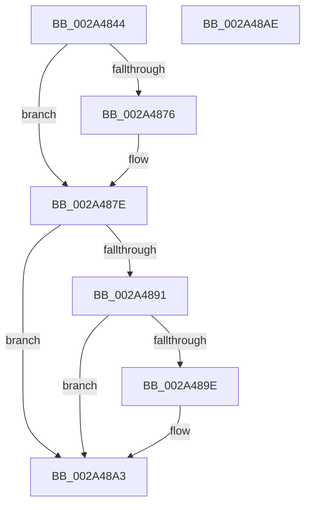

# UNLOCK_ADDRESS_SPACE

- RVA: `0x002A4844`–`0x002A48AF` (길이 `107` bytes)
- VA: `0x00000001402A4844`
- 실행 섹션: `.text`
- PDB 이름 있음: `예`; PDB Function 태그: `아니요`
- unwind 정보 RVA: `0x0005CAAC`
- 디코드: `30`개 명령, `107/107` bytes 표시
- 미해석 바이트: `0` (있으면 어셈블리에 `.byte`로 보존)

> 이 문서는 커널 이미지의 기계어와 PDB 기호를 분석해 생성했습니다. 4번과 5번은 함수 원형과 자료형을 바이너리 사용 방식에서 추정한 C 해석이며 원본 소스 복구 결과는 아닙니다.

## 1. Dependencies

- 직접 호출 지점: **3**; 고유 호출 대상: **3**
- 직접 호출자로 확인된 함수: **30**
- RIP 상대 이미지 참조: **0**

### Outgoing calls
- `0x002A4879` → [ExfTryToWakePushLock](../26/ExfTryToWakePushLock_function_00265DD0.md) (function, `0x00265DD0`)
- `0x002A4881` → [KeAbPostRelease](../2E/KeAbPostRelease_function_002E1600.md) (function, `0x002E1600`)
- `0x002A489E` → [KiCheckForKernelApcDelivery](../2E/KiCheckForKernelApcDelivery_function_002E2C80.md) (function, `0x002E2C80`)

### Direct callers
- [MiWalkVaRange](../24/MiWalkVaRange_function_00243BF0.md) at `0x00244C78`
- [MiBeginProcessClean](MiBeginProcessClean_function_002A473C.md) at `0x002A47E7`
- [MiDeleteEmptyPageTables](MiDeleteEmptyPageTables_function_002A5220.md) at `0x002A54AF`
- [MiCopyOnWriteCheckConditions](MiCopyOnWriteCheckConditions_function_002A750C.md) at `0x002A75BD`
- [MiDeletePartialVad](MiDeletePartialVad_function_002A7A30.md) at `0x002A7AC7`
- [MiReleaseOutSwappedProcessCommit](../3C/MiReleaseOutSwappedProcessCommit_function_003C8320.md) at `0x003C84C2`
- [MiDeleteFinalPageTables](../46/MiDeleteFinalPageTables_function_004659AC.md) at `0x00465B7B`
- [MiReleaseCommitForResetPages](../66/MiReleaseCommitForResetPages_function_0066FAF8.md) at `0x0066FBB4`
- [MiAllocateEnclaveVad](../../page/80/MiAllocateEnclaveVad_function_008080A4.md) at `0x00808253`
- [MiAllocateEnclaveVad](../../page/80/MiAllocateEnclaveVad_function_008080A4.md) at `0x008083AB`
- [MiResizeAweBitMap](../../page/80/MiResizeAweBitMap_function_0080AD00.md) at `0x0080ADC2`
- [MiResizeAweBitMap](../../page/80/MiResizeAweBitMap_function_0080AD00.md) at `0x0080AE07`
- [MiResizeAweBitMap](../../page/80/MiResizeAweBitMap_function_0080AD00.md) at `0x0080AE49`
- [NtFreeUserPhysicalPages](../../page/80/NtFreeUserPhysicalPages_function_0080AF30.md) at `0x0080B25A`
- [NtFreeUserPhysicalPages](../../page/80/NtFreeUserPhysicalPages_function_0080AF30.md) at `0x0080B3BD`
- [sub_0087F65A](../../page/87/Unknown_function_0087F65A.md) at `0x0087F65A`
- [MiLockVadRange](../../page/87/MiLockVadRange_function_0087F670.md) at `0x0087F8D8`
- [MiFreeVirtualMemory](../../page/88/MiFreeVirtualMemory_function_00880268.md) at `0x0088053F`
- [MiCoalescePlaceholderAllocations](../../page/88/MiCoalescePlaceholderAllocations_function_0088095C.md) at `0x00880B87`
- [MiReserveUserMemory](../../page/88/MiReserveUserMemory_function_00884498.md) at `0x00884811`
- [MiReserveUserMemory](../../page/88/MiReserveUserMemory_function_00884498.md) at `0x008848C2`
- [MiReserveUserMemory](../../page/88/MiReserveUserMemory_function_00884498.md) at `0x00884938`
- [MiReserveUserMemory](../../page/88/MiReserveUserMemory_function_00884498.md) at `0x00884B70`
- [sub_00884EE1](../../page/88/Unknown_function_00884EE1.md) at `0x00885329`
- [sub_0088535F](../../page/88/Unknown_function_0088535F.md) at `0x008853B3`
- [sub_0088535F](../../page/88/Unknown_function_0088535F.md) at `0x0088546F`
- [sub_00885634](../../page/88/Unknown_function_00885634.md) at `0x008856A6`
- [sub_00885634](../../page/88/Unknown_function_00885634.md) at `0x0088577B`
- [MiInitializeVadCellBitMap](../../page/88/MiInitializeVadCellBitMap_function_00887B64.md) at `0x00887BF8`
- [MiInsertProcessVads](../../page/8C/MiInsertProcessVads_function_008CFD08.md) at `0x008CFD75`
- [MiInsertProcessVads](../../page/8C/MiInsertProcessVads_function_008CFD08.md) at `0x008CFD9C`
- [MiMapViewOfImageSection](../../page/97/MiMapViewOfImageSection_function_0097E92C.md) at `0x0097EF56`
- [MiMapViewOfImageSection](../../page/97/MiMapViewOfImageSection_function_0097E92C.md) at `0x0097F01E`
- [MiMapViewOfImageSection](../../page/97/MiMapViewOfImageSection_function_0097E92C.md) at `0x0097F8A5`
- [MiMapViewOfPhysicalSection](../../page/97/MiMapViewOfPhysicalSection_function_0097F984.md) at `0x0097FBF1`
- [MiMapViewOfPhysicalSection](../../page/97/MiMapViewOfPhysicalSection_function_0097F984.md) at `0x0097FC0B`
- [MiMapViewOfPhysicalSection](../../page/97/MiMapViewOfPhysicalSection_function_0097F984.md) at `0x0097FC58`
- [MiMapLockedPagesInUserSpace](../../page/97/MiMapLockedPagesInUserSpace_function_0097FE04.md) at `0x00980089`
- [MiMapLockedPagesInUserSpace](../../page/97/MiMapLockedPagesInUserSpace_function_0097FE04.md) at `0x0098013A`
- [MiAllocateFromSubAllocatedRegion](../../page/98/MiAllocateFromSubAllocatedRegion_function_00981C24.md) at `0x00981D3F`
- [MiAllocateFromSubAllocatedRegion](../../page/98/MiAllocateFromSubAllocatedRegion_function_00981C24.md) at `0x00981E1F`
- [MiAllocateFromSubAllocatedRegion](../../page/98/MiAllocateFromSubAllocatedRegion_function_00981C24.md) at `0x00981E4B`
- [MmCleanProcessAddressSpace](../../page/A1/MmCleanProcessAddressSpace_function_00A17EC0.md) at `0x00A1809E`
- [MiPrepareVadDelete](../../page/A2/MiPrepareVadDelete_function_00A25E98.md) at `0x00A25F9E`
- [MiInitializeVadBitMap](../../page/A4/MiInitializeVadBitMap_function_00A4869C.md) at `0x00A48751`
- [sub_00B18F72](../../page/B1/Unknown_function_00B18F72.md) at `0x00B18F81`
- [sub_00B2A146](../../page/B2/Unknown_function_00B2A146.md) at `0x00B2A434`

### Static image references
- 디코드된 RIP-relative 메모리 참조가 없습니다.

## 2. Other-region calls and transfers

- 다른 실행 섹션으로 향하는 call: **0**
- 별도 외부 분기/꼬리 이동을 확인하지 못했습니다.

## 3. Assembly (complete function range)

```asm
002A4844  48 89 5C 24 08                  mov qword ptr [rsp + 8], rbx
002A4849  57                              push rdi
002A484A  48 83 EC 20                     sub rsp, 0x20
002A484E  8B 81 A8 05 00 00               mov eax, dword ptr [rcx + 0x5a8]
002A4854  48 8D BA 58 02 00 00            lea rdi, [rdx + 0x258]
002A485B  83 E0 FE                        and eax, 0xfffffffe
002A485E  48 8B D9                        mov rbx, rcx
002A4861  89 81 A8 05 00 00               mov dword ptr [rcx + 0x5a8], eax
002A4867  48 83 C8 FF                     or rax, 0xffffffffffffffff
002A486B  F0 48 0F C1 07                  lock xadd qword ptr [rdi], rax
002A4870  24 06                           and al, 6
002A4872  3C 02                           cmp al, 2
002A4874  75 08                           jne 0x1402a487e
002A4876  48 8B CF                        mov rcx, rdi
002A4879  E8 52 15 FC FF                  call 0x140265dd0
002A487E  48 8B CF                        mov rcx, rdi
002A4881  E8 7A CD 03 00                  call 0x1402e1600
002A4886  90                              nop
002A4887  66 83 83 E6 01 00 00 01         add word ptr [rbx + 0x1e6], 1
002A488F  75 12                           jne 0x1402a48a3
002A4891  48 8D 83 98 00 00 00            lea rax, [rbx + 0x98]
002A4898  90                              nop
002A4899  48 39 00                        cmp qword ptr [rax], rax
002A489C  74 05                           je 0x1402a48a3
002A489E  E8 DD E3 03 00                  call 0x1402e2c80
002A48A3  48 8B 5C 24 30                  mov rbx, qword ptr [rsp + 0x30]
002A48A8  48 83 C4 20                     add rsp, 0x20
002A48AC  5F                              pop rdi
002A48AD  C3                              ret
002A48AE  CC                              int3
```

## 4. C-style interpretation (structured pseudocode)

```c
__int64 __fastcall UNLOCK_ADDRESS_SPACE(__int64 a1, __int64 a2)
{
    __int64 result;
    __int64 v_rsp;
    unsigned __int64 v_stack_p8;

    v_stack_p8 = v_rbx;
    v_rsp = (v_rsp) - (32);
    result = (unsigned int)(((unsigned int)(*(unsigned int *)(a1 + 1448))) & (0xFFFFFFFEULL));
    *(unsigned int *)(a1 + 1448) = (unsigned int)(result);
    result = (result) | (-1);
    result = (unsigned __int8)((result) & (6));
    if (((unsigned __int8)(result)) == 2) {
        a1 = a2 + 600;
        result = ExfTryToWakePushLock(a1, a2, a3, a4);
    }
    result = KeAbPostRelease(a2 + 600, a2, a3, a4);
    if (((unsigned __int8)(result)) != 2) goto loc_002A48A3;
    result = a1 + 152;
    if ((*(unsigned __int64 *)(a1 + 152)) != (a1 + 152)) {
        result = KiCheckForKernelApcDelivery(a2 + 600, a2, a3, a4);
    }
    v_rsp = (v_rsp) + (32);
    return result;
}
```

## 5. (Beta) C Style

```c
int64_t UNLOCK_ADDRESS_SPACE(void *Arg1, void *Arg2)
{
    uint8_t *arg1 = (uint8_t *)Arg1;
    uint8_t *arg2 = (uint8_t *)Arg2;

    int64_t result;
    int64_t local_rsp;
    uint64_t v_stack_p8;

    v_stack_p8 = local_rbx;
    local_rsp = (local_rsp) - (32);
    result = (uint32_t)(((uint32_t)(*(uint32_t *)(arg1 + 0x5A8))) & (0xFFFFFFFEULL));
    *(uint32_t *)(arg1 + 0x5A8) = (uint32_t)(result);
    result = (result) | (-1);
    result = (uint8_t)((result) & (6));
    if (((uint8_t)(result)) == 2) {
        Arg1 = Arg2 + 600;
        result = ExfTryToWakePushLock(Arg1, Arg2, a3, a4);
    }
    result = KeAbPostRelease(Arg2 + 600, Arg2, a3, a4);
    if (((uint8_t)(result)) != 2) goto loc_002A48A3;
    result = Arg1 + 152;
    if ((*(uint64_t *)(arg1 + 0x98)) != (Arg1 + 152)) {
        result = KiCheckForKernelApcDelivery(Arg2 + 600, Arg2, a3, a4);
    }
    local_rsp = (local_rsp) + (32);
    return result;
}
```

### 관측된 메모리 오프셋

구조체 형식이 확인되지 않은 접근은 인자 기준의 오프셋으로만 기록했습니다.

| 기준 인자 | 오프셋 표현 | 폭 (bit) | 접근 |
|---|---:|---:|---|
| `Arg1` | `+ 0x0` | `64` | `R` |
| `Arg1` | `+ 0x98` | `64` | `R` |
| `Arg1` | `+ 0x1E6` | `16` | `R/W` |
| `Arg1` | `+ 0x5A8` | `32` | `R` |
| `Arg1` | `+ 0x5A8` | `32` | `W` |
| `Arg2` | `+ 0x0` | `64` | `R/W` |
| `Arg2` | `+ 0x258` | `64` | `R` |

## 6. Execution-region graph

[열기: 2D/3D 그래프와 함수 탐색 컨트롤 패널](../../../control-panel.html?section=text&rva=0x002A4844&view=graph)

- 2D 그래프는 위에서 아래로 흐르고, 3D 그래프는 빈 공간을 드래그해 회전합니다. Shift+드래그는 이동, 휠은 확대·축소, 함수 노드 선택은 대상 보고서 이동입니다.

### Static fallback


