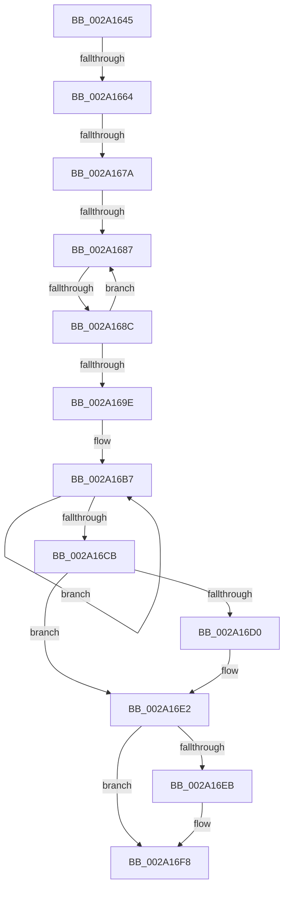

# sub_002A1645

- RVA: `0x002A1645`–`0x002A170A` (길이 `197` bytes)
- VA: `0x00000001402A1645`
- 실행 섹션: `.text`
- PDB 이름 있음: `아니요`; PDB Function 태그: `아니요`
- unwind 정보 RVA: `0x00068510`
- 디코드: `45`개 명령, `197/197` bytes 표시
- 미해석 바이트: `0` (있으면 어셈블리에 `.byte`로 보존)

> 이 문서는 커널 이미지의 기계어와 PDB 기호를 분석해 생성했습니다. 4번과 5번은 함수 원형과 자료형을 바이너리 사용 방식에서 추정한 C 해석이며 원본 소스 복구 결과는 아닙니다.

## 1. Dependencies

- 직접 호출 지점: **3**; 고유 호출 대상: **3**
- 직접 호출자로 확인된 함수: **0**
- RIP 상대 이미지 참조: **3**

### Outgoing calls
- `0x002A1667` → [KiAcquireKobjectLockSafe](../25/KiAcquireKobjectLockSafe_function_00251C90.md) (function, `0x00251C90`)
- `0x002A16DD` → [KeSetEvent](../33/KeSetEvent_function_0033F310.md) (function, `0x0033F310`)
- `0x002A16F3` → [KiLowerIrqlProcessIrqlFlags](../4F/KiLowerIrqlProcessIrqlFlags_function_004F5698.md) (function, `0x004F5698`)

### Direct callers
- 이 함수 시작 RVA로 연결되는 직접 call은 확인되지 않았습니다. 간접 호출은 완전히 역산할 수 없습니다.

### Static image references
- `0x002A1657` → RVA `0x00FC6D20` (`ALMOSTRO`; read)
- `0x002A16A9` → RVA `0x00F22D40` (`.data`; read)
- `0x002A16D6` → RVA `0x00F22D80` (`.data`; read)

## 2. Other-region calls and transfers

- 다른 실행 섹션으로 향하는 call: **0**
- call이 아닌 외부 분기/꼬리 이동: **5**
  - `0x002A165E` → [sub_002A170A + 0x9](Unknown_function_002A170A.md) (`tail-transfer`)
  - `0x002A1674` → [sub_002A170A](Unknown_function_002A170A.md) (`tail-transfer`)
  - `0x002A1681` → [sub_002A170A](Unknown_function_002A170A.md) (`tail-transfer`)
  - `0x002A168A` → [sub_002A170A](Unknown_function_002A170A.md) (`tail-transfer`)
  - `0x002A1705` → [KiDecrementProcessStackCount + 0x1E](KiDecrementProcessStackCount_function_002A1620.md) (`tail-transfer`)

## 3. Assembly (complete function range)

```asm
002A1645  48 89 7C 24 30                  mov qword ptr [rsp + 0x30], rdi
002A164A  44 0F 20 C7                     mov rdi, cr8
002A164E  B8 02 00 00 00                  mov eax, 2
002A1653  44 0F 22 C0                     mov cr8, rax
002A1657  83 3D C2 56 D2 00 00            cmp dword ptr [rip + 0xd256c2], 0
002A165E  0F 85 AF 00 00 00               jne 0x1402a1713
002A1664  48 8B CB                        mov rcx, rbx
002A1667  E8 24 06 FB FF                  call 0x140251c90
002A166C  8B 83 08 01 00 00               mov eax, dword ptr [rbx + 0x108]
002A1672  A8 07                           test al, 7
002A1674  0F 85 90 00 00 00               jne 0x1402a170a
002A167A  48 8D 4B 30                     lea rcx, [rbx + 0x30]
002A167E  48 39 09                        cmp qword ptr [rcx], rcx
002A1681  0F 84 83 00 00 00               je 0x1402a170a
002A1687  83 F8 08                        cmp eax, 8
002A168A  73 7E                           jae 0x1402a170a
002A168C  8B C8                           mov ecx, eax
002A168E  83 E1 FB                        and ecx, 0xfffffffb
002A1691  83 C9 03                        or ecx, 3
002A1694  F0 0F B1 8B 08 01 00 00         lock cmpxchg dword ptr [rbx + 0x108], ecx
002A169C  75 E9                           jne 0x1402a1687
002A169E  F0 81 23 7F FF FF FF            lock and dword ptr [rbx], 0xffffff7f
002A16A5  48 83 C3 78                     add rbx, 0x78
002A16A9  0F 0D 0D 90 16 C8 00            prefetchw byte ptr [rip + 0xc81690]
002A16B0  48 8B 05 89 16 C8 00            mov rax, qword ptr [rip + 0xc81689]
002A16B7  48 89 03                        mov qword ptr [rbx], rax
002A16BA  48 8B C8                        mov rcx, rax
002A16BD  F0 48 0F B1 1D 7A 16 C8 00      lock cmpxchg qword ptr [rip + 0xc8167a], rbx
002A16C6  48 3B C1                        cmp rax, rcx
002A16C9  75 EC                           jne 0x1402a16b7
002A16CB  48 85 C0                        test rax, rax
002A16CE  75 12                           jne 0x1402a16e2
002A16D0  45 33 C0                        xor r8d, r8d
002A16D3  8D 50 0A                        lea edx, [rax + 0xa]
002A16D6  48 8D 0D A3 16 C8 00            lea rcx, [rip + 0xc816a3]
002A16DD  E8 2E DC 09 00                  call 0x14033f310
002A16E2  83 3D 37 56 D2 00 00            cmp dword ptr [rip + 0xd25637], 0
002A16E9  74 0D                           je 0x1402a16f8
002A16EB  44 0F 20 C1                     mov rcx, cr8
002A16EF  40 0F B6 D7                     movzx edx, dil
002A16F3  E8 A0 3F 25 00                  call 0x1404f5698
002A16F8  40 0F B6 C7                     movzx eax, dil
002A16FC  44 0F 22 C0                     mov cr8, rax
002A1700  48 8B 7C 24 30                  mov rdi, qword ptr [rsp + 0x30]
002A1705  E9 34 FF FF FF                  jmp 0x1402a163e
```

## 4. C-style interpretation (structured pseudocode)

```c
__int64 __fastcall sub_002A1645(__int64 a1, __int64 a2, int a3, __int64 a4, __int64 a5, __int64 a6)
{
    __int64 result;
    __int64 v_rbx;
    unsigned __int64 v_stack_p30;

    v_stack_p30 = v_rdi;
    result = KiAcquireKobjectLockSafe(v_rbx, a2, a3, a4);
loc_002A1687:
    a1 = (unsigned int)(((unsigned int)((unsigned int)((unsigned int)(*(unsigned int *)(v_rbx + 264))))) & (0xFFFFFFFBULL));
    a1 = (unsigned int)((a1) | (3));
    if (condition_is_not_equal) goto loc_002A1687;
    v_rbx = (v_rbx) + (120);
loc_002A16B7:
    *(unsigned __int64 *)(v_rbx) = *(unsigned __int64 *)(v_rip + 13112969);
    if ((*(unsigned __int64 *)(v_rip + 13112969)) != (*(unsigned __int64 *)(v_rip + 13112969))) goto loc_002A16B7;
    result = *(unsigned __int64 *)(v_rip + 13112969);
    if (*(unsigned __int64 *)(v_rip + 13112969) == 0) {
        a3 = 0;
        a2 = *(unsigned __int64 *)(v_rip + 13112969) + 10;
        a1 = v_rip + 13112995;
        result = KeSetEvent(a1, a2, a3, a4);
    }
    if ((*(unsigned int *)(v_rip + 13784631)) != 0) {
        a1 = 2;
        a2 = (unsigned __int8)(v_cr8);
        result = KiLowerIrqlProcessIrqlFlags(a1, a2, a3, a4);
    }
}
```

## 5. (Beta) C Style

```c
int64_t sub_002A1645(int64_t Arg1, int64_t Arg2, int32_t Arg3, int64_t Arg4, uint64_t Arg5, int64_t Arg6)
{
    int64_t result;
    int64_t local_rbx;
    uint64_t v_stack_p30;

    v_stack_p30 = local_rdi;
    result = KiAcquireKobjectLockSafe(local_rbx, Arg2, Arg3, Arg4);
loc_002A1687:
    Arg1 = (uint32_t)(((uint32_t)((uint32_t)((uint32_t)(*(uint32_t *)(local_rbx + 0x108))))) & (0xFFFFFFFBULL));
    Arg1 = (uint32_t)((Arg1) | (3));
    if (condition_is_not_equal) goto loc_002A1687;
    local_rbx = (local_rbx) + (120);
loc_002A16B7:
    *(uint64_t *)(local_rbx) = *(uint64_t *)(v_rip + 0xC81689);
    if ((*(uint64_t *)(v_rip + 0xC81689)) != (*(uint64_t *)(v_rip + 0xC81689))) goto loc_002A16B7;
    result = *(uint64_t *)(v_rip + 0xC81689);
    if (*(uint64_t *)(v_rip + 0xC81689) == 0) {
        Arg3 = 0;
        Arg2 = *(uint64_t *)(v_rip + 0xC81689) + 10;
        Arg1 = v_rip + 13112995;
        result = KeSetEvent(Arg1, Arg2, Arg3, Arg4);
    }
    if ((*(uint32_t *)(v_rip + 0xD25637)) != 0) {
        Arg1 = 2;
        Arg2 = (uint8_t)(v_cr8);
        result = KiLowerIrqlProcessIrqlFlags(Arg1, Arg2, Arg3, Arg4);
    }
}
```

## 6. Execution-region graph

[열기: 2D/3D 그래프와 함수 탐색 컨트롤 패널](../../../control-panel.html?section=text&rva=0x002A1645&view=graph)

- 2D 그래프는 위에서 아래로 흐르고, 3D 그래프는 빈 공간을 드래그해 회전합니다. Shift+드래그는 이동, 휠은 확대·축소, 함수 노드 선택은 대상 보고서 이동입니다.

### Static fallback


