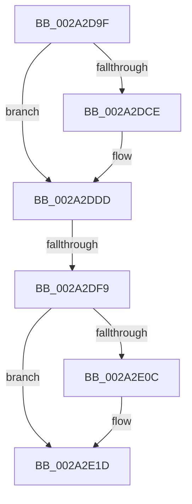

# sub_002A2D9F

- RVA: `0x002A2D9F`–`0x002A2E22` (길이 `131` bytes)
- VA: `0x00000001402A2D9F`
- 실행 섹션: `.text`
- PDB 이름 있음: `아니요`; PDB Function 태그: `아니요`
- unwind 정보 RVA: `0x0006865C`
- 디코드: `34`개 명령, `131/131` bytes 표시
- 미해석 바이트: `0` (있으면 어셈블리에 `.byte`로 보존)

> 이 문서는 커널 이미지의 기계어와 PDB 기호를 분석해 생성했습니다. 4번과 5번은 함수 원형과 자료형을 바이너리 사용 방식에서 추정한 C 해석이며 원본 소스 복구 결과는 아닙니다.

## 1. Dependencies

- 직접 호출 지점: **4**; 고유 호출 대상: **4**
- 직접 호출자로 확인된 함수: **0**
- RIP 상대 이미지 참조: **1**

### Outgoing calls
- `0x002A2DC5` → [MiCheckAvailablePagesForFaultDelay](MiCheckAvailablePagesForFaultDelay_function_002A31C0.md) (function, `0x002A31C0`)
- `0x002A2DF9` → [MiDelayFaultingThread](MiDelayFaultingThread_function_002A3054.md) (function, `0x002A3054`)
- `0x002A2E03` → [MiPageAvailable](MiPageAvailable_function_002A3138.md) (function, `0x002A3138`)
- `0x002A2E18` → [MiWaitForFreePage](MiWaitForFreePage_function_002A3324.md) (function, `0x002A3324`)

### Direct callers
- 이 함수 시작 RVA로 연결되는 직접 call은 확인되지 않았습니다. 간접 호출은 완전히 역산할 수 없습니다.

### Static image references
- `0x002A2DB2` → RVA `0x00E30088` (`.data`; read)

## 2. Other-region calls and transfers

- 다른 실행 섹션으로 향하는 call: **0**
- call이 아닌 외부 분기/꼬리 이동: **1**
  - `0x002A2DF7` → [sub_002A2E64](Unknown_function_002A2E64.md) (`tail-transfer`)

## 3. Assembly (complete function range)

```asm
002A2D9F  48 89 6C 24 40                  mov qword ptr [rsp + 0x40], rbp
002A2DA4  41 F7 D1                        not r9d
002A2DA7  0F B7 88 AE 00 00 00            movzx ecx, word ptr [rax + 0xae]
002A2DAE  41 83 E1 01                     and r9d, 1
002A2DB2  48 8B 05 CF D2 B8 00            mov rax, qword ptr [rip + 0xb8d2cf]
002A2DB9  48 89 74 24 20                  mov qword ptr [rsp + 0x20], rsi
002A2DBE  48 8B 2C C8                     mov rbp, qword ptr [rax + rcx*8]
002A2DC2  48 8B CD                        mov rcx, rbp
002A2DC5  E8 F6 03 00 00                  call 0x1402a31c0
002A2DCA  85 C0                           test eax, eax
002A2DCC  74 0F                           je 0x1402a2ddd
002A2DCE  A8 02                           test al, 2
002A2DD0  BB 0A 00 01 00                  mov ebx, 0x1000a
002A2DD5  B8 0A 00 03 00                  mov eax, 0x3000a
002A2DDA  0F 45 D8                        cmovne ebx, eax
002A2DDD  48 8B 85 40 49 00 00            mov rax, qword ptr [rbp + 0x4940]
002A2DE4  B9 0A 00 00 00                  mov ecx, 0xa
002A2DE9  48 3D 00 04 00 00               cmp rax, 0x400
002A2DEF  8B 47 50                        mov eax, dword ptr [rdi + 0x50]
002A2DF2  0F 42 D9                        cmovb ebx, ecx
002A2DF5  A8 04                           test al, 4
002A2DF7  74 6B                           je 0x1402a2e64
002A2DF9  E8 56 02 00 00                  call 0x1402a3054
002A2DFE  8B D6                           mov edx, esi
002A2E00  48 8B CD                        mov rcx, rbp
002A2E03  E8 30 03 00 00                  call 0x1402a3138
002A2E08  85 C0                           test eax, eax
002A2E0A  75 11                           jne 0x1402a2e1d
002A2E0C  8B 57 50                        mov edx, dword ptr [rdi + 0x50]
002A2E0F  48 8B CD                        mov rcx, rbp
002A2E12  C1 EA 03                        shr edx, 3
002A2E15  83 E2 02                        and edx, 2
002A2E18  E8 07 05 00 00                  call 0x1402a3324
002A2E1D  48 8B 6C 24 40                  mov rbp, qword ptr [rsp + 0x40]
```

## 4. C-style interpretation (structured pseudocode)

```c
__int64 __fastcall sub_002A2D9F(__int64 a1, __int64 a2, __int64 a3, int a4, __int64 a5, __int64 a6, __int64 a7, __int64 a8)
{
    __int64 result;
    __int64 v_rbx;
    unsigned __int64 v_stack_p20;
    unsigned __int64 v_stack_p40;

    v_stack_p40 = v_rbp;
    a4 = (unsigned int)(~(a4));
    a4 = (unsigned int)((a4) & (1));
    v_stack_p20 = v_rsi;
    result = MiCheckAvailablePagesForFaultDelay(*(unsigned __int64 *)(*(unsigned __int64 *)(v_rip + 12112591) + *(unsigned __int16 *)(result + 174) * 8), a2, a3, a4);
    if ((unsigned int)(result) != 0) {
        v_rbx = 0x1000AULL;
        result = 0x3000AULL;
        if ((((unsigned __int8)(result)) & (2)) != 0) { v_rbx = (unsigned int)(result); }
    }
    if ((*(unsigned __int64 *)(*(unsigned __int64 *)(*(unsigned __int64 *)(v_rip + 12112591) + *(unsigned __int16 *)(result + 174) * 8) + 18752)) < 0x400ULL) { v_rbx = 10; }
    result = MiDelayFaultingThread(10, a2, a3, a4);
    result = MiPageAvailable(*(unsigned __int64 *)(*(unsigned __int64 *)(v_rip + 12112591) + *(unsigned __int16 *)(result + 174) * 8), (unsigned int)((unsigned int)(v_rsi)), a3, a4);
    if ((unsigned int)(result) == 0) {
        a2 = *(unsigned int *)(v_rdi + 80);
        a1 = *(unsigned __int64 *)(*(unsigned __int64 *)(v_rip + 12112591) + *(unsigned __int16 *)(result + 174) * 8);
        a2 = (unsigned int)((a2) >> (3));
        a2 = (unsigned int)((a2) & (2));
        result = MiWaitForFreePage(a1, a2, a3, a4);
    }
    return result;
}
```

## 5. (Beta) C Style

```c
int64_t sub_002A2D9F(int64_t Arg1, int64_t Arg2, int64_t Arg3, int32_t Arg4, uint64_t Arg5, uint64_t Arg6, uint64_t Arg7, int64_t Arg8)
{
    int64_t result;
    int64_t local_rbx;
    uint64_t v_stack_p20;
    uint64_t v_stack_p40;

    v_stack_p40 = local_rbp;
    Arg4 = (uint32_t)(~(Arg4));
    Arg4 = (uint32_t)((Arg4) & (1));
    v_stack_p20 = local_rsi;
    result = MiCheckAvailablePagesForFaultDelay(*(uint64_t *)(*(uint64_t *)(v_rip + 0xB8D2CF) + *(uint16_t *)(result + 0xAE) * 8), Arg2, Arg3, Arg4);
    if ((uint32_t)(result) != 0) {
        local_rbx = 0x1000AULL;
        result = 0x3000AULL;
        if ((((uint8_t)(result)) & (2)) != 0) { local_rbx = (uint32_t)(result); }
    }
    if ((*(uint64_t *)(*(uint64_t *)(*(uint64_t *)(v_rip + 0xB8D2CF) + *(uint16_t *)(result + 0xAE) * 8) + 0x4940)) < 0x400ULL) { local_rbx = 10; }
    result = MiDelayFaultingThread(10, Arg2, Arg3, Arg4);
    result = MiPageAvailable(*(uint64_t *)(*(uint64_t *)(v_rip + 0xB8D2CF) + *(uint16_t *)(result + 0xAE) * 8), (uint32_t)((uint32_t)(local_rsi)), Arg3, Arg4);
    if ((uint32_t)(result) == 0) {
        Arg2 = *(uint32_t *)(local_rdi + 0x50);
        Arg1 = *(uint64_t *)(*(uint64_t *)(v_rip + 0xB8D2CF) + *(uint16_t *)(result + 0xAE) * 8);
        Arg2 = (uint32_t)((Arg2) >> (3));
        Arg2 = (uint32_t)((Arg2) & (2));
        result = MiWaitForFreePage(Arg1, Arg2, Arg3, Arg4);
    }
    return result;
}
```

## 6. Execution-region graph

[열기: 2D/3D 그래프와 함수 탐색 컨트롤 패널](../../../control-panel.html?section=text&rva=0x002A2D9F&view=graph)

- 2D 그래프는 위에서 아래로 흐르고, 3D 그래프는 빈 공간을 드래그해 회전합니다. Shift+드래그는 이동, 휠은 확대·축소, 함수 노드 선택은 대상 보고서 이동입니다.

### Static fallback


