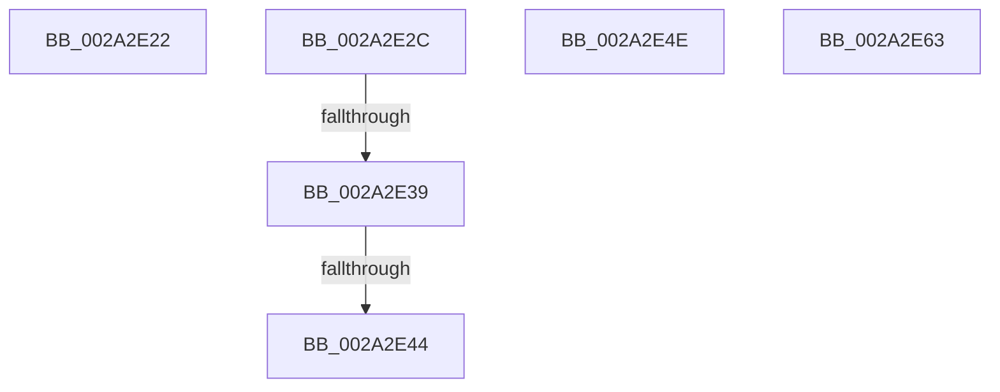

# sub_002A2E22

- RVA: `0x002A2E22`–`0x002A2E64` (길이 `66` bytes)
- VA: `0x00000001402A2E22`
- 실행 섹션: `.text`
- PDB 이름 있음: `아니요`; PDB Function 태그: `아니요`
- unwind 정보 RVA: `0x00068670`
- 디코드: `17`개 명령, `66/66` bytes 표시
- 미해석 바이트: `0` (있으면 어셈블리에 `.byte`로 보존)

> 이 문서는 커널 이미지의 기계어와 PDB 기호를 분석해 생성했습니다. 4번과 5번은 함수 원형과 자료형을 바이너리 사용 방식에서 추정한 C 해석이며 원본 소스 복구 결과는 아닙니다.

## 1. Dependencies

- 직접 호출 지점: **0**; 고유 호출 대상: **0**
- 직접 호출자로 확인된 함수: **0**
- RIP 상대 이미지 참조: **0**

### Outgoing calls
- 직접 디코드된 call 명령이 없습니다.

### Direct callers
- 이 함수 시작 RVA로 연결되는 직접 call은 확인되지 않았습니다. 간접 호출은 완전히 역산할 수 없습니다.

### Static image references
- 디코드된 RIP-relative 메모리 참조가 없습니다.

## 2. Other-region calls and transfers

- 다른 실행 섹션으로 향하는 call: **0**
- call이 아닌 외부 분기/꼬리 이동: **4**
  - `0x002A2E27` → [MiConvertFaultStatus + 0x3B](MiConvertFaultStatus_function_002A2CC0.md) (`tail-transfer`)
  - `0x002A2E33` → [MiConvertFaultStatus + 0xCF](MiConvertFaultStatus_function_002A2CC0.md) (`tail-transfer`)
  - `0x002A2E3E` → [MiConvertFaultStatus + 0xCF](MiConvertFaultStatus_function_002A2CC0.md) (`tail-transfer`)
  - `0x002A2E49` → [MiConvertFaultStatus + 0x3B](MiConvertFaultStatus_function_002A2CC0.md) (`tail-transfer`)

## 3. Assembly (complete function range)

```asm
002A2E22  B8 69 03 00 00                  mov eax, 0x369
002A2E27  E9 CF FE FF FF                  jmp 0x1402a2cfb
002A2E2C  48 83 E0 FE                     and rax, 0xfffffffffffffffe
002A2E30  80 38 05                        cmp byte ptr [rax], 5
002A2E33  0F 85 56 FF FF FF               jne 0x1402a2d8f
002A2E39  8B 40 38                        mov eax, dword ptr [rax + 0x38]
002A2E3C  A8 0C                           test al, 0xc
002A2E3E  0F 84 4B FF FF FF               je 0x1402a2d8f
002A2E44  B8 D8 00 00 C0                  mov eax, 0xc00000d8
002A2E49  E9 AD FE FF FF                  jmp 0x1402a2cfb
002A2E4E  48 8B 5C 24 48                  mov rbx, qword ptr [rsp + 0x48]
002A2E53  B8 17 00 00 C0                  mov eax, 0xc0000017
002A2E58  48 8B 74 24 50                  mov rsi, qword ptr [rsp + 0x50]
002A2E5D  48 83 C4 30                     add rsp, 0x30
002A2E61  5F                              pop rdi
002A2E62  C3                              ret
002A2E63  CC                              int3
```

## 4. C-style interpretation (structured pseudocode)

```c
__int64 __fastcall sub_002A2E22(void)
{
    unsigned __int64 v_stack_p48;
    unsigned __int64 v_stack_p50;
}
```

## 5. (Beta) C Style

```c
void sub_002A2E22(void)
{
    uint64_t v_stack_p48;
    uint64_t v_stack_p50;
}
```

## 6. Execution-region graph

[열기: 2D/3D 그래프와 함수 탐색 컨트롤 패널](../../../control-panel.html?section=text&rva=0x002A2E22&view=graph)

- 2D 그래프는 위에서 아래로 흐르고, 3D 그래프는 빈 공간을 드래그해 회전합니다. Shift+드래그는 이동, 휠은 확대·축소, 함수 노드 선택은 대상 보고서 이동입니다.

### Static fallback


