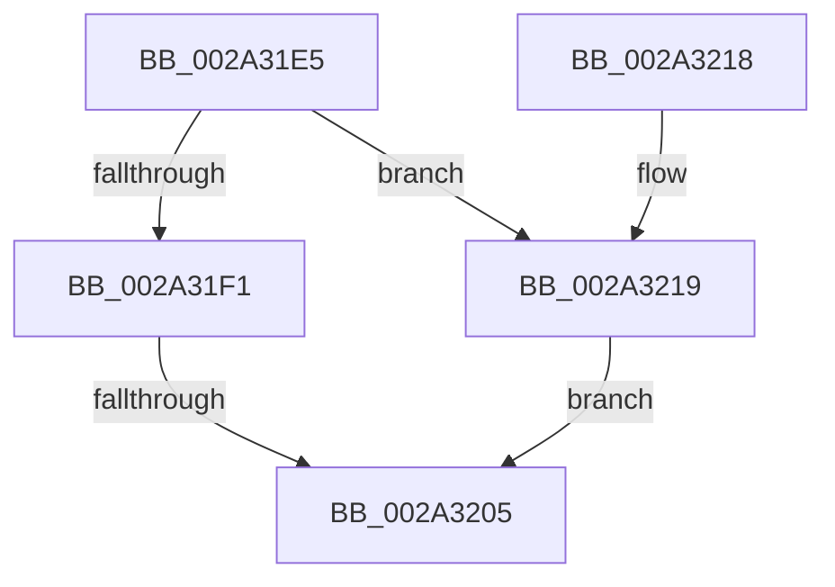

# sub_002A31E5

- RVA: `0x002A31E5`–`0x002A3255` (길이 `112` bytes)
- VA: `0x00000001402A31E5`
- 실행 섹션: `.text`
- PDB 이름 있음: `아니요`; PDB Function 태그: `아니요`
- unwind 정보 RVA: `0x000686D8`
- 디코드: `24`개 명령, `112/112` bytes 표시
- 미해석 바이트: `0` (있으면 어셈블리에 `.byte`로 보존)

> 이 문서는 커널 이미지의 기계어와 PDB 기호를 분석해 생성했습니다. 4번과 5번은 함수 원형과 자료형을 바이너리 사용 방식에서 추정한 C 해석이며 원본 소스 복구 결과는 아닙니다.

## 1. Dependencies

- 직접 호출 지점: **0**; 고유 호출 대상: **0**
- 직접 호출자로 확인된 함수: **0**
- RIP 상대 이미지 참조: **0**

### Outgoing calls
- 직접 디코드된 call 명령이 없습니다.

### Direct callers
- 이 함수 시작 RVA로 연결되는 직접 call은 확인되지 않았습니다. 간접 호출은 완전히 역산할 수 없습니다.

### Static image references
- 디코드된 RIP-relative 메모리 참조가 없습니다.

## 2. Other-region calls and transfers

- 다른 실행 섹션으로 향하는 call: **0**
- call이 아닌 외부 분기/꼬리 이동: **1**
  - `0x002A31FF` → [sub_002A32C4 + 0x5](Unknown_function_002A32C4.md) (`tail-transfer`)

## 3. Assembly (complete function range)

```asm
002A31E5  48 89 74 24 48                  mov qword ptr [rsp + 0x48], rsi
002A31EA  4C 89 64 24 50                  mov qword ptr [rsp + 0x50], r12
002A31EF  77 28                           ja 0x1402a3219
002A31F1  49 8B 92 00 49 00 00            mov rdx, qword ptr [r10 + 0x4900]
002A31F8  48 81 FA 20 04 00 00            cmp rdx, 0x420
002A31FF  0F 82 C4 00 00 00               jb 0x1402a32c9
002A3205  33 C0                           xor eax, eax
002A3207  4C 8B 64 24 50                  mov r12, qword ptr [rsp + 0x50]
002A320C  48 8B 74 24 48                  mov rsi, qword ptr [rsp + 0x48]
002A3211  48 83 C4 28                     add rsp, 0x28
002A3215  5F                              pop rdi
002A3216  5B                              pop rbx
002A3217  C3                              ret
002A3218  CC                              int3
002A3219  65 48 8B 04 25 20 00 00 00      mov rax, qword ptr gs:[0x20]
002A3222  48 8B 88 C0 00 00 00            mov rcx, qword ptr [rax + 0xc0]
002A3229  0F B7 81 8A 00 00 00            movzx eax, word ptr [rcx + 0x8a]
002A3230  48 69 F0 80 DF 00 00            imul rsi, rax, 0xdf80
002A3237  49 03 72 10                     add rsi, qword ptr [r10 + 0x10]
002A323B  48 8B 8E 08 0F 00 00            mov rcx, qword ptr [rsi + 0xf08]
002A3242  4C 8B A6 10 0F 00 00            mov r12, qword ptr [rsi + 0xf10]
002A3249  4C 03 E1                        add r12, rcx
002A324C  49 81 FC 20 04 00 00            cmp r12, 0x420
002A3253  73 B0                           jae 0x1402a3205
```

## 4. C-style interpretation (structured pseudocode)

```c
__int64 __fastcall sub_002A31E5(__int64 a1, __int64 a2, __int64 a3, __int64 a4, __int64 a5, __int64 a6, __int64 a7, __int64 a8, __int64 a9, __int64 a10)
{
    __int64 result;
    __int64 v_r12;
    __int64 v_rsi;
    __int64 v_rsp;
    unsigned __int64 v_stack_p48;
    unsigned __int64 v_stack_p50;

    v_stack_p48 = v_rsi;
    v_stack_p50 = v_r12;
    if (condition_is_above) goto loc_002A3219;
loc_002A3205:
    result = 0;
    v_rsp = (v_rsp) + (40);
    return result;
loc_002A3219:
    v_rsi = (a9) * (*(unsigned __int16 *)(*(unsigned __int64 *)(*(unsigned __int64 *)(gs_base + (0 + 32)) + 192) + 138));
    v_rsi = (v_rsi) + (*(unsigned __int64 *)(v_r10 + 16));
    v_r12 = (*(unsigned __int64 *)(v_rsi + 3856)) + (*(unsigned __int64 *)(v_rsi + 3848));
    if (v_r12 >= 0x420ULL) goto loc_002A3205;
}
```

## 5. (Beta) C Style

```c
int64_t sub_002A31E5(int64_t Arg1, int64_t Arg2, int64_t Arg3, int64_t Arg4, uint64_t Arg5, uint64_t Arg6, uint64_t Arg7, uint64_t Arg8, int64_t Arg9, int64_t Arg10)
{
    int64_t result;
    int64_t local_r12;
    int64_t local_rsi;
    int64_t local_rsp;
    uint64_t v_stack_p48;
    uint64_t v_stack_p50;

    v_stack_p48 = local_rsi;
    v_stack_p50 = local_r12;
    if (condition_is_above) goto loc_002A3219;
loc_002A3205:
    result = 0;
    local_rsp = (local_rsp) + (40);
    return result;
loc_002A3219:
    local_rsi = (Arg9) * (*(uint16_t *)(*(uint64_t *)(*(uint64_t *)(gs_base + (0 + 0x20)) + 0xC0) + 0x8A));
    local_rsi = (local_rsi) + (*(uint64_t *)(local_r10 + 0x10));
    local_r12 = (*(uint64_t *)(local_rsi + 0xF10)) + (*(uint64_t *)(local_rsi + 0xF08));
    if (local_r12 >= 0x420ULL) goto loc_002A3205;
}
```

## 6. Execution-region graph

[열기: 2D/3D 그래프와 함수 탐색 컨트롤 패널](../../../control-panel.html?section=text&rva=0x002A31E5&view=graph)

- 2D 그래프는 위에서 아래로 흐르고, 3D 그래프는 빈 공간을 드래그해 회전합니다. Shift+드래그는 이동, 휠은 확대·축소, 함수 노드 선택은 대상 보고서 이동입니다.

### Static fallback


