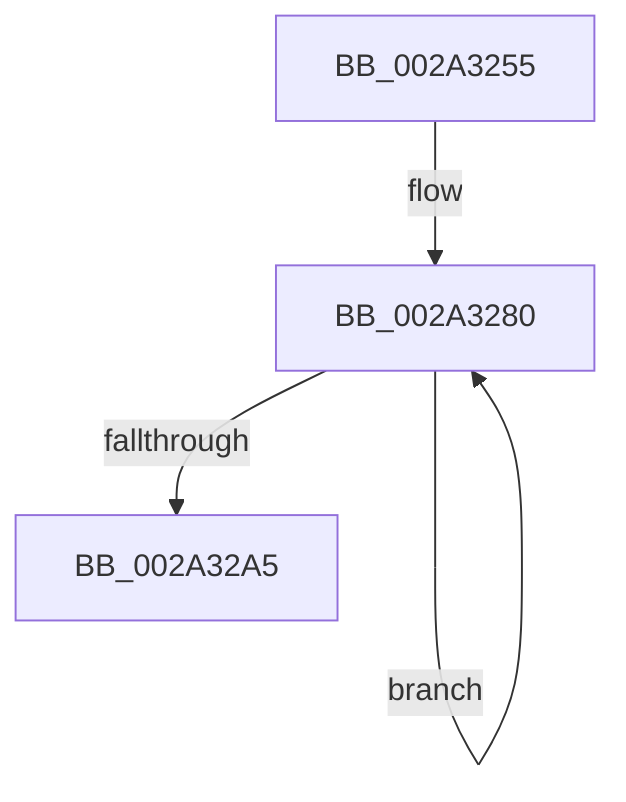

# sub_002A3255

- RVA: `0x002A3255`–`0x002A32C4` (길이 `111` bytes)
- VA: `0x00000001402A3255`
- 실행 섹션: `.text`
- PDB 이름 있음: `아니요`; PDB Function 태그: `아니요`
- unwind 정보 RVA: `0x000686F4`
- 디코드: `24`개 명령, `111/111` bytes 표시
- 미해석 바이트: `0` (있으면 어셈블리에 `.byte`로 보존)

> 이 문서는 커널 이미지의 기계어와 PDB 기호를 분석해 생성했습니다. 4번과 5번은 함수 원형과 자료형을 바이너리 사용 방식에서 추정한 C 해석이며 원본 소스 복구 결과는 아닙니다.

## 1. Dependencies

- 직접 호출 지점: **0**; 고유 호출 대상: **0**
- 직접 호출자로 확인된 함수: **0**
- RIP 상대 이미지 참조: **1**

### Outgoing calls
- 직접 디코드된 call 명령이 없습니다.

### Direct callers
- 이 함수 시작 RVA로 연결되는 직접 call은 확인되지 않았습니다. 간접 호출은 완전히 역산할 수 없습니다.

### Static image references
- `0x002A326D` → RVA `0x00011C60` (`.rdata`; read)

## 2. Other-region calls and transfers

- 다른 실행 섹션으로 향하는 call: **0**
- call이 아닌 외부 분기/꼬리 이동: **1**
  - `0x002A32BE` → [sub_002A31E5 + 0xC](Unknown_function_002A31E5.md) (`tail-transfer`)

## 3. Assembly (complete function range)

```asm
002A3255  48 89 6C 24 40                  mov qword ptr [rsp + 0x40], rbp
002A325A  48 83 C6 10                     add rsi, 0x10
002A325E  4C 89 74 24 58                  mov qword ptr [rsp + 0x58], r14
002A3263  BD 03 00 00 00                  mov ebp, 3
002A3268  4C 89 7C 24 20                  mov qword ptr [rsp + 0x20], r15
002A326D  4C 8D 35 EC E9 D6 FF            lea r14, [rip - 0x291614]
002A3274  4C 8B FB                        mov r15, rbx
002A3277  66 0F 1F 84 00 00 00 00 00      nop word ptr [rax + rax]
002A3280  48 8B 4E F8                     mov rcx, qword ptr [rsi - 8]
002A3284  48 8B 16                        mov rdx, qword ptr [rsi]
002A3287  48 8D B6 00 05 00 00            lea rsi, [rsi + 0x500]
002A328E  4D 8B 06                        mov r8, qword ptr [r14]
002A3291  4D 8D 76 08                     lea r14, [r14 + 8]
002A3295  48 03 D1                        add rdx, rcx
002A3298  4C 0F AF C2                     imul r8, rdx
002A329C  4D 03 F8                        add r15, r8
002A329F  48 83 ED 01                     sub rbp, 1
002A32A3  75 DB                           jne 0x1402a3280
002A32A5  4C 8B 74 24 58                  mov r14, qword ptr [rsp + 0x58]
002A32AA  4B 8D 04 27                     lea rax, [r15 + r12]
002A32AE  48 8B 6C 24 40                  mov rbp, qword ptr [rsp + 0x40]
002A32B3  4C 8B 7C 24 20                  mov r15, qword ptr [rsp + 0x20]
002A32B8  48 3D 20 04 00 00               cmp rax, 0x420
002A32BE  0F 82 2D FF FF FF               jb 0x1402a31f1
```

## 4. C-style interpretation (structured pseudocode)

```c
__int64 __fastcall sub_002A3255(__int64 a1, __int64 a2, __int64 a3, __int64 a4, __int64 a5, __int64 a6, __int64 a7, __int64 a8, __int64 a9, __int64 a10, __int64 a11)
{
    __int64 v_r15;
    __int64 v_rbp;
    __int64 v_rsi;
    unsigned __int64 v_stack_p20;
    unsigned __int64 v_stack_p40;
    unsigned __int64 v_stack_p58;

    v_stack_p40 = v_rbp;
    v_rsi = (v_rsi) + (16);
    v_stack_p58 = v_r14;
    v_stack_p20 = v_r15;
loc_002A3280:
    a2 = (*(unsigned __int64 *)(v_rsi)) + (*(unsigned __int64 *)(v_rsi - 8));
    a3 = (*(unsigned __int64 *)(v_rip - 2692628)) * (a2);
    v_r15 = (v_rbx) + (a3);
    v_rbp = (3) - (1);
    if (condition_is_not_equal) goto loc_002A3280;
}
```

## 5. (Beta) C Style

```c
int64_t sub_002A3255(int64_t Arg1, int64_t Arg2, int64_t Arg3, int64_t Arg4, uint64_t Arg5, uint64_t Arg6, uint64_t Arg7, int64_t Arg8, uint64_t Arg9, uint64_t Arg10, int64_t Arg11)
{
    int64_t local_r15;
    int64_t local_rbp;
    int64_t local_rsi;
    uint64_t v_stack_p20;
    uint64_t v_stack_p40;
    uint64_t v_stack_p58;

    v_stack_p40 = local_rbp;
    local_rsi = (local_rsi) + (16);
    v_stack_p58 = local_r14;
    v_stack_p20 = local_r15;
loc_002A3280:
    Arg2 = (*(uint64_t *)(local_rsi)) + (*(uint64_t *)(local_rsi - 0x8));
    Arg3 = (*(uint64_t *)(v_rip - 0x291614)) * (Arg2);
    local_r15 = (local_rbx) + (Arg3);
    local_rbp = (3) - (1);
    if (condition_is_not_equal) goto loc_002A3280;
}
```

## 6. Execution-region graph

[열기: 2D/3D 그래프와 함수 탐색 컨트롤 패널](../../../control-panel.html?section=text&rva=0x002A3255&view=graph)

- 2D 그래프는 위에서 아래로 흐르고, 3D 그래프는 빈 공간을 드래그해 회전합니다. Shift+드래그는 이동, 휠은 확대·축소, 함수 노드 선택은 대상 보고서 이동입니다.

### Static fallback


