# sub_002A32C4

- RVA: `0x002A32C4`–`0x002A3311` (길이 `77` bytes)
- VA: `0x00000001402A32C4`
- 실행 섹션: `.text`
- PDB 이름 있음: `아니요`; PDB Function 태그: `아니요`
- unwind 정보 RVA: `0x00068710`
- 디코드: `23`개 명령, `77/77` bytes 표시
- 미해석 바이트: `0` (있으면 어셈블리에 `.byte`로 보존)

> 이 문서는 커널 이미지의 기계어와 PDB 기호를 분석해 생성했습니다. 4번과 5번은 함수 원형과 자료형을 바이너리 사용 방식에서 추정한 C 해석이며 원본 소스 복구 결과는 아닙니다.

## 1. Dependencies

- 직접 호출 지점: **1**; 고유 호출 대상: **1**
- 직접 호출자로 확인된 함수: **0**
- RIP 상대 이미지 참조: **0**

### Outgoing calls
- `0x002A32D1` → [MiGetCurrentSlabIdentity](../3B/MiGetCurrentSlabIdentity_function_003BD020.md) (function, `0x003BD020`)

### Direct callers
- 이 함수 시작 RVA로 연결되는 직접 call은 확인되지 않았습니다. 간접 호출은 완전히 역산할 수 없습니다.

### Static image references
- 디코드된 RIP-relative 메모리 참조가 없습니다.

## 2. Other-region calls and transfers

- 다른 실행 섹션으로 향하는 call: **0**
- call이 아닌 외부 분기/꼬리 이동: **3**
  - `0x002A32C4` → [sub_002A31E5 + 0x20](Unknown_function_002A31E5.md) (`tail-transfer`)
  - `0x002A32EB` → [sub_002A31E5 + 0x20](Unknown_function_002A31E5.md) (`tail-transfer`)
  - `0x002A32F8` → [sub_002A3319](Unknown_function_002A3319.md) (`tail-transfer`)

## 3. Assembly (complete function range)

```asm
002A32C4  E9 3C FF FF FF                  jmp 0x1402a3205
002A32C9  45 85 C9                        test r9d, r9d
002A32CC  75 27                           jne 0x1402a32f5
002A32CE  48 8B CF                        mov rcx, rdi
002A32D1  E8 4A 9D 11 00                  call 0x1403bd020
002A32D6  3C FF                           cmp al, 0xff
002A32D8  74 1B                           je 0x1402a32f5
002A32DA  49 8B 82 80 47 00 00            mov rax, qword ptr [r10 + 0x4780]
002A32E1  48 03 D0                        add rdx, rax
002A32E4  48 81 FA 20 04 00 00            cmp rdx, 0x420
002A32EB  0F 83 14 FF FF FF               jae 0x1402a3205
002A32F1  41 8D 59 02                     lea ebx, [r9 + 2]
002A32F5  4D 85 DB                        test r11, r11
002A32F8  75 1F                           jne 0x1402a3319
002A32FA  4C 8B 64 24 50                  mov r12, qword ptr [rsp + 0x50]
002A32FF  83 CB 01                        or ebx, 1
002A3302  48 8B 74 24 48                  mov rsi, qword ptr [rsp + 0x48]
002A3307  8B C3                           mov eax, ebx
002A3309  48 83 C4 28                     add rsp, 0x28
002A330D  5F                              pop rdi
002A330E  5B                              pop rbx
002A330F  C3                              ret
002A3310  CC                              int3
```

## 4. C-style interpretation (structured pseudocode)

```c
__int64 __fastcall sub_002A32C4(__int64 a1, __int64 a2, __int64 a3, __int64 a4)
{
    unsigned __int64 v_stack_p48;
    unsigned __int64 v_stack_p50;
}
```

## 5. (Beta) C Style

```c
int64_t sub_002A32C4(int64_t Arg1, int64_t Arg2, int64_t Arg3, int64_t Arg4)
{
    uint64_t v_stack_p48;
    uint64_t v_stack_p50;
}
```

## 6. Execution-region graph

[열기: 2D/3D 그래프와 함수 탐색 컨트롤 패널](../../../control-panel.html?section=text&rva=0x002A32C4&view=graph)

- 2D 그래프는 위에서 아래로 흐르고, 3D 그래프는 빈 공간을 드래그해 회전합니다. Shift+드래그는 이동, 휠은 확대·축소, 함수 노드 선택은 대상 보고서 이동입니다.

### Static fallback

```mermaid
flowchart TD
  bb_002A32C4[BB_002A32C4]
  bb_002A32C9[BB_002A32C9]
  bb_002A32CE[BB_002A32CE]
  bb_002A32DA[BB_002A32DA]
  bb_002A32F1[BB_002A32F1]
  bb_002A32F5[BB_002A32F5]
  bb_002A32FA[BB_002A32FA]
  bb_002A3310[BB_002A3310]
  bb_002A32C9 -->|branch| bb_002A32F5
  bb_002A32C9 -->|fallthrough| bb_002A32CE
  bb_002A32CE -->|branch| bb_002A32F5
  bb_002A32CE -->|fallthrough| bb_002A32DA
  bb_002A32DA -->|fallthrough| bb_002A32F1
  bb_002A32F1 -->|flow| bb_002A32F5
  bb_002A32F5 -->|fallthrough| bb_002A32FA
```


