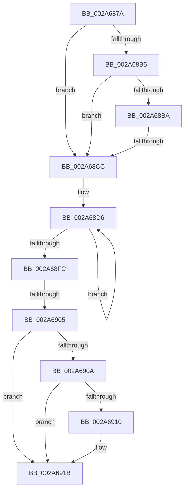

# sub_002A687A

- RVA: `0x002A687A`–`0x002A692F` (길이 `181` bytes)
- VA: `0x00000001402A687A`
- 실행 섹션: `.text`
- PDB 이름 있음: `아니요`; PDB Function 태그: `아니요`
- unwind 정보 RVA: `0x00068AC4`
- 디코드: `45`개 명령, `181/181` bytes 표시
- 미해석 바이트: `0` (있으면 어셈블리에 `.byte`로 보존)

> 이 문서는 커널 이미지의 기계어와 PDB 기호를 분석해 생성했습니다. 4번과 5번은 함수 원형과 자료형을 바이너리 사용 방식에서 추정한 C 해석이며 원본 소스 복구 결과는 아닙니다.

## 1. Dependencies

- 직접 호출 지점: **0**; 고유 호출 대상: **0**
- 직접 호출자로 확인된 함수: **0**
- RIP 상대 이미지 참조: **3**

### Outgoing calls
- 직접 디코드된 call 명령이 없습니다.

### Direct callers
- 이 함수 시작 RVA로 연결되는 직접 call은 확인되지 않았습니다. 간접 호출은 완전히 역산할 수 없습니다.

### Static image references
- `0x002A6895` → RVA `0x00FC7358` (`ALMOSTRO`; read)
- `0x002A68BA` → RVA `0x00F06680` (`.data`; read)
- `0x002A68CF` → RVA `0x00E27F80` (`.data`; read)

## 2. Other-region calls and transfers

- 다른 실행 섹션으로 향하는 call: **0**
- call이 아닌 외부 분기/꼬리 이동: **2**
  - `0x002A68CA` → [sub_002A6937](Unknown_function_002A6937.md) (`tail-transfer`)
  - `0x002A68FF` → [sub_002A6937 + 0x59](Unknown_function_002A6937.md) (`tail-transfer`)

## 3. Assembly (complete function range)

```asm
002A687A  48 89 6C 24 58                  mov qword ptr [rsp + 0x58], rbp
002A687F  48 89 74 24 60                  mov qword ptr [rsp + 0x60], rsi
002A6884  4C 89 74 24 68                  mov qword ptr [rsp + 0x68], r14
002A6889  4C 89 7C 24 30                  mov qword ptr [rsp + 0x30], r15
002A688E  4C 8B B9 F8 02 00 00            mov r15, qword ptr [rcx + 0x2f8]
002A6895  0F B6 2D BC 0A D2 00            movzx ebp, byte ptr [rip + 0xd20abc]
002A689C  4D 8D B7 80 00 00 00            lea r14, [r15 + 0x80]
002A68A3  41 0F 0D 0E                     prefetchw byte ptr [r14]
002A68A7  49 8B 36                        mov rsi, qword ptr [r14]
002A68AA  4D 8B 46 40                     mov r8, qword ptr [r14 + 0x40]
002A68AE  49 83 7E 50 00                  cmp qword ptr [r14 + 0x50], 0
002A68B3  74 17                           je 0x1402a68cc
002A68B5  4C 3B C6                        cmp r8, rsi
002A68B8  76 12                           jbe 0x1402a68cc
002A68BA  48 8B 15 BF FD C5 00            mov rdx, qword ptr [rip + 0xc5fdbf]
002A68C1  49 8B C0                        mov rax, r8
002A68C4  48 2B C6                        sub rax, rsi
002A68C7  48 3B C2                        cmp rax, rdx
002A68CA  77 6B                           ja 0x1402a6937
002A68CC  4C 8B C7                        mov r8, rdi
002A68CF  4C 8D 15 AA 16 B8 00            lea r10, [rip + 0xb816aa]
002A68D6  4C 3B C6                        cmp r8, rsi
002A68D9  4C 8B CE                        mov r9, rsi
002A68DC  48 8B CE                        mov rcx, rsi
002A68DF  48 8B C6                        mov rax, rsi
002A68E2  4D 0F 42 C8                     cmovb r9, r8
002A68E6  49 2B C8                        sub rcx, r8
002A68E9  33 D2                           xor edx, edx
002A68EB  4C 3B C6                        cmp r8, rsi
002A68EE  48 0F 42 D1                     cmovb rdx, rcx
002A68F2  F0 49 0F B1 16                  lock cmpxchg qword ptr [r14], rdx
002A68F7  48 8B F0                        mov rsi, rax
002A68FA  75 DA                           jne 0x1402a68d6
002A68FC  4D 2B C1                        sub r8, r9
002A68FF  0F 85 8B 00 00 00               jne 0x1402a6990
002A6905  48 85 DB                        test rbx, rbx
002A6908  74 11                           je 0x1402a691b
002A690A  40 F6 C5 04                     test bpl, 4
002A690E  74 0B                           je 0x1402a691b
002A6910  48 F7 DF                        neg rdi
002A6913  F0 48 01 BB 08 02 00 00         lock add qword ptr [rbx + 0x208], rdi
002A691B  4C 8B 74 24 68                  mov r14, qword ptr [rsp + 0x68]
002A6920  48 8B 74 24 60                  mov rsi, qword ptr [rsp + 0x60]
002A6925  48 8B 6C 24 58                  mov rbp, qword ptr [rsp + 0x58]
002A692A  4C 8B 7C 24 30                  mov r15, qword ptr [rsp + 0x30]
```

## 4. C-style interpretation (structured pseudocode)

```c
__int64 __fastcall sub_002A687A(__int64 a1, __int64 a2, __int64 a3, __int64 a4, __int64 a5, __int64 a6, __int64 a7, __int64 a8, __int64 a9, __int64 a10, __int64 a11, __int64 a12, __int64 a13)
{
    __int64 result;
    __int64 v_rdi;
    unsigned __int64 v_stack_p30;
    unsigned __int64 v_stack_p58;
    unsigned __int64 v_stack_p60;
    unsigned __int64 v_stack_p68;

    v_stack_p58 = v_rbp;
    v_stack_p60 = v_rsi;
    v_stack_p68 = v_r14;
    v_stack_p30 = v_r15;
    if ((*(unsigned __int64 *)(*(unsigned __int64 *)(a1 + 760) + 128 + 80)) == 0) goto loc_002A68CC;
    if ((*(unsigned __int64 *)(*(unsigned __int64 *)(a1 + 760) + 128 + 64)) <= (*(unsigned __int64 *)(*(unsigned __int64 *)(a1 + 760) + 128))) goto loc_002A68CC;
    result = (*(unsigned __int64 *)(*(unsigned __int64 *)(a1 + 760) + 128 + 64)) - (*(unsigned __int64 *)(*(unsigned __int64 *)(a1 + 760) + 128));
loc_002A68CC:
loc_002A68D6:
    a4 = *(unsigned __int64 *)(*(unsigned __int64 *)(a1 + 760) + 128);
    if (v_rdi < (*(unsigned __int64 *)(*(unsigned __int64 *)(a1 + 760) + 128))) { a4 = v_rdi; }
    a1 = (*(unsigned __int64 *)(*(unsigned __int64 *)(a1 + 760) + 128)) - (v_rdi);
    a2 = 0;
    if (v_rdi < (*(unsigned __int64 *)(*(unsigned __int64 *)(a1 + 760) + 128))) { a2 = a1; }
    if (v_rdi != (*(unsigned __int64 *)(*(unsigned __int64 *)(a1 + 760) + 128))) goto loc_002A68D6;
    a3 = (v_rdi) - (a4);
    if (v_rbx == 0) goto loc_002A691B;
    if ((((unsigned __int8)(*(unsigned __int8 *)(v_rip + 13765308))) & (4)) != 0) {
        v_rdi = -(v_rdi);
    }
    return *(unsigned __int64 *)(*(unsigned __int64 *)(a1 + 760) + 128);
}
```

## 5. (Beta) C Style

```c
int64_t sub_002A687A(void *Arg1, int64_t Arg2, int64_t Arg3, int64_t Arg4, uint64_t Arg5, int64_t Arg6, uint64_t Arg7, uint64_t Arg8, uint64_t Arg9, uint64_t Arg10, int64_t Arg11, int64_t Arg12, int64_t Arg13)
{
    uint8_t *arg1 = (uint8_t *)Arg1;

    int64_t result;
    int64_t local_rdi;
    uint64_t v_stack_p30;
    uint64_t v_stack_p58;
    uint64_t v_stack_p60;
    uint64_t v_stack_p68;

    v_stack_p58 = local_rbp;
    v_stack_p60 = local_rsi;
    v_stack_p68 = local_r14;
    v_stack_p30 = local_r15;
    if ((*(uint64_t *)(*(uint64_t *)(arg1 + 0x2F8) + 0x80 + 0x50)) == 0) goto loc_002A68CC;
    if ((*(uint64_t *)(*(uint64_t *)(arg1 + 0x2F8) + 0x80 + 0x40)) <= (*(uint64_t *)(*(uint64_t *)(arg1 + 0x2F8) + 0x80))) goto loc_002A68CC;
    result = (*(uint64_t *)(*(uint64_t *)(arg1 + 0x2F8) + 0x80 + 0x40)) - (*(uint64_t *)(*(uint64_t *)(arg1 + 0x2F8) + 0x80));
loc_002A68CC:
loc_002A68D6:
    Arg4 = *(uint64_t *)(*(uint64_t *)(arg1 + 0x2F8) + 0x80);
    if (local_rdi < (*(uint64_t *)(*(uint64_t *)(arg1 + 0x2F8) + 0x80))) { Arg4 = local_rdi; }
    Arg1 = (*(uint64_t *)(*(uint64_t *)(arg1 + 0x2F8) + 0x80)) - (local_rdi);
    Arg2 = 0;
    if (local_rdi < (*(uint64_t *)(*(uint64_t *)(arg1 + 0x2F8) + 0x80))) { Arg2 = Arg1; }
    if (local_rdi != (*(uint64_t *)(*(uint64_t *)(arg1 + 0x2F8) + 0x80))) goto loc_002A68D6;
    Arg3 = (local_rdi) - (Arg4);
    if (local_rbx == 0) goto loc_002A691B;
    if ((((uint8_t)(*(uint8_t *)(v_rip + 0xD20ABC))) & (4)) != 0) {
        local_rdi = -(local_rdi);
    }
    return *(uint64_t *)(*(uint64_t *)(arg1 + 0x2F8) + 0x80);
}
```

### 관측된 메모리 오프셋

구조체 형식이 확인되지 않은 접근은 인자 기준의 오프셋으로만 기록했습니다.

| 기준 인자 | 오프셋 표현 | 폭 (bit) | 접근 |
|---|---:|---:|---|
| `Arg1` | `+ 0x2F8` | `64` | `R` |

## 6. Execution-region graph

[열기: 2D/3D 그래프와 함수 탐색 컨트롤 패널](../../../control-panel.html?section=text&rva=0x002A687A&view=graph)

- 2D 그래프는 위에서 아래로 흐르고, 3D 그래프는 빈 공간을 드래그해 회전합니다. Shift+드래그는 이동, 휠은 확대·축소, 함수 노드 선택은 대상 보고서 이동입니다.

### Static fallback


