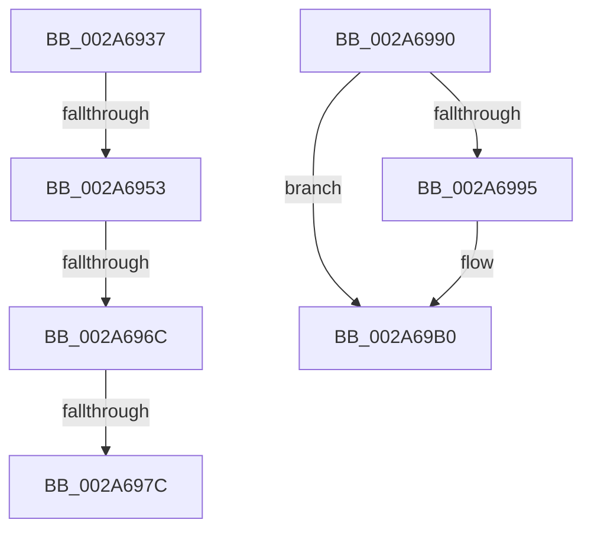

# sub_002A6937

- RVA: `0x002A6937`–`0x002A69CD` (길이 `150` bytes)
- VA: `0x00000001402A6937`
- 실행 섹션: `.text`
- PDB 이름 있음: `아니요`; PDB Function 태그: `아니요`
- unwind 정보 RVA: `0x00068AF8`
- 디코드: `35`개 명령, `150/150` bytes 표시
- 미해석 바이트: `0` (있으면 어셈블리에 `.byte`로 보존)

> 이 문서는 커널 이미지의 기계어와 PDB 기호를 분석해 생성했습니다. 4번과 5번은 함수 원형과 자료형을 바이너리 사용 방식에서 추정한 C 해석이며 원본 소스 복구 결과는 아닙니다.

## 1. Dependencies

- 직접 호출 지점: **2**; 고유 호출 대상: **2**
- 직접 호출자로 확인된 함수: **0**
- RIP 상대 이미지 참조: **2**

### Outgoing calls
- `0x002A6986` → [PspReturnResourceQuota](../38/PspReturnResourceQuota_function_0038FFC4.md) (function, `0x0038FFC4`)
- `0x002A69AA` → [KeBugCheckEx](../4F/KeBugCheckEx_function_004FD660.md) (function, `0x004FD660`)

### Direct callers
- 이 함수 시작 RVA로 연결되는 직접 call은 확인되지 않았습니다. 간접 호출은 완전히 역산할 수 없습니다.

### Static image references
- `0x002A695F` → RVA `0x00F06680` (`.data`; read)
- `0x002A69B3` → RVA `0x00E28000` (`.data`; read)

## 2. Other-region calls and transfers

- 다른 실행 섹션으로 향하는 call: **0**
- call이 아닌 외부 분기/꼬리 이동: **5**
  - `0x002A694D` → [sub_002A687A + 0x52](Unknown_function_002A687A.md) (`tail-transfer`)
  - `0x002A6966` → [sub_002A687A + 0x52](Unknown_function_002A687A.md) (`tail-transfer`)
  - `0x002A6976` → [sub_002A687A + 0x52](Unknown_function_002A687A.md) (`tail-transfer`)
  - `0x002A698B` → [sub_002A687A + 0x52](Unknown_function_002A687A.md) (`tail-transfer`)
  - `0x002A69C8` → [sub_002A687A + 0x5C](Unknown_function_002A687A.md) (`tail-transfer`)

## 3. Assembly (complete function range)

```asm
002A6937  48 3B D7                        cmp rdx, rdi
002A693A  49 8B C8                        mov rcx, r8
002A693D  49 8B C0                        mov rax, r8
002A6940  48 0F 47 D7                     cmova rdx, rdi
002A6944  48 2B CA                        sub rcx, rdx
002A6947  F0 49 0F B1 4E 40               lock cmpxchg qword ptr [r14 + 0x40], rcx
002A694D  0F 85 79 FF FF FF               jne 0x1402a68cc
002A6953  48 8B C2                        mov rax, rdx
002A6956  F0 49 0F C1 46 48               lock xadd qword ptr [r14 + 0x48], rax
002A695C  48 03 D0                        add rdx, rax
002A695F  48 3B 15 1A FD C5 00            cmp rdx, qword ptr [rip + 0xc5fd1a]
002A6966  0F 86 60 FF FF FF               jbe 0x1402a68cc
002A696C  45 33 C0                        xor r8d, r8d
002A696F  4D 87 46 48                     xchg qword ptr [r14 + 0x48], r8
002A6973  4D 85 C0                        test r8, r8
002A6976  0F 84 50 FF FF FF               je 0x1402a68cc
002A697C  45 33 C9                        xor r9d, r9d
002A697F  49 8B D6                        mov rdx, r14
002A6982  41 8D 49 01                     lea ecx, [r9 + 1]
002A6986  E8 39 96 0E 00                  call 0x14038ffc4
002A698B  E9 3C FF FF FF                  jmp 0x1402a68cc
002A6990  4D 3B FA                        cmp r15, r10
002A6993  75 1B                           jne 0x1402a69b0
002A6995  4C 89 44 24 20                  mov qword ptr [rsp + 0x20], r8
002A699A  4C 8B CF                        mov r9, rdi
002A699D  41 B8 01 00 00 00               mov r8d, 1
002A69A3  48 8B D3                        mov rdx, rbx
002A69A6  41 8D 48 20                     lea ecx, [r8 + 0x20]
002A69AA  E8 B1 6C 25 00                  call 0x1404fd660
002A69AF  CC                              int3
002A69B0  4D 8B FA                        mov r15, r10
002A69B3  4C 8D 35 46 16 B8 00            lea r14, [rip + 0xb81646]
002A69BA  0F 0D 0D 3F 16 B8 00            prefetchw byte ptr [rip + 0xb8163f]
002A69C1  48 8B 35 38 16 B8 00            mov rsi, qword ptr [rip + 0xb81638]
002A69C8  E9 09 FF FF FF                  jmp 0x1402a68d6
```

## 4. C-style interpretation (structured pseudocode)

```c
__int64 __fastcall sub_002A6937(__int64 a1, __int64 a2, __int64 a3, int a4)
{
    __int64 result;
    unsigned __int64 v_stack_p20;

    if (a2 > v_rdi) { a2 = v_rdi; }
    a1 = (a3) - (a2);
    a2 = (a2) + (a2);
    a3 = 0;
    a4 = 0;
    result = PspReturnResourceQuota(a4 + 1, v_r14, a3, a4);
}
```

## 5. (Beta) C Style

```c
int64_t sub_002A6937(int64_t Arg1, int64_t Arg2, int64_t Arg3, int32_t Arg4)
{
    int64_t result;
    uint64_t v_stack_p20;

    if (Arg2 > local_rdi) { Arg2 = local_rdi; }
    Arg1 = (Arg3) - (Arg2);
    Arg2 = (Arg2) + (Arg2);
    Arg3 = 0;
    Arg4 = 0;
    result = PspReturnResourceQuota(Arg4 + 1, local_r14, Arg3, Arg4);
}
```

## 6. Execution-region graph

[열기: 2D/3D 그래프와 함수 탐색 컨트롤 패널](../../../control-panel.html?section=text&rva=0x002A6937&view=graph)

- 2D 그래프는 위에서 아래로 흐르고, 3D 그래프는 빈 공간을 드래그해 회전합니다. Shift+드래그는 이동, 휠은 확대·축소, 함수 노드 선택은 대상 보고서 이동입니다.

### Static fallback


