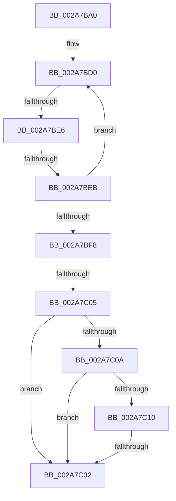

# sub_002A7BA0

- RVA: `0x002A7BA0`–`0x002A7C4E` (길이 `174` bytes)
- VA: `0x00000001402A7BA0`
- 실행 섹션: `.text`
- PDB 이름 있음: `아니요`; PDB Function 태그: `아니요`
- unwind 정보 RVA: `0x00068C80`
- 디코드: `42`개 명령, `174/174` bytes 표시
- 미해석 바이트: `0` (있으면 어셈블리에 `.byte`로 보존)

> 이 문서는 커널 이미지의 기계어와 PDB 기호를 분석해 생성했습니다. 4번과 5번은 함수 원형과 자료형을 바이너리 사용 방식에서 추정한 C 해석이며 원본 소스 복구 결과는 아닙니다.

## 1. Dependencies

- 직접 호출 지점: **0**; 고유 호출 대상: **0**
- 직접 호출자로 확인된 함수: **0**
- RIP 상대 이미지 참조: **1**

### Outgoing calls
- 직접 디코드된 call 명령이 없습니다.

### Direct callers
- 이 함수 시작 RVA로 연결되는 직접 call은 확인되지 않았습니다. 간접 호출은 완전히 역산할 수 없습니다.

### Static image references
- `0x002A7BB1` → RVA `0x00FC7350` (`ALMOSTRO`; read)

## 2. Other-region calls and transfers

- 다른 실행 섹션으로 향하는 call: **0**
- call이 아닌 외부 분기/꼬리 이동: **5**
  - `0x002A7BE0` → [sub_002A7C4E + 0x6A](Unknown_function_002A7C4E.md) (`tail-transfer`)
  - `0x002A7BE9` → [sub_002A7C4E + 0x10](Unknown_function_002A7C4E.md) (`tail-transfer`)
  - `0x002A7C03` → [sub_002A7C4E](Unknown_function_002A7C4E.md) (`tail-transfer`)
  - `0x002A7C30` → [sub_002A7C4E + 0x50](Unknown_function_002A7C4E.md) (`tail-transfer`)
  - `0x002A7C49` → [PsChargeProcessNonPagedPoolQuota + 0x18](PsChargeProcessNonPagedPoolQuota_function_002A7B80.md) (`tail-transfer`)

## 3. Assembly (complete function range)

```asm
002A7BA0  48 89 6C 24 58                  mov qword ptr [rsp + 0x58], rbp
002A7BA5  48 89 74 24 60                  mov qword ptr [rsp + 0x60], rsi
002A7BAA  48 8B B1 F8 02 00 00            mov rsi, qword ptr [rcx + 0x2f8]
002A7BB1  0F B6 2D 98 F7 D1 00            movzx ebp, byte ptr [rip + 0xd1f798]
002A7BB8  4C 89 74 24 68                  mov qword ptr [rsp + 0x68], r14
002A7BBD  4C 89 7C 24 30                  mov qword ptr [rsp + 0x30], r15
002A7BC2  0F 0D 0E                        prefetchw byte ptr [rsi]
002A7BC5  4C 8B 36                        mov r14, qword ptr [rsi]
002A7BC8  F0 83 0C 24 00                  lock or dword ptr [rsp], 0
002A7BCD  45 33 FF                        xor r15d, r15d
002A7BD0  48 8B 4E 40                     mov rcx, qword ptr [rsi + 0x40]
002A7BD4  48 89 4C 24 50                  mov qword ptr [rsp + 0x50], rcx
002A7BD9  49 8D 14 3E                     lea rdx, [r14 + rdi]
002A7BDD  49 3B D6                        cmp rdx, r14
002A7BE0  0F 82 D2 00 00 00               jb 0x1402a7cb8
002A7BE6  48 3B D1                        cmp rdx, rcx
002A7BE9  77 73                           ja 0x1402a7c5e
002A7BEB  49 8B C6                        mov rax, r14
002A7BEE  F0 48 0F B1 16                  lock cmpxchg qword ptr [rsi], rdx
002A7BF3  4C 8B F0                        mov r14, rax
002A7BF6  75 D8                           jne 0x1402a7bd0
002A7BF8  0F 0D 4E 08                     prefetchw byte ptr [rsi + 8]
002A7BFC  48 8B 46 08                     mov rax, qword ptr [rsi + 8]
002A7C00  48 3B D0                        cmp rdx, rax
002A7C03  77 49                           ja 0x1402a7c4e
002A7C05  48 85 DB                        test rbx, rbx
002A7C08  74 28                           je 0x1402a7c32
002A7C0A  40 F6 C5 04                     test bpl, 4
002A7C0E  74 22                           je 0x1402a7c32
002A7C10  48 8B D7                        mov rdx, rdi
002A7C13  F0 48 0F C1 93 00 02 00 00      lock xadd qword ptr [rbx + 0x200], rdx
002A7C1C  48 03 D7                        add rdx, rdi
002A7C1F  0F 0D 8B 10 02 00 00            prefetchw byte ptr [rbx + 0x210]
002A7C26  48 8B 83 10 02 00 00            mov rax, qword ptr [rbx + 0x210]
002A7C2D  48 3B D0                        cmp rdx, rax
002A7C30  77 6C                           ja 0x1402a7c9e
002A7C32  4C 8B 74 24 68                  mov r14, qword ptr [rsp + 0x68]
002A7C37  41 8B C7                        mov eax, r15d
002A7C3A  4C 8B 7C 24 30                  mov r15, qword ptr [rsp + 0x30]
002A7C3F  48 8B 74 24 60                  mov rsi, qword ptr [rsp + 0x60]
002A7C44  48 8B 6C 24 58                  mov rbp, qword ptr [rsp + 0x58]
002A7C49  E9 4A FF FF FF                  jmp 0x1402a7b98
```

## 4. C-style interpretation (structured pseudocode)

```c
__int64 __fastcall sub_002A7BA0(__int64 a1, __int64 a2, __int64 a3, __int64 a4, __int64 a5, __int64 a6, __int64 a7, __int64 a8, __int64 a9, __int64 a10, __int64 a11, __int64 a12, __int64 a13)
{
    __int64 v_r15;
    unsigned int v_stack_p0;
    unsigned __int64 v_stack_p30;
    unsigned __int64 v_stack_p50;
    unsigned __int64 v_stack_p58;
    unsigned __int64 v_stack_p60;
    unsigned __int64 v_stack_p68;

    v_stack_p58 = v_rbp;
    v_stack_p60 = v_rsi;
    v_stack_p68 = v_r14;
    v_stack_p30 = v_r15;
    v_r15 = 0;
loc_002A7BD0:
    v_stack_p50 = *(unsigned __int64 *)(*(unsigned __int64 *)(a1 + 760) + 64);
    if ((*(unsigned __int64 *)(*(unsigned __int64 *)(a1 + 760)) + v_rdi * 1) != (*(unsigned __int64 *)(*(unsigned __int64 *)(a1 + 760) + 64))) goto loc_002A7BD0;
    if (v_rbx == 0) goto loc_002A7C32;
    if ((((unsigned __int8)(*(unsigned __int8 *)(v_rip + 13760408))) & (4)) == 0) goto loc_002A7C32;
    a2 = (v_rdi) + (v_rdi);
loc_002A7C32:
}
```

## 5. (Beta) C Style

```c
int64_t sub_002A7BA0(void *Arg1, int64_t Arg2, int64_t Arg3, int64_t Arg4, uint64_t Arg5, int64_t Arg6, uint64_t Arg7, uint64_t Arg8, uint64_t Arg9, uint64_t Arg10, int64_t Arg11, int64_t Arg12, int64_t Arg13)
{
    uint8_t *arg1 = (uint8_t *)Arg1;

    int64_t local_r15;
    uint32_t v_stack_p0;
    uint64_t v_stack_p30;
    uint64_t v_stack_p50;
    uint64_t v_stack_p58;
    uint64_t v_stack_p60;
    uint64_t v_stack_p68;

    v_stack_p58 = local_rbp;
    v_stack_p60 = local_rsi;
    v_stack_p68 = local_r14;
    v_stack_p30 = local_r15;
    local_r15 = 0;
loc_002A7BD0:
    v_stack_p50 = *(uint64_t *)(*(uint64_t *)(arg1 + 0x2F8) + 0x40);
    if ((*(uint64_t *)(*(uint64_t *)(arg1 + 0x2F8)) + local_rdi * 1) != (*(uint64_t *)(*(uint64_t *)(arg1 + 0x2F8) + 0x40))) goto loc_002A7BD0;
    if (local_rbx == 0) goto loc_002A7C32;
    if ((((uint8_t)(*(uint8_t *)(v_rip + 0xD1F798))) & (4)) == 0) goto loc_002A7C32;
    Arg2 = (local_rdi) + (local_rdi);
loc_002A7C32:
}
```

### 관측된 메모리 오프셋

구조체 형식이 확인되지 않은 접근은 인자 기준의 오프셋으로만 기록했습니다.

| 기준 인자 | 오프셋 표현 | 폭 (bit) | 접근 |
|---|---:|---:|---|
| `Arg1` | `+ 0x2F8` | `64` | `R` |

## 6. Execution-region graph

[열기: 2D/3D 그래프와 함수 탐색 컨트롤 패널](../../../control-panel.html?section=text&rva=0x002A7BA0&view=graph)

- 2D 그래프는 위에서 아래로 흐르고, 3D 그래프는 빈 공간을 드래그해 회전합니다. Shift+드래그는 이동, 휠은 확대·축소, 함수 노드 선택은 대상 보고서 이동입니다.

### Static fallback


