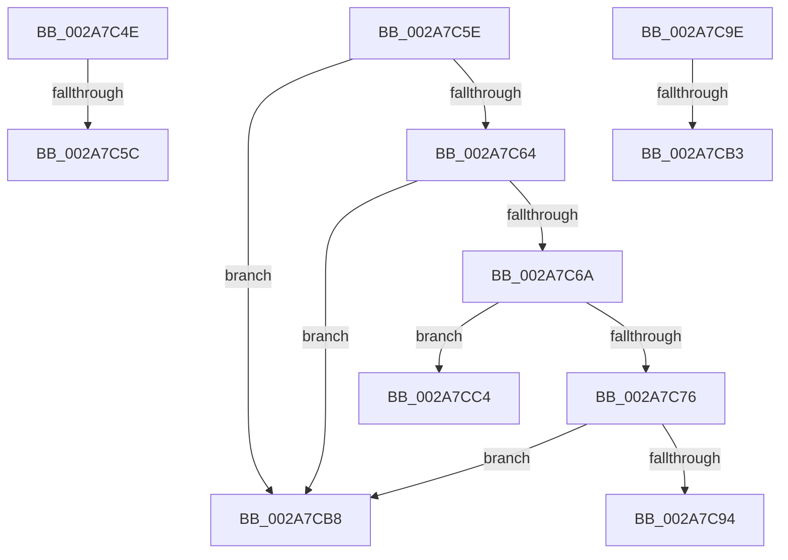

# sub_002A7C4E

- RVA: `0x002A7C4E`–`0x002A7CD5` (길이 `135` bytes)
- VA: `0x00000001402A7C4E`
- 실행 섹션: `.text`
- PDB 이름 있음: `아니요`; PDB Function 태그: `아니요`
- unwind 정보 RVA: `0x00068CA0`
- 디코드: `35`개 명령, `135/135` bytes 표시
- 미해석 바이트: `0` (있으면 어셈블리에 `.byte`로 보존)

> 이 문서는 커널 이미지의 기계어와 PDB 기호를 분석해 생성했습니다. 4번과 5번은 함수 원형과 자료형을 바이너리 사용 방식에서 추정한 C 해석이며 원본 소스 복구 결과는 아닙니다.

## 1. Dependencies

- 직접 호출 지점: **1**; 고유 호출 대상: **1**
- 직접 호출자로 확인된 함수: **0**
- RIP 상대 이미지 참조: **1**

### Outgoing calls
- `0x002A7C8B` → [PspExpandQuota](../39/PspExpandQuota_function_00390660.md) (function, `0x00390660`)

### Direct callers
- 이 함수 시작 RVA로 연결되는 직접 call은 확인되지 않았습니다. 간접 호출은 완전히 역산할 수 없습니다.

### Static image references
- `0x002A7CB8` → RVA `0x00FC7354` (`ALMOSTRO`; read)

## 2. Other-region calls and transfers

- 다른 실행 섹션으로 향하는 call: **0**
- call이 아닌 외부 분기/꼬리 이동: **7**
  - `0x002A7C5A` → [sub_002A7BA0 + 0x60](Unknown_function_002A7BA0.md) (`tail-transfer`)
  - `0x002A7C5C` → [sub_002A7BA0 + 0x65](Unknown_function_002A7BA0.md) (`tail-transfer`)
  - `0x002A7C99` → [sub_002A7BA0 + 0x39](Unknown_function_002A7BA0.md) (`tail-transfer`)
  - `0x002A7CAD` → [sub_002A7BA0 + 0x8D](Unknown_function_002A7BA0.md) (`tail-transfer`)
  - `0x002A7CB3` → [sub_002A7BA0 + 0x92](Unknown_function_002A7BA0.md) (`tail-transfer`)
  - `0x002A7CBF` → [sub_002A7BA0 + 0x92](Unknown_function_002A7BA0.md) (`tail-transfer`)
  - `0x002A7CD0` → [sub_002A7BA0 + 0x34](Unknown_function_002A7BA0.md) (`tail-transfer`)

## 3. Assembly (complete function range)

```asm
002A7C4E  48 8B C8                        mov rcx, rax
002A7C51  F0 48 0F B1 56 08               lock cmpxchg qword ptr [rsi + 8], rdx
002A7C57  48 3B C1                        cmp rax, rcx
002A7C5A  75 A4                           jne 0x1402a7c00
002A7C5C  EB A7                           jmp 0x1402a7c05
002A7C5E  40 F6 C5 01                     test bpl, 1
002A7C62  74 54                           je 0x1402a7cb8
002A7C64  4C 39 7E 50                     cmp qword ptr [rsi + 0x50], r15
002A7C68  74 4E                           je 0x1402a7cb8
002A7C6A  49 8B C7                        mov rax, r15
002A7C6D  48 87 46 48                     xchg qword ptr [rsi + 0x48], rax
002A7C71  48 85 C0                        test rax, rax
002A7C74  75 4E                           jne 0x1402a7cc4
002A7C76  48 8D 44 24 50                  lea rax, [rsp + 0x50]
002A7C7B  4C 8B CF                        mov r9, rdi
002A7C7E  4D 8B C6                        mov r8, r14
002A7C81  48 89 44 24 20                  mov qword ptr [rsp + 0x20], rax
002A7C86  48 8B D6                        mov rdx, rsi
002A7C89  33 C9                           xor ecx, ecx
002A7C8B  E8 D0 89 0E 00                  call 0x140390660
002A7C90  84 C0                           test al, al
002A7C92  74 24                           je 0x1402a7cb8
002A7C94  48 8B 4C 24 50                  mov rcx, qword ptr [rsp + 0x50]
002A7C99  E9 3B FF FF FF                  jmp 0x1402a7bd9
002A7C9E  48 8B C8                        mov rcx, rax
002A7CA1  F0 48 0F B1 93 10 02 00 00      lock cmpxchg qword ptr [rbx + 0x210], rdx
002A7CAA  48 3B C1                        cmp rax, rcx
002A7CAD  0F 85 7A FF FF FF               jne 0x1402a7c2d
002A7CB3  E9 7A FF FF FF                  jmp 0x1402a7c32
002A7CB8  44 8B 3D 95 F6 D1 00            mov r15d, dword ptr [rip + 0xd1f695]
002A7CBF  E9 6E FF FF FF                  jmp 0x1402a7c32
002A7CC4  48 8B C8                        mov rcx, rax
002A7CC7  F0 48 0F C1 4E 40               lock xadd qword ptr [rsi + 0x40], rcx
002A7CCD  48 03 C8                        add rcx, rax
002A7CD0  E9 FF FE FF FF                  jmp 0x1402a7bd4
```

## 4. C-style interpretation (structured pseudocode)

```c
__int64 __fastcall sub_002A7C4E(__int64 a1, __int64 a2)
{
    unsigned __int64 v_stack_p20;
    unsigned __int64 v_stack_p50;
}
```

## 5. (Beta) C Style

```c
int64_t sub_002A7C4E(int64_t Arg1, int64_t Arg2)
{
    uint64_t v_stack_p20;
    uint64_t v_stack_p50;
}
```

## 6. Execution-region graph

[열기: 2D/3D 그래프와 함수 탐색 컨트롤 패널](../../../control-panel.html?section=text&rva=0x002A7C4E&view=graph)

- 2D 그래프는 위에서 아래로 흐르고, 3D 그래프는 빈 공간을 드래그해 회전합니다. Shift+드래그는 이동, 휠은 확대·축소, 함수 노드 선택은 대상 보고서 이동입니다.

### Static fallback


