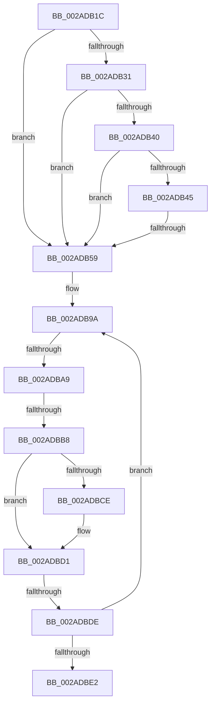

# sub_002ADB1C

- RVA: `0x002ADB1C`–`0x002ADBF4` (길이 `216` bytes)
- VA: `0x00000001402ADB1C`
- 실행 섹션: `.text`
- PDB 이름 있음: `아니요`; PDB Function 태그: `아니요`
- unwind 정보 RVA: `0x0006D31C`
- 디코드: `48`개 명령, `216/216` bytes 표시
- 미해석 바이트: `0` (있으면 어셈블리에 `.byte`로 보존)

> 이 문서는 커널 이미지의 기계어와 PDB 기호를 분석해 생성했습니다. 4번과 5번은 함수 원형과 자료형을 바이너리 사용 방식에서 추정한 C 해석이며 원본 소스 복구 결과는 아닙니다.

## 1. Dependencies

- 직접 호출 지점: **0**; 고유 호출 대상: **0**
- 직접 호출자로 확인된 함수: **0**
- RIP 상대 이미지 참조: **1**

### Outgoing calls
- 직접 디코드된 call 명령이 없습니다.

### Direct callers
- 이 함수 시작 RVA로 연결되는 직접 call은 확인되지 않았습니다. 간접 호출은 완전히 역산할 수 없습니다.

### Static image references
- `0x002ADBC1` → RVA `0x00FC6A88` (`ALMOSTRO`; read)

## 2. Other-region calls and transfers

- 다른 실행 섹션으로 향하는 call: **0**
- call이 아닌 외부 분기/꼬리 이동: **5**
  - `0x002ADB53` → [sub_002ADC8C](Unknown_function_002ADC8C.md) (`tail-transfer`)
  - `0x002ADBA7` → [sub_002ADBF4 + 0x6](Unknown_function_002ADBF4.md) (`tail-transfer`)
  - `0x002ADBB2` → [sub_002ADD0C](Unknown_function_002ADD0C.md) (`tail-transfer`)
  - `0x002ADBDC` → [sub_002ADBF4](Unknown_function_002ADBF4.md) (`tail-transfer`)
  - `0x002ADBEF` → [MiLockPageTableInternal + 0xA1](MiLockPageTableInternal_function_002AD9F0.md) (`tail-transfer`)

## 3. Assembly (complete function range)

```asm
002ADB1C  4C 89 64 24 50                  mov qword ptr [rsp + 0x50], r12
002ADB21  45 8B FE                        mov r15d, r14d
002ADB24  4C 89 6C 24 60                  mov qword ptr [rsp + 0x60], r13
002ADB29  49 8B C0                        mov rax, r8
002ADB2C  48 3B F0                        cmp rsi, rax
002ADB2F  72 28                           jb 0x1402adb59
002ADB31  48 B8 F8 D7 BE 7D FB F6 FF FF   movabs rax, 0xfffff6fb7dbed7f8
002ADB3B  48 3B F0                        cmp rsi, rax
002ADB3E  77 19                           ja 0x1402adb59
002ADB40  F6 C3 01                        test bl, 1
002ADB43  74 14                           je 0x1402adb59
002ADB45  F6 C3 42                        test bl, 0x42
002ADB48  0F 95 C1                        setne cl
002ADB4B  F6 C3 20                        test bl, 0x20
002ADB4E  0F 95 C0                        setne al
002ADB51  84 C8                           test al, cl
002ADB53  0F 84 33 01 00 00               je 0x1402adc8c
002ADB59  49 BC FF FF FF FF FF FF FF DF   movabs r12, 0xdfffffffffffffff
002ADB63  49 BD 20 00 00 00 00 00 00 10   movabs r13, 0x1000000000000020
002ADB6D  48 BF 00 00 00 00 00 00 00 10   movabs rdi, 0x1000000000000000
002ADB77  8B D5                           mov edx, ebp
002ADB79  49 B9 00 00 00 00 80 F6 FF FF   movabs r9, 0xfffff68000000000
002ADB83  83 E2 01                        and edx, 1
002ADB86  49 BA 00 00 00 00 40 00 00 00   movabs r10, 0x4000000000
002ADB90  49 B8 00 00 00 00 00 00 00 20   movabs r8, 0x2000000000000000
002ADB9A  48 B9 00 00 00 00 10 00 00 00   movabs rcx, 0x1000000000
002ADBA4  F6 C3 01                        test bl, 1
002ADBA7  74 51                           je 0x1402adbfa
002ADBA9  48 8B C3                        mov rax, rbx
002ADBAC  48 C1 E8 3C                     shr rax, 0x3c
002ADBB0  A8 01                           test al, 1
002ADBB2  0F 85 54 01 00 00               jne 0x1402add0c
002ADBB8  48 8B CB                        mov rcx, rbx
002ADBBB  49 23 CC                        and rcx, r12
002ADBBE  49 0B CD                        or rcx, r13
002ADBC1  48 F7 05 BC 8E D1 00 00 00 00 02  test qword ptr [rip + 0xd18ebc], 0x2000000
002ADBCC  74 03                           je 0x1402adbd1
002ADBCE  0F AE E8                        lfence
002ADBD1  48 8B C3                        mov rax, rbx
002ADBD4  F0 48 0F B1 0E                  lock cmpxchg qword ptr [rsi], rcx
002ADBD9  48 8B D8                        mov rbx, rax
002ADBDC  74 16                           je 0x1402adbf4
002ADBDE  85 D2                           test edx, edx
002ADBE0  74 B8                           je 0x1402adb9a
002ADBE2  4C 8B 6C 24 60                  mov r13, qword ptr [rsp + 0x60]
002ADBE7  41 8B C6                        mov eax, r14d
002ADBEA  4C 8B 64 24 50                  mov r12, qword ptr [rsp + 0x50]
002ADBEF  E9 9D FE FF FF                  jmp 0x1402ada91
```

## 4. C-style interpretation (structured pseudocode)

```c
__int64 __fastcall sub_002ADB1C(__int64 a1, __int64 a2, __int64 a3, __int64 a4, __int64 a5, __int64 a6, __int64 a7, __int64 a8, __int64 a9, __int64 a10, __int64 a11, __int64 a12)
{
    __int64 result;
    unsigned __int64 v_stack_p50;
    unsigned __int64 v_stack_p60;

    v_stack_p50 = v_r12;
    v_stack_p60 = v_r13;
    if (v_rsi < a3) goto loc_002ADB59;
    if (v_rsi > a3) goto loc_002ADB59;
    if ((((unsigned __int8)(v_rbx)) & (1)) == 0) goto loc_002ADB59;
    a1 = ((((unsigned __int8)(v_rbx)) & (66)) != 0) ? 1 : 0;
    result = ((((unsigned __int8)(v_rbx)) & (32)) != 0) ? 1 : 0;
loc_002ADB59:
    a2 = (unsigned int)(((unsigned int)((unsigned int)(v_rbp))) & (1));
loc_002ADB9A:
    result = (v_rbx) >> (60);
    a1 = (v_rbx) & (v_r12);
    a1 = (a1) | (v_r13);
    if (((*(unsigned __int64 *)(v_rip + 13733564)) & (0x2000000ULL)) != 0) {
    }
    if ((unsigned int)(a2) == 0) goto loc_002ADB9A;
}
```

## 5. (Beta) C Style

```c
int64_t sub_002ADB1C(int64_t Arg1, int64_t Arg2, int64_t Arg3, int64_t Arg4, uint64_t Arg5, uint64_t Arg6, uint64_t Arg7, uint64_t Arg8, uint64_t Arg9, int64_t Arg10, uint64_t Arg11, int64_t Arg12)
{
    int64_t result;
    uint64_t v_stack_p50;
    uint64_t v_stack_p60;

    v_stack_p50 = local_r12;
    v_stack_p60 = local_r13;
    if (local_rsi < Arg3) goto loc_002ADB59;
    if (local_rsi > Arg3) goto loc_002ADB59;
    if ((((uint8_t)(local_rbx)) & (1)) == 0) goto loc_002ADB59;
    Arg1 = ((((uint8_t)(local_rbx)) & (66)) != 0) ? 1 : 0;
    result = ((((uint8_t)(local_rbx)) & (32)) != 0) ? 1 : 0;
loc_002ADB59:
    Arg2 = (uint32_t)(((uint32_t)((uint32_t)(local_rbp))) & (1));
loc_002ADB9A:
    result = (local_rbx) >> (60);
    Arg1 = (local_rbx) & (local_r12);
    Arg1 = (Arg1) | (local_r13);
    if (((*(uint64_t *)(v_rip + 0xD18EBC)) & (0x2000000ULL)) != 0) {
    }
    if ((uint32_t)(Arg2) == 0) goto loc_002ADB9A;
}
```

## 6. Execution-region graph

[열기: 2D/3D 그래프와 함수 탐색 컨트롤 패널](../../../control-panel.html?section=text&rva=0x002ADB1C&view=graph)

- 2D 그래프는 위에서 아래로 흐르고, 3D 그래프는 빈 공간을 드래그해 회전합니다. Shift+드래그는 이동, 휠은 확대·축소, 함수 노드 선택은 대상 보고서 이동입니다.

### Static fallback


