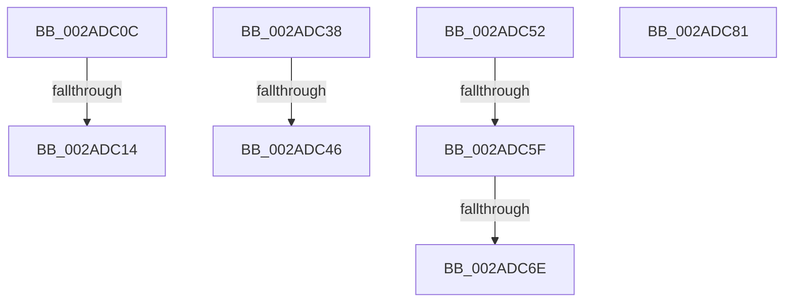

# sub_002ADC0C

- RVA: `0x002ADC0C`–`0x002ADC8C` (길이 `128` bytes)
- VA: `0x00000001402ADC0C`
- 실행 섹션: `.text`
- PDB 이름 있음: `아니요`; PDB Function 태그: `아니요`
- unwind 정보 RVA: `0x0006D34C`
- 디코드: `35`개 명령, `128/128` bytes 표시
- 미해석 바이트: `0` (있으면 어셈블리에 `.byte`로 보존)

> 이 문서는 커널 이미지의 기계어와 PDB 기호를 분석해 생성했습니다. 4번과 5번은 함수 원형과 자료형을 바이너리 사용 방식에서 추정한 C 해석이며 원본 소스 복구 결과는 아닙니다.

## 1. Dependencies

- 직접 호출 지점: **1**; 고유 호출 대상: **1**
- 직접 호출자로 확인된 함수: **0**
- RIP 상대 이미지 참조: **3**

### Outgoing calls
- `0x002ADC46` → [KiTryToAcquireQueuedSpinLockInstrumented](KiTryToAcquireQueuedSpinLockInstrumented_function_002ADF38.md) (function, `0x002ADF38`)

### Direct callers
- 이 함수 시작 RVA로 연결되는 직접 call은 확인되지 않았습니다. 간접 호출은 완전히 역산할 수 없습니다.

### Static image references
- `0x002ADC21` → RVA `0x00E2CB40` (`.data`; read)
- `0x002ADC38` → RVA `0x00F0DE58` (`.data`; read)
- `0x002ADC52` → RVA `0x00FC6B06` (`ALMOSTRO`; read)

## 2. Other-region calls and transfers

- 다른 실행 섹션으로 향하는 call: **0**
- call이 아닌 외부 분기/꼬리 이동: **7**
  - `0x002ADC0E` → [sub_002ADD4F](Unknown_function_002ADD4F.md) (`tail-transfer`)
  - `0x002ADC33` → [MiLockPageTableInternal + 0x57](MiLockPageTableInternal_function_002AD9F0.md) (`tail-transfer`)
  - `0x002ADC40` → [MiLockPageTableInternal + 0x86](MiLockPageTableInternal_function_002AD9F0.md) (`tail-transfer`)
  - `0x002ADC4D` → [MiLockPageTableInternal + 0x9F](MiLockPageTableInternal_function_002AD9F0.md) (`tail-transfer`)
  - `0x002ADC59` → [sub_002ADCF4](Unknown_function_002ADCF4.md) (`tail-transfer`)
  - `0x002ADC68` → [sub_002ADE2A](Unknown_function_002ADE2A.md) (`tail-transfer`)
  - `0x002ADC87` → [MiLockPageTableInternal + 0x9F](MiLockPageTableInternal_function_002AD9F0.md) (`tail-transfer`)

## 3. Assembly (complete function range)

```asm
002ADC0C  3C 07                           cmp al, 7
002ADC0E  0F 84 3B 01 00 00               je 0x1402add4f
002ADC14  3C 05                           cmp al, 5
002ADC16  BF 03 00 00 00                  mov edi, 3
002ADC1B  41 0F 44 FE                     cmove edi, r14d
002ADC1F  8B D7                           mov edx, edi
002ADC21  48 8D 0D 18 EF B7 00            lea rcx, [rip + 0xb7ef18]
002ADC28  48 8D 89 80 32 00 00            lea rcx, [rcx + 0x3280]
002ADC2F  48 8D 14 D1                     lea rdx, [rcx + rdx*8]
002ADC33  E9 0F FE FF FF                  jmp 0x1402ada47
002ADC38  8B 05 1A 02 C6 00               mov eax, dword ptr [rip + 0xc6021a]
002ADC3E  85 C0                           test eax, eax
002ADC40  0F 85 30 FE FF FF               jne 0x1402ada76
002ADC46  E8 ED 02 00 00                  call 0x1402adf38
002ADC4B  8B D8                           mov ebx, eax
002ADC4D  E9 3D FE FF FF                  jmp 0x1402ada8f
002ADC52  F6 05 AD 8E D1 00 21            test byte ptr [rip + 0xd18ead], 0x21
002ADC59  0F 85 95 00 00 00               jne 0x1402adcf4
002ADC5F  48 8B C1                        mov rax, rcx
002ADC62  48 87 02                        xchg qword ptr [rdx], rax
002ADC65  48 85 C0                        test rax, rax
002ADC68  0F 85 BC 01 00 00               jne 0x1402ade2a
002ADC6E  8B C3                           mov eax, ebx
002ADC70  48 8B 5C 24 68                  mov rbx, qword ptr [rsp + 0x68]
002ADC75  48 83 C4 20                     add rsp, 0x20
002ADC79  41 5F                           pop r15
002ADC7B  41 5E                           pop r14
002ADC7D  5F                              pop rdi
002ADC7E  5E                              pop rsi
002ADC7F  5D                              pop rbp
002ADC80  C3                              ret
002ADC81  CC                              int3
002ADC82  41 8B DE                        mov ebx, r14d
002ADC85  F3 90                           pause
002ADC87  E9 03 FE FF FF                  jmp 0x1402ada8f
```

## 4. C-style interpretation (structured pseudocode)

```c
__int64 __fastcall sub_002ADC0C(void)
{
    __int64 v_rdi;
    unsigned __int64 v_stack_p68;

    v_rdi = 3;
    if (((unsigned __int8)(result)) == 5) { v_rdi = (unsigned int)(v_r14); }
}
```

## 5. (Beta) C Style

```c
void sub_002ADC0C(void)
{
    int64_t local_rdi;
    uint64_t v_stack_p68;

    local_rdi = 3;
    if (((uint8_t)(result)) == 5) { local_rdi = (uint32_t)(local_r14); }
}
```

## 6. Execution-region graph

[열기: 2D/3D 그래프와 함수 탐색 컨트롤 패널](../../../control-panel.html?section=text&rva=0x002ADC0C&view=graph)

- 2D 그래프는 위에서 아래로 흐르고, 3D 그래프는 빈 공간을 드래그해 회전합니다. Shift+드래그는 이동, 휠은 확대·축소, 함수 노드 선택은 대상 보고서 이동입니다.

### Static fallback


