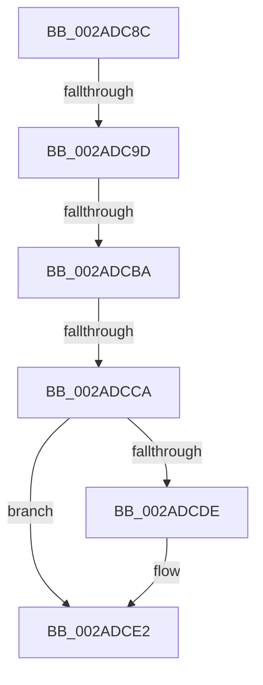

# sub_002ADC8C

- RVA: `0x002ADC8C`–`0x002ADCF4` (길이 `104` bytes)
- VA: `0x00000001402ADC8C`
- 실행 섹션: `.text`
- PDB 이름 있음: `아니요`; PDB Function 태그: `아니요`
- unwind 정보 RVA: `0x0006D360`
- 디코드: `21`개 명령, `104/104` bytes 표시
- 미해석 바이트: `0` (있으면 어셈블리에 `.byte`로 보존)

> 이 문서는 커널 이미지의 기계어와 PDB 기호를 분석해 생성했습니다. 4번과 5번은 함수 원형과 자료형을 바이너리 사용 방식에서 추정한 C 해석이며 원본 소스 복구 결과는 아닙니다.

## 1. Dependencies

- 직접 호출 지점: **0**; 고유 호출 대상: **0**
- 직접 호출자로 확인된 함수: **0**
- RIP 상대 이미지 참조: **1**

### Outgoing calls
- 직접 디코드된 call 명령이 없습니다.

### Direct callers
- 이 함수 시작 RVA로 연결되는 직접 call은 확인되지 않았습니다. 간접 호출은 완전히 역산할 수 없습니다.

### Static image references
- `0x002ADC8C` → RVA `0x00FC6A88` (`ALMOSTRO`; read)

## 2. Other-region calls and transfers

- 다른 실행 섹션으로 향하는 call: **0**
- call이 아닌 외부 분기/꼬리 이동: **4**
  - `0x002ADC97` → [sub_002ADB1C + 0x3D](Unknown_function_002ADB1C.md) (`tail-transfer`)
  - `0x002ADCB4` → [sub_002ADB1C + 0x3D](Unknown_function_002ADB1C.md) (`tail-transfer`)
  - `0x002ADCC4` → [sub_002ADB1C + 0x3D](Unknown_function_002ADB1C.md) (`tail-transfer`)
  - `0x002ADCEF` → [sub_002ADB1C + 0x3D](Unknown_function_002ADB1C.md) (`tail-transfer`)

## 3. Assembly (complete function range)

```asm
002ADC8C  48 F7 05 F1 8D D1 00 00 00 60 00  test qword ptr [rip + 0xd18df1], 0x600000
002ADC97  0F 84 BC FE FF FF               je 0x1402adb59
002ADC9D  65 48 8B 04 25 88 01 00 00      mov rax, qword ptr gs:[0x188]
002ADCA6  48 8B 88 B8 00 00 00            mov rcx, qword ptr [rax + 0xb8]
002ADCAD  80 B9 60 01 00 00 01            cmp byte ptr [rcx + 0x160], 1
002ADCB4  0F 84 9F FE FF FF               je 0x1402adb59
002ADCBA  48 8B 91 08 05 00 00            mov rdx, qword ptr [rcx + 0x508]
002ADCC1  48 85 D2                        test rdx, rdx
002ADCC4  0F 84 8F FE FF FF               je 0x1402adb59
002ADCCA  48 8B C6                        mov rax, rsi
002ADCCD  48 C1 E8 03                     shr rax, 3
002ADCD1  25 FF 01 00 00                  and eax, 0x1ff
002ADCD6  48 8B 04 C2                     mov rax, qword ptr [rdx + rax*8]
002ADCDA  A8 20                           test al, 0x20
002ADCDC  74 04                           je 0x1402adce2
002ADCDE  48 83 CB 20                     or rbx, 0x20
002ADCE2  48 8B CB                        mov rcx, rbx
002ADCE5  48 83 CB 42                     or rbx, 0x42
002ADCE9  A8 42                           test al, 0x42
002ADCEB  48 0F 44 D9                     cmove rbx, rcx
002ADCEF  E9 65 FE FF FF                  jmp 0x1402adb59
```

## 4. C-style interpretation (structured pseudocode)

```c
__int64 __fastcall sub_002ADC8C(void)
{
    __int64 result;
    __int64 v_rbx;

    result = (v_rsi) >> (3);
    result = (unsigned int)((result) & (511));
    if ((((unsigned __int8)(*(unsigned __int64 *)(*(unsigned __int64 *)(*(unsigned __int64 *)(*(unsigned __int64 *)(gs_base + (0 + 392)) + 184) + 1288) + result * 8))) & (32)) != 0) {
        v_rbx = (v_rbx) | (32);
    }
    v_rbx = (v_rbx) | (66);
    if ((((unsigned __int8)(*(unsigned __int64 *)(*(unsigned __int64 *)(*(unsigned __int64 *)(*(unsigned __int64 *)(gs_base + (0 + 392)) + 184) + 1288) + result * 8))) & (66)) == 0) { v_rbx = v_rbx; }
}
```

## 5. (Beta) C Style

```c
void sub_002ADC8C(void)
{
    int64_t result;
    int64_t local_rbx;

    result = (local_rsi) >> (3);
    result = (uint32_t)((result) & (511));
    if ((((uint8_t)(*(uint64_t *)(*(uint64_t *)(*(uint64_t *)(*(uint64_t *)(gs_base + (0 + 0x188)) + 0xB8) + 0x508) + result * 8))) & (32)) != 0) {
        local_rbx = (local_rbx) | (32);
    }
    local_rbx = (local_rbx) | (66);
    if ((((uint8_t)(*(uint64_t *)(*(uint64_t *)(*(uint64_t *)(*(uint64_t *)(gs_base + (0 + 0x188)) + 0xB8) + 0x508) + result * 8))) & (66)) == 0) { local_rbx = local_rbx; }
}
```

## 6. Execution-region graph

[열기: 2D/3D 그래프와 함수 탐색 컨트롤 패널](../../../control-panel.html?section=text&rva=0x002ADC8C&view=graph)

- 2D 그래프는 위에서 아래로 흐르고, 3D 그래프는 빈 공간을 드래그해 회전합니다. Shift+드래그는 이동, 휠은 확대·축소, 함수 노드 선택은 대상 보고서 이동입니다.

### Static fallback


