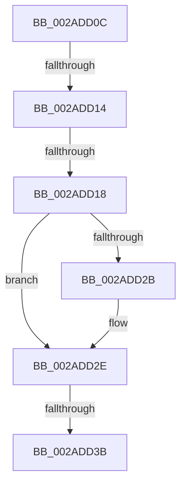

# sub_002ADD0C

- RVA: `0x002ADD0C`–`0x002ADD4F` (길이 `67` bytes)
- VA: `0x00000001402ADD0C`
- 실행 섹션: `.text`
- PDB 이름 있음: `아니요`; PDB Function 태그: `아니요`
- unwind 정보 RVA: `0x0006D388`
- 디코드: `16`개 명령, `67/67` bytes 표시
- 미해석 바이트: `0` (있으면 어셈블리에 `.byte`로 보존)

> 이 문서는 커널 이미지의 기계어와 PDB 기호를 분석해 생성했습니다. 4번과 5번은 함수 원형과 자료형을 바이너리 사용 방식에서 추정한 C 해석이며 원본 소스 복구 결과는 아닙니다.

## 1. Dependencies

- 직접 호출 지점: **0**; 고유 호출 대상: **0**
- 직접 호출자로 확인된 함수: **0**
- RIP 상대 이미지 참조: **1**

### Outgoing calls
- 직접 디코드된 call 명령이 없습니다.

### Direct callers
- 이 함수 시작 RVA로 연결되는 직접 call은 확인되지 않았습니다. 간접 호출은 완전히 역산할 수 없습니다.

### Static image references
- `0x002ADD1E` → RVA `0x00FC6A88` (`ALMOSTRO`; read)

## 2. Other-region calls and transfers

- 다른 실행 섹션으로 향하는 call: **0**
- call이 아닌 외부 분기/꼬리 이동: **4**
  - `0x002ADD0E` → [sub_002ADBF4 + 0x6](Unknown_function_002ADBF4.md) (`tail-transfer`)
  - `0x002ADD16` → [sub_002ADD60](Unknown_function_002ADD60.md) (`tail-transfer`)
  - `0x002ADD35` → [sub_002ADE4F](Unknown_function_002ADE4F.md) (`tail-transfer`)
  - `0x002ADD4A` → [sub_002ADB1C + 0x51](Unknown_function_002ADB1C.md) (`tail-transfer`)

## 3. Assembly (complete function range)

```asm
002ADD0C  85 D2                           test edx, edx
002ADD0E  0F 85 E6 FE FF FF               jne 0x1402adbfa
002ADD14  A8 02                           test al, 2
002ADD16  75 48                           jne 0x1402add60
002ADD18  48 8B FB                        mov rdi, rbx
002ADD1B  49 0B F8                        or rdi, r8
002ADD1E  48 F7 05 5F 8D D1 00 00 00 00 02  test qword ptr [rip + 0xd18d5f], 0x2000000
002ADD29  74 03                           je 0x1402add2e
002ADD2B  0F AE E8                        lfence
002ADD2E  48 85 0D 53 8D D1 00            test qword ptr [rip + 0xd18d53], rcx
002ADD35  0F 85 14 01 00 00               jne 0x1402ade4f
002ADD3B  48 8B C3                        mov rax, rbx
002ADD3E  F0 48 0F B1 3E                  lock cmpxchg qword ptr [rsi], rdi
002ADD43  48 8B D8                        mov rbx, rax
002ADD46  48 0F 44 DF                     cmove rbx, rdi
002ADD4A  E9 1E FE FF FF                  jmp 0x1402adb6d
```

## 4. C-style interpretation (structured pseudocode)

```c
__int64 __fastcall sub_002ADD0C(__int64 a1, int a2, __int64 a3)
{
    __int64 v_rbx;
    __int64 v_rdi;

    v_rdi = (v_rbx) | (a3);
    if (((*(unsigned __int64 *)(v_rip + 13733215)) & (0x2000000ULL)) != 0) {
    }
    if (((*(unsigned __int64 *)(v_rip + 13733203)) & (a1)) == 0) { v_rbx = v_rdi; }
}
```

## 5. (Beta) C Style

```c
int64_t sub_002ADD0C(int64_t Arg1, int32_t Arg2, int64_t Arg3)
{
    int64_t local_rbx;
    int64_t local_rdi;

    local_rdi = (local_rbx) | (Arg3);
    if (((*(uint64_t *)(v_rip + 0xD18D5F)) & (0x2000000ULL)) != 0) {
    }
    if (((*(uint64_t *)(v_rip + 0xD18D53)) & (Arg1)) == 0) { local_rbx = local_rdi; }
}
```

## 6. Execution-region graph

[열기: 2D/3D 그래프와 함수 탐색 컨트롤 패널](../../../control-panel.html?section=text&rva=0x002ADD0C&view=graph)

- 2D 그래프는 위에서 아래로 흐르고, 3D 그래프는 빈 공간을 드래그해 회전합니다. Shift+드래그는 이동, 휠은 확대·축소, 함수 노드 선택은 대상 보고서 이동입니다.

### Static fallback


