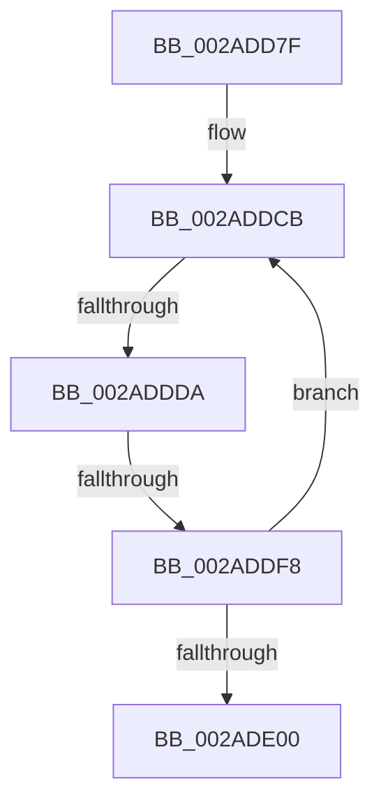

# sub_002ADD7F

- RVA: `0x002ADD7F`–`0x002ADE02` (길이 `131` bytes)
- VA: `0x00000001402ADD7F`
- 실행 섹션: `.text`
- PDB 이름 있음: `아니요`; PDB Function 태그: `아니요`
- unwind 정보 RVA: `0x0006D3C8`
- 디코드: `40`개 명령, `131/131` bytes 표시
- 미해석 바이트: `0` (있으면 어셈블리에 `.byte`로 보존)

> 이 문서는 커널 이미지의 기계어와 PDB 기호를 분석해 생성했습니다. 4번과 5번은 함수 원형과 자료형을 바이너리 사용 방식에서 추정한 C 해석이며 원본 소스 복구 결과는 아닙니다.

## 1. Dependencies

- 직접 호출 지점: **0**; 고유 호출 대상: **0**
- 직접 호출자로 확인된 함수: **0**
- RIP 상대 이미지 참조: **1**

### Outgoing calls
- 직접 디코드된 call 명령이 없습니다.

### Direct callers
- 이 함수 시작 RVA로 연결되는 직접 call은 확인되지 않았습니다. 간접 호출은 완전히 역산할 수 없습니다.

### Static image references
- `0x002ADD88` → RVA `0x00E2CB40` (`.data`; read)

## 2. Other-region calls and transfers

- 다른 실행 섹션으로 향하는 call: **0**
- call이 아닌 외부 분기/꼬리 이동: **3**
  - `0x002ADDD8` → [sub_002ADE2A + 0xD](Unknown_function_002ADE2A.md) (`tail-transfer`)
  - `0x002ADDF2` → [sub_002ADC0C + 0x62](Unknown_function_002ADC0C.md) (`tail-transfer`)
  - `0x002ADE00` → [sub_002ADE2A + 0x11](Unknown_function_002ADE2A.md) (`tail-transfer`)

## 3. Assembly (complete function range)

```asm
002ADD7F  45 33 F6                        xor r14d, r14d
002ADD82  49 8B C0                        mov rax, r8
002ADD85  48 2B F0                        sub rsi, rax
002ADD88  48 8D 0D B1 ED B7 00            lea rcx, [rip + 0xb7edb1]
002ADD8F  8B 82 B8 00 00 00               mov eax, dword ptr [rdx + 0xb8]
002ADD95  48 8D 89 6C 26 00 00            lea rcx, [rcx + 0x266c]
002ADD9C  48 C1 FE 03                     sar rsi, 3
002ADDA0  BF 02 00 00 00                  mov edi, 2
002ADDA5  03 F6                           add esi, esi
002ADDA7  8B D5                           mov edx, ebp
002ADDA9  44 8B FE                        mov r15d, esi
002ADDAC  48 C1 EE 05                     shr rsi, 5
002ADDB0  44 8B 0C B1                     mov r9d, dword ptr [rcx + rsi*4]
002ADDB4  48 8D 34 B1                     lea rsi, [rcx + rsi*4]
002ADDB8  41 83 E7 1F                     and r15d, 0x1f
002ADDBC  8D 5F FF                        lea ebx, [rdi - 1]
002ADDBF  83 E2 01                        and edx, 1
002ADDC2  41 8B CF                        mov ecx, r15d
002ADDC5  44 8B C7                        mov r8d, edi
002ADDC8  41 D3 E0                        shl r8d, cl
002ADDCB  41 8B CF                        mov ecx, r15d
002ADDCE  41 8B C1                        mov eax, r9d
002ADDD1  D3 E8                           shr eax, cl
002ADDD3  44 8B D2                        mov r10d, edx
002ADDD6  84 C3                           test bl, al
002ADDD8  75 5D                           jne 0x1402ade37
002ADDDA  8B D3                           mov edx, ebx
002ADDDC  41 8B C0                        mov eax, r8d
002ADDDF  D3 E2                           shl edx, cl
002ADDE1  F7 D0                           not eax
002ADDE3  41 0B D1                        or edx, r9d
002ADDE6  23 D0                           and edx, eax
002ADDE8  41 8B C1                        mov eax, r9d
002ADDEB  F0 0F B1 16                     lock cmpxchg dword ptr [rsi], edx
002ADDEF  44 8B C8                        mov r9d, eax
002ADDF2  0F 84 76 FE FF FF               je 0x1402adc6e
002ADDF8  41 8B D2                        mov edx, r10d
002ADDFB  45 85 D2                        test r10d, r10d
002ADDFE  74 CB                           je 0x1402addcb
002ADE00  EB 39                           jmp 0x1402ade3b
```

## 4. C-style interpretation (structured pseudocode)

```c
__int64 __fastcall sub_002ADD7F(__int64 a1, __int64 a2, __int64 a3)
{
    __int64 result;
    __int64 v_r14;
    __int64 v_r15;
    __int64 v_rsi;

    v_r14 = 0;
    v_rsi = (v_rsi) - (a3);
    v_rsi = (v_rsi) >> (3);
    v_rsi = (unsigned int)((v_rsi) + ((unsigned int)(v_rsi)));
    v_rsi = (v_rsi) >> (5);
    v_r15 = (unsigned int)(((unsigned int)((unsigned int)(v_rsi))) & (31));
    a2 = (unsigned int)(((unsigned int)((unsigned int)(v_rbp))) & (1));
    a3 = (unsigned int)((2) << ((unsigned __int8)((unsigned int)((unsigned int)(v_r15)))));
loc_002ADDCB:
    result = (unsigned int)(((unsigned int)((unsigned int)((unsigned int)(*(unsigned int *)(v_rip + 12053937 + 9836 + v_rsi * 4))))) >> ((unsigned __int8)((unsigned int)((unsigned int)(v_r15)))));
    a2 = (unsigned int)(((unsigned int)((unsigned int)(2 - 1))) << ((unsigned __int8)((unsigned int)((unsigned int)(v_r15)))));
    result = (unsigned int)(~((unsigned int)((unsigned int)(a3))));
    a2 = (unsigned int)((a2) | ((unsigned int)((unsigned int)(*(unsigned int *)(v_rip + 12053937 + 9836 + v_rsi * 4)))));
    a2 = (unsigned int)((a2) & ((unsigned int)(result)));
    if ((unsigned int)((unsigned int)((unsigned int)(a2))) == 0) goto loc_002ADDCB;
}
```

## 5. (Beta) C Style

```c
int64_t sub_002ADD7F(int64_t Arg1, void *Arg2, int64_t Arg3)
{
    uint8_t *arg2 = (uint8_t *)Arg2;

    int64_t result;
    int64_t local_r14;
    int64_t local_r15;
    int64_t local_rsi;

    local_r14 = 0;
    local_rsi = (local_rsi) - (Arg3);
    local_rsi = (local_rsi) >> (3);
    local_rsi = (uint32_t)((local_rsi) + ((uint32_t)(local_rsi)));
    local_rsi = (local_rsi) >> (5);
    local_r15 = (uint32_t)(((uint32_t)((uint32_t)(local_rsi))) & (31));
    Arg2 = (uint32_t)(((uint32_t)((uint32_t)(local_rbp))) & (1));
    Arg3 = (uint32_t)((2) << ((uint8_t)((uint32_t)((uint32_t)(local_r15)))));
loc_002ADDCB:
    result = (uint32_t)(((uint32_t)((uint32_t)((uint32_t)(*(uint32_t *)(v_rip + 0xB7EDB1 + 0x266C + local_rsi * 4))))) >> ((uint8_t)((uint32_t)((uint32_t)(local_r15)))));
    Arg2 = (uint32_t)(((uint32_t)((uint32_t)(2 - 1))) << ((uint8_t)((uint32_t)((uint32_t)(local_r15)))));
    result = (uint32_t)(~((uint32_t)((uint32_t)(Arg3))));
    Arg2 = (uint32_t)((Arg2) | ((uint32_t)((uint32_t)(*(uint32_t *)(v_rip + 0xB7EDB1 + 0x266C + local_rsi * 4)))));
    Arg2 = (uint32_t)((Arg2) & ((uint32_t)(result)));
    if ((uint32_t)((uint32_t)((uint32_t)(Arg2))) == 0) goto loc_002ADDCB;
}
```

### 관측된 메모리 오프셋

구조체 형식이 확인되지 않은 접근은 인자 기준의 오프셋으로만 기록했습니다.

| 기준 인자 | 오프셋 표현 | 폭 (bit) | 접근 |
|---|---:|---:|---|
| `Arg2` | `+ 0xB8` | `32` | `R` |

## 6. Execution-region graph

[열기: 2D/3D 그래프와 함수 탐색 컨트롤 패널](../../../control-panel.html?section=text&rva=0x002ADD7F&view=graph)

- 2D 그래프는 위에서 아래로 흐르고, 3D 그래프는 빈 공간을 드래그해 회전합니다. Shift+드래그는 이동, 휠은 확대·축소, 함수 노드 선택은 대상 보고서 이동입니다.

### Static fallback


