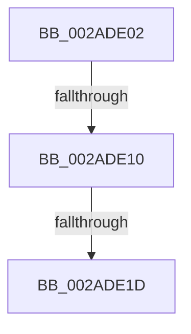

# sub_002ADE02

- RVA: `0x002ADE02`–`0x002ADE2A` (길이 `40` bytes)
- VA: `0x00000001402ADE02`
- 실행 섹션: `.text`
- PDB 이름 있음: `아니요`; PDB Function 태그: `아니요`
- unwind 정보 RVA: `0x0006D3D8`
- 디코드: `9`개 명령, `40/40` bytes 표시
- 미해석 바이트: `0` (있으면 어셈블리에 `.byte`로 보존)

> 이 문서는 커널 이미지의 기계어와 PDB 기호를 분석해 생성했습니다. 4번과 5번은 함수 원형과 자료형을 바이너리 사용 방식에서 추정한 C 해석이며 원본 소스 복구 결과는 아닙니다.

## 1. Dependencies

- 직접 호출 지점: **2**; 고유 호출 대상: **2**
- 직접 호출자로 확인된 함수: **0**
- RIP 상대 이미지 참조: **1**

### Outgoing calls
- `0x002ADE10` → [KiCheckVpBackingLongSpinWaitHypercall](../30/KiCheckVpBackingLongSpinWaitHypercall_function_0030F490.md) (function, `0x0030F490`)
- `0x002ADE20` → [HvlNotifyLongSpinWait](../30/HvlNotifyLongSpinWait_function_0030F460.md) (function, `0x0030F460`)

### Direct callers
- 이 함수 시작 RVA로 연결되는 직접 call은 확인되지 않았습니다. 간접 호출은 완전히 역산할 수 없습니다.

### Static image references
- `0x002ADE02` → RVA `0x00FC6AB8` (`ALMOSTRO`; read)

## 2. Other-region calls and transfers

- 다른 실행 섹션으로 향하는 call: **0**
- call이 아닌 외부 분기/꼬리 이동: **3**
  - `0x002ADE0A` → [sub_002ADD60 + 0x10](Unknown_function_002ADD60.md) (`tail-transfer`)
  - `0x002ADE17` → [sub_002ADD60 + 0x10](Unknown_function_002ADD60.md) (`tail-transfer`)
  - `0x002ADE25` → [sub_002ADD60 + 0x12](Unknown_function_002ADD60.md) (`tail-transfer`)

## 3. Assembly (complete function range)

```asm
002ADE02  8B 05 B0 8C D1 00               mov eax, dword ptr [rip + 0xd18cb0]
002ADE08  A8 40                           test al, 0x40
002ADE0A  0F 84 60 FF FF FF               je 0x1402add70
002ADE10  E8 7B 16 06 00                  call 0x14030f490
002ADE15  84 C0                           test al, al
002ADE17  0F 84 53 FF FF FF               je 0x1402add70
002ADE1D  41 8B CF                        mov ecx, r15d
002ADE20  E8 3B 16 06 00                  call 0x14030f460
002ADE25  E9 48 FF FF FF                  jmp 0x1402add72
```

## 4. C-style interpretation (structured pseudocode)

```c
__int64 __fastcall sub_002ADE02(void)
{
    __int64 result;

    result = KiCheckVpBackingLongSpinWaitHypercall(a1, a2, a3, a4);
    result = HvlNotifyLongSpinWait((unsigned int)((unsigned int)(v_r15)), a2, a3, a4);
}
```

## 5. (Beta) C Style

```c
void sub_002ADE02(void)
{
    int64_t result;

    result = KiCheckVpBackingLongSpinWaitHypercall(a1, a2, a3, a4);
    result = HvlNotifyLongSpinWait((uint32_t)((uint32_t)(local_r15)), a2, a3, a4);
}
```

## 6. Execution-region graph

[열기: 2D/3D 그래프와 함수 탐색 컨트롤 패널](../../../control-panel.html?section=text&rva=0x002ADE02&view=graph)

- 2D 그래프는 위에서 아래로 흐르고, 3D 그래프는 빈 공간을 드래그해 회전합니다. Shift+드래그는 이동, 휠은 확대·축소, 함수 노드 선택은 대상 보고서 이동입니다.

### Static fallback


