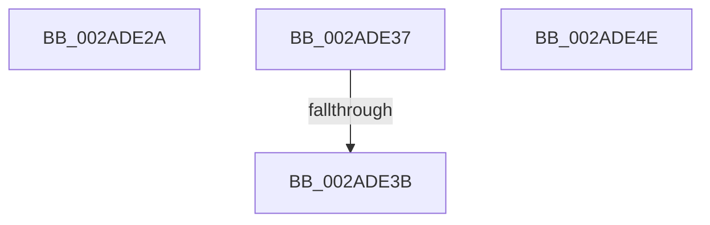

# sub_002ADE2A

- RVA: `0x002ADE2A`–`0x002ADE4F` (길이 `37` bytes)
- VA: `0x00000001402ADE2A`
- 실행 섹션: `.text`
- PDB 이름 있음: `아니요`; PDB Function 태그: `아니요`
- unwind 정보 RVA: `0x0006D3F0`
- 디코드: `15`개 명령, `37/37` bytes 표시
- 미해석 바이트: `0` (있으면 어셈블리에 `.byte`로 보존)

> 이 문서는 커널 이미지의 기계어와 PDB 기호를 분석해 생성했습니다. 4번과 5번은 함수 원형과 자료형을 바이너리 사용 방식에서 추정한 C 해석이며 원본 소스 복구 결과는 아닙니다.

## 1. Dependencies

- 직접 호출 지점: **1**; 고유 호출 대상: **1**
- 직접 호출자로 확인된 함수: **0**
- RIP 상대 이미지 참조: **0**

### Outgoing calls
- `0x002ADE2D` → [KxWaitForLockOwnerShip](../25/KxWaitForLockOwnerShip_function_00257EB0.md) (function, `0x00257EB0`)

### Direct callers
- 이 함수 시작 RVA로 연결되는 직접 call은 확인되지 않았습니다. 간접 호출은 완전히 역산할 수 없습니다.

### Static image references
- 디코드된 RIP-relative 메모리 참조가 없습니다.

## 2. Other-region calls and transfers

- 다른 실행 섹션으로 향하는 call: **0**
- call이 아닌 외부 분기/꼬리 이동: **2**
  - `0x002ADE32` → [sub_002ADC0C + 0x62](Unknown_function_002ADC0C.md) (`tail-transfer`)
  - `0x002ADE39` → [sub_002ADE82 + 0x29](Unknown_function_002ADE82.md) (`tail-transfer`)

## 3. Assembly (complete function range)

```asm
002ADE2A  48 8B D0                        mov rdx, rax
002ADE2D  E8 7E A0 FA FF                  call 0x140257eb0
002ADE32  E9 37 FE FF FF                  jmp 0x1402adc6e
002ADE37  85 D2                           test edx, edx
002ADE39  74 70                           je 0x1402adeab
002ADE3B  48 8B 5C 24 68                  mov rbx, qword ptr [rsp + 0x68]
002ADE40  33 C0                           xor eax, eax
002ADE42  48 83 C4 20                     add rsp, 0x20
002ADE46  41 5F                           pop r15
002ADE48  41 5E                           pop r14
002ADE4A  5F                              pop rdi
002ADE4B  5E                              pop rsi
002ADE4C  5D                              pop rbp
002ADE4D  C3                              ret
002ADE4E  CC                              int3
```

## 4. C-style interpretation (structured pseudocode)

```c
__int64 __fastcall sub_002ADE2A(void)
{
    __int64 result;
    unsigned __int64 v_stack_p68;

    result = KxWaitForLockOwnerShip(a1, result, a3, a4);
}
```

## 5. (Beta) C Style

```c
void sub_002ADE2A(void)
{
    int64_t result;
    uint64_t v_stack_p68;

    result = KxWaitForLockOwnerShip(a1, result, a3, a4);
}
```

## 6. Execution-region graph

[열기: 2D/3D 그래프와 함수 탐색 컨트롤 패널](../../../control-panel.html?section=text&rva=0x002ADE2A&view=graph)

- 2D 그래프는 위에서 아래로 흐르고, 3D 그래프는 빈 공간을 드래그해 회전합니다. Shift+드래그는 이동, 휠은 확대·축소, 함수 노드 선택은 대상 보고서 이동입니다.

### Static fallback


