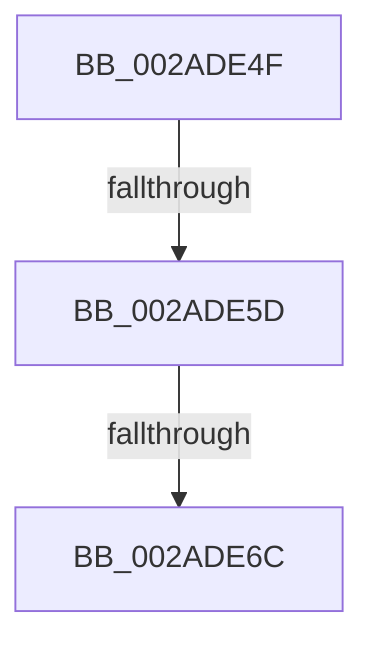

# sub_002ADE4F

- RVA: `0x002ADE4F`–`0x002ADE82` (길이 `51` bytes)
- VA: `0x00000001402ADE4F`
- 실행 섹션: `.text`
- PDB 이름 있음: `아니요`; PDB Function 태그: `아니요`
- unwind 정보 RVA: `0x0006D404`
- 디코드: `13`개 명령, `51/51` bytes 표시
- 미해석 바이트: `0` (있으면 어셈블리에 `.byte`로 보존)

> 이 문서는 커널 이미지의 기계어와 PDB 기호를 분석해 생성했습니다. 4번과 5번은 함수 원형과 자료형을 바이너리 사용 방식에서 추정한 C 해석이며 원본 소스 복구 결과는 아닙니다.

## 1. Dependencies

- 직접 호출 지점: **1**; 고유 호출 대상: **1**
- 직접 호출자로 확인된 함수: **0**
- RIP 상대 이미지 참조: **0**

### Outgoing calls
- `0x002ADE78` → [MiCheckLinearProtectedPteAccessedBit](../29/MiCheckLinearProtectedPteAccessedBit_function_00292D80.md) (function, `0x00292D80`)

### Direct callers
- 이 함수 시작 RVA로 연결되는 직접 call은 확인되지 않았습니다. 간접 호출은 완전히 역산할 수 없습니다.

### Static image references
- 디코드된 RIP-relative 메모리 참조가 없습니다.

## 2. Other-region calls and transfers

- 다른 실행 섹션으로 향하는 call: **0**
- call이 아닌 외부 분기/꼬리 이동: **3**
  - `0x002ADE57` → [sub_002ADD0C + 0x2F](Unknown_function_002ADD0C.md) (`tail-transfer`)
  - `0x002ADE66` → [sub_002ADD0C + 0x2F](Unknown_function_002ADD0C.md) (`tail-transfer`)
  - `0x002ADE7D` → [sub_002ADD0C + 0x2F](Unknown_function_002ADD0C.md) (`tail-transfer`)

## 3. Assembly (complete function range)

```asm
002ADE4F  40 0F B6 C7                     movzx eax, dil
002ADE53  24 21                           and al, 0x21
002ADE55  3C 01                           cmp al, 1
002ADE57  0F 85 DE FE FF FF               jne 0x1402add3b
002ADE5D  49 8B C1                        mov rax, r9
002ADE60  49 03 C2                        add rax, r10
002ADE63  48 3B F0                        cmp rsi, rax
002ADE66  0F 82 CF FE FF FF               jb 0x1402add3b
002ADE6C  41 B8 80 00 00 00               mov r8d, 0x80
002ADE72  48 8B D7                        mov rdx, rdi
002ADE75  48 8B CE                        mov rcx, rsi
002ADE78  E8 03 4F FE FF                  call 0x140292d80
002ADE7D  E9 B9 FE FF FF                  jmp 0x1402add3b
```

## 4. C-style interpretation (structured pseudocode)

```c
__int64 __fastcall sub_002ADE4F(__int64 a1, __int64 a2, __int64 a3, __int64 a4)
{
    __int64 result;

    result = (unsigned __int8)(((unsigned __int8)(v_rdi)) & (33));
    result = (a4) + (v_r10);
    result = MiCheckLinearProtectedPteAccessedBit(v_rsi, v_rdi, 128, a4);
}
```

## 5. (Beta) C Style

```c
int64_t sub_002ADE4F(int64_t Arg1, int64_t Arg2, int64_t Arg3, int64_t Arg4)
{
    int64_t result;

    result = (uint8_t)(((uint8_t)(local_rdi)) & (33));
    result = (Arg4) + (local_r10);
    result = MiCheckLinearProtectedPteAccessedBit(local_rsi, local_rdi, 128, Arg4);
}
```

## 6. Execution-region graph

[열기: 2D/3D 그래프와 함수 탐색 컨트롤 패널](../../../control-panel.html?section=text&rva=0x002ADE4F&view=graph)

- 2D 그래프는 위에서 아래로 흐르고, 3D 그래프는 빈 공간을 드래그해 회전합니다. Shift+드래그는 이동, 휠은 확대·축소, 함수 노드 선택은 대상 보고서 이동입니다.

### Static fallback


