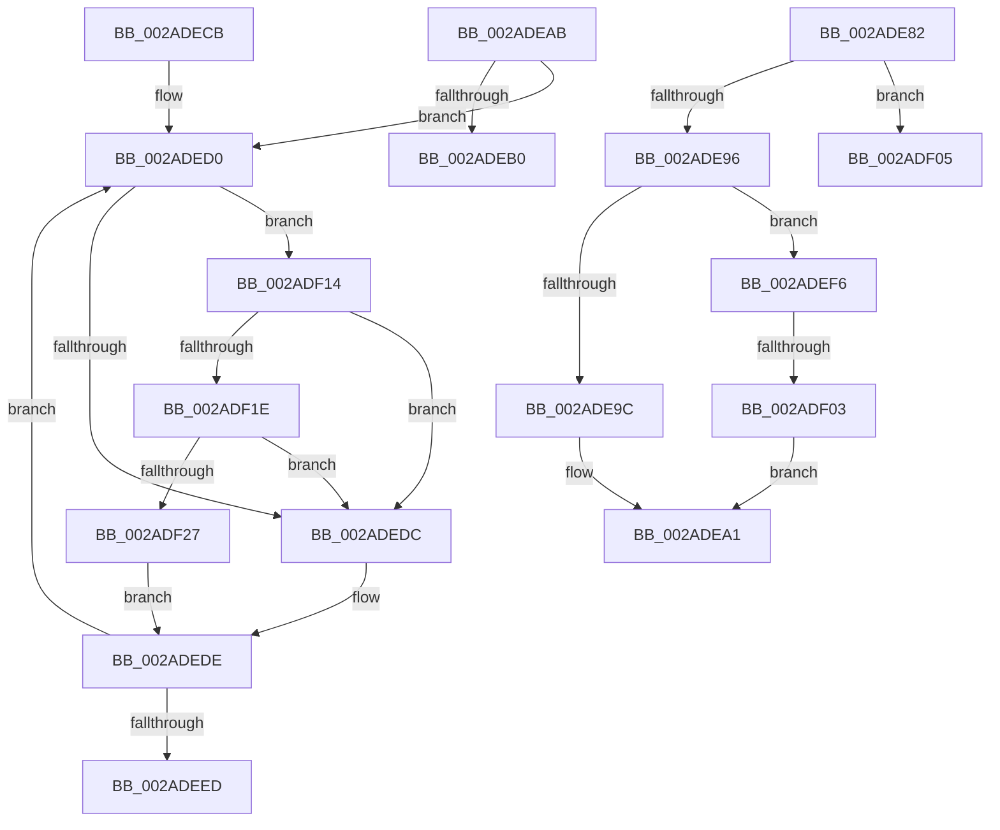

# sub_002ADE82

- RVA: `0x002ADE82`–`0x002ADF31` (길이 `175` bytes)
- VA: `0x00000001402ADE82`
- 실행 섹션: `.text`
- PDB 이름 있음: `아니요`; PDB Function 태그: `아니요`
- unwind 정보 RVA: `0x0006D41C`
- 디코드: `50`개 명령, `175/175` bytes 표시
- 미해석 바이트: `0` (있으면 어셈블리에 `.byte`로 보존)

> 이 문서는 커널 이미지의 기계어와 PDB 기호를 분석해 생성했습니다. 4번과 5번은 함수 원형과 자료형을 바이너리 사용 방식에서 추정한 C 해석이며 원본 소스 복구 결과는 아닙니다.

## 1. Dependencies

- 직접 호출 지점: **5**; 고유 호출 대상: **5**
- 직접 호출자로 확인된 함수: **0**
- RIP 상대 이미지 참조: **2**

### Outgoing calls
- `0x002ADE9C` → [ExAcquireSpinLockExclusiveAtDpcLevel](../24/ExAcquireSpinLockExclusiveAtDpcLevel_function_00248E80.md) (function, `0x00248E80`)
- `0x002ADEF6` → [ExTryAcquireSpinLockExclusiveAtDpcLevel](../2B/ExTryAcquireSpinLockExclusiveAtDpcLevel_function_002BB800.md) (function, `0x002BB800`)
- `0x002ADF05` → [ExAcquireSpinLockSharedAtDpcLevel](../24/ExAcquireSpinLockSharedAtDpcLevel_function_00248E30.md) (function, `0x00248E30`)
- `0x002ADF1E` → [KiCheckVpBackingLongSpinWaitHypercall](../30/KiCheckVpBackingLongSpinWaitHypercall_function_0030F490.md) (function, `0x0030F490`)
- `0x002ADF2A` → [HvlNotifyLongSpinWait](../30/HvlNotifyLongSpinWait_function_0030F460.md) (function, `0x0030F460`)

### Direct callers
- 이 함수 시작 RVA로 연결되는 직접 call은 확인되지 않았습니다. 간접 호출은 완전히 역산할 수 없습니다.

### Static image references
- `0x002ADED3` → RVA `0x00FC52AC` (`ALMOSTRO`; reference)
- `0x002ADF14` → RVA `0x00FC6AB8` (`ALMOSTRO`; read)

## 2. Other-region calls and transfers

- 다른 실행 섹션으로 향하는 call: **0**
- call이 아닌 외부 분기/꼬리 이동: **5**
  - `0x002ADEA6` → [sub_002ADC0C + 0x62](Unknown_function_002ADC0C.md) (`tail-transfer`)
  - `0x002ADEC6` → [sub_002ADD7F + 0x43](Unknown_function_002ADD7F.md) (`tail-transfer`)
  - `0x002ADEF1` → [sub_002ADD7F + 0x43](Unknown_function_002ADD7F.md) (`tail-transfer`)
  - `0x002ADEFD` → [sub_002ADE2A + 0x11](Unknown_function_002ADE2A.md) (`tail-transfer`)
  - `0x002ADF0F` → [sub_002ADC0C + 0x62](Unknown_function_002ADC0C.md) (`tail-transfer`)

## 3. Assembly (complete function range)

```asm
002ADE82  48 C1 EE 03                     shr rsi, 3
002ADE86  81 E6 FF 01 00 00               and esi, 0x1ff
002ADE8C  48 8D 0C B1                     lea rcx, [rcx + rsi*4]
002ADE90  40 F6 C5 04                     test bpl, 4
002ADE94  75 6F                           jne 0x1402adf05
002ADE96  40 F6 C5 01                     test bpl, 1
002ADE9A  75 5A                           jne 0x1402adef6
002ADE9C  E8 DF AF F9 FF                  call 0x140248e80
002ADEA1  BB 01 00 00 00                  mov ebx, 1
002ADEA6  E9 C3 FD FF FF                  jmp 0x1402adc6e
002ADEAB  40 84 C7                        test dil, al
002ADEAE  75 20                           jne 0x1402aded0
002ADEB0  45 0B C1                        or r8d, r9d
002ADEB3  41 8B C1                        mov eax, r9d
002ADEB6  F0 44 0F B1 06                  lock cmpxchg dword ptr [rsi], r8d
002ADEBB  44 8B C8                        mov r9d, eax
002ADEBE  8B D5                           mov edx, ebp
002ADEC0  45 0F 44 C8                     cmove r9d, r8d
002ADEC4  23 D3                           and edx, ebx
002ADEC6  E9 F7 FE FF FF                  jmp 0x1402addc2
002ADECB  0F 1F 44 00 00                  nop dword ptr [rax + rax]
002ADED0  41 FF C6                        inc r14d
002ADED3  44 85 35 D2 73 D1 00            test dword ptr [rip + 0xd173d2], r14d
002ADEDA  74 38                           je 0x1402adf14
002ADEDC  F3 90                           pause
002ADEDE  44 8B 0E                        mov r9d, dword ptr [rsi]
002ADEE1  41 8B CF                        mov ecx, r15d
002ADEE4  41 8B C1                        mov eax, r9d
002ADEE7  D3 E8                           shr eax, cl
002ADEE9  84 C3                           test bl, al
002ADEEB  75 E3                           jne 0x1402aded0
002ADEED  8B D5                           mov edx, ebp
002ADEEF  23 D3                           and edx, ebx
002ADEF1  E9 CC FE FF FF                  jmp 0x1402addc2
002ADEF6  E8 05 D9 00 00                  call 0x1402bb800
002ADEFB  85 C0                           test eax, eax
002ADEFD  0F 84 38 FF FF FF               je 0x1402ade3b
002ADF03  EB 9C                           jmp 0x1402adea1
002ADF05  E8 26 AF F9 FF                  call 0x140248e30
002ADF0A  BB 01 00 00 00                  mov ebx, 1
002ADF0F  E9 5A FD FF FF                  jmp 0x1402adc6e
002ADF14  8B 05 9E 8B D1 00               mov eax, dword ptr [rip + 0xd18b9e]
002ADF1A  A8 40                           test al, 0x40
002ADF1C  74 BE                           je 0x1402adedc
002ADF1E  E8 6D 15 06 00                  call 0x14030f490
002ADF23  84 C0                           test al, al
002ADF25  74 B5                           je 0x1402adedc
002ADF27  41 8B CE                        mov ecx, r14d
002ADF2A  E8 31 15 06 00                  call 0x14030f460
002ADF2F  EB AD                           jmp 0x1402adede
```

## 4. C-style interpretation (structured pseudocode)

```c
__int64 __fastcall sub_002ADE82(__int64 a1, __int64 a2, int a3, int a4)
{
    __int64 result;
    __int64 v_rsi;

    v_rsi = (v_rsi) >> (3);
    v_rsi = (unsigned int)((v_rsi) & (511));
    if ((((unsigned __int8)(v_rbp)) & (4)) != 0) goto loc_002ADF05;
    if ((((unsigned __int8)(v_rbp)) & (1)) != 0) goto loc_002ADEF6;
    result = ExAcquireSpinLockExclusiveAtDpcLevel(a1 + v_rsi * 4, a2, a3, a4);
loc_002ADEA1:
loc_002ADEF6:
    result = ExTryAcquireSpinLockExclusiveAtDpcLevel(a1 + v_rsi * 4, a2, a3, a4);
    goto loc_002ADEA1;
loc_002ADF05:
    result = ExAcquireSpinLockSharedAtDpcLevel(a1 + v_rsi * 4, a2, a3, a4);
}
```

## 5. (Beta) C Style

```c
int64_t sub_002ADE82(void *Arg1, int64_t Arg2, int32_t Arg3, int32_t Arg4)
{
    uint8_t *arg1 = (uint8_t *)Arg1;

    int64_t result;
    int64_t local_rsi;

    local_rsi = (local_rsi) >> (3);
    local_rsi = (uint32_t)((local_rsi) & (511));
    if ((((uint8_t)(local_rbp)) & (4)) != 0) goto loc_002ADF05;
    if ((((uint8_t)(local_rbp)) & (1)) != 0) goto loc_002ADEF6;
    result = ExAcquireSpinLockExclusiveAtDpcLevel(Arg1 + local_rsi * 4, Arg2, Arg3, Arg4);
loc_002ADEA1:
loc_002ADEF6:
    result = ExTryAcquireSpinLockExclusiveAtDpcLevel(Arg1 + local_rsi * 4, Arg2, Arg3, Arg4);
    goto loc_002ADEA1;
loc_002ADF05:
    result = ExAcquireSpinLockSharedAtDpcLevel(Arg1 + local_rsi * 4, Arg2, Arg3, Arg4);
}
```

### 관측된 메모리 오프셋

구조체 형식이 확인되지 않은 접근은 인자 기준의 오프셋으로만 기록했습니다.

| 기준 인자 | 오프셋 표현 | 폭 (bit) | 접근 |
|---|---:|---:|---|
| `Arg1` | `+ 0x0 + rsi*4` | `64` | `R` |

## 6. Execution-region graph

[열기: 2D/3D 그래프와 함수 탐색 컨트롤 패널](../../../control-panel.html?section=text&rva=0x002ADE82&view=graph)

- 2D 그래프는 위에서 아래로 흐르고, 3D 그래프는 빈 공간을 드래그해 회전합니다. Shift+드래그는 이동, 휠은 확대·축소, 함수 노드 선택은 대상 보고서 이동입니다.

### Static fallback


