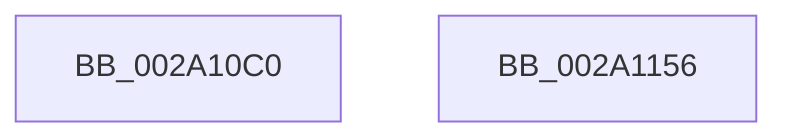

# VslSetPlaceholderPages

- RVA: `0x002A10C0`–`0x002A1157` (길이 `151` bytes)
- VA: `0x00000001402A10C0`
- 실행 섹션: `.text`
- PDB 이름 있음: `예`; PDB Function 태그: `아니요`
- unwind 정보 RVA: `0x00068468`
- 디코드: `36`개 명령, `151/151` bytes 표시
- 미해석 바이트: `0` (있으면 어셈블리에 `.byte`로 보존)

> 이 문서는 커널 이미지의 기계어와 PDB 기호를 분석해 생성했습니다. 4번과 5번은 함수 원형과 자료형을 바이너리 사용 방식에서 추정한 C 해석이며 원본 소스 복구 결과는 아닙니다.

## 1. Dependencies

- 직접 호출 지점: **3**; 고유 호출 대상: **3**
- 직접 호출자로 확인된 함수: **1**
- RIP 상대 이미지 참조: **1**

### Outgoing calls
- `0x002A1100` → [memset](../6C/memset_function_006C6C40.md) (function, `0x006C6C40`)
- `0x002A1128` → [VslpEnterIumSecureMode](../23/VslpEnterIumSecureMode_function_00235E50.md) (function, `0x00235E50`)
- `0x002A1138` → [_security_check_cookie](../6A/_security_check_cookie_function_006AC640.md) (function, `0x006AC640`)

### Direct callers
- [MiUpdateSlabPagePlaceholderState](MiUpdateSlabPagePlaceholderState_function_002A0FB0.md) at `0x002A1044`

### Static image references
- `0x002A10D7` → RVA `0x00E0A740` (`.data`; read)

## 2. Other-region calls and transfers

- 다른 실행 섹션으로 향하는 call: **0**
- 별도 외부 분기/꼬리 이동을 확인하지 못했습니다.

## 3. Assembly (complete function range)

```asm
002A10C0  48 89 5C 24 08                  mov qword ptr [rsp + 8], rbx
002A10C5  48 89 6C 24 10                  mov qword ptr [rsp + 0x10], rbp
002A10CA  48 89 74 24 18                  mov qword ptr [rsp + 0x18], rsi
002A10CF  57                              push rdi
002A10D0  48 81 EC A0 00 00 00            sub rsp, 0xa0
002A10D7  48 8B 05 62 96 B6 00            mov rax, qword ptr [rip + 0xb69662]
002A10DE  48 33 C4                        xor rax, rsp
002A10E1  48 89 84 24 90 00 00 00         mov qword ptr [rsp + 0x90], rax
002A10E9  48 8B FA                        mov rdi, rdx
002A10EC  49 63 F0                        movsxd rsi, r8d
002A10EF  33 D2                           xor edx, edx
002A10F1  49 63 E9                        movsxd rbp, r9d
002A10F4  48 8B D9                        mov rbx, rcx
002A10F7  48 8D 4C 24 20                  lea rcx, [rsp + 0x20]
002A10FC  44 8D 42 68                     lea r8d, [rdx + 0x68]
002A1100  E8 3B 5B 42 00                  call 0x1406c6c40
002A1105  BA 01 01 00 00                  mov edx, 0x101
002A110A  48 89 5C 24 28                  mov qword ptr [rsp + 0x28], rbx
002A110F  4C 8D 4C 24 20                  lea r9, [rsp + 0x20]
002A1114  48 89 7C 24 30                  mov qword ptr [rsp + 0x30], rdi
002A1119  45 33 C0                        xor r8d, r8d
002A111C  48 89 74 24 38                  mov qword ptr [rsp + 0x38], rsi
002A1121  B1 02                           mov cl, 2
002A1123  48 89 6C 24 40                  mov qword ptr [rsp + 0x40], rbp
002A1128  E8 23 4D F9 FF                  call 0x140235e50
002A112D  48 8B 8C 24 90 00 00 00         mov rcx, qword ptr [rsp + 0x90]
002A1135  48 33 CC                        xor rcx, rsp
002A1138  E8 03 B5 40 00                  call 0x1406ac640
002A113D  4C 8D 9C 24 A0 00 00 00         lea r11, [rsp + 0xa0]
002A1145  49 8B 5B 10                     mov rbx, qword ptr [r11 + 0x10]
002A1149  49 8B 6B 18                     mov rbp, qword ptr [r11 + 0x18]
002A114D  49 8B 73 20                     mov rsi, qword ptr [r11 + 0x20]
002A1151  49 8B E3                        mov rsp, r11
002A1154  5F                              pop rdi
002A1155  C3                              ret
002A1156  CC                              int3
```

## 4. C-style interpretation (structured pseudocode)

```c
__int64 __fastcall VslSetPlaceholderPages(__int64 a1, __int64 a2, int a3, int a4)
{
    __int64 result;
    __int64 v_rsp;
    unsigned __int64 v_stack_m18;
    unsigned __int64 v_stack_m68;
    unsigned __int64 v_stack_m70;
    unsigned __int64 v_stack_m78;
    unsigned __int64 v_stack_m8;
    unsigned __int64 v_stack_m80;
    unsigned __int64 v_stack_m88;
    unsigned __int64 v_stack_p10;
    unsigned __int64 v_stack_p18;
    unsigned __int64 v_stack_p8;

    v_stack_p8 = v_rbx;
    v_stack_p10 = v_rbp;
    v_stack_p18 = v_rsi;
    v_rsp = (v_rsp) - (160);
    result = (*(unsigned __int64 *)(v_rip + 11966050)) ^ (v_rsp);
    v_stack_m18 = result;
    a2 = 0;
    result = memset(v_stack_m88, a2, a2 + 104, a4);
    v_stack_m80 = a1;
    v_stack_m78 = 0;
    a3 = 0;
    v_stack_m70 = (int)(a3);
    v_stack_m68 = (int)(a4);
    result = VslpEnterIumSecureMode(2, 257, a3, v_stack_m88);
    a1 = (v_stack_m18) ^ (v_rsp);
    result = _security_check_cookie(a1, 257, a3, v_stack_m88);
    return result;
}
```

## 5. (Beta) C Style

```c
int64_t VslSetPlaceholderPages(int64_t Arg1, int64_t Arg2, int32_t Arg3, int32_t Arg4)
{
    int64_t result;
    int64_t local_rsp;
    uint64_t v_stack_m18;
    uint64_t v_stack_m68;
    uint64_t v_stack_m70;
    uint64_t v_stack_m78;
    uint64_t v_stack_m8;
    uint64_t v_stack_m80;
    uint64_t v_stack_m88;
    uint64_t v_stack_p10;
    uint64_t v_stack_p18;
    uint64_t v_stack_p8;

    v_stack_p8 = local_rbx;
    v_stack_p10 = local_rbp;
    v_stack_p18 = local_rsi;
    local_rsp = (local_rsp) - (160);
    result = (*(uint64_t *)(v_rip + 0xB69662)) ^ (local_rsp);
    v_stack_m18 = result;
    Arg2 = 0;
    result = memset(v_stack_m88, Arg2, Arg2 + 104, Arg4);
    v_stack_m80 = Arg1;
    v_stack_m78 = 0;
    Arg3 = 0;
    v_stack_m70 = (int32_t)(Arg3);
    v_stack_m68 = (int32_t)(Arg4);
    result = VslpEnterIumSecureMode(2, 257, Arg3, v_stack_m88);
    Arg1 = (v_stack_m18) ^ (local_rsp);
    result = _security_check_cookie(Arg1, 257, Arg3, v_stack_m88);
    return result;
}
```

## 6. Execution-region graph

[열기: 2D/3D 그래프와 함수 탐색 컨트롤 패널](../../../control-panel.html?section=text&rva=0x002A10C0&view=graph)

- 2D 그래프는 위에서 아래로 흐르고, 3D 그래프는 빈 공간을 드래그해 회전합니다. Shift+드래그는 이동, 휠은 확대·축소, 함수 노드 선택은 대상 보고서 이동입니다.

### Static fallback


