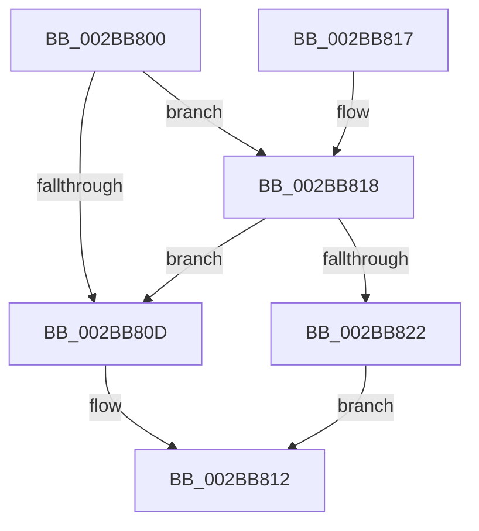

# ExTryAcquireSpinLockExclusiveAtDpcLevel

- RVA: `0x002BB800`–`0x002BB829` (길이 `41` bytes)
- VA: `0x00000001402BB800`
- 실행 섹션: `.text`
- PDB 이름 있음: `예`; PDB Function 태그: `아니요`
- unwind 정보 RVA: `0x00063CEC`
- 디코드: `12`개 명령, `41/41` bytes 표시
- 미해석 바이트: `0` (있으면 어셈블리에 `.byte`로 보존)

> 이 문서는 커널 이미지의 기계어와 PDB 기호를 분석해 생성했습니다. 4번과 5번은 함수 원형과 자료형을 바이너리 사용 방식에서 추정한 C 해석이며 원본 소스 복구 결과는 아닙니다.

## 1. Dependencies

- 직접 호출 지점: **2**; 고유 호출 대상: **2**
- 직접 호출자로 확인된 함수: **28**
- RIP 상대 이미지 참조: **2**

### Outgoing calls
- `0x002BB80D` → [TRY_ACQUIRE_EXLOCK_EXCLUSIVE](TRY_ACQUIRE_EXLOCK_EXCLUSIVE_function_002BD130.md) (function, `0x002BD130`)
- `0x002BB822` → [ExpTryAcquireSpinLockExclusiveAtDpcLevelInstrumented](ExpTryAcquireSpinLockExclusiveAtDpcLevelInstrumented_function_002BE6A0.md) (function, `0x002BE6A0`)

### Direct callers
- [MiReacquireHigherPageTableLock](../23/MiReacquireHigherPageTableLock_function_00239650.md) at `0x00239CB2`
- [MiFastLockLeafPageTable](../27/MiFastLockLeafPageTable_function_00276340.md) at `0x002770B8`
- [MiDeleteVaDirect](../27/MiDeleteVaDirect_function_00277560.md) at `0x0027890B`
- [MiGetPerfectColorHeadPage](../28/MiGetPerfectColorHeadPage_function_00289CA8.md) at `0x00289F1A`
- [MmFlushImageSection](../2A/MmFlushImageSection_function_002AB930.md) at `0x002AB971`
- [MmFlushImageSection](../2A/MmFlushImageSection_function_002AB930.md) at `0x002AB9CD`
- [MiCanFileBeTruncatedInternal](../2A/MiCanFileBeTruncatedInternal_function_002ACCB4.md) at `0x002ACD20`
- [MiCanFileBeTruncatedInternal](../2A/MiCanFileBeTruncatedInternal_function_002ACCB4.md) at `0x002ACDF3`
- [sub_002ADE82](../2A/Unknown_function_002ADE82.md) at `0x002ADEF6`
- [MiCopyDataPageToImagePage](../2A/MiCopyDataPageToImagePage_function_002AE818.md) at `0x002AE920`
- [MiReferencePfBackedSection](MiReferencePfBackedSection_function_002B9B70.md) at `0x002B9BCC`
- [MiSynchronizeFastPageInsert](MiSynchronizeFastPageInsert_function_002BAE80.md) at `0x002BB425`
- [MmDoesFileHaveUserWritableReferences](MmDoesFileHaveUserWritableReferences_function_002BB690.md) at `0x002BB723`
- [MiComputeFlushRange](MiComputeFlushRange_function_002BB8D0.md) at `0x002BB941`
- [MiReferenceControlArea](MiReferenceControlArea_function_002BC198.md) at `0x002BC208`
- [PspIumReplenishPartitionPages](../2C/PspIumReplenishPartitionPages_function_002C8710.md) at `0x002C8756`
- [RtlpHpTryAcquireQueuedLockExclusive](../2E/RtlpHpTryAcquireQueuedLockExclusive_function_002EB23C.md) at `0x002EB27F`
- [MiDeleteEmptyControlAreas](../49/MiDeleteEmptyControlAreas_function_0049334C.md) at `0x0049339F`
- [MiDeleteEmptySubsections](../4E/MiDeleteEmptySubsections_function_004ED818.md) at `0x004ED893`
- [CcBcbProfiler](../50/CcBcbProfiler_function_005099B0.md) at `0x00509D1C`
- [IvtHandleInterrupt](../56/IvtHandleInterrupt_function_0056FF00.md) at `0x0057015E`
- [MiDeleteCachedEntries](../67/MiDeleteCachedEntries_function_00677A28.md) at `0x00677AD5`
- [MiDeleteDeleteOnCloseSubsections](../67/MiDeleteDeleteOnCloseSubsections_function_00677D20.md) at `0x00677D6B`
- [MiMakeUnusedSegmentDeleteOnClose](../67/MiMakeUnusedSegmentDeleteOnClose_function_00678078.md) at `0x006780F2`
- [MiPrepareDeleteOnClose](../67/MiPrepareDeleteOnClose_function_0067835C.md) at `0x0067838F`
- [MiProcessDeleteOnClose](../67/MiProcessDeleteOnClose_function_006783D8.md) at `0x0067842E`
- [MiFreezeIoPfnNode](../67/MiFreezeIoPfnNode_function_0067BDAC.md) at `0x0067BE51`
- [MiConvertWorkingSetLockSharedToExclusive](../68/MiConvertWorkingSetLockSharedToExclusive_function_0068B104.md) at `0x0068B197`
- [sub_00705ED0](../../page/70/Unknown_function_00705ED0.md) at `0x00706213`
- [KiForceSymbolReferences](../../init/C3/KiForceSymbolReferences_function_00C381DC.md) at `0x00C38250`

### Static image references
- `0x002BB804` → RVA `0x00FC6B06` (`ALMOSTRO`; read)
- `0x002BB818` → RVA `0x00F0DE58` (`.data`; read)

## 2. Other-region calls and transfers

- 다른 실행 섹션으로 향하는 call: **0**
- 별도 외부 분기/꼬리 이동을 확인하지 못했습니다.

## 3. Assembly (complete function range)

```asm
002BB800  48 83 EC 28                     sub rsp, 0x28
002BB804  F6 05 FB B2 D0 00 21            test byte ptr [rip + 0xd0b2fb], 0x21
002BB80B  75 0B                           jne 0x1402bb818
002BB80D  E8 1E 19 00 00                  call 0x1402bd130
002BB812  48 83 C4 28                     add rsp, 0x28
002BB816  C3                              ret
002BB817  CC                              int3
002BB818  8B 05 3A 26 C5 00               mov eax, dword ptr [rip + 0xc5263a]
002BB81E  85 C0                           test eax, eax
002BB820  75 EB                           jne 0x1402bb80d
002BB822  E8 79 2E 00 00                  call 0x1402be6a0
002BB827  EB E9                           jmp 0x1402bb812
```

## 4. C-style interpretation (structured pseudocode)

```c
__int64 __fastcall ExTryAcquireSpinLockExclusiveAtDpcLevel(void)
{
    __int64 result;
    __int64 v_rsp;

    v_rsp = (v_rsp) - (40);
    if (((*(unsigned __int8 *)(v_rip + 13677307)) & (33)) != 0) goto loc_002BB818;
loc_002BB80D:
    result = TRY_ACQUIRE_EXLOCK_EXCLUSIVE(a1, a2, a3, a4);
loc_002BB812:
    v_rsp = (v_rsp) + (40);
    return result;
loc_002BB818:
    if ((unsigned int)((unsigned int)(*(unsigned int *)(v_rip + 12920378))) != 0) goto loc_002BB80D;
    result = ExpTryAcquireSpinLockExclusiveAtDpcLevelInstrumented(a1, a2, a3, a4);
    goto loc_002BB812;
}
```

## 5. (Beta) C Style

```c
void ExTryAcquireSpinLockExclusiveAtDpcLevel(void)
{
    int64_t result;
    int64_t local_rsp;

    local_rsp = (local_rsp) - (40);
    if (((*(uint8_t *)(v_rip + 0xD0B2FB)) & (33)) != 0) goto loc_002BB818;
loc_002BB80D:
    result = TRY_ACQUIRE_EXLOCK_EXCLUSIVE(a1, a2, a3, a4);
loc_002BB812:
    local_rsp = (local_rsp) + (40);
    return result;
loc_002BB818:
    if ((uint32_t)((uint32_t)(*(uint32_t *)(v_rip + 0xC5263A))) != 0) goto loc_002BB80D;
    result = ExpTryAcquireSpinLockExclusiveAtDpcLevelInstrumented(a1, a2, a3, a4);
    goto loc_002BB812;
}
```

## 6. Execution-region graph

[열기: 2D/3D 그래프와 함수 탐색 컨트롤 패널](../../../control-panel.html?section=text&rva=0x002BB800&view=graph)

- 2D 그래프는 위에서 아래로 흐르고, 3D 그래프는 빈 공간을 드래그해 회전합니다. Shift+드래그는 이동, 휠은 확대·축소, 함수 노드 선택은 대상 보고서 이동입니다.

### Static fallback


