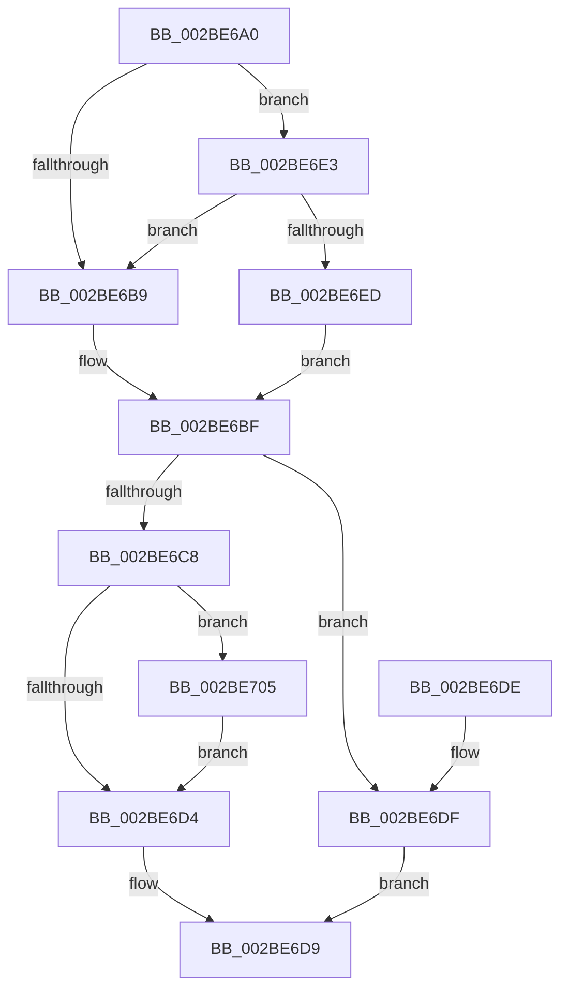

# ExpTryAcquireSpinLockExclusiveAtDpcLevelInstrumented

- RVA: `0x002BE6A0`–`0x002BE72B` (길이 `139` bytes)
- VA: `0x00000001402BE6A0`
- 실행 섹션: `.text`
- PDB 이름 있음: `예`; PDB Function 태그: `아니요`
- unwind 정보 RVA: `0x0006E3E4`
- 디코드: `40`개 명령, `139/139` bytes 표시
- 미해석 바이트: `0` (있으면 어셈블리에 `.byte`로 보존)

> 이 문서는 커널 이미지의 기계어와 PDB 기호를 분석해 생성했습니다. 4번과 5번은 함수 원형과 자료형을 바이너리 사용 방식에서 추정한 C 해석이며 원본 소스 복구 결과는 아닙니다.

## 1. Dependencies

- 직접 호출 지점: **2**; 고유 호출 대상: **2**
- 직접 호출자로 확인된 함수: **4**
- RIP 상대 이미지 참조: **2**

### Outgoing calls
- `0x002BE6BF` → [TRY_ACQUIRE_EXLOCK_EXCLUSIVE](TRY_ACQUIRE_EXLOCK_EXCLUSIVE_function_002BD130.md) (function, `0x002BD130`)
- `0x002BE724` → [PerfLogSpinLockAcquire](../41/PerfLogSpinLockAcquire_function_00414FC4.md) (function, `0x00414FC4`)

### Direct callers
- [MiLockStealUserVm](MiLockStealUserVm_function_002B3EDC.md) at `0x002B42E9`
- [ExTryAcquireSpinLockExclusiveAtDpcLevel](ExTryAcquireSpinLockExclusiveAtDpcLevel_function_002BB800.md) at `0x002BB822`
- [MiLockSectionControlArea](MiLockSectionControlArea_function_002BC930.md) at `0x002BCAD0`
- [PopPepWork](PopPepWork_function_002BCBC0.md) at `0x002BCD99`

### Static image references
- `0x002BE6B0` → RVA `0x00FC6B06` (`ALMOSTRO`; read)
- `0x002BE6E3` → RVA `0x00F0DE58` (`.data`; read)

## 2. Other-region calls and transfers

- 다른 실행 섹션으로 향하는 call: **0**
- 별도 외부 분기/꼬리 이동을 확인하지 못했습니다.

## 3. Assembly (complete function range)

```asm
002BE6A0  48 83 EC 38                     sub rsp, 0x38
002BE6A4  65 4C 8B 04 25 20 00 00 00      mov r8, qword ptr gs:[0x20]
002BE6AD  45 33 DB                        xor r11d, r11d
002BE6B0  F6 05 4F 84 D0 00 01            test byte ptr [rip + 0xd0844f], 1
002BE6B7  75 2A                           jne 0x1402be6e3
002BE6B9  45 32 C9                        xor r9b, r9b
002BE6BC  45 33 D2                        xor r10d, r10d
002BE6BF  E8 6C EA FF FF                  call 0x1402bd130
002BE6C4  85 C0                           test eax, eax
002BE6C6  74 17                           je 0x1402be6df
002BE6C8  41 FF 80 C0 8E 00 00            inc dword ptr [r8 + 0x8ec0]
002BE6CF  45 84 C9                        test r9b, r9b
002BE6D2  75 31                           jne 0x1402be705
002BE6D4  B8 01 00 00 00                  mov eax, 1
002BE6D9  48 83 C4 38                     add rsp, 0x38
002BE6DD  C3                              ret
002BE6DE  CC                              int3
002BE6DF  33 C0                           xor eax, eax
002BE6E1  EB F6                           jmp 0x1402be6d9
002BE6E3  8B 05 6F F7 C4 00               mov eax, dword ptr [rip + 0xc4f76f]
002BE6E9  85 C0                           test eax, eax
002BE6EB  75 CC                           jne 0x1402be6b9
002BE6ED  41 B1 01                        mov r9b, 1
002BE6F0  0F 31                           rdtsc
002BE6F2  45 8B 90 40 86 00 00            mov r10d, dword ptr [r8 + 0x8640]
002BE6F9  48 C1 E2 20                     shl rdx, 0x20
002BE6FD  48 0B C2                        or rax, rdx
002BE700  4C 8B D8                        mov r11, rax
002BE703  EB BA                           jmp 0x1402be6bf
002BE705  0F 31                           rdtsc
002BE707  48 C1 E2 20                     shl rdx, 0x20
002BE70B  45 33 C9                        xor r9d, r9d
002BE70E  48 0B C2                        or rax, rdx
002BE711  C6 44 24 28 03                  mov byte ptr [rsp + 0x28], 3
002BE716  44 8B C0                        mov r8d, eax
002BE719  44 89 54 24 20                  mov dword ptr [rsp + 0x20], r10d
002BE71E  45 2B C3                        sub r8d, r11d
002BE721  48 8B D0                        mov rdx, rax
002BE724  E8 9B 68 15 00                  call 0x140414fc4
002BE729  EB A9                           jmp 0x1402be6d4
```

## 4. C-style interpretation (structured pseudocode)

```c
__int64 __fastcall ExpTryAcquireSpinLockExclusiveAtDpcLevelInstrumented(__int64 a1, __int64 a2, __int64 a3, unsigned __int8 a4)
{
    __int64 result;
    __int64 v_r10;
    __int64 v_r11;
    __int64 v_rsp;
    unsigned int v_stack_p20;
    unsigned __int8 v_stack_p28;

    v_rsp = (v_rsp) - (56);
    v_r11 = 0;
    if (((*(unsigned __int8 *)(v_rip + 13665359)) & (1)) != 0) goto loc_002BE6E3;
loc_002BE6B9:
    a4 = 0;
    v_r10 = 0;
loc_002BE6BF:
    result = TRY_ACQUIRE_EXLOCK_EXCLUSIVE(a1, a2, *(unsigned __int64 *)(gs_base + (0 + 32)), a4);
    if ((unsigned int)(result) == 0) goto loc_002BE6DF;
    if (0 != 0) goto loc_002BE705;
loc_002BE6D4:
loc_002BE6D9:
    v_rsp = (v_rsp) + (56);
    return 1;
loc_002BE6DF:
    result = 0;
    goto loc_002BE6D9;
loc_002BE6E3:
    if ((unsigned int)((unsigned int)(*(unsigned int *)(v_rip + 12908399))) != 0) goto loc_002BE6B9;
    a2 = (a2) << (32);
    result = ((unsigned int)(*(unsigned int *)(v_rip + 12908399))) | (a2);
    goto loc_002BE6BF;
loc_002BE705:
    a2 = (a2) << (32);
    a4 = 0;
    result = (result) | (a2);
    v_stack_p28 = 3;
    v_stack_p20 = (unsigned int)((unsigned int)(*(unsigned int *)(*(unsigned __int64 *)(gs_base + (0 + 32)) + 34368)));
    a3 = (unsigned int)(((unsigned int)((unsigned int)(result))) - ((unsigned int)(result)));
    result = PerfLogSpinLockAcquire(a1, result, a3, a4);
    goto loc_002BE6D4;
}
```

## 5. (Beta) C Style

```c
int64_t ExpTryAcquireSpinLockExclusiveAtDpcLevelInstrumented(int64_t Arg1, int64_t Arg2, int64_t Arg3, uint8_t Arg4)
{
    int64_t result;
    int64_t local_r10;
    int64_t local_r11;
    int64_t local_rsp;
    uint32_t v_stack_p20;
    uint8_t v_stack_p28;

    local_rsp = (local_rsp) - (56);
    local_r11 = 0;
    if (((*(uint8_t *)(v_rip + 0xD0844F)) & (1)) != 0) goto loc_002BE6E3;
loc_002BE6B9:
    Arg4 = 0;
    local_r10 = 0;
loc_002BE6BF:
    result = TRY_ACQUIRE_EXLOCK_EXCLUSIVE(Arg1, Arg2, *(uint64_t *)(gs_base + (0 + 0x20)), Arg4);
    if ((uint32_t)(result) == 0) goto loc_002BE6DF;
    if (0 != 0) goto loc_002BE705;
loc_002BE6D4:
loc_002BE6D9:
    local_rsp = (local_rsp) + (56);
    return 1;
loc_002BE6DF:
    result = 0;
    goto loc_002BE6D9;
loc_002BE6E3:
    if ((uint32_t)((uint32_t)(*(uint32_t *)(v_rip + 0xC4F76F))) != 0) goto loc_002BE6B9;
    Arg2 = (Arg2) << (32);
    result = ((uint32_t)(*(uint32_t *)(v_rip + 0xC4F76F))) | (Arg2);
    goto loc_002BE6BF;
loc_002BE705:
    Arg2 = (Arg2) << (32);
    Arg4 = 0;
    result = (result) | (Arg2);
    v_stack_p28 = 3;
    v_stack_p20 = (uint32_t)((uint32_t)(*(uint32_t *)(*(uint64_t *)(gs_base + (0 + 0x20)) + 0x8640)));
    Arg3 = (uint32_t)(((uint32_t)((uint32_t)(result))) - ((uint32_t)(result)));
    result = PerfLogSpinLockAcquire(Arg1, result, Arg3, Arg4);
    goto loc_002BE6D4;
}
```

## 6. Execution-region graph

[열기: 2D/3D 그래프와 함수 탐색 컨트롤 패널](../../../control-panel.html?section=text&rva=0x002BE6A0&view=graph)

- 2D 그래프는 위에서 아래로 흐르고, 3D 그래프는 빈 공간을 드래그해 회전합니다. Shift+드래그는 이동, 휠은 확대·축소, 함수 노드 선택은 대상 보고서 이동입니다.

### Static fallback


