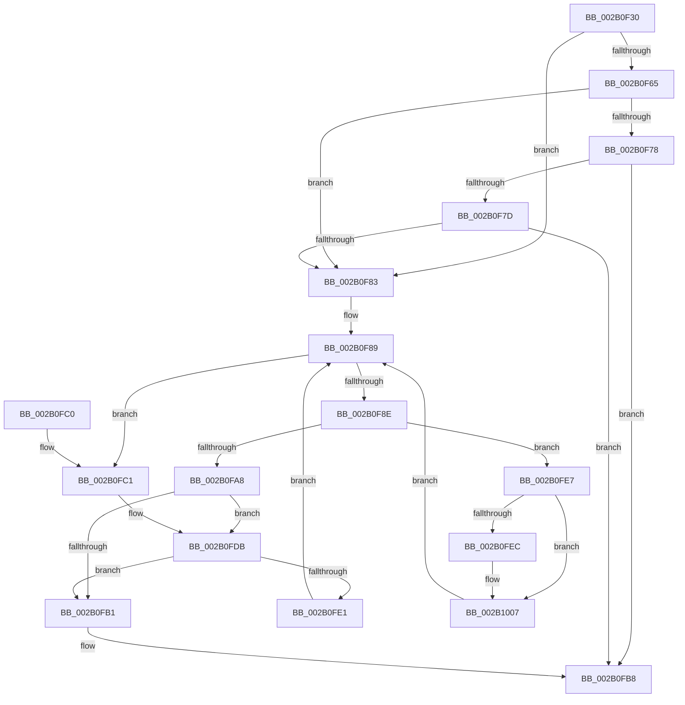

# MI_NODE_FROM_PFN

- RVA: `0x002B0F30`–`0x002B1010` (길이 `224` bytes)
- VA: `0x00000001402B0F30`
- 실행 섹션: `.text`
- PDB 이름 있음: `예`; PDB Function 태그: `아니요`
- unwind 정보 RVA: `0x0006D61C`
- 디코드: `59`개 명령, `224/224` bytes 표시
- 미해석 바이트: `0` (있으면 어셈블리에 `.byte`로 보존)

> 이 문서는 커널 이미지의 기계어와 PDB 기호를 분석해 생성했습니다. 4번과 5번은 함수 원형과 자료형을 바이너리 사용 방식에서 추정한 C 해석이며 원본 소스 복구 결과는 아닙니다.

## 1. Dependencies

- 직접 호출 지점: **2**; 고유 호출 대상: **1**
- 직접 호출자로 확인된 함수: **22**
- RIP 상대 이미지 참조: **4**

### Outgoing calls
- `0x002B0FD5` → [KeBugCheckEx](../4F/KeBugCheckEx_function_004FD660.md) (function, `0x004FD660`)
- `0x002B1001` → [KeBugCheckEx](../4F/KeBugCheckEx_function_004FD660.md) (function, `0x004FD660`)

### Direct callers
- [MiTradePage](../28/MiTradePage_function_0028D160.md) at `0x0028D78F`
- [MiMigratePfn](../28/MiMigratePfn_function_0028DBB0.md) at `0x0028DC4E`
- [MiGetSlabAllocatorRepurposedStandbyList](../2A/MiGetSlabAllocatorRepurposedStandbyList_function_002AF428.md) at `0x002AF47C`
- [MiGetWorkingSetInfoList](../2A/MiGetWorkingSetInfoList_function_002AF770.md) at `0x002AFCDC`
- [sub_002B0DDD](Unknown_function_002B0DDD.md) at `0x002B0E4F`
- [MiReplaceTransitionPage](MiReplaceTransitionPage_function_002B1120.md) at `0x002B134F`
- [MiReplaceTransitionPage](MiReplaceTransitionPage_function_002B1120.md) at `0x002B1359`
- [MiStealPage](MiStealPage_function_002B28D0.md) at `0x002B3A9B`
- [MiStoreCheckCandidatePage](MiStoreCheckCandidatePage_function_002B54E8.md) at `0x002B55F3`
- [MiInsertPageInList](MiInsertPageInList_function_002BA000.md) at `0x002BA729`
- [MiInitializeMdlOneNodeBatchPages](../2C/MiInitializeMdlOneNodeBatchPages_function_002C9480.md) at `0x002C961C`
- [MiReplenishUltraPageTables](../2C/MiReplenishUltraPageTables_function_002CB4EC.md) at `0x002CB607`
- [MiReturnPhysicalPoolPages](../32/MiReturnPhysicalPoolPages_function_00328568.md) at `0x00328859`
- [sub_003354FB](../33/Unknown_function_003354FB.md) at `0x00335C94`
- [MiWalkEntireImage](../36/MiWalkEntireImage_function_00365D70.md) at `0x00366A41`
- [MiPrefetchPreallocatePages](../36/MiPrefetchPreallocatePages_function_0036B1F0.md) at `0x0036B378`
- [MiZeroAndReleasePages](../37/MiZeroAndReleasePages_function_003748D0.md) at `0x00374C2E`
- [MiDrainZeroLookasides](../44/MiDrainZeroLookasides_function_0044D818.md) at `0x0044D85E`
- [MiUpdatePageAttributeStamp](../48/MiUpdatePageAttributeStamp_function_00482364.md) at `0x004824BA`
- [MiFinalizeImageHeaderPage](../4A/MiFinalizeImageHeaderPage_function_004A89A8.md) at `0x004A8A0A`
- [MiSetPfnRemovalRequested](../67/MiSetPfnRemovalRequested_function_0067A4D0.md) at `0x0067A528`
- [MiAddExpansionNonPagedPool](../68/MiAddExpansionNonPagedPool_function_00682B4C.md) at `0x00682BAC`
- [MiAddExpansionNonPagedPool](../68/MiAddExpansionNonPagedPool_function_00682B4C.md) at `0x00682BC4`
- [MiScrubLargePage](../69/MiScrubLargePage_function_006942E8.md) at `0x0069446B`

### Static image references
- `0x002B0F3E` → RVA `0x00E2DBC0` (`.data`; read)
- `0x002B0F48` → RVA `0x00E2DBC4` (`.data`; read)
- `0x002B0F6C` → RVA `0x00E2DC20` (`.data`; read)
- `0x002B0FB1` → RVA `0x00E2DBC0` (`.data`; write)

## 2. Other-region calls and transfers

- 다른 실행 섹션으로 향하는 call: **0**
- 별도 외부 분기/꼬리 이동을 확인하지 못했습니다.

## 3. Assembly (complete function range)

```asm
002B0F30  48 83 EC 38                     sub rsp, 0x38
002B0F34  48 B8 00 00 00 00 00 DE FF FF   movabs rax, 0xffffde0000000000
002B0F3E  4C 63 05 7B CC B7 00            movsxd r8, dword ptr [rip + 0xb7cc7b]
002B0F45  48 2B C8                        sub rcx, rax
002B0F48  8B 15 76 CC B7 00               mov edx, dword ptr [rip + 0xb7cc76]
002B0F4E  48 B8 AB AA AA AA AA AA AA AA   movabs rax, 0xaaaaaaaaaaaaaaab
002B0F58  48 C1 F9 04                     sar rcx, 4
002B0F5C  48 0F AF C8                     imul rcx, rax
002B0F60  44 3B C2                        cmp r8d, edx
002B0F63  77 1E                           ja 0x1402b0f83
002B0F65  49 8B C0                        mov rax, r8
002B0F68  48 C1 E0 04                     shl rax, 4
002B0F6C  48 03 05 AD CC B7 00            add rax, qword ptr [rip + 0xb7ccad]
002B0F73  48 3B 08                        cmp rcx, qword ptr [rax]
002B0F76  72 0B                           jb 0x1402b0f83
002B0F78  44 3B C2                        cmp r8d, edx
002B0F7B  74 3B                           je 0x1402b0fb8
002B0F7D  48 3B 48 10                     cmp rcx, qword ptr [rax + 0x10]
002B0F81  72 35                           jb 0x1402b0fb8
002B0F83  45 33 D2                        xor r10d, r10d
002B0F86  45 8B CA                        mov r9d, r10d
002B0F89  41 3B D1                        cmp edx, r9d
002B0F8C  7C 33                           jl 0x1402b0fc1
002B0F8E  45 8D 04 11                     lea r8d, [r9 + rdx]
002B0F92  41 D1 F8                        sar r8d, 1
002B0F95  49 63 C0                        movsxd rax, r8d
002B0F98  48 C1 E0 04                     shl rax, 4
002B0F9C  48 03 05 7D CC B7 00            add rax, qword ptr [rip + 0xb7cc7d]
002B0FA3  48 3B 08                        cmp rcx, qword ptr [rax]
002B0FA6  72 3F                           jb 0x1402b0fe7
002B0FA8  44 3B 05 15 CC B7 00            cmp r8d, dword ptr [rip + 0xb7cc15]
002B0FAF  75 2A                           jne 0x1402b0fdb
002B0FB1  44 89 05 08 CC B7 00            mov dword ptr [rip + 0xb7cc08], r8d
002B0FB8  8B 40 08                        mov eax, dword ptr [rax + 8]
002B0FBB  48 83 C4 38                     add rsp, 0x38
002B0FBF  C3                              ret
002B0FC0  CC                              int3
002B0FC1  45 33 C9                        xor r9d, r9d
002B0FC4  4C 89 54 24 20                  mov qword ptr [rsp + 0x20], r10
002B0FC9  4C 8B C1                        mov r8, rcx
002B0FCC  BA 80 51 00 00                  mov edx, 0x5180
002B0FD1  41 8D 49 1A                     lea ecx, [r9 + 0x1a]
002B0FD5  E8 86 C6 24 00                  call 0x1404fd660
002B0FDA  CC                              int3
002B0FDB  48 3B 48 10                     cmp rcx, qword ptr [rax + 0x10]
002B0FDF  72 D0                           jb 0x1402b0fb1
002B0FE1  45 8D 48 01                     lea r9d, [r8 + 1]
002B0FE5  EB A2                           jmp 0x1402b0f89
002B0FE7  45 85 C0                        test r8d, r8d
002B0FEA  75 1B                           jne 0x1402b1007
002B0FEC  4C 8B C1                        mov r8, rcx
002B0FEF  4C 89 54 24 20                  mov qword ptr [rsp + 0x20], r10
002B0FF4  B9 1A 00 00 00                  mov ecx, 0x1a
002B0FF9  4C 8B C8                        mov r9, rax
002B0FFC  BA 80 51 00 00                  mov edx, 0x5180
002B1001  E8 5A C6 24 00                  call 0x1404fd660
002B1006  CC                              int3
002B1007  41 8D 50 FF                     lea edx, [r8 - 1]
002B100B  E9 79 FF FF FF                  jmp 0x1402b0f89
```

## 4. C-style interpretation (structured pseudocode)

```c
__int64 __fastcall MI_NODE_FROM_PFN(__int64 a1)
{
    __int64 result;
    __int64 v_r10;
    __int64 v_rsp;
    unsigned __int64 v_stack_p20;

    v_rsp = (v_rsp) - (56);
    a1 = (a1) - (result);
    a1 = (a1) >> (4);
    a1 = (a1) * (result);
    if (((unsigned int)((int)(*(unsigned int *)(v_rip + 12045435)))) > ((unsigned int)((unsigned int)(*(unsigned int *)(v_rip + 12045430))))) goto loc_002B0F83;
    result = ((int)(*(unsigned int *)(v_rip + 12045435))) << (4);
    result = (result) + (*(unsigned __int64 *)(v_rip + 12045485));
    if (a1 < (*(unsigned __int64 *)(result))) goto loc_002B0F83;
    if (((unsigned int)((int)(*(unsigned int *)(v_rip + 12045435)))) == ((unsigned int)((unsigned int)(*(unsigned int *)(v_rip + 12045430))))) goto loc_002B0FB8;
    if (a1 < (*(unsigned __int64 *)(result + 16))) goto loc_002B0FB8;
loc_002B0F83:
    v_r10 = 0;
loc_002B0F89:
    if (((unsigned int)((unsigned int)(*(unsigned int *)(v_rip + 12045430)))) < 0) goto loc_002B0FC1;
    a3 = (unsigned int)((0 + (unsigned int)(*(unsigned int *)(v_rip + 12045430)) * 1) >> (1));
    result = ((int)((unsigned int)(a3))) << (4);
    result = (result) + (*(unsigned __int64 *)(v_rip + 12045437));
    if (a1 < (*(unsigned __int64 *)(result))) goto loc_002B0FE7;
    if (((unsigned int)(a3)) != (*(unsigned int *)(v_rip + 12045333))) goto loc_002B0FDB;
loc_002B0FB1:
    *(unsigned int *)(v_rip + 12045320) = (unsigned int)(a3);
loc_002B0FB8:
    v_rsp = (v_rsp) + (56);
    return (unsigned int)(*(unsigned int *)(result + 8));
loc_002B0FC1:
    a4 = 0;
    v_stack_p20 = 0;
    result = KeBugCheckEx(a4 + 26, (unsigned int)(0x5180ULL), a1, a4);
loc_002B0FDB:
    if ((a4 + 26) < (*(unsigned __int64 *)(result + 16))) goto loc_002B0FB1;
    goto loc_002B0F89;
loc_002B0FE7:
    if ((unsigned int)(a1) == 0) {
        a3 = a4 + 26;
        v_stack_p20 = 0;
        a1 = 26;
        a4 = result;
        a2 = 0x5180ULL;
        result = KeBugCheckEx(a1, a2, a3, a4);
    }
    goto loc_002B0F89;
}
```

## 5. (Beta) C Style

```c
int64_t MI_NODE_FROM_PFN(int64_t Arg1)
{
    int64_t result;
    int64_t local_r10;
    int64_t local_rsp;
    uint64_t v_stack_p20;

    local_rsp = (local_rsp) - (56);
    Arg1 = (Arg1) - (result);
    Arg1 = (Arg1) >> (4);
    Arg1 = (Arg1) * (result);
    if (((uint32_t)((int32_t)(*(uint32_t *)(v_rip + 0xB7CC7B)))) > ((uint32_t)((uint32_t)(*(uint32_t *)(v_rip + 0xB7CC76))))) goto loc_002B0F83;
    result = ((int32_t)(*(uint32_t *)(v_rip + 0xB7CC7B))) << (4);
    result = (result) + (*(uint64_t *)(v_rip + 0xB7CCAD));
    if (Arg1 < (*(uint64_t *)(result))) goto loc_002B0F83;
    if (((uint32_t)((int32_t)(*(uint32_t *)(v_rip + 0xB7CC7B)))) == ((uint32_t)((uint32_t)(*(uint32_t *)(v_rip + 0xB7CC76))))) goto loc_002B0FB8;
    if (Arg1 < (*(uint64_t *)(result + 0x10))) goto loc_002B0FB8;
loc_002B0F83:
    local_r10 = 0;
loc_002B0F89:
    if (((uint32_t)((uint32_t)(*(uint32_t *)(v_rip + 0xB7CC76)))) < 0) goto loc_002B0FC1;
    a3 = (uint32_t)((0 + (uint32_t)(*(uint32_t *)(v_rip + 0xB7CC76)) * 1) >> (1));
    result = ((int32_t)((uint32_t)(a3))) << (4);
    result = (result) + (*(uint64_t *)(v_rip + 0xB7CC7D));
    if (Arg1 < (*(uint64_t *)(result))) goto loc_002B0FE7;
    if (((uint32_t)(a3)) != (*(uint32_t *)(v_rip + 0xB7CC15))) goto loc_002B0FDB;
loc_002B0FB1:
    *(uint32_t *)(v_rip + 0xB7CC08) = (uint32_t)(a3);
loc_002B0FB8:
    local_rsp = (local_rsp) + (56);
    return (uint32_t)(*(uint32_t *)(result + 0x8));
loc_002B0FC1:
    a4 = 0;
    v_stack_p20 = 0;
    result = KeBugCheckEx(a4 + 26, (uint32_t)(0x5180ULL), Arg1, a4);
loc_002B0FDB:
    if ((a4 + 26) < (*(uint64_t *)(result + 0x10))) goto loc_002B0FB1;
    goto loc_002B0F89;
loc_002B0FE7:
    if ((uint32_t)(Arg1) == 0) {
        a3 = a4 + 26;
        v_stack_p20 = 0;
        Arg1 = 26;
        a4 = result;
        a2 = 0x5180ULL;
        result = KeBugCheckEx(Arg1, a2, a3, a4);
    }
    goto loc_002B0F89;
}
```

## 6. Execution-region graph

[열기: 2D/3D 그래프와 함수 탐색 컨트롤 패널](../../../control-panel.html?section=text&rva=0x002B0F30&view=graph)

- 2D 그래프는 위에서 아래로 흐르고, 3D 그래프는 빈 공간을 드래그해 회전합니다. Shift+드래그는 이동, 휠은 확대·축소, 함수 노드 선택은 대상 보고서 이동입니다.

### Static fallback


