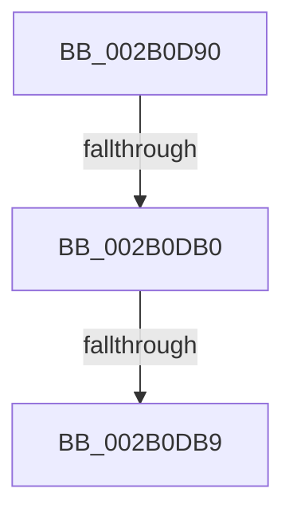

# MiClearStackOwners

- RVA: `0x002B0D90`–`0x002B0DDD` (길이 `77` bytes)
- VA: `0x00000001402B0D90`
- 실행 섹션: `.text`
- PDB 이름 있음: `예`; PDB Function 태그: `아니요`
- unwind 정보 RVA: `0x0006D588`
- 디코드: `20`개 명령, `77/77` bytes 표시
- 미해석 바이트: `0` (있으면 어셈블리에 `.byte`로 보존)

> 이 문서는 커널 이미지의 기계어와 PDB 기호를 분석해 생성했습니다. 4번과 5번은 함수 원형과 자료형을 바이너리 사용 방식에서 추정한 C 해석이며 원본 소스 복구 결과는 아닙니다.

## 1. Dependencies

- 직접 호출 지점: **0**; 고유 호출 대상: **0**
- 직접 호출자로 확인된 함수: **1**
- RIP 상대 이미지 참조: **1**

### Outgoing calls
- 직접 디코드된 call 명령이 없습니다.

### Direct callers
- [MmDeleteKernelStack](../33/MmDeleteKernelStack_function_0033A960.md) at `0x0033AD0B`

### Static image references
- `0x002B0DB9` → RVA `0x00E35FA4` (`.data`; read)

## 2. Other-region calls and transfers

- 다른 실행 섹션으로 향하는 call: **0**
- call이 아닌 외부 분기/꼬리 이동: **3**
  - `0x002B0DAA` → [sub_002B0EF2 + 0xE](Unknown_function_002B0EF2.md) (`tail-transfer`)
  - `0x002B0DB3` → [sub_002B0EF2](Unknown_function_002B0EF2.md) (`tail-transfer`)
  - `0x002B0DD7` → [sub_002B0EBA](Unknown_function_002B0EBA.md) (`tail-transfer`)

## 3. Assembly (complete function range)

```asm
002B0D90  40 57                           push rdi
002B0D92  41 54                           push r12
002B0D94  41 56                           push r14
002B0D96  41 57                           push r15
002B0D98  48 83 EC 28                     sub rsp, 0x28
002B0D9C  41 BF 01 00 00 00               mov r15d, 1
002B0DA2  BF FF FF FF FF                  mov edi, 0xffffffff
002B0DA7  41 84 D7                        test r15b, dl
002B0DAA  0F 85 50 01 00 00               jne 0x1402b0f00
002B0DB0  F6 C2 08                        test dl, 8
002B0DB3  0F 85 39 01 00 00               jne 0x1402b0ef2
002B0DB9  0F B6 15 E4 51 B8 00            movzx edx, byte ptr [rip + 0xb851e4]
002B0DC0  8B C2                           mov eax, edx
002B0DC2  48 F7 D8                        neg rax
002B0DC5  4C 8D 34 C1                     lea r14, [rcx + rax*8]
002B0DC9  8D 42 01                        lea eax, [rdx + 1]
002B0DCC  4D 8D 24 C6                     lea r12, [r14 + rax*8]
002B0DD0  49 83 C6 08                     add r14, 8
002B0DD4  4D 3B F4                        cmp r14, r12
002B0DD7  0F 83 DD 00 00 00               jae 0x1402b0eba
```

## 4. C-style interpretation (structured pseudocode)

```c
__int64 __fastcall MiClearStackOwners(__int64 a1, unsigned __int8 a2)
{
    __int64 result;
    __int64 v_r14;
    __int64 v_rsp;

    v_rsp = (v_rsp) - (40);
    result = -((unsigned int)((unsigned int)(*(unsigned __int8 *)(v_rip + 12079588))));
    v_r14 = (a1 + result * 8) + (8);
}
```

## 5. (Beta) C Style

```c
int64_t MiClearStackOwners(void *Arg1, uint8_t Arg2)
{
    uint8_t *arg1 = (uint8_t *)Arg1;

    int64_t result;
    int64_t local_r14;
    int64_t local_rsp;

    local_rsp = (local_rsp) - (40);
    result = -((uint32_t)((uint32_t)(*(uint8_t *)(v_rip + 0xB851E4))));
    local_r14 = (Arg1 + result * 8) + (8);
}
```

### 관측된 메모리 오프셋

구조체 형식이 확인되지 않은 접근은 인자 기준의 오프셋으로만 기록했습니다.

| 기준 인자 | 오프셋 표현 | 폭 (bit) | 접근 |
|---|---:|---:|---|
| `Arg1` | `+ 0x0 + rax*8` | `64` | `R` |

## 6. Execution-region graph

[열기: 2D/3D 그래프와 함수 탐색 컨트롤 패널](../../../control-panel.html?section=text&rva=0x002B0D90&view=graph)

- 2D 그래프는 위에서 아래로 흐르고, 3D 그래프는 빈 공간을 드래그해 회전합니다. Shift+드래그는 이동, 휠은 확대·축소, 함수 노드 선택은 대상 보고서 이동입니다.

### Static fallback


