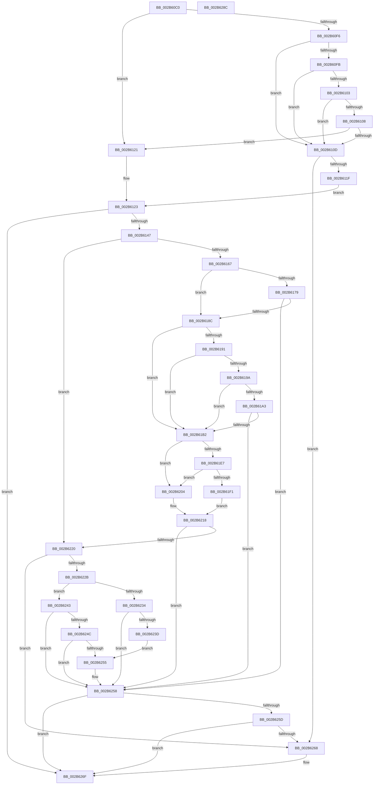

# MiComputeFaultNode

- RVA: `0x002B60C0`–`0x002B628D` (길이 `461` bytes)
- VA: `0x00000001402B60C0`
- 실행 섹션: `.text`
- PDB 이름 있음: `예`; PDB Function 태그: `아니요`
- unwind 정보 RVA: `0x0006D984`
- 디코드: `116`개 명령, `461/461` bytes 표시
- 미해석 바이트: `0` (있으면 어셈블리에 `.byte`로 보존)

> 이 문서는 커널 이미지의 기계어와 PDB 기호를 분석해 생성했습니다. 4번과 5번은 함수 원형과 자료형을 바이너리 사용 방식에서 추정한 C 해석이며 원본 소스 복구 결과는 아닙니다.

## 1. Dependencies

- 직접 호출 지점: **4**; 고유 호출 대상: **4**
- 직접 호출자로 확인된 함수: **6**
- RIP 상대 이미지 참조: **2**

### Outgoing calls
- `0x002B61B7` → [MiLockVadTree](../27/MiLockVadTree_function_0027C0F0.md) (function, `0x0027C0F0`)
- `0x002B61BF` → [MiLocateAddress](../31/MiLocateAddress_function_003168D0.md) (function, `0x003168D0`)
- `0x002B61FD` → [ExpReleaseSpinLockSharedFromDpcLevelInstrumented](../2F/ExpReleaseSpinLockSharedFromDpcLevelInstrumented_function_002F0F48.md) (function, `0x002F0F48`)
- `0x002B622B` → [Feature_2429262139__private_IsEnabledNoReportingNoInline](../66/Feature_2429262139__private_IsEnabledNoReportingNoInline_function_0066E0A8.md) (function, `0x0066E0A8`)

### Direct callers
- [MiMigratePfn](../28/MiMigratePfn_function_0028DBB0.md) at `0x0028DC62`
- [sub_002B5B1B](Unknown_function_002B5B1B.md) at `0x002B5B47`
- [MiCopyOnWrite](../36/MiCopyOnWrite_function_00362A0C.md) at `0x00362B94`
- [MiResolveMappedFileFault](../36/MiResolveMappedFileFault_function_0036B640.md) at `0x0036B7BD`
- [MiResolvePageFileFault](../36/MiResolvePageFileFault_function_0036D968.md) at `0x0036DB82`
- [MiHandleSpecialPurposeMemoryCachedFault](../44/MiHandleSpecialPurposeMemoryCachedFault_function_0044C740.md) at `0x0044C7D4`

### Static image references
- `0x002B61D0` → RVA `0x00FC6B06` (`ALMOSTRO`; read)
- `0x002B61E7` → RVA `0x00F0DE58` (`.data`; read)

## 2. Other-region calls and transfers

- 다른 실행 섹션으로 향하는 call: **0**
- 별도 외부 분기/꼬리 이동을 확인하지 못했습니다.

## 3. Assembly (complete function range)

```asm
002B60C0  48 89 5C 24 08                  mov qword ptr [rsp + 8], rbx
002B60C5  48 89 6C 24 10                  mov qword ptr [rsp + 0x10], rbp
002B60CA  48 89 74 24 18                  mov qword ptr [rsp + 0x18], rsi
002B60CF  48 89 7C 24 20                  mov qword ptr [rsp + 0x20], rdi
002B60D4  41 56                           push r14
002B60D6  48 83 EC 20                     sub rsp, 0x20
002B60DA  4C 8B 49 10                     mov r9, qword ptr [rcx + 0x10]
002B60DE  48 8B EA                        mov rbp, rdx
002B60E1  49 8B C1                        mov rax, r9
002B60E4  33 D2                           xor edx, edx
002B60E6  48 83 E0 FE                     and rax, 0xfffffffffffffffe
002B60EA  4D 8B F0                        mov r14, r8
002B60ED  48 8B F1                        mov rsi, rcx
002B60F0  41 F6 C1 01                     test r9b, 1
002B60F4  74 2B                           je 0x1402b6121
002B60F6  80 38 02                        cmp byte ptr [rax], 2
002B60F9  74 12                           je 0x1402b610d
002B60FB  0F B6 08                        movzx ecx, byte ptr [rax]
002B60FE  80 F9 07                        cmp cl, 7
002B6101  74 0A                           je 0x1402b610d
002B6103  80 F9 08                        cmp cl, 8
002B6106  74 05                           je 0x1402b610d
002B6108  80 F9 04                        cmp cl, 4
002B610B  75 14                           jne 0x1402b6121
002B610D  49 8B D9                        mov rbx, r9
002B6110  48 83 E3 FE                     and rbx, 0xfffffffffffffffe
002B6114  8B 5B 28                        mov ebx, dword ptr [rbx + 0x28]
002B6117  85 DB                           test ebx, ebx
002B6119  0F 85 49 01 00 00               jne 0x1402b6268
002B611F  EB 02                           jmp 0x1402b6123
002B6121  8B DA                           mov ebx, edx
002B6123  49 8B 38                        mov rdi, qword ptr [r8]
002B6126  41 0F B6 C1                     movzx eax, r9b
002B612A  49 83 E1 FE                     and r9, 0xfffffffffffffffe
002B612E  A8 01                           test al, 1
002B6130  48 8B 46 38                     mov rax, qword ptr [rsi + 0x38]
002B6134  4C 0F 44 CA                     cmove r9, rdx
002B6138  8B 88 B8 00 00 00               mov ecx, dword ptr [rax + 0xb8]
002B613E  F6 C1 0F                        test cl, 0xf
002B6141  0F 85 28 01 00 00               jne 0x1402b626f
002B6147  65 48 8B 04 25 88 01 00 00      mov rax, qword ptr gs:[0x188]
002B6150  48 8B 88 B8 00 00 00            mov rcx, qword ptr [rax + 0xb8]
002B6157  48 8B 81 10 04 00 00            mov rax, qword ptr [rcx + 0x410]
002B615E  48 85 FF                        test rdi, rdi
002B6161  0F 85 B9 00 00 00               jne 0x1402b6220
002B6167  48 8B 0E                        mov rcx, qword ptr [rsi]
002B616A  48 BA 00 00 00 00 80 F6 FF FF   movabs rdx, 0xfffff68000000000
002B6174  48 3B CA                        cmp rcx, rdx
002B6177  72 13                           jb 0x1402b618c
002B6179  48 BA FF FF FF FF FF F6 FF FF   movabs rdx, 0xfffff6ffffffffff
002B6183  48 3B CA                        cmp rcx, rdx
002B6186  0F 86 CC 00 00 00               jbe 0x1402b6258
002B618C  4D 85 C9                        test r9, r9
002B618F  75 21                           jne 0x1402b61b2
002B6191  4C 39 88 90 04 00 00            cmp qword ptr [rax + 0x490], r9
002B6198  75 18                           jne 0x1402b61b2
002B619A  4C 39 88 98 04 00 00            cmp qword ptr [rax + 0x498], r9
002B61A1  75 0F                           jne 0x1402b61b2
002B61A3  0F B6 80 24 04 00 00            movzx eax, byte ptr [rax + 0x424]
002B61AA  84 C0                           test al, al
002B61AC  0F 84 A6 00 00 00               je 0x1402b6258
002B61B2  B9 01 00 00 00                  mov ecx, 1
002B61B7  E8 34 5F FC FF                  call 0x14027c0f0
002B61BC  48 8B 0E                        mov rcx, qword ptr [rsi]
002B61BF  E8 0C 07 06 00                  call 0x1403168d0
002B61C4  48 8B F8                        mov rdi, rax
002B61C7  65 48 8B 04 25 88 01 00 00      mov rax, qword ptr gs:[0x188]
002B61D0  F6 05 2F 09 D1 00 01            test byte ptr [rip + 0xd1092f], 1
002B61D7  48 8B 88 B8 00 00 00            mov rcx, qword ptr [rax + 0xb8]
002B61DE  4C 8B 81 10 04 00 00            mov r8, qword ptr [rcx + 0x410]
002B61E5  74 1D                           je 0x1402b6204
002B61E7  8B 05 6B 7C C5 00               mov eax, dword ptr [rip + 0xc57c6b]
002B61ED  85 C0                           test eax, eax
002B61EF  75 13                           jne 0x1402b6204
002B61F1  48 8B 54 24 28                  mov rdx, qword ptr [rsp + 0x28]
002B61F6  49 8D 88 EC 03 00 00            lea rcx, [r8 + 0x3ec]
002B61FD  E8 46 AD 03 00                  call 0x1402f0f48
002B6202  EB 14                           jmp 0x1402b6218
002B6204  F0 41 81 A0 EC 03 00 00 FF FF FF BF  lock and dword ptr [r8 + 0x3ec], 0xbfffffff
002B6210  F0 41 FF 88 EC 03 00 00         lock dec dword ptr [r8 + 0x3ec]
002B6218  49 89 3E                        mov qword ptr [r14], rdi
002B621B  48 85 FF                        test rdi, rdi
002B621E  74 38                           je 0x1402b6258
002B6220  8B 5F 30                        mov ebx, dword ptr [rdi + 0x30]
002B6223  C1 EB 0C                        shr ebx, 0xc
002B6226  83 E3 7F                        and ebx, 0x7f
002B6229  75 3D                           jne 0x1402b6268
002B622B  E8 78 7E 3B 00                  call 0x14066e0a8
002B6230  85 C0                           test eax, eax
002B6232  75 0F                           jne 0x1402b6243
002B6234  F7 47 30 00 00 20 00            test dword ptr [rdi + 0x30], 0x200000
002B623B  75 1B                           jne 0x1402b6258
002B623D  48 8B 47 48                     mov rax, qword ptr [rdi + 0x48]
002B6241  EB 12                           jmp 0x1402b6255
002B6243  F7 47 30 04 00 20 00            test dword ptr [rdi + 0x30], 0x200004
002B624A  75 0C                           jne 0x1402b6258
002B624C  48 8B 47 48                     mov rax, qword ptr [rdi + 0x48]
002B6250  48 85 C0                        test rax, rax
002B6253  74 03                           je 0x1402b6258
002B6255  48 8B 28                        mov rbp, qword ptr [rax]
002B6258  48 85 ED                        test rbp, rbp
002B625B  74 12                           je 0x1402b626f
002B625D  8B 5D 38                        mov ebx, dword ptr [rbp + 0x38]
002B6260  C1 EB 14                        shr ebx, 0x14
002B6263  83 E3 7F                        and ebx, 0x7f
002B6266  74 07                           je 0x1402b626f
002B6268  81 4E 50 00 00 02 00            or dword ptr [rsi + 0x50], 0x20000
002B626F  48 8B 6C 24 38                  mov rbp, qword ptr [rsp + 0x38]
002B6274  8B C3                           mov eax, ebx
002B6276  48 8B 5C 24 30                  mov rbx, qword ptr [rsp + 0x30]
002B627B  48 8B 74 24 40                  mov rsi, qword ptr [rsp + 0x40]
002B6280  48 8B 7C 24 48                  mov rdi, qword ptr [rsp + 0x48]
002B6285  48 83 C4 20                     add rsp, 0x20
002B6289  41 5E                           pop r14
002B628B  C3                              ret
002B628C  CC                              int3
```

## 4. C-style interpretation (structured pseudocode)

```c
__int64 __fastcall MiComputeFaultNode(__int64 a1, __int64 a2, __int64 a3)
{
    __int64 result;
    __int64 v_rbp;
    __int64 v_rbx;
    __int64 v_rsp;
    unsigned __int64 v_stack_p0;
    unsigned __int64 v_stack_p10;
    unsigned __int64 v_stack_p18;
    unsigned __int64 v_stack_p20;
    unsigned __int64 v_stack_p8;

    v_stack_p8 = v_rbx;
    v_stack_p10 = v_rbp;
    v_stack_p18 = v_rsi;
    v_stack_p20 = v_rdi;
    v_rsp = (v_rsp) - (32);
    a2 = 0;
    result = (*(unsigned __int64 *)(a1 + 16)) & (-2);
    if ((((unsigned __int8)(*(unsigned __int64 *)(a1 + 16))) & (1)) == 0) goto loc_002B6121;
    if ((*(unsigned __int8 *)(result)) == 2) goto loc_002B610D;
    if (((unsigned __int8)(*(unsigned __int8 *)(result))) == 7) goto loc_002B610D;
    if (((unsigned __int8)(*(unsigned __int8 *)(result))) == 8) goto loc_002B610D;
    if (((unsigned __int8)(*(unsigned __int8 *)(result))) != 4) goto loc_002B6121;
loc_002B610D:
    v_rbx = (*(unsigned __int64 *)(a1 + 16)) & (-2);
    if ((unsigned int)((unsigned int)(*(unsigned int *)(v_rbx + 40))) != 0) goto loc_002B6268;
    goto loc_002B6123;
loc_002B6121:
loc_002B6123:
    a4 = (*(unsigned __int64 *)(a1 + 16)) & (-2);
    if ((((unsigned __int8)((unsigned __int8)(*(unsigned __int64 *)(a1 + 16)))) & (1)) == 0) { a4 = 0; }
    if ((((unsigned __int8)((unsigned int)(*(unsigned int *)(*(unsigned __int64 *)(a1 + 56) + 184)))) & (15)) != 0) goto loc_002B626F;
    if (*(unsigned __int64 *)(a3) != 0) goto loc_002B6220;
    if ((*(unsigned __int64 *)(a1)) < 0) goto loc_002B618C;
    if ((*(unsigned __int64 *)(a1)) <= 0) goto loc_002B6258;
loc_002B618C:
    if (a4 != 0) goto loc_002B61B2;
    if ((*(unsigned __int64 *)(*(unsigned __int64 *)(*(unsigned __int64 *)(*(unsigned __int64 *)(gs_base + (0 + 392)) + 184) + 1040) + 1168)) != a4) goto loc_002B61B2;
    if ((*(unsigned __int64 *)(*(unsigned __int64 *)(*(unsigned __int64 *)(*(unsigned __int64 *)(gs_base + (0 + 392)) + 184) + 1040) + 1176)) != a4) goto loc_002B61B2;
    if ((unsigned __int8)(*(unsigned __int8 *)(*(unsigned __int64 *)(*(unsigned __int64 *)(*(unsigned __int64 *)(gs_base + (0 + 392)) + 184) + 1040) + 1060)) == 0) goto loc_002B6258;
loc_002B61B2:
    result = MiLockVadTree(1, a2, a3, a4);
    result = MiLocateAddress(*(unsigned __int64 *)(a1), a2, a3, a4);
    if (((*(unsigned __int8 *)(v_rip + 13699375)) & (1)) == 0) goto loc_002B6204;
    if ((unsigned int)((unsigned int)(*(unsigned int *)(v_rip + 12942443))) != 0) goto loc_002B6204;
    result = ExpReleaseSpinLockSharedFromDpcLevelInstrumented(*(unsigned __int64 *)(*(unsigned __int64 *)(*(unsigned __int64 *)(gs_base + (0 + 392)) + 184) + 1040) + 1004, v_stack_p0, *(unsigned __int64 *)(*(unsigned __int64 *)(*(unsigned __int64 *)(gs_base + (0 + 392)) + 184) + 1040), a4);
    goto loc_002B6218;
loc_002B6204:
loc_002B6218:
    *(unsigned __int64 *)(a3) = result;
    if (result == 0) goto loc_002B6258;
loc_002B6220:
    v_rbx = (unsigned int)(((unsigned int)(*(unsigned int *)(result + 48))) >> (12));
    v_rbx = (unsigned int)((v_rbx) & (127));
    if (condition_is_not_equal) goto loc_002B6268;
    result = Feature_2429262139__private_IsEnabledNoReportingNoInline(*(unsigned __int64 *)(*(unsigned __int64 *)(*(unsigned __int64 *)(gs_base + (0 + 392)) + 184) + 1040) + 1004, v_stack_p0, *(unsigned __int64 *)(*(unsigned __int64 *)(*(unsigned __int64 *)(gs_base + (0 + 392)) + 184) + 1040), a4);
    if ((unsigned int)(result) != 0) goto loc_002B6243;
    if (((*(unsigned int *)(result + 48)) & (0x200000ULL)) != 0) goto loc_002B6258;
    goto loc_002B6255;
loc_002B6243:
    if (((*(unsigned int *)(result + 48)) & (0x200004ULL)) != 0) goto loc_002B6258;
    v_rbp = a2;
    if (*(unsigned __int64 *)(result + 72) != 0) {
        v_rbp = *(unsigned __int64 *)(*(unsigned __int64 *)(result + 72));
    }
    if (v_rbp == 0) goto loc_002B626F;
    v_rbx = (unsigned int)(((unsigned int)(*(unsigned int *)(v_rbp + 56))) >> (20));
    v_rbx = (unsigned int)((v_rbx) & (127));
    if (!(condition_is_equal)) {
    }
    v_rsp = (v_rsp) + (32);
    return (unsigned int)((unsigned int)(v_rbx));
}
```

## 5. (Beta) C Style

```c
int64_t MiComputeFaultNode(void *Arg1, int64_t Arg2, void *Arg3)
{
    uint8_t *arg1 = (uint8_t *)Arg1;
    uint8_t *arg3 = (uint8_t *)Arg3;

    int64_t result;
    int64_t local_rbp;
    int64_t local_rbx;
    int64_t local_rsp;
    uint64_t v_stack_p0;
    uint64_t v_stack_p10;
    uint64_t v_stack_p18;
    uint64_t v_stack_p20;
    uint64_t v_stack_p8;

    v_stack_p8 = local_rbx;
    v_stack_p10 = local_rbp;
    v_stack_p18 = local_rsi;
    v_stack_p20 = local_rdi;
    local_rsp = (local_rsp) - (32);
    Arg2 = 0;
    result = (*(uint64_t *)(arg1 + 0x10)) & (-2);
    if ((((uint8_t)(*(uint64_t *)(arg1 + 0x10))) & (1)) == 0) goto loc_002B6121;
    if ((*(uint8_t *)(result)) == 2) goto loc_002B610D;
    if (((uint8_t)(*(uint8_t *)(result))) == 7) goto loc_002B610D;
    if (((uint8_t)(*(uint8_t *)(result))) == 8) goto loc_002B610D;
    if (((uint8_t)(*(uint8_t *)(result))) != 4) goto loc_002B6121;
loc_002B610D:
    local_rbx = (*(uint64_t *)(arg1 + 0x10)) & (-2);
    if ((uint32_t)((uint32_t)(*(uint32_t *)(local_rbx + 0x28))) != 0) goto loc_002B6268;
    goto loc_002B6123;
loc_002B6121:
loc_002B6123:
    a4 = (*(uint64_t *)(arg1 + 0x10)) & (-2);
    if ((((uint8_t)((uint8_t)(*(uint64_t *)(arg1 + 0x10)))) & (1)) == 0) { a4 = 0; }
    if ((((uint8_t)((uint32_t)(*(uint32_t *)(*(uint64_t *)(arg1 + 0x38) + 0xB8)))) & (15)) != 0) goto loc_002B626F;
    if (*(uint64_t *)(arg3) != 0) goto loc_002B6220;
    if ((*(uint64_t *)(arg1)) < 0) goto loc_002B618C;
    if ((*(uint64_t *)(arg1)) <= 0) goto loc_002B6258;
loc_002B618C:
    if (a4 != 0) goto loc_002B61B2;
    if ((*(uint64_t *)(*(uint64_t *)(*(uint64_t *)(*(uint64_t *)(gs_base + (0 + 0x188)) + 0xB8) + 0x410) + 0x490)) != a4) goto loc_002B61B2;
    if ((*(uint64_t *)(*(uint64_t *)(*(uint64_t *)(*(uint64_t *)(gs_base + (0 + 0x188)) + 0xB8) + 0x410) + 0x498)) != a4) goto loc_002B61B2;
    if ((uint8_t)(*(uint8_t *)(*(uint64_t *)(*(uint64_t *)(*(uint64_t *)(gs_base + (0 + 0x188)) + 0xB8) + 0x410) + 0x424)) == 0) goto loc_002B6258;
loc_002B61B2:
    result = MiLockVadTree(1, Arg2, Arg3, a4);
    result = MiLocateAddress(*(uint64_t *)(arg1), Arg2, Arg3, a4);
    if (((*(uint8_t *)(v_rip + 0xD1092F)) & (1)) == 0) goto loc_002B6204;
    if ((uint32_t)((uint32_t)(*(uint32_t *)(v_rip + 0xC57C6B))) != 0) goto loc_002B6204;
    result = ExpReleaseSpinLockSharedFromDpcLevelInstrumented(*(uint64_t *)(*(uint64_t *)(*(uint64_t *)(gs_base + (0 + 0x188)) + 0xB8) + 0x410) + 1004, v_stack_p0, *(uint64_t *)(*(uint64_t *)(*(uint64_t *)(gs_base + (0 + 0x188)) + 0xB8) + 0x410), a4);
    goto loc_002B6218;
loc_002B6204:
loc_002B6218:
    *(uint64_t *)(arg3) = result;
    if (result == 0) goto loc_002B6258;
loc_002B6220:
    local_rbx = (uint32_t)(((uint32_t)(*(uint32_t *)(result + 0x30))) >> (12));
    local_rbx = (uint32_t)((local_rbx) & (127));
    if (condition_is_not_equal) goto loc_002B6268;
    result = Feature_2429262139__private_IsEnabledNoReportingNoInline(*(uint64_t *)(*(uint64_t *)(*(uint64_t *)(gs_base + (0 + 0x188)) + 0xB8) + 0x410) + 1004, v_stack_p0, *(uint64_t *)(*(uint64_t *)(*(uint64_t *)(gs_base + (0 + 0x188)) + 0xB8) + 0x410), a4);
    if ((uint32_t)(result) != 0) goto loc_002B6243;
    if (((*(uint32_t *)(result + 0x30)) & (0x200000ULL)) != 0) goto loc_002B6258;
    goto loc_002B6255;
loc_002B6243:
    if (((*(uint32_t *)(result + 0x30)) & (0x200004ULL)) != 0) goto loc_002B6258;
    local_rbp = Arg2;
    if (*(uint64_t *)(result + 0x48) != 0) {
        local_rbp = *(uint64_t *)(*(uint64_t *)(result + 0x48));
    }
    if (local_rbp == 0) goto loc_002B626F;
    local_rbx = (uint32_t)(((uint32_t)(*(uint32_t *)(local_rbp + 0x38))) >> (20));
    local_rbx = (uint32_t)((local_rbx) & (127));
    if (!(condition_is_equal)) {
    }
    local_rsp = (local_rsp) + (32);
    return (uint32_t)((uint32_t)(local_rbx));
}
```

### 관측된 메모리 오프셋

구조체 형식이 확인되지 않은 접근은 인자 기준의 오프셋으로만 기록했습니다.

| 기준 인자 | 오프셋 표현 | 폭 (bit) | 접근 |
|---|---:|---:|---|
| `Arg1` | `+ 0x0` | `64` | `R` |
| `Arg1` | `+ 0x10` | `64` | `R` |
| `Arg1` | `+ 0x38` | `64` | `R` |
| `Arg1` | `+ 0x50` | `32` | `R/W` |
| `Arg3` | `+ 0x0` | `64` | `R` |
| `Arg3` | `+ 0x0` | `64` | `W` |

## 6. Execution-region graph

[열기: 2D/3D 그래프와 함수 탐색 컨트롤 패널](../../../control-panel.html?section=text&rva=0x002B60C0&view=graph)

- 2D 그래프는 위에서 아래로 흐르고, 3D 그래프는 빈 공간을 드래그해 회전합니다. Shift+드래그는 이동, 휠은 확대·축소, 함수 노드 선택은 대상 보고서 이동입니다.

### Static fallback


